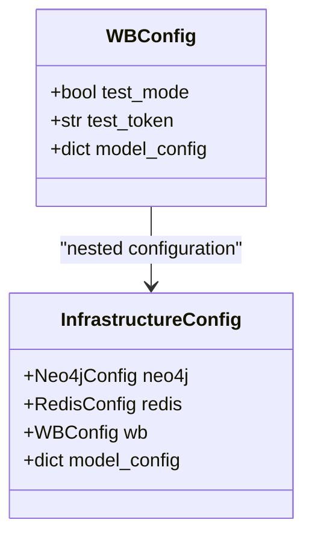
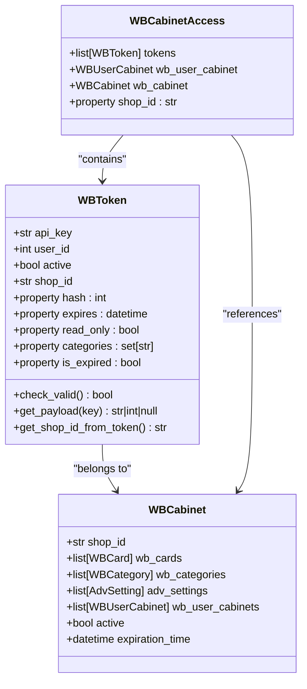
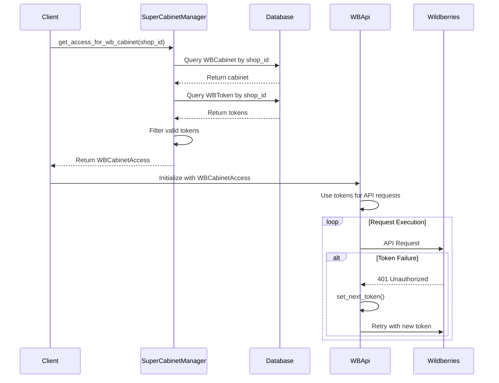
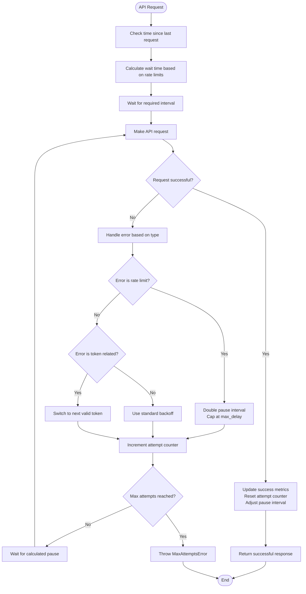
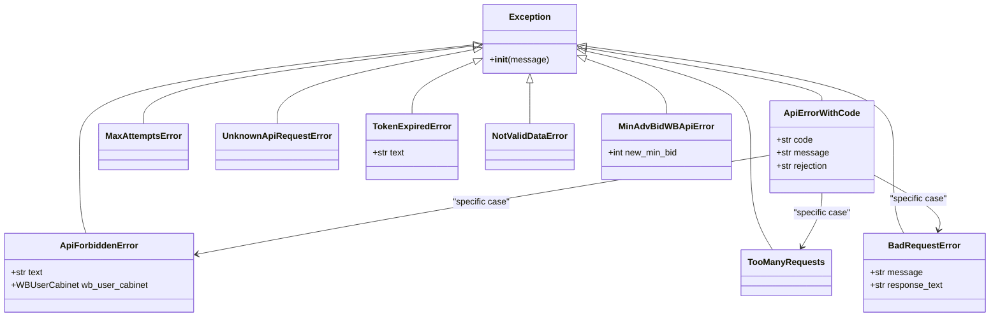
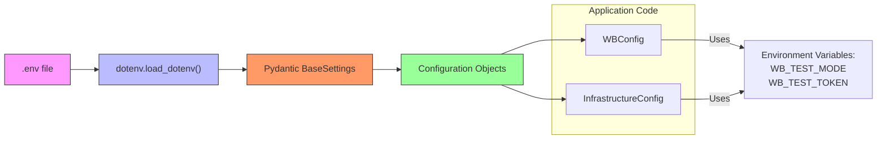

# Wildberries API Configuration

<cite>
**Referenced Files in This Document**   
- [wb_config.py](file://app/configs/infrastructure_config/wb_config.py)
- [infrastructure_config.py](file://app/configs/infrastructure_config/infrastructure_config.py)
- [super_cabinet_manager.py](file://app/modules/common_slaves/wildberries/super_cabinet_manager.py)
- [api.py](file://app/modules/common_slaves/wildberries/api/api.py)
- [ABC_WB_API.py](file://app/modules/common_slaves/wildberries/ABC_WB_API.py)
- [base.py](file://app/core/wb_api/base.py)
- [http_request.py](file://app/core/wb_api/http_request.py)
- [exceptions.py](file://app/core/wb_api/exceptions.py)
- [models.py](file://app/modules/common_slaves/wildberries/models/models.py)
- [api_rights.py](file://app/modules/common_slaves/wildberries/api_rights.py)
</cite>

## Table of Contents
1. [Introduction](#introduction)
2. [Configuration Structure](#configuration-structure)
3. [API Endpoints and Base URLs](#api-endpoints-and-base-urls)
4. [Authentication and Token Management](#authentication-and-token-management)
5. [Multiple Shop Account Support](#multiple-shop-account-support)
6. [Rate Limiting and Retry Policies](#rate-limiting-and-retry-policies)
7. [Error Handling Mechanisms](#error-handling-mechanisms)
8. [Environment Variable Integration](#environment-variable-integration)
9. [Best Practices and Common Issues](#best-practices-and-common-issues)
10. [Architecture Overview](#architecture-overview)

## Introduction
The Wildberries API configuration system provides a comprehensive framework for integrating with the Wildberries marketplace. This documentation details how the system manages API endpoints, authentication tokens, rate limits, and versioning across multiple shop accounts. The configuration is designed to handle complex scenarios including token expiration, permission validation, and API request throttling while maintaining high reliability and security standards.

## Configuration Structure

The Wildberries API configuration is organized through a hierarchical structure that separates concerns and enables flexible deployment. The core configuration is defined in the `WBConfig` class, which inherits from Pydantic's `BaseSettings` to provide robust environment variable handling.



**Diagram sources**
- [wb_config.py](file://app/configs/infrastructure_config/wb_config.py#L4-L23)
- [infrastructure_config.py](file://app/configs/infrastructure_config/infrastructure_config.py#L13-L20)

**Section sources**
- [wb_config.py](file://app/configs/infrastructure_config/wb_config.py#L1-L23)
- [infrastructure_config.py](file://app/configs/infrastructure_config/infrastructure_config.py#L1-L20)

## API Endpoints and Base URLs

The Wildberries API client implements a modular approach to endpoint management, with different API categories exposed through dedicated interfaces. The system uses distinct base URLs for different API services, following Wildberries' API documentation standards.

```mermaid
classDiagram
class AdvertApi {
+str HOST : "advert-api.wildberries.ru"
+set[str] _rights : {PROMOTION}
+bool _only_read : FALSE
}
class ContentApi {
+str HOST : "wildberries.ru"
+set[str] _rights : {CONTENT}
+bool _only_read : FALSE
}
class BaseAPI {
+str HOST : "wildberries.ru"
}
class ABC_WB_API {
+str current_path
+str ORDERS_REPORTS_FOLDER
+str DISCOUNT_REPORTS_FOLDER
+str DB_NAME
+str _single_adv_files
+str _single_advs_report
}
AdvertApi --|> ABC_WB_API : "inherits"
ContentApi --|> BaseAPI : "inherits"
BaseAPI --|> WbRequestApiMixin : "inherits"
ABC_WB_API --|> WbRequestApiMixin : "inherits"
```

**Diagram sources**
- [api.py](file://app/modules/common_slaves/wildberries/api/api.py#L150-L475)
- [base.py](file://app/core/wb_api/base.py#L10-L115)
- [ABC_WB_API.py](file://app/modules/common_slaves/wildberries/ABC_WB_API.py#L50-L115)

**Section sources**
- [api.py](file://app/modules/common_slaves/wildberries/api/api.py#L1-L475)
- [base.py](file://app/core/wb_api/base.py#L1-L115)
- [ABC_WB_API.py](file://app/modules/common_slaves/wildberries/ABC_WB_API.py#L1-L115)

## Authentication and Token Management

The authentication system is built around JWT-based API tokens that are validated and managed through a comprehensive token management framework. Tokens are stored in the database with associated metadata including expiration dates, permissions, and shop identifiers.



**Diagram sources**
- [models.py](file://app/modules/common_slaves/wildberries/models/models.py#L169-L335)
- [super_cabinet_manager.py](file://app/modules/common_slaves/wildberries/super_cabinet_manager.py#L25-L38)

**Section sources**
- [models.py](file://app/modules/common_slaves/wildberries/models/models.py#L135-L335)
- [super_cabinet_manager.py](file://app/modules/common_slaves/wildberries/super_cabinet_manager.py#L1-L115)

## Multiple Shop Account Support

The system supports multiple shop accounts through a routing mechanism that uses shop_id for token scoping and request routing. Each shop account can have multiple API tokens, and the system automatically selects valid tokens based on expiration and permissions.



**Diagram sources**
- [super_cabinet_manager.py](file://app/modules/common_slaves/wildberries/super_cabinet_manager.py#L43-L114)
- [api.py](file://app/modules/common_slaves/wildberries/api/api.py#L430-L475)

**Section sources**
- [super_cabinet_manager.py](file://app/modules/common_slaves/wildberries/super_cabinet_manager.py#L1-L115)
- [api.py](file://app/modules/common_slaves/wildberries/api/api.py#L1-L475)

## Rate Limiting and Retry Policies

The system implements sophisticated rate limiting and retry policies to handle API throttling and transient failures. The retry mechanism uses exponential backoff with adaptive pause intervals based on API response patterns.



**Diagram sources**
- [http_request.py](file://app/core/wb_api/http_request.py#L30-L212)
- [base.py](file://app/core/wb_api/base.py#L90-L115)

**Section sources**
- [http_request.py](file://app/core/wb_api/http_request.py#L1-L212)
- [base.py](file://app/core/wb_api/base.py#L1-L115)

## Error Handling Mechanisms

The error handling system provides comprehensive exception handling for various API failure scenarios. Custom exceptions are defined for different error types, enabling precise error handling and recovery strategies.



**Diagram sources**
- [exceptions.py](file://app/core/wb_api/exceptions.py#L1-L84)
- [http_request.py](file://app/core/wb_api/http_request.py#L150-L212)

**Section sources**
- [exceptions.py](file://app/core/wb_api/exceptions.py#L1-L84)
- [http_request.py](file://app/core/wb_api/http_request.py#L1-L212)

## Environment Variable Integration

The configuration system loads API credentials securely from environment variables, preventing hard-coded secrets in the source code. The system uses Pydantic's settings management with dotenv integration to load configuration from .env files.



**Diagram sources**
- [wb_config.py](file://app/configs/infrastructure_config/wb_config.py#L18-L23)
- [infrastructure_config.py](file://app/configs/infrastructure_config/infrastructure_config.py#L18-L20)

**Section sources**
- [wb_config.py](file://app/configs/infrastructure_config/wb_config.py#L1-L23)
- [infrastructure_config.py](file://app/configs/infrastructure_config/infrastructure_config.py#L1-L20)

## Best Practices and Common Issues

### Best Practices for API Integration

1. **Token Management**: Always validate token permissions before making API calls. The system checks for required rights including "Content", "Statistics", "Analytics", and "Promotion".

2. **Rate Limit Handling**: Implement exponential backoff strategies and monitor API usage patterns to avoid hitting rate limits.

3. **Error Recovery**: Use the built-in retry mechanisms and token rotation features to handle transient failures gracefully.

4. **Security**: Never store API tokens in source code. Use environment variables and secure storage mechanisms.

5. **Monitoring**: Implement comprehensive logging and monitoring to track API usage, errors, and performance metrics.

### Common Issues and Solutions

**Token Expiration**: Tokens are automatically checked for expiration using the `is_expired` property which compares the current time with the token's expiration timestamp. When a token expires, the system automatically rotates to the next valid token.

**Insufficient Rights**: The system validates token permissions through the `categories` property which decodes the JWT payload to determine available rights. If a token lacks required permissions, an `ApiForbiddenError` is raised.

**Inconsistent Response Formats**: The system handles inconsistent Wildberries API responses through robust JSON parsing with error handling. The `get_error_from_response` function parses error responses and maps them to appropriate exception types.

**Multiple Token Management**: When multiple tokens are available for a shop, the system sorts them by expiration date (newest first) and uses token rotation when requests fail due to authentication issues.

**Test Mode Configuration**: The system supports a test mode flag that allows developers to use mock tokens and bypass certain API calls during development and testing.

**Section sources**
- [wb_config.py](file://app/configs/infrastructure_config/wb_config.py#L1-L23)
- [super_cabinet_manager.py](file://app/modules/common_slaves/wildberries/super_cabinet_manager.py#L1-L115)
- [exceptions.py](file://app/core/wb_api/exceptions.py#L1-L84)
- [http_request.py](file://app/core/wb_api/http_request.py#L1-L212)

## Architecture Overview

The Wildberries API integration architecture follows a layered approach with clear separation of concerns between configuration, authentication, API clients, and error handling.

```mermaid
graph TD
subgraph "Configuration Layer"
WBConfig["WBConfig<br>Handles API settings<br>test_mode, test_token"]
InfrastructureConfig["InfrastructureConfig<br>Central configuration<br>Manages wb, neo4j, redis"]
end
subgraph "Authentication Layer"
TokenManagement["Token Management<br>WBToken model<br>Validation and parsing"]
CabinetAccess["WBCabinetAccess<br>Token routing<br>Shop ID scoping"]
end
subgraph "API Client Layer"
AdvertApi["AdvertApi<br>advert-api.wildberries.ru<br>Promotion endpoints"]
ContentApi["ContentApi<br>wildberries.ru<br>Content endpoints"]
end
subgraph "Error Handling Layer"
RetryPolicy["Retry Policy<br>Exponential backoff<br>Adaptive pauses"]
ExceptionHandling["Exception Handling<br>Custom exceptions<br>Error mapping"]
end
subgraph "Integration Layer"
Environment["Environment Variables<br>.env file loading<br>Secure credential storage"]
end
Environment --> Configuration Layer
Configuration Layer --> Authentication Layer
Authentication Layer --> API Client Layer
API Client Layer --> Error Handling Layer
Error Handling Layer --> API Client Layer
style Configuration Layer fill:#f0f0f0,stroke:#333,stroke-width:1px
style Authentication Layer fill:#f0f0f0,stroke:#333,stroke-width:1px
style API Client Layer fill:#f0f0f0,stroke:#333,stroke-width:1px
style Error Handling Layer fill:#f0f0f0,stroke:#333,stroke-width:1px
style Integration Layer fill:#f0f0f0,stroke:#333,stroke-width:1px
```

**Diagram sources**
- [wb_config.py](file://app/configs/infrastructure_config/wb_config.py#L1-L23)
- [infrastructure_config.py](file://app/configs/infrastructure_config/infrastructure_config.py#L1-L20)
- [super_cabinet_manager.py](file://app/modules/common_slaves/wildberries/super_cabinet_manager.py#L1-L115)
- [api.py](file://app/modules/common_slaves/wildberries/api/api.py#L1-L475)
- [http_request.py](file://app/core/wb_api/http_request.py#L1-L212)

**Section sources**
- [wb_config.py](file://app/configs/infrastructure_config/wb_config.py#L1-L23)
- [infrastructure_config.py](file://app/configs/infrastructure_config/infrastructure_config.py#L1-L20)
- [super_cabinet_manager.py](file://app/modules/common_slaves/wildberries/super_cabinet_manager.py#L1-L115)
- [api.py](file://app/modules/common_slaves/wildberries/api/api.py#L1-L475)
- [http_request.py](file://app/core/wb_api/http_request.py#L1-L212)