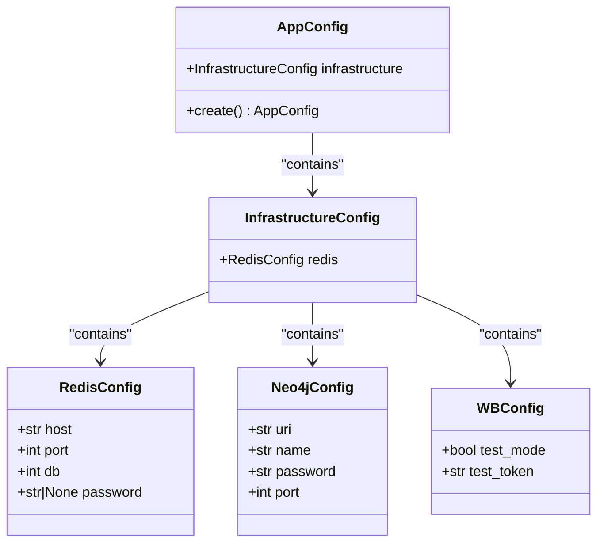
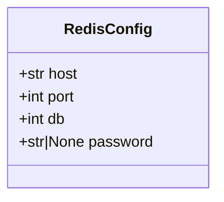
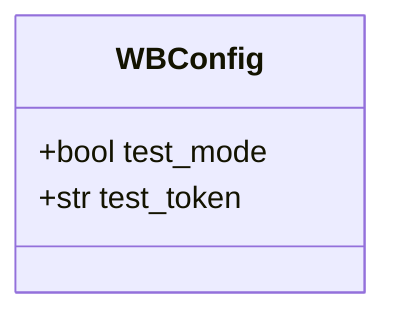
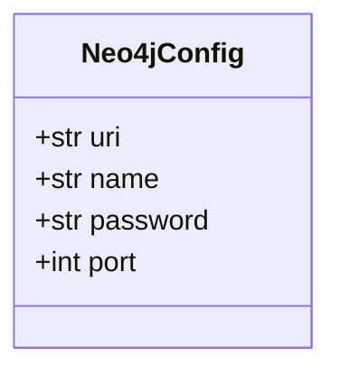
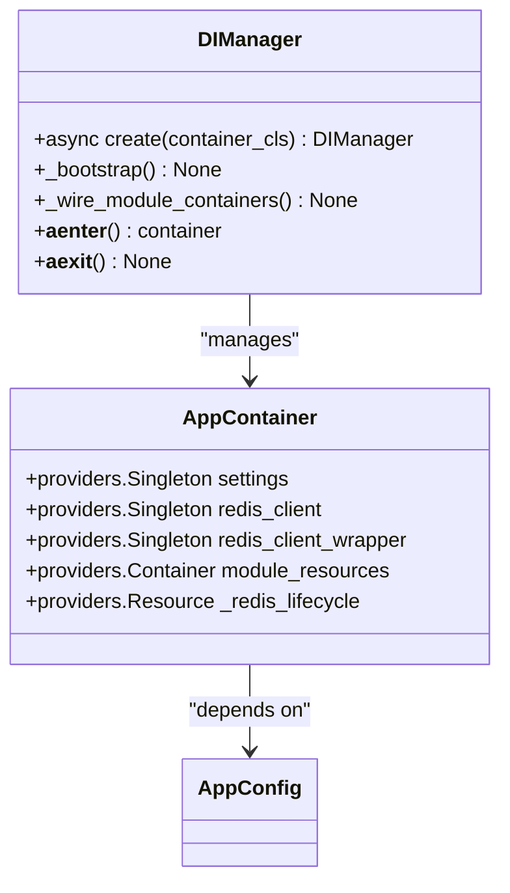

# Configuration Management

<cite>
**Referenced Files in This Document**   
- [app_config.py](file://app/configs/app_config.py)
- [infrastructure_config.py](file://app/configs/infrastructure_config/infrastructure_config.py)
- [redis_config.py](file://app/configs/infrastructure_config/redis_config.py)
- [neo4j_config.py](file://app/configs/infrastructure_config/neo4j_config.py)
- [wb_config.py](file://app/configs/infrastructure_config/wb_config.py)
- [app_container.py](file://app/core/di/app_container.py)
- [di_manager.py](file://app/core/di/di_manager.py)
- [config.py](file://app/core/di/configs/config.py)
</cite>

## Table of Contents
1. [Introduction](#introduction)
2. [Hierarchical Configuration Structure](#hierarchical-configuration-structure)
3. [Environment Variables Loading and Validation](#environment-variables-loading-and-validation)
4. [Service-Specific Configurations](#service-specific-configurations)
5. [Configuration Overrides by Environment](#configuration-overrides-by-environment)
6. [Dependency Injection Pattern](#dependency-injection-pattern)
7. [Security Considerations](#security-considerations)
8. [Extending Configuration System](#extending-configuration-system)
9. [Configuration Reloading Patterns](#configuration-reloading-patterns)
10. [Conclusion](#conclusion)

## Introduction
The configuration management system in the adv-bot application provides a structured approach to managing application settings across different environments. Built on Pydantic models and integrated with a dependency injection container, this system ensures type safety, validation, and centralized access to configuration values throughout the application.

**Section sources**
- [app_config.py](file://app/configs/app_config.py#L1-L20)
- [infrastructure_config.py](file://app/configs/infrastructure_config/infrastructure_config.py#L1-L15)

## Hierarchical Configuration Structure

The configuration system follows a hierarchical structure with two main levels: the application configuration and infrastructure configuration. The `AppConfig` class serves as the root configuration object, which contains an `infrastructure` field that holds configurations for various external services.

**Diagram sources**
- [app_config.py](file://app/configs/app_config.py#L1-L20)
- [infrastructure_config.py](file://app/configs/infrastructure_config/infrastructure_config.py#L1-L15)
- [redis_config.py](file://app/configs/infrastructure_config/redis_config.py#L1-L15)
- [neo4j_config.py](file://app/configs/infrastructure_config/neo4j_config.py#L1-L15)
- [wb_config.py](file://app/configs/infrastructure_config/wb_config.py#L1-L23)

**Section sources**
- [app_config.py](file://app/configs/app_config.py#L1-L20)
- [infrastructure_config.py](file://app/configs/infrastructure_config/infrastructure_config.py#L1-L15)

## Environment Variables Loading and Validation

The configuration system leverages Pydantic Settings to automatically load and validate environment variables. Each configuration class inherits from `BaseSettings` and specifies a model configuration that defines the environment file to use (`.env`) and encoding (utf-8). The system ignores extra fields to prevent errors when additional environment variables are present.

Each infrastructure component has its own environment variable prefix, enabling clear separation of configuration concerns. For example, Redis configuration uses the `REDIS_` prefix, while Neo4j uses `NEO4J_`. This allows environment variables like `REDIS_HOST`, `REDIS_PORT`, `NEO4J_URI`, and `NEO4J_NAME` to be automatically mapped to their respective configuration fields.

Validation occurs at instantiation time, ensuring that required fields are present and of the correct type. The factory method pattern in `AppConfig.create()` provides a safe way to instantiate the configuration while maintaining type hints and error handling.

**Section sources**
- [app_config.py](file://app/configs/app_config.py#L1-L20)
- [redis_config.py](file://app/configs/infrastructure_config/redis_config.py#L1-L15)
- [neo4j_config.py](file://app/configs/infrastructure_config/neo4j_config.py#L1-L15)

## Service-Specific Configurations

### Redis Configuration
The Redis configuration is defined in `RedisConfig` with fields for host, port, database number, and optional password. These values are loaded from environment variables with the `REDIS_` prefix, allowing different Redis instances to be configured for various services.

**Diagram sources**
- [redis_config.py](file://app/configs/infrastructure_config/redis_config.py#L1-L15)

### Wildberries API Configuration
The Wildberries API configuration is managed through `WBConfig`, which includes settings for test mode operation and test tokens. This allows the application to switch between production and testing environments seamlessly by changing the `test_mode` flag and using appropriate tokens.

**Diagram sources**
- [wb_config.py](file://app/configs/infrastructure_config/wb_config.py#L1-L23)

### Database Configuration
Database configurations, including Neo4j, are defined with required connection parameters. The `Neo4jConfig` class specifies the URI, username, password, and port, all of which are mandatory fields validated at startup. This ensures that the application cannot start with incomplete database connection information.

**Diagram sources**
- [neo4j_config.py](file://app/configs/infrastructure_config/neo4j_config.py#L1-L15)

**Section sources**
- [redis_config.py](file://app/configs/infrastructure_config/redis_config.py#L1-L15)
- [wb_config.py](file://app/configs/infrastructure_config/wb_config.py#L1-L23)
- [neo4j_config.py](file://app/configs/infrastructure_config/neo4j_config.py#L1-L15)

## Configuration Overrides by Environment

The configuration system supports environment-specific overrides through the `.env` file mechanism. Different environments (development, production) can have their own `.env` files with appropriate values for each service. The hierarchical structure allows for selective overrides - for example, keeping most infrastructure settings the same while changing only the Redis host for a development environment.

The `extra="ignore"` setting in the model configuration allows for environment-specific variables that may not be used in all environments, providing flexibility without configuration errors. This enables teams to add temporary debugging flags or feature toggles in specific environments without affecting others.

**Section sources**
- [app_config.py](file://app/configs/app_config.py#L1-L20)
- [infrastructure_config.py](file://app/configs/infrastructure_config/infrastructure_config.py#L1-L15)

## Dependency Injection Pattern

The configuration system is integrated with a dependency injection container defined in `AppContainer`. This container provides singleton access to the application configuration and creates dependent services like the Redis client based on the loaded configuration.

**Diagram sources**
- [app_container.py](file://app/core/di/app_container.py#L1-L47)
- [di_manager.py](file://app/core/di/di_manager.py#L1-L97)

The `DIManager` class acts as a context manager for the dependency injection container, handling the lifecycle of resources and ensuring proper wiring of dependencies. It prevents direct instantiation through `__init__`, requiring the use of the `create` class method, which ensures asynchronous initialization and proper error handling.

**Section sources**
- [app_container.py](file://app/core/di/app_container.py#L1-L47)
- [di_manager.py](file://app/core/di/di_manager.py#L1-L97)

## Security Considerations

The configuration system addresses security concerns through several mechanisms. Sensitive data like database passwords and API tokens are loaded from environment variables rather than being hardcoded in the source code. This prevents accidental exposure in version control systems.

The use of Pydantic's Field with descriptions but without default values for sensitive fields (like Neo4j password) ensures these values must be provided externally. The optional password field in Redis configuration accommodates environments where Redis may not require authentication, while still supporting secure configurations.

Additionally, the system includes a secure token storage mechanism that tracks token states in memory or Redis, helping to manage and rotate tokens effectively while minimizing exposure of sensitive credentials.

**Section sources**
- [neo4j_config.py](file://app/configs/infrastructure_config/neo4j_config.py#L1-L15)
- [redis_config.py](file://app/configs/infrastructure_config/redis_config.py#L1-L15)
- [secure_redis_storage.py](file://app/core/mp/wb/token_management/secure_redis_storage.py#L1-L74)

## Extending Configuration System

Adding new configuration options follows a consistent pattern. New service configurations should be created as Pydantic models inheriting from `BaseSettings`, with an appropriate environment variable prefix. They should then be added to the `InfrastructureConfig` class as a field with a default factory.

To maintain backward compatibility, new fields should have sensible default values when possible, or be marked as required only when absolutely necessary. The `extra="ignore"` setting helps maintain compatibility by allowing unknown environment variables without raising errors.

When adding complex configuration structures, consider creating nested models that reflect the logical grouping of settings, similar to how infrastructure services are grouped under the main application configuration.

**Section sources**
- [app_config.py](file://app/configs/app_config.py#L1-L20)
- [infrastructure_config.py](file://app/configs/infrastructure_config/infrastructure_config.py#L1-L15)

## Configuration Reloading Patterns

While the current configuration system loads settings at application startup, the dependency injection container structure supports configuration reloading patterns. The singleton providers in `AppContainer` could be modified to support reloading, or a separate configuration service could be implemented to monitor changes and update running services.

For services that need to respond to configuration changes without restart, a pattern involving event listeners or polling mechanisms could be implemented. The DI container's lifecycle management through `DIManager` provides hooks where configuration reload logic could be integrated, ensuring proper cleanup and reinitialization of dependent services.

However, the current implementation appears to load configuration once at startup, which is appropriate for most production scenarios where configuration changes typically accompany deployments rather than runtime modifications.

**Section sources**
- [app_container.py](file://app/core/di/app_container.py#L1-L47)
- [di_manager.py](file://app/core/di/di_manager.py#L1-L97)