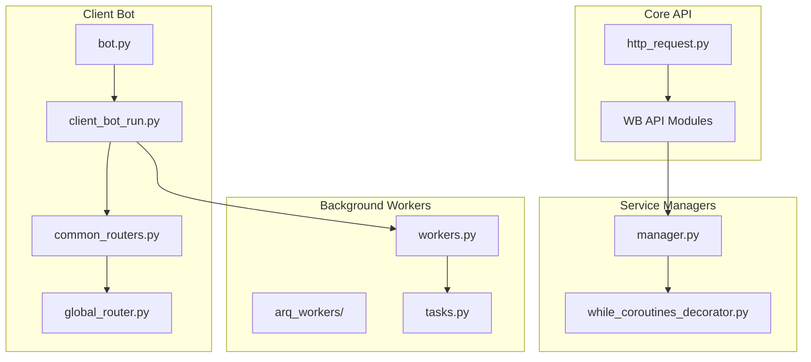
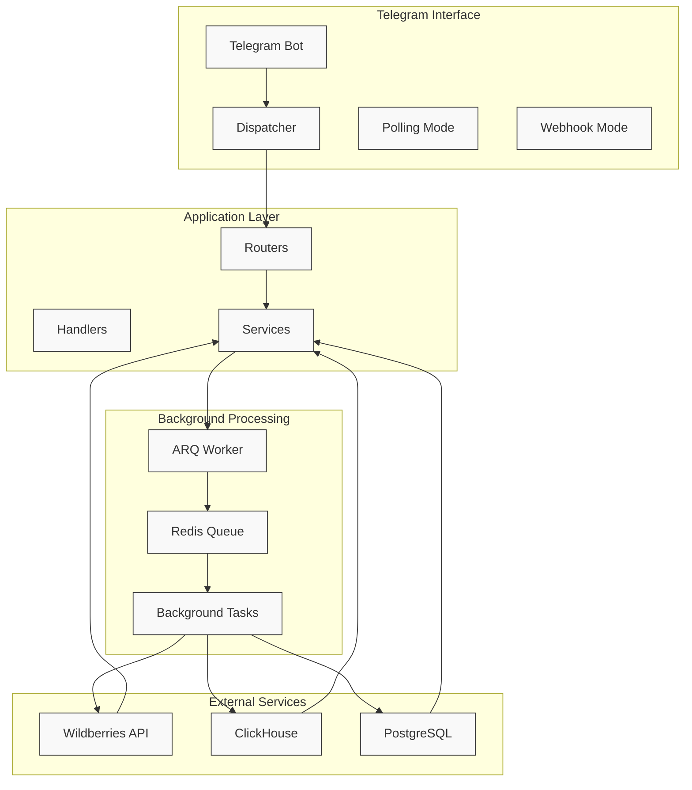
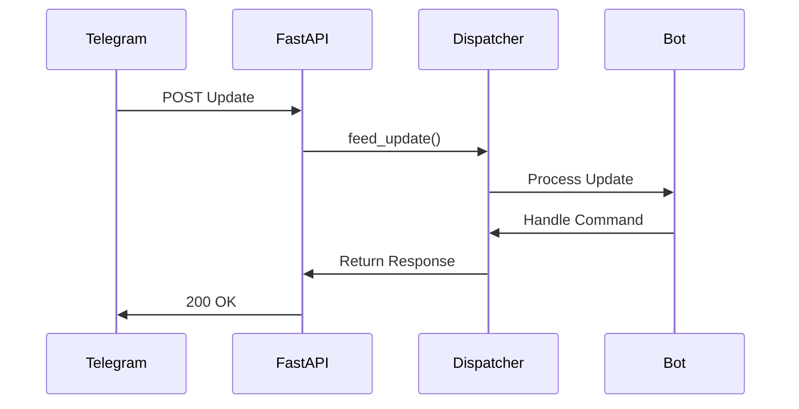
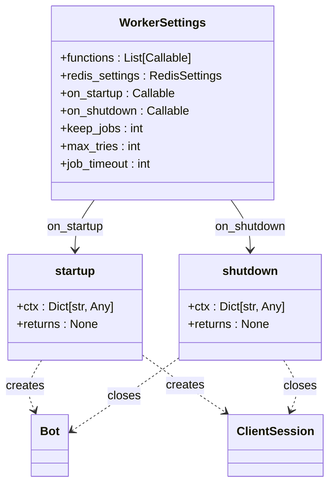
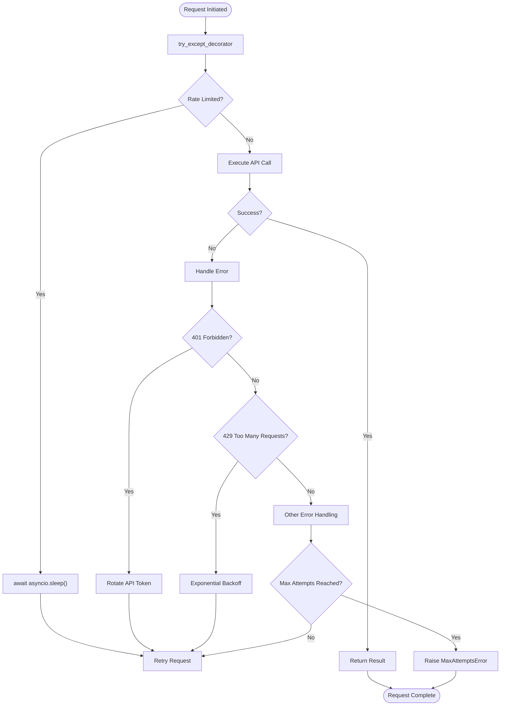
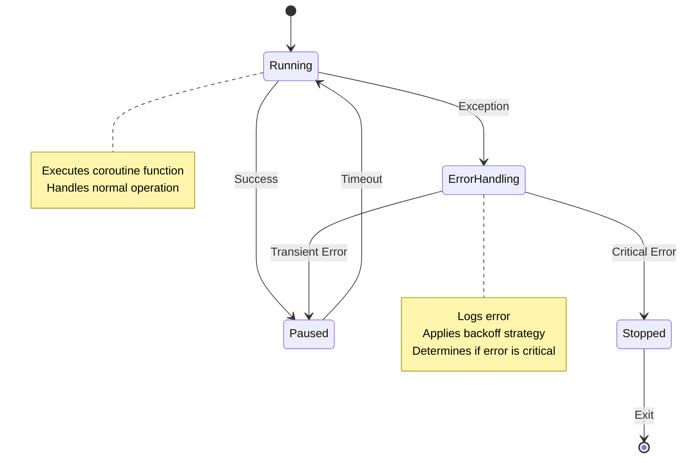
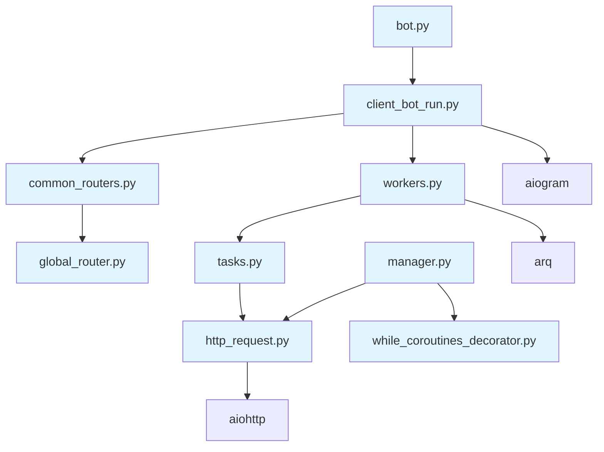

# Async Processing Model

<cite>
**Referenced Files in This Document**   
- [bot.py](file://app/client_bot/bot.py)
- [client_bot_run.py](file://client_bot_run.py)
- [http_request.py](file://app/core/wb_api/http_request.py)
- [workers.py](file://app/arq_workers/workers.py)
- [tasks.py](file://app/modules/adv_creator/backend/tasks.py)
- [manager.py](file://app/modules/shop_runner/service_manager/manager.py)
- [while_coroutines_decorator.py](file://app/modules/shop_runner/service_manager/while_coroutines_decorator.py)
- [common_routers.py](file://app/client_bot/common_routers.py)
- [global_router.py](file://app/client_bot/global_router.py)
</cite>

## Table of Contents
1. [Introduction](#introduction)
2. [Project Structure](#project-structure)
3. [Core Components](#core-components)
4. [Architecture Overview](#architecture-overview)
5. [Detailed Component Analysis](#detailed-component-analysis)
6. [Dependency Analysis](#dependency-analysis)
7. [Performance Considerations](#performance-considerations)
8. [Troubleshooting Guide](#troubleshooting-guide)
9. [Conclusion](#conclusion)

## Introduction
The adv-bot system implements a sophisticated asynchronous processing architecture to handle concurrent Telegram updates, Wildberries API interactions, and background tasks. Built on Python's asyncio framework and aiogram 3.x, the system leverages async/await patterns to maximize efficiency and responsiveness. This document details the event loop management, ARQ worker integration, HTTP client usage with aiohttp, synchronization mechanisms, error handling in async contexts, and optimization strategies employed throughout the codebase.

## Project Structure

**Diagram sources**
- [bot.py](file://app/client_bot/bot.py)
- [client_bot_run.py](file://client_bot_run.py)
- [http_request.py](file://app/core/wb_api/http_request.py)
- [workers.py](file://app/arq_workers/workers.py)
- [manager.py](file://app/modules/shop_runner/service_manager/manager.py)

**Section sources**
- [bot.py](file://app/client_bot/bot.py)
- [client_bot_run.py](file://client_bot_run.py)
- [http_request.py](file://app/core/wb_api/http_request.py)
- [workers.py](file://app/arq_workers/workers.py)

## Core Components

The adv-bot system's asynchronous architecture centers around several key components that work together to process Telegram updates, interact with the Wildberries API, and execute background tasks efficiently. The core components include the Telegram bot interface using aiogram 3.x, the ARQ-based background worker system, the aiohttp-powered HTTP client for Wildberries API calls, and various service managers that coordinate long-running processes.

The system employs a modular design where the client bot handles user interactions while offloading intensive operations to ARQ workers. This separation ensures that the bot remains responsive to user commands while complex operations like ad creation and keyword parsing occur in the background. The architecture also incorporates sophisticated error handling and retry mechanisms to maintain reliability when dealing with external APIs.

**Section sources**
- [bot.py](file://app/client_bot/bot.py)
- [workers.py](file://app/arq_workers/workers.py)
- [http_request.py](file://app/core/wb_api/http_request.py)

## Architecture Overview

**Diagram sources**
- [client_bot_run.py](file://client_bot_run.py)
- [workers.py](file://app/arq_workers/workers.py)
- [manager.py](file://app/modules/shop_runner/service_manager/manager.py)

## Detailed Component Analysis

### Bot and Event Loop Management

The bot implementation in `bot.py` creates a singleton Bot instance using the Telegram token from settings. This instance is accessed through the `get_bot()` function, ensuring consistent access throughout the application. The event loop management is handled in `client_bot_run.py`, which supports both polling and webhook modes.

In polling mode, the application uses `dp.start_polling()` to continuously fetch updates from Telegram, while in webhook mode, it integrates with FastAPI to receive updates via HTTP POST requests. The lifespan context manager ensures proper setup and teardown of resources, including the aiohttp ClientSession and webhook configuration.

**Diagram sources**
- [bot.py](file://app/client_bot/bot.py)
- [client_bot_run.py](file://client_bot_run.py)

**Section sources**
- [bot.py](file://app/client_bot/bot.py#L1-L15)
- [client_bot_run.py](file://client_bot_run.py#L1-L150)

### ARQ Worker Integration

The ARQ worker system, configured in `workers.py`, provides a robust mechanism for offloading CPU- and I/O-intensive operations. The WorkerSettings class defines the functions to be executed (currently only `create_complex_advs`), Redis connection settings, and lifecycle hooks for startup and shutdown.

During startup, the worker initializes a Bot instance and aiohttp ClientSession, storing them in the context dictionary for use by worker functions. This ensures that background tasks can send Telegram messages and make HTTP requests without creating new connections for each task. The shutdown function properly closes these resources to prevent connection leaks.

**Diagram sources**
- [workers.py](file://app/arq_workers/workers.py#L1-L50)
- [tasks.py](file://app/modules/adv_creator/backend/tasks.py#L1-L106)

**Section sources**
- [workers.py](file://app/arq_workers/workers.py#L1-L50)
- [tasks.py](file://app/modules/adv_creator/backend/tasks.py#L1-L106)

### Async HTTP Client Implementation

The `http_request.py` module implements a comprehensive async HTTP client for Wildberries API interactions. It uses aiohttp to make requests and includes sophisticated error handling and rate limiting through the `try_except_decorator`. This decorator implements exponential backoff with adaptive pausing based on API response patterns.

The `requests` function serves as a wrapper for aiohttp operations, handling response validation, error parsing, and logging. It raises appropriate exceptions based on HTTP status codes, such as `ApiForbiddenError` for 401 responses and `TooManyRequests` for 429 responses. The `get_error_from_response` function parses Wildberries API error responses to provide more specific exception types.

**Diagram sources**
- [http_request.py](file://app/core/wb_api/http_request.py#L1-L200)

**Section sources**
- [http_request.py](file://app/core/wb_api/http_request.py#L1-L200)

### Service Manager Coroutines

The `manager.py` file in the shop_runner module implements long-running coroutines for various background tasks using the `while_coroutine_decorator`. This decorator creates infinite loops that execute a function repeatedly with configurable pauses between successful executions and error recovery.

Key coroutines include:
- `update_cpm_bid`: Updates bid values for active advertising campaigns
- `update_common_sale_stat`: Updates common sales statistics
- `update_full_adv_stat`: Updates full advertising statistics in ClickHouse
- `parsing_keywords_run`: Manages keyword parsing from Wildberries

The `while_coroutine_decorator` handles various exceptions appropriately, raising `StopShopUpdateException` for critical errors like `NotFoundActiveAdvCompany` or `ApiForbiddenError`, while implementing exponential backoff for transient issues.

**Diagram sources**
- [manager.py](file://app/modules/shop_runner/service_manager/manager.py#L1-L199)
- [while_coroutines_decorator.py](file://app/modules/shop_runner/service_manager/while_coroutines_decorator.py#L1-L54)

**Section sources**
- [manager.py](file://app/modules/shop_runner/service_manager/manager.py#L1-L199)
- [while_coroutines_decorator.py](file://app/modules/shop_runner/service_manager/while_coroutines_decorator.py#L1-L54)

## Dependency Analysis

**Diagram sources**
- [bot.py](file://app/client_bot/bot.py)
- [client_bot_run.py](file://client_bot_run.py)
- [common_routers.py](file://app/client_bot/common_routers.py)
- [global_router.py](file://app/client_bot/global_router.py)
- [workers.py](file://app/arq_workers/workers.py)
- [tasks.py](file://app/modules/adv_creator/backend/tasks.py)
- [http_request.py](file://app/core/wb_api/http_request.py)
- [manager.py](file://app/modules/shop_runner/service_manager/manager.py)
- [while_coroutines_decorator.py](file://app/modules/shop_runner/service_manager/while_coroutines_decorator.py)

**Section sources**
- [bot.py](file://app/client_bot/bot.py)
- [client_bot_run.py](file://client_bot_run.py)
- [common_routers.py](file://app/client_bot/common_routers.py)
- [global_router.py](file://app/client_bot/global_router.py)
- [workers.py](file://app/arq_workers/workers.py)
- [tasks.py](file://app/modules/adv_creator/backend/tasks.py)
- [http_request.py](file://app/core/wb_api/http_request.py)
- [manager.py](file://app/modules/shop_runner/service_manager/manager.py)
- [while_coroutines_decorator.py](file://app/modules/shop_runner/service_manager/while_coroutines_decorator.py)

## Performance Considerations

The adv-bot system implements several performance optimization strategies to handle high-concurrency scenarios efficiently:

1. **Connection Pooling**: The aiohttp ClientSession is reused across requests, reducing connection overhead
2. **Rate Limiting**: The `try_except_decorator` implements adaptive rate limiting based on API responses
3. **Task Scheduling**: Background tasks are scheduled with appropriate intervals to avoid overwhelming external services
4. **Resource Management**: Proper lifecycle management ensures connections are closed when no longer needed
5. **Error Recovery**: Exponential backoff prevents hammering APIs during transient failures

The system also employs connection reuse through the ARQ worker context, where a single ClientSession is shared among all tasks executed by a worker. This reduces the overhead of establishing new connections for each background operation.

For high-frequency operations like keyword parsing, the system implements configurable delays between tasks (`PARSING_KEYWORDS_DELAY_BETWEEN_TASKS`) to prevent rate limiting by the Wildberries API.

## Troubleshooting Guide

Common issues in the async processing architecture and their solutions:

1. **Connection Leaks**: Ensure all ClientSession instances are properly closed in shutdown functions
2. **Task Deadlocks**: Avoid synchronous operations in async functions that could block the event loop
3. **Rate Limiting**: Monitor API response codes and adjust rate limiting parameters accordingly
4. **Memory Leaks**: Use context managers and proper exception handling to ensure resource cleanup
5. **Worker Failures**: Implement comprehensive logging to diagnose background task failures

When debugging async issues, enable detailed logging to trace the flow of coroutine execution and identify bottlenecks. The system's logging configuration should capture both successful operations and error conditions with sufficient context for diagnosis.

**Section sources**
- [http_request.py](file://app/core/wb_api/http_request.py#L1-L200)
- [workers.py](file://app/arq_workers/workers.py#L1-L50)
- [while_coroutines_decorator.py](file://app/modules/shop_runner/service_manager/while_coroutines_decorator.py#L1-L54)

## Conclusion

The adv-bot system demonstrates a robust asynchronous processing architecture that effectively handles concurrent Telegram updates, Wildberries API interactions, and background tasks. By leveraging asyncio, aiogram 3.x, and ARQ, the system achieves high efficiency and responsiveness while maintaining reliability through comprehensive error handling and retry mechanisms.

Key strengths of the architecture include the clear separation of concerns between the Telegram interface and background processing, the sophisticated rate limiting and error recovery mechanisms, and the efficient resource management through connection pooling and proper lifecycle handling. The system serves as a strong example of how to build scalable, maintainable async applications in Python.