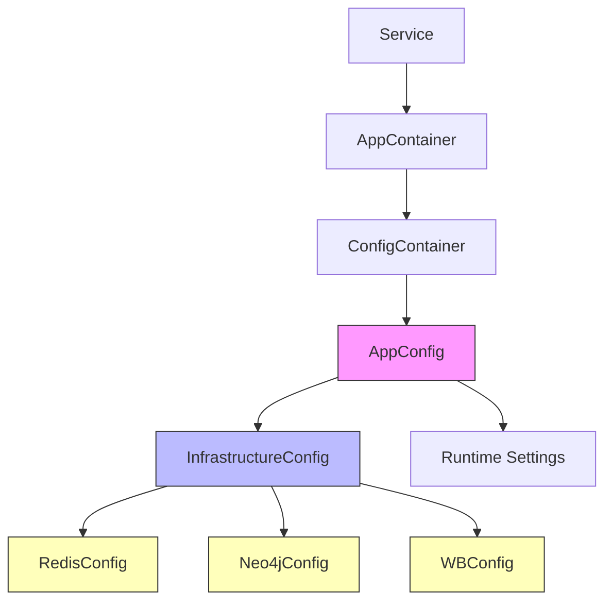
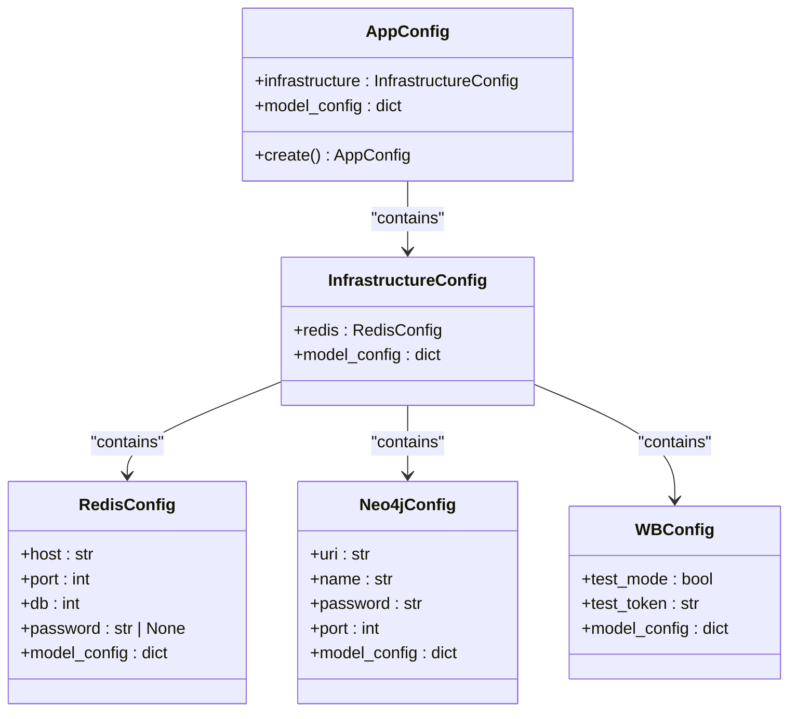
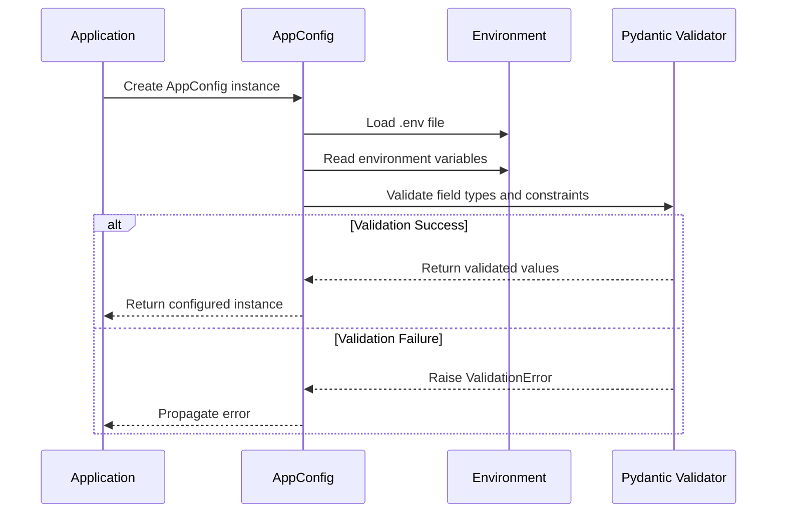
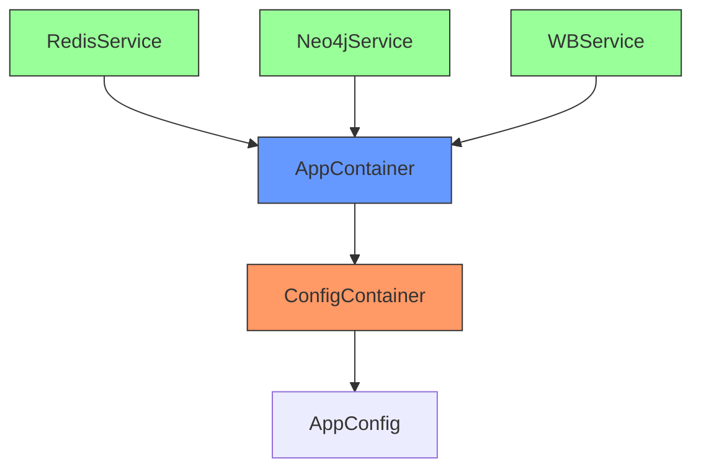

# Configuration Management

<cite>
**Referenced Files in This Document**   
- [app_config.py](file://app/configs/app_config.py)
- [infrastructure_config.py](file://app/configs/infrastructure_config/infrastructure_config.py)
- [redis_config.py](file://app/configs/infrastructure_config/redis_config.py)
- [neo4j_config.py](file://app/configs/infrastructure_config/neo4j_config.py)
- [wb_config.py](file://app/configs/infrastructure_config/wb_config.py)
- [config.py](file://app/core/di/configs/config.py)
- [app_container.py](file://app/core/di/app_container.py)
- [redis.py](file://app/core/di/databases/redis.py)
- [neo4j.py](file://app/core/di/databases/neo4j.py)
- [module_resources.py](file://app/core/di/module_resources.py)
- [settings_master.py](file://app/settings/settings_master.py)
</cite>

## Table of Contents
1. [Introduction](#introduction)
2. [Configuration Architecture](#configuration-architecture)
3. [Core Configuration Models](#core-configuration-models)
4. [Hierarchical Configuration Structure](#hierarchical-configuration-structure)
5. [Environment Variable Loading and Validation](#environment-variable-loading-and-validation)
6. [Dependency Injection Integration](#dependency-injection-integration)
7. [Best Practices for Configuration Management](#best-practices-for-configuration-management)
8. [Troubleshooting Configuration Issues](#troubleshooting-configuration-issues)
9. [Conclusion](#conclusion)

## Introduction
The adv-bot application implements a robust configuration system using Pydantic's BaseSettings for type-safe, validated settings across different environments. This documentation provides a comprehensive overview of the configuration architecture, focusing on the hierarchical structure that organizes settings at the application, infrastructure, and runtime levels. The system leverages environment variables for external configuration while providing strong typing and validation through Pydantic models. The integration with Dependency Injection (DI) enables seamless access to configuration values throughout the application, ensuring consistency and maintainability.

**Section sources**
- [app_config.py](file://app/configs/app_config.py#L1-L21)
- [infrastructure_config.py](file://app/configs/infrastructure_config/infrastructure_config.py#L1-L16)

## Configuration Architecture
The configuration system in adv-bot follows a hierarchical, modular design that separates concerns and promotes reusability. At its core, the system uses Pydantic's BaseSettings to provide type safety, validation, and environment variable loading capabilities. The architecture is organized around a main AppConfig class that serves as the root configuration object, containing nested configuration objects for different aspects of the application.

The system implements a layered approach where the main application configuration delegates to specialized infrastructure configurations, creating a clear separation between application-level settings and infrastructure-specific parameters. This design enables better organization, easier maintenance, and more focused configuration management for different components.

**Diagram sources**
- [app_config.py](file://app/configs/app_config.py#L1-L21)
- [infrastructure_config.py](file://app/configs/infrastructure_config/infrastructure_config.py#L1-L16)
- [config.py](file://app/core/di/configs/config.py#L1-L20)

**Section sources**
- [app_config.py](file://app/configs/app_config.py#L1-L21)
- [infrastructure_config.py](file://app/configs/infrastructure_config/infrastructure_config.py#L1-L16)
- [config.py](file://app/core/di/configs/config.py#L1-L20)

## Core Configuration Models
The configuration system is built around several core Pydantic models that define the structure and validation rules for different aspects of the application. The primary model, AppConfig, serves as the entry point for the entire configuration hierarchy. It contains a reference to InfrastructureConfig, which in turn aggregates configuration for various infrastructure components.

Each configuration model inherits from Pydantic's BaseSettings, enabling automatic loading of values from environment variables, validation of data types, and sensible defaults. The models use Field definitions to provide additional metadata, descriptions, and default values where appropriate. This approach ensures that all configuration values are properly typed and validated before being used by the application.

**Diagram sources**
- [app_config.py](file://app/configs/app_config.py#L1-L21)
- [infrastructure_config.py](file://app/configs/infrastructure_config/infrastructure_config.py#L1-L16)
- [redis_config.py](file://app/configs/infrastructure_config/redis_config.py#L1-L16)
- [neo4j_config.py](file://app/configs/infrastructure_config/neo4j_config.py#L1-L17)
- [wb_config.py](file://app/configs/infrastructure_config/wb_config.py#L1-L23)

**Section sources**
- [app_config.py](file://app/configs/app_config.py#L1-L21)
- [infrastructure_config.py](file://app/configs/infrastructure_config/infrastructure_config.py#L1-L16)
- [redis_config.py](file://app/configs/infrastructure_config/redis_config.py#L1-L16)
- [neo4j_config.py](file://app/configs/infrastructure_config/neo4j_config.py#L1-L17)
- [wb_config.py](file://app/configs/infrastructure_config/wb_config.py#L1-L23)

## Hierarchical Configuration Structure
The configuration system implements a hierarchical structure that organizes settings into logical groups based on their scope and purpose. At the top level, the AppConfig class represents the complete application configuration, serving as a container for all other configuration objects. This hierarchical approach enables better organization, reduces naming conflicts, and makes the configuration more intuitive to navigate.

The hierarchy follows a composition pattern where higher-level configuration objects contain instances of lower-level configuration objects. For example, the AppConfig contains an InfrastructureConfig instance, which in turn contains configuration objects for specific infrastructure components like Redis, Neo4j, and Wildberries API. This nesting creates a natural grouping of related settings while maintaining type safety and validation at each level.

This structure also supports the principle of separation of concerns, allowing different parts of the application to access only the configuration they need. Services that interact with Redis can depend on RedisConfig directly, while higher-level components can access the complete configuration through AppConfig. The hierarchy can be easily extended to accommodate new infrastructure components or application features by adding new configuration classes at the appropriate level.

**Section sources**
- [app_config.py](file://app/configs/app_config.py#L1-L21)
- [infrastructure_config.py](file://app/configs/infrastructure_config/infrastructure_config.py#L1-L16)

## Environment Variable Loading and Validation
The configuration system leverages Pydantic's BaseSettings to automatically load values from environment variables, providing a seamless integration between code and deployment configuration. Each configuration model specifies an env_file parameter in its model_config, pointing to a .env file that contains default values for environment variables. This allows developers to define sensible defaults while still enabling override through actual environment variables.

Environment variables are mapped to configuration fields using naming conventions and the env_prefix parameter. For example, the RedisConfig class uses "REDIS_" as its env_prefix, meaning that the host field will be populated from the REDIS_HOST environment variable. This convention ensures a clear and predictable mapping between configuration fields and environment variables, reducing the potential for errors.

The validation process occurs automatically when configuration objects are instantiated. Pydantic validates that each field has a value of the correct type and meets any specified constraints. If validation fails, a ValidationError is raised with detailed information about the problem, helping developers quickly identify and fix configuration issues. This robust validation ensures that the application fails fast when configuration is incorrect, preventing subtle bugs that could arise from invalid settings.

**Diagram sources**
- [app_config.py](file://app/configs/app_config.py#L1-L21)
- [infrastructure_config.py](file://app/configs/infrastructure_config/infrastructure_config.py#L1-L16)
- [redis_config.py](file://app/configs/infrastructure_config/redis_config.py#L1-L16)

**Section sources**
- [app_config.py](file://app/configs/app_config.py#L1-L21)
- [infrastructure_config.py](file://app/configs/infrastructure_config/infrastructure_config.py#L1-L16)
- [redis_config.py](file://app/configs/infrastructure_config/redis_config.py#L1-L16)

## Dependency Injection Integration
The configuration system is tightly integrated with the application's Dependency Injection (DI) framework, enabling services to access configuration values through dependency injection. The ConfigContainer class serves as the DI container for configuration, providing a singleton instance of AppConfig that can be injected into any component that requires configuration access.

This integration is implemented using the dependency_injector library, which allows configuration values to be provided as dependencies to services and other components. The AppContainer class, which is the main DI container for the application, includes the ConfigContainer as a dependency, making configuration available throughout the application's object graph.

Services can access configuration values by declaring dependencies on specific configuration objects. For example, a service that needs Redis configuration can declare a dependency on RedisConfig, and the DI framework will automatically provide the appropriate configuration values. This approach promotes loose coupling between components and makes testing easier, as configuration dependencies can be easily mocked or replaced in test environments.

**Diagram sources**
- [config.py](file://app/core/di/configs/config.py#L1-L20)
- [app_container.py](file://app/core/di/app_container.py#L1-L47)

**Section sources**
- [config.py](file://app/core/di/configs/config.py#L1-L20)
- [app_container.py](file://app/core/di/app_container.py#L1-L47)
- [di_manager.py](file://app/core/di/di_manager.py#L1-L97)

## Best Practices for Configuration Management
When extending or modifying the configuration system, several best practices should be followed to maintain consistency and reliability. When adding new settings, create dedicated configuration classes for related groups of settings rather than adding fields directly to existing classes. This promotes organization and makes it easier to manage and validate related settings as a unit.

For sensitive information such as passwords and API keys, always use appropriate field types and consider additional security measures. The configuration system should never log sensitive values, and environment variables containing secrets should be protected through proper access controls. When defining default values, ensure they are safe and appropriate for the target environment, avoiding defaults that could lead to security vulnerabilities or unexpected behavior.

Configuration overrides between development and production environments should be managed through environment-specific .env files or environment variables, rather than hardcoding different values in the configuration classes. This approach ensures that the same codebase can be deployed to different environments without modification. When introducing new infrastructure components, follow the established pattern of creating a dedicated configuration class that inherits from BaseSettings and integrates with the existing hierarchy through composition.

**Section sources**
- [app_config.py](file://app/configs/app_config.py#L1-L21)
- [infrastructure_config.py](file://app/configs/infrastructure_config/infrastructure_config.py#L1-L16)
- [settings_master.py](file://app/settings/settings_master.py#L1-L369)

## Troubleshooting Configuration Issues
Common configuration issues typically fall into several categories: missing environment variables, type mismatches, and validation errors. When encountering configuration problems, first verify that all required environment variables are set and accessible to the application. The error messages from Pydantic's validation system provide detailed information about the specific field that failed validation and the reason for the failure.

For issues related to environment variable loading, check that the .env file is present and correctly formatted, and that the environment variable names match the expected patterns based on the env_prefix and field names. Type-related errors often occur when environment variables are not properly formatted as the expected type (e.g., passing a string where an integer is expected), so ensure that values are correctly formatted in the environment.

When debugging configuration issues, the hierarchical nature of the system can be leveraged to isolate problems. Start by verifying the top-level AppConfig and then drill down into specific configuration objects to identify where the issue occurs. The use of type hints and IDE support can also help catch configuration issues before runtime by identifying mismatches between expected and actual types.

**Section sources**
- [app_config.py](file://app/configs/app_config.py#L1-L21)
- [infrastructure_config.py](file://app/configs/infrastructure_config/infrastructure_config.py#L1-L16)
- [settings_master.py](file://app/settings/settings_master.py#L1-L369)

## Conclusion
The configuration management system in the adv-bot application provides a robust, type-safe foundation for managing application settings across different environments. By leveraging Pydantic's BaseSettings and a hierarchical configuration structure, the system ensures that all configuration values are properly validated and typed, reducing the risk of runtime errors due to incorrect settings. The integration with Dependency Injection enables seamless access to configuration values throughout the application while promoting loose coupling and testability.

The modular design allows for easy extension and maintenance, with clear separation between application-level settings and infrastructure-specific configurations. This structure supports the addition of new services and components without disrupting existing configuration patterns. By following the established patterns and best practices, developers can ensure that configuration remains consistent, secure, and maintainable as the application evolves.