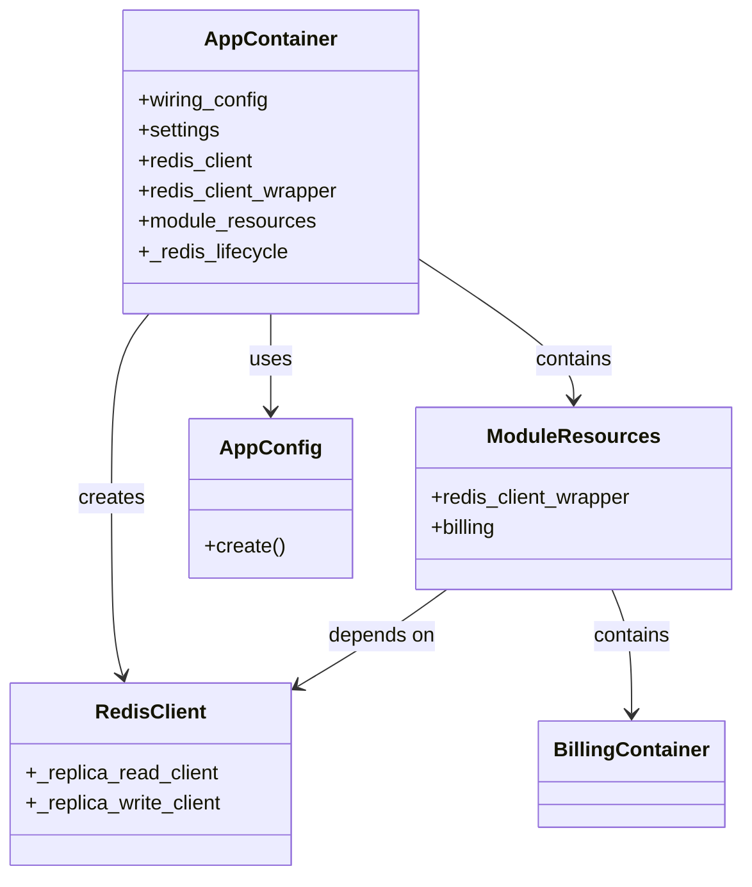
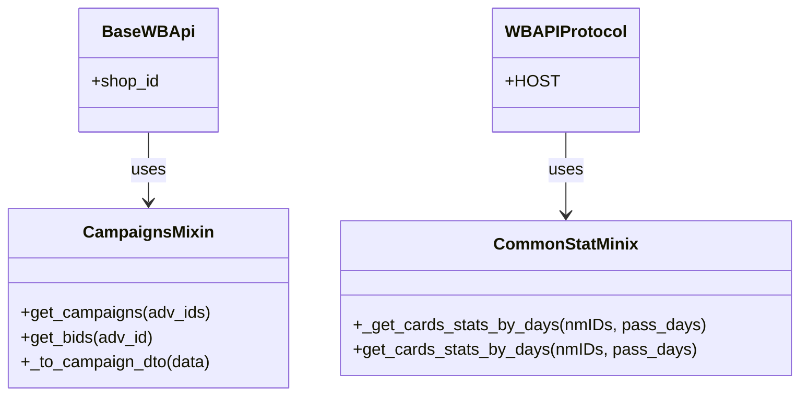
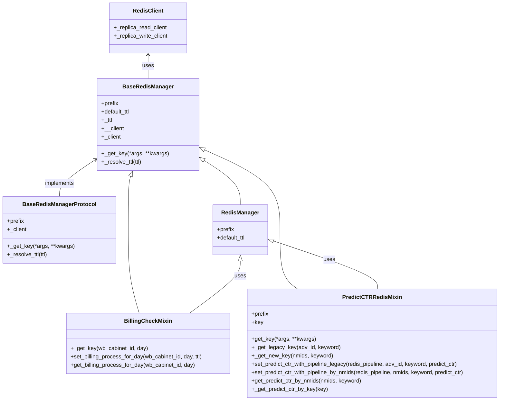
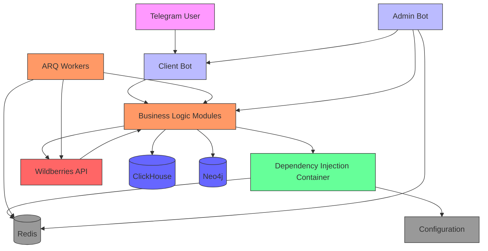

# Core Architecture

<cite>
**Referenced Files in This Document**   
- [app_container.py](file://app/core/di/app_container.py)
- [module_resources.py](file://app/core/di/module_resources.py)
- [redis.py](file://app/core/di/databases/redis.py)
- [campaigns_mixin.py](file://app/core/mp/wb/mixins/campaigns_mixin.py)
- [statistic_mixin.py](file://app/core/wb_api/mixins/statistic_mixin/statistic_mixin.py)
- [base_redis_manager.py](file://app/core/redis_manager_v2/base_redis_manager.py)
- [redis_client.py](file://app/core/redis_manager_v2/redis_client.py)
- [billing_check.py](file://app/core/redis_manager_v2/mixins/billing_check.py)
- [predic_ctr.py](file://app/core/redis_manager_v2/mixins/predic_ctr.py)
- [base_protocol.py](file://app/core/redis_manager_v2/base_protocol.py)
- [redis_cache_base.py](file://app/core/redis_cache/redis_cache_base.py)
- [my_log_handler.py](file://my_log_handler.py)
- [exc.py](file://app/exc.py)
</cite>

## Table of Contents
1. [Introduction](#introduction)
2. [Layered Architecture](#layered-architecture)
3. [Dependency Injection System](#dependency-injection-system)
4. [Async Processing Model](#async-processing-model)
5. [Mixin Pattern Implementation](#mixin-pattern-implementation)
6. [Repository Pattern and Data Access](#repository-pattern-and-data-access)
7. [System Context and Component Interactions](#system-context-and-component-interactions)
8. [Cross-Cutting Concerns](#cross-cutting-concerns)
9. [Architectural Trade-offs and Scalability](#architectural-trade-offs-and-scalability)
10. [Conclusion](#conclusion)

## Introduction
The adv-bot system is a sophisticated advertising management platform designed to interface with Wildberries' advertising API through a Telegram-based user interface. The architecture follows a clean separation of concerns with distinct layers for presentation, business logic, and data access. Built on Python's asyncio framework, the system handles concurrent operations efficiently while maintaining responsiveness. The dependency injection system, powered by the dependency_injector library, enables loose coupling between components and facilitates testing and configuration management. This document provides a comprehensive analysis of the core infrastructure components, detailing the architectural patterns, dependency management, and integration points that form the foundation of the system.

## Layered Architecture
The adv-bot system implements a strict layered architecture that separates concerns across three primary layers: presentation (Telegram interface), business logic (modules), and data access (core components and models). The presentation layer, implemented in the client_bot package, handles user interactions through Telegram, processing commands and displaying information. This layer communicates with the business logic layer, which contains modular components like billing, balance management, and campaign management in the modules directory. Each module encapsulates specific business functionality and coordinates operations across multiple services. The data access layer, located in the core directory, provides abstractions for interacting with external systems including Redis, ClickHouse, and the Wildberries API. This layered approach ensures that changes in one layer have minimal impact on others, promoting maintainability and testability. The clear separation enables independent development and scaling of components based on their specific requirements and performance characteristics.

**Section sources**
- [client_bot](file://app/client_bot)
- [modules](file://app/modules)
- [core](file://app/core)

## Dependency Injection System
The dependency injection system in adv-bot is centered around the AppContainer class in app_container.py, which serves as the main DI container for the application. Built on the dependency_injector library, this system provides a declarative approach to service registration and injection across components. The AppContainer defines providers for essential services including configuration (AppConfig), Redis client, and module resources. Services are registered as singletons, ensuring consistent instances throughout the application lifecycle. The wiring configuration enables automatic injection of dependencies into classes within specified packages, reducing boilerplate code and improving testability. The system implements a hierarchical container structure where the main AppContainer delegates to ModuleResources, which in turn contains containers for individual modules like billing. This nested approach allows modules to define their own dependencies while maintaining access to shared resources like the Redis client wrapper. The DI system also manages the lifecycle of async resources, particularly the Redis connection, ensuring proper initialization and cleanup.

**Diagram sources**
- [app_container.py](file://app/core/di/app_container.py#L1-L47)
- [module_resources.py](file://app/core/di/module_resources.py#L1-L26)

**Section sources**
- [app_container.py](file://app/core/di/app_container.py)
- [module_resources.py](file://app/core/di/module_resources.py)
- [redis.py](file://app/core/di/databases/redis.py)

## Async Processing Model
The adv-bot system leverages Python's asyncio framework extensively to handle concurrent operations efficiently. The architecture is designed around asynchronous programming patterns, enabling non-blocking I/O operations for API calls, database queries, and message processing. This async model is evident throughout the codebase, from the Redis client implementation to the Wildberries API interactions. The Redis client wrapper (RedisClient) provides async methods for all operations, allowing multiple requests to be processed concurrently without blocking the event loop. The system uses async context managers and coroutines to manage resources and coordinate operations. For batch operations, the system employs pipeline patterns to group multiple Redis commands, reducing network overhead and improving performance. The arq_workers package implements a task queue system that processes background jobs asynchronously, enabling long-running operations like campaign updates and billing calculations to run without affecting the responsiveness of the Telegram interface. This async processing model allows the system to handle multiple user requests and background tasks simultaneously, maximizing resource utilization and minimizing latency.

**Section sources**
- [redis_client.py](file://app/core/redis_manager_v2/redis_client.py)
- [arq_workers](file://app/arq_workers)
- [wb_api](file://app/core/wb_api)

## Mixin Pattern Implementation
The adv-bot system employs the mixin pattern extensively to promote code reuse and composition across related components. Two prominent examples are the campaigns_mixin.py and statistic_mixin.py files, which provide specialized functionality to classes that incorporate them. The CampaignsMixin, located in mp/wb/mixins/, adds capabilities for working with advertising campaigns through the Promotion API. It provides methods for retrieving campaign lists, getting bids, and converting raw API responses to DTOs (Data Transfer Objects). This mixin is designed to be used with classes that inherit from BaseWBApi, leveraging Python's multiple inheritance to add campaign-related functionality without creating deep inheritance hierarchies. Similarly, the CommonStatMinix in wb_api/mixins/statistic_mixin/ provides methods for retrieving product statistics from Wildberries' analytics API. It handles pagination, date range calculations, and response parsing, abstracting the complexity of the underlying API. The mixin pattern allows these cross-cutting concerns to be developed and tested independently, then composed into various classes as needed. This approach promotes the Single Responsibility Principle by separating distinct functionalities while enabling flexible composition of behaviors.

**Diagram sources**
- [campaigns_mixin.py](file://app/core/mp/wb/mixins/campaigns_mixin.py#L1-L97)
- [statistic_mixin.py](file://app/core/wb_api/mixins/statistic_mixin/statistic_mixin.py#L1-L90)

**Section sources**
- [campaigns_mixin.py](file://app/core/mp/wb/mixins/campaigns_mixin.py)
- [statistic_mixin.py](file://app/core/wb_api/mixins/statistic_mixin/statistic_mixin.py)

## Repository Pattern and Data Access
The adv-bot system implements a repository pattern for data access through its Redis manager components, providing an abstraction layer between the business logic and data storage. The core of this pattern is the BaseRedisManager class, which defines a common interface for Redis operations with methods for key generation, TTL (time-to-live) resolution, and client access. This base class is extended by specialized managers like the BillingCheckMixin, which adds domain-specific methods for checking and setting billing processing status. The repository pattern is further enhanced by the use of mixins that add specific functionality to managers, such as the PredictCTRRedisMixin for handling CTR (click-through rate) predictions. The system distinguishes between legacy and new key formats, allowing for gradual migration while maintaining backward compatibility. The RedisClient class provides a unified interface to Redis with separate clients for read and write operations, enabling potential read replica support. This abstraction allows business logic to interact with data storage through high-level methods without knowledge of the underlying Redis commands or key structures, improving maintainability and testability.

**Diagram sources**
- [base_redis_manager.py](file://app/core/redis_manager_v2/base_redis_manager.py#L1-L33)
- [redis_client.py](file://app/core/redis_manager_v2/redis_client.py#L1-L167)
- [billing_check.py](file://app/core/redis_manager_v2/mixins/billing_check.py#L1-L42)
- [predic_ctr.py](file://app/core/redis_manager_v2/mixins/predic_ctr.py#L1-L78)
- [base_protocol.py](file://app/core/redis_manager_v2/base_protocol.py#L1-L38)

**Section sources**
- [base_redis_manager.py](file://app/core/redis_manager_v2/base_redis_manager.py)
- [redis_client.py](file://app/core/redis_manager_v2/redis_client.py)
- [billing_check.py](file://app/core/redis_manager_v2/mixins/billing_check.py)
- [predic_ctr.py](file://app/core/redis_manager_v2/mixins/predic_ctr.py)

## System Context and Component Interactions
The adv-bot system operates as a middleware layer between Telegram users and the Wildberries advertising platform, coordinating interactions across multiple components and external systems. The system context reveals a complex network of dependencies and data flows that enable comprehensive advertising management capabilities. At the core of the system is the Redis database, which serves as the primary data store for session state, caching, and distributed locking. The AppContainer orchestrates the initialization of services, injecting dependencies into various components through the dependency injection system. The client_bot receives user commands from Telegram and routes them to appropriate handlers in the modules package, which implement specific business functionality. These modules interact with the Wildberries API through specialized adapters and mixins, retrieving campaign data, updating bids, and processing analytics. Background workers, managed by arq_workers, handle time-consuming operations like campaign updates and billing calculations, ensuring the main application remains responsive. The system also integrates with external services including ClickHouse for analytics storage and Neo4j for graph-based data relationships. Data flows through the system in both directions: user commands trigger API calls to Wildberries, while periodic updates from Wildberries are processed and stored for later retrieval by users.

**Diagram sources**
- [app_container.py](file://app/core/di/app_container.py)
- [client_bot](file://app/client_bot)
- [modules](file://app/modules)
- [arq_workers](file://app/arq_workers)
- [redis_client.py](file://app/core/redis_manager_v2/redis_client.py)

## Cross-Cutting Concerns
The adv-bot system addresses several cross-cutting concerns through dedicated components and patterns. Configuration management is handled by the AppConfig class, which centralizes application settings and provides a consistent interface for accessing configuration values across the system. Error handling is implemented through a combination of try-except decorators and centralized exception management in exc.py, ensuring consistent error reporting and recovery across components. Logging is facilitated by my_log_handler.py, which configures structured logging with appropriate formatting and output destinations. The system employs distributed locking using Redis to prevent race conditions in critical operations like billing processing and campaign updates. The BillingCheckMixin, for example, uses Redis to track whether billing has been processed for a specific cabinet and day, preventing duplicate processing. The system also implements caching strategies through various Redis managers, storing frequently accessed data like CTR predictions and campaign information to reduce API calls and improve performance. Security considerations are addressed through secure storage of API tokens and credentials, though specific implementation details would require further analysis of the token management components.

**Section sources**
- [my_log_handler.py](file://my_log_handler.py)
- [exc.py](file://app/exc.py)
- [billing_check.py](file://app/core/redis_manager_v2/mixins/billing_check.py)
- [app_config.py](file://app/configs/app_config.py)

## Architectural Trade-offs and Scalability
The adv-bot system makes several architectural trade-offs that impact its scalability and maintainability. The extensive use of asyncio enables high concurrency and efficient resource utilization, but requires careful management of the event loop and can complicate debugging and testing. The dependency injection system provides excellent testability and loose coupling, but adds complexity to the codebase and requires developers to understand the DI container structure. The mixin pattern promotes code reuse but can lead to implicit dependencies and make it difficult to trace method resolution order in complex inheritance hierarchies. The system's reliance on Redis as a primary data store provides excellent performance for caching and session management, but introduces a single point of failure and requires careful capacity planning. For scalability, the system could benefit from horizontal partitioning of Redis data by user or cabinet, allowing multiple instances to handle different subsets of the workload. The current architecture supports this through the use of prefixes and structured keys, but would require additional coordination mechanisms for distributed locking across instances. The modular design of the business logic components enables independent scaling of specific functionalities, such as separating billing processing from campaign management. However, the tight integration with Wildberries' API limits the ability to scale beyond the rate limits and performance characteristics of the external service.

## Conclusion
The adv-bot system demonstrates a sophisticated architectural approach to building a Telegram-based advertising management platform for Wildberries. Its layered architecture, dependency injection system, and extensive use of async programming patterns create a maintainable and scalable foundation for complex business logic. The strategic use of design patterns like mixins and the repository pattern promotes code reuse and separation of concerns, while the comprehensive handling of cross-cutting concerns ensures robust operation in production environments. The system's reliance on Redis for both data storage and coordination mechanisms highlights the importance of careful resource management and capacity planning. Future improvements could focus on enhancing observability through more comprehensive monitoring and tracing, implementing circuit breakers for external API calls, and exploring event-driven architectures for better decoupling of components. Overall, the architecture provides a solid foundation for a feature-rich advertising management system that balances performance, maintainability, and developer productivity.