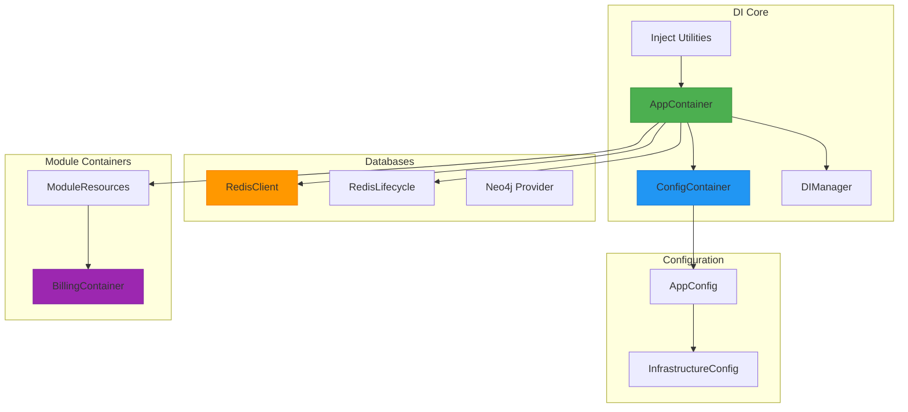
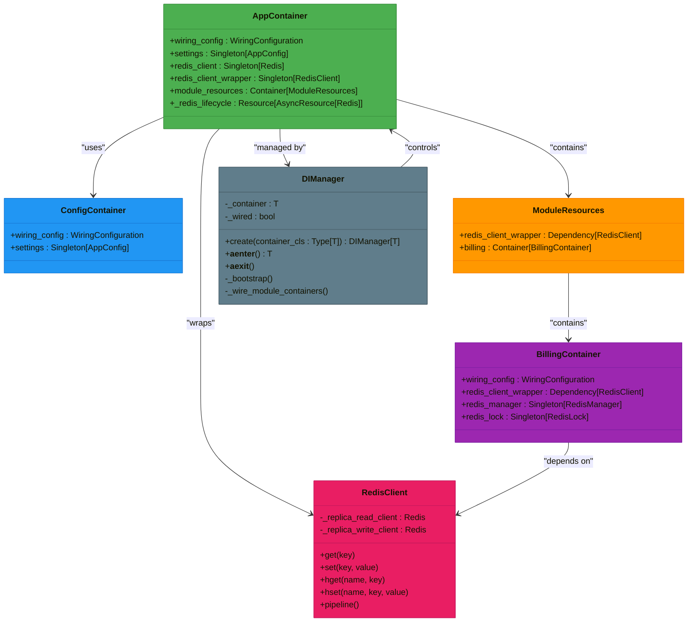
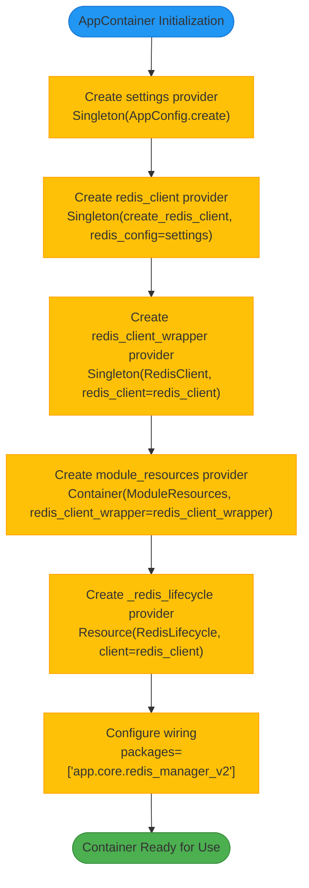
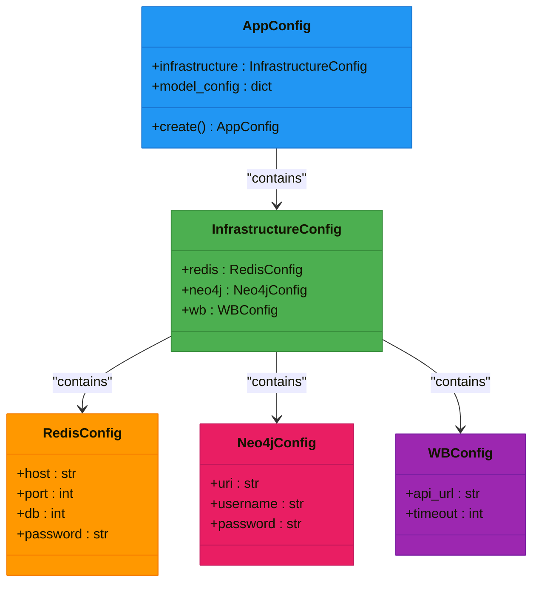
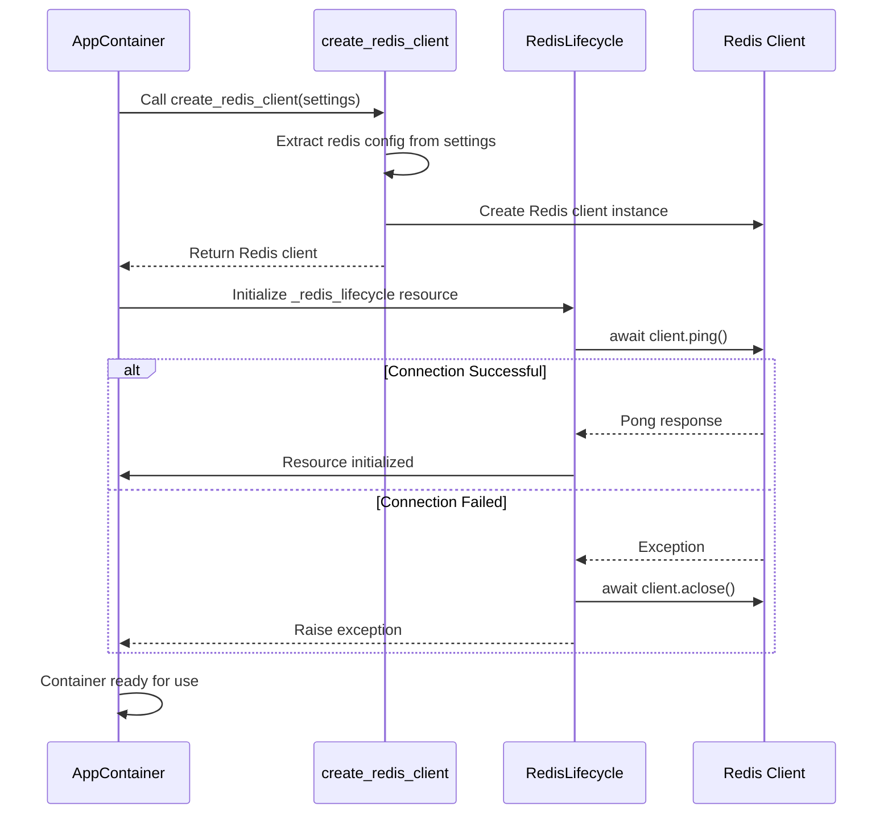
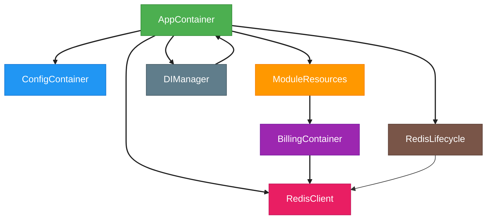

# Dependency Injection System

<cite>
**Referenced Files in This Document**   
- [app_container.py](file://app/core/di/app_container.py)
- [config.py](file://app/core/di/configs/config.py)
- [app_config.py](file://app/configs/app_config.py)
- [redis.py](file://app/core/di/databases/redis.py)
- [module_resources.py](file://app/core/di/module_resources.py)
- [di.py](file://app/modules/billing/di.py)
- [redis_client.py](file://app/core/redis_manager_v2/redis_client.py)
- [di_manager.py](file://app/core/di/di_manager.py)
- [inject.py](file://app/core/di/inject_preserve/inject.py)
</cite>

## Table of Contents
1. [Introduction](#introduction)
2. [Project Structure](#project-structure)
3. [Core Components](#core-components)
4. [Architecture Overview](#architecture-overview)
5. [Detailed Component Analysis](#detailed-component-analysis)
6. [Dependency Analysis](#dependency-analysis)
7. [Performance Considerations](#performance-considerations)
8. [Troubleshooting Guide](#troubleshooting-guide)
9. [Conclusion](#conclusion)

## Introduction
The adv-bot application implements a comprehensive dependency injection (DI) system using the `dependency_injector` library to manage service instantiation and lifecycle across modules. This documentation details the architecture of the DI system, focusing on the `AppContainer` class that serves as the central container for all application services. The system provides a structured approach to configuration management, database connections (PostgreSQL, Redis, Neo4j), and core service instantiation, enabling clean separation of concerns and improved testability.

## Project Structure
The dependency injection system is organized within the `app/core/di` directory, following a modular structure that separates concerns and promotes reusability. The core components include the main application container, configuration containers, database providers, and module-specific containers.

**Diagram sources**
- [app_container.py](file://app/core/di/app_container.py)
- [config.py](file://app/core/di/configs/config.py)
- [module_resources.py](file://app/core/di/module_resources.py)

**Section sources**
- [app_container.py](file://app/core/di/app_container.py)
- [config.py](file://app/core/di/configs/config.py)
- [module_resources.py](file://app/core/di/module_resources.py)

## Core Components
The dependency injection system in adv-bot consists of several core components that work together to provide a robust service management framework. The `AppContainer` serves as the primary container for all application services, while the `ConfigContainer` manages configuration injection. The system leverages the `dependency_injector` library to provide singleton instances of services, manage resource lifecycles, and enable dependency wiring across modules.

The `DIManager` class provides a context manager interface for initializing and shutting down the container, ensuring proper resource management. The `inject` and `Provide` utilities offer type-safe dependency injection that integrates well with static type checkers like mypy. Database connections are managed through dedicated providers that handle connection creation and lifecycle management.

**Section sources**
- [app_container.py](file://app/core/di/app_container.py#L1-L46)
- [di_manager.py](file://app/core/di/di_manager.py#L1-L96)
- [inject.py](file://app/core/di/inject_preserve/inject.py#L1-L47)

## Architecture Overview
The dependency injection architecture in adv-bot follows a hierarchical container pattern where the `AppContainer` serves as the root container, delegating module-specific dependencies to specialized containers through the `ModuleResources` intermediary. This design enables loose coupling between modules while maintaining a centralized configuration and service registry.

**Diagram sources**
- [app_container.py](file://app/core/di/app_container.py#L1-L46)
- [config.py](file://app/core/di/configs/config.py#L1-L19)
- [module_resources.py](file://app/core/di/module_resources.py#L1-L25)
- [di.py](file://app/modules/billing/di.py#L1-L41)
- [di_manager.py](file://app/core/di/di_manager.py#L1-L96)
- [redis_client.py](file://app/core/redis_manager_v2/redis_client.py#L1-L166)

## Detailed Component Analysis

### AppContainer Analysis
The `AppContainer` class is the central dependency injection container for the adv-bot application, implementing the `DeclarativeContainer` pattern from the `dependency_injector` library. It serves as the root container that orchestrates the instantiation and lifecycle management of all application services.

**Diagram sources**
- [app_container.py](file://app/core/di/app_container.py#L1-L46)

**Section sources**
- [app_container.py](file://app/core/di/app_container.py#L1-L46)

### Configuration Injection
The configuration system in adv-bot leverages Pydantic's `BaseSettings` to provide type-safe, environment-aware configuration management. The `AppConfig` class serves as the main configuration entry point, aggregating infrastructure settings from the `InfrastructureConfig` class.

**Diagram sources**
- [app_config.py](file://app/configs/app_config.py#L1-L20)
- [infrastructure_config.py](file://app/configs/infrastructure_config/infrastructure_config.py)

**Section sources**
- [app_config.py](file://app/configs/app_config.py#L1-L20)
- [config.py](file://app/core/di/configs/config.py#L1-L19)

### Database Providers
The database provider system in adv-bot implements a clean separation between connection creation and lifecycle management. The `create_redis_client` function is responsible for creating Redis client instances based on configuration, while the `RedisLifecycle` class handles connection validation and cleanup.

**Diagram sources**
- [app_container.py](file://app/core/di/app_container.py#L1-L46)
- [redis.py](file://app/core/di/databases/redis.py#L1-L36)

**Section sources**
- [app_container.py](file://app/core/di/app_container.py#L1-L46)
- [redis.py](file://app/core/di/databases/redis.py#L1-L36)

## Dependency Analysis
The dependency injection system in adv-bot features a well-structured dependency graph that promotes loose coupling and high cohesion. The architecture follows a hierarchical pattern where the root container (`AppContainer`) delegates module-specific dependencies to specialized containers through the `ModuleResources` intermediary.

**Diagram sources**
- [app_container.py](file://app/core/di/app_container.py)
- [config.py](file://app/core/di/configs/config.py)
- [module_resources.py](file://app/core/di/module_resources.py)
- [di.py](file://app/modules/billing/di.py)
- [di_manager.py](file://app/core/di/di_manager.py)
- [redis.py](file://app/core/di/databases/redis.py)

**Section sources**
- [app_container.py](file://app/core/di/app_container.py)
- [module_resources.py](file://app/core/di/module_resources.py)
- [di.py](file://app/modules/billing/di.py)

## Performance Considerations
The dependency injection system in adv-bot is designed with performance in mind, leveraging singleton providers to ensure that expensive resources like database connections are created only once and reused throughout the application lifecycle. The use of async resources and proper lifecycle management helps prevent connection leaks and ensures efficient resource utilization.

The `RedisClient` wrapper provides optimized methods for common operations, including pipeline support for batch operations that reduce round-trip times to the Redis server. The hierarchical container structure minimizes initialization overhead by only wiring modules that are actually used in a particular execution context.

The `DIManager` class implements lazy initialization of module containers, ensuring that wiring only occurs when a module is actually needed. This approach reduces startup time and memory usage, particularly in scenarios where only a subset of the application's functionality is required.

## Troubleshooting Guide
When working with the dependency injection system in adv-bot, several common issues may arise. Connection problems with Redis can often be traced to misconfigured settings in the `.env` file or network connectivity issues. Ensure that the Redis configuration in `InfrastructureConfig` matches the actual Redis server settings.

Circular dependencies between modules can prevent proper container initialization. To avoid this, follow the principle of depending on abstractions rather than concrete implementations, and use the `ModuleResources` container to manage inter-module dependencies.

Type checking errors with injected dependencies may occur if the `inject` and `Provide` utilities are not used correctly. Ensure that all injected parameters have proper type annotations and that the `Provide` generic type matches the expected service type.

Resource cleanup issues can arise if the `DIManager` context manager is not properly used. Always ensure that the container is properly shut down by using the async context manager pattern or explicitly calling the shutdown methods.

**Section sources**
- [app_container.py](file://app/core/di/app_container.py)
- [di_manager.py](file://app/core/di/di_manager.py)
- [inject.py](file://app/core/di/inject_preserve/inject.py)

## Conclusion
The dependency injection system in adv-bot provides a robust foundation for managing application services and their dependencies. By leveraging the `dependency_injector` library, the system enables clean separation of concerns, improved testability, and efficient resource management. The hierarchical container structure, combined with proper lifecycle management and configuration injection, creates a maintainable architecture that can scale with the application's complexity.

The system's design promotes best practices such as dependency inversion, single responsibility, and explicit dependency declaration. The use of type-safe injection utilities ensures compatibility with static analysis tools, reducing the likelihood of runtime errors. Overall, the DI system in adv-bot demonstrates how dependency injection can be effectively applied to create a modular, maintainable, and testable application architecture.