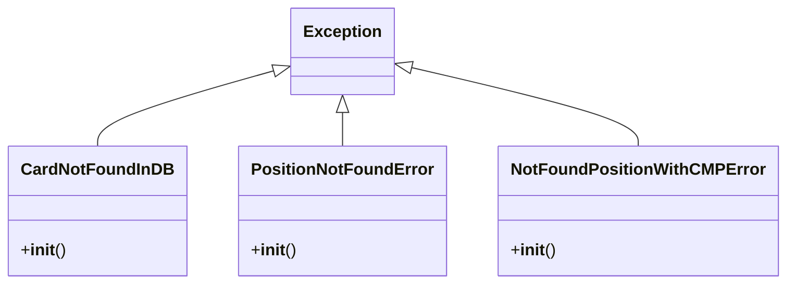
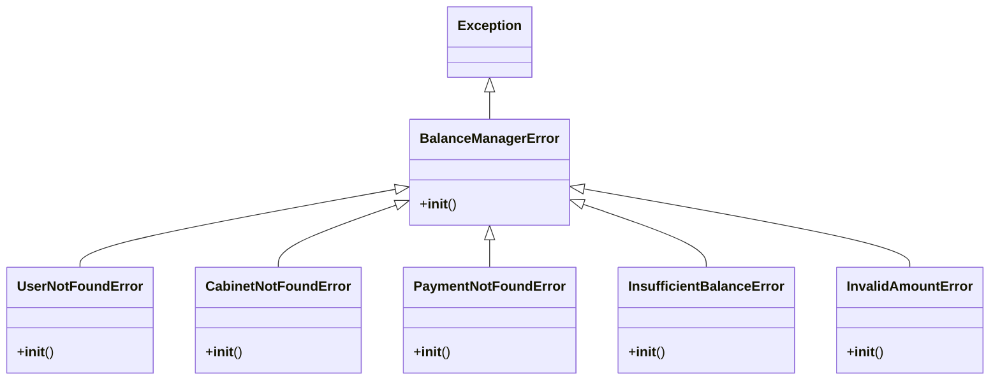
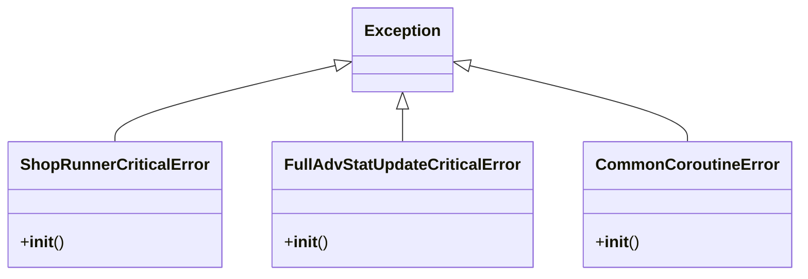
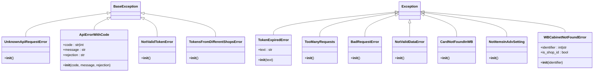
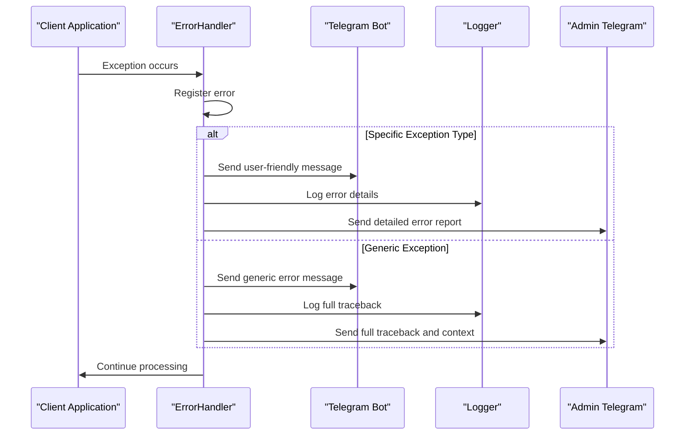
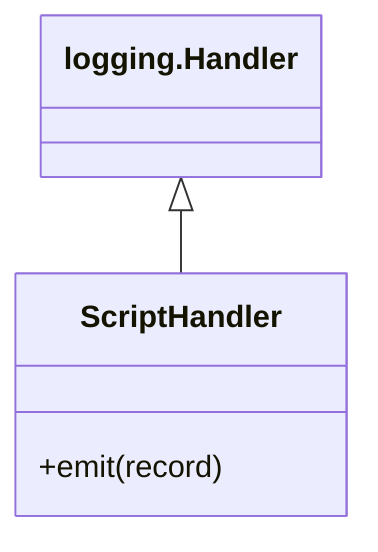

# Error Handling and Logging

<cite>
**Referenced Files in This Document**   
- [exc.py](file://app/exc.py)
- [user_backend_errors_handler/error_handler.py](file://app/user_backend_errors_handler/error_handler.py)
- [core/wb_api/exceptions.py](file://app/core/wb_api/exceptions.py)
- [modules/balance_manager/exceptions.py](file://app/modules/balance_manager/exceptions.py)
- [modules/shop_runner/exceptions.py](file://app/modules/shop_runner/exceptions.py)
- [modules/common_slaves/wildberries/exceptions.py](file://app/modules/common_slaves/wildberries/exceptions.py)
- [client_bot/user_interface/handlers/exceptions.py](file://app/client_bot/user_interface/handlers/exceptions.py)
- [logging_config.json](file://logging_config.json)
- [my_log_handler.py](file://my_log_handler.py)
</cite>

## Table of Contents
1. [Introduction](#introduction)
2. [Exception Hierarchy](#exception-hierarchy)
3. [Module-Specific Exceptions](#module-specific-exceptions)
4. [Error Handling Mechanism](#error-handling-mechanism)
5. [Logging Configuration](#logging-configuration)
6. [Structured Logging Implementation](#structured-logging-implementation)
7. [Best Practices for Logging](#best-practices-for-logging)
8. [Production Debugging and Monitoring](#production-debugging-and-monitoring)
9. [Conclusion](#conclusion)

## Introduction
This document provides comprehensive documentation for the error handling and logging infrastructure of the adv-bot application. The system is designed to handle various types of exceptions across different modules while maintaining detailed logs for debugging, monitoring, and alerting purposes. The architecture includes a hierarchical exception structure, centralized error handling, and a configurable logging system that supports multiple output destinations.

## Exception Hierarchy

The application implements a comprehensive exception hierarchy to handle different types of errors that may occur during execution. The base exceptions are defined in `exc.py` and serve as the foundation for more specific exceptions throughout the application.



**Diagram sources**
- [exc.py](file://app/exc.py#L1-L11)

**Section sources**
- [exc.py](file://app/exc.py#L1-L11)

## Module-Specific Exceptions

### WB API Exceptions
The Wildberries API module defines specific exceptions to handle various API-related errors, including authentication issues, rate limiting, and data validation problems.

```mermaid
classDiagram
class Exception
class MaxAttemptsError {
+__init__()
}
class UnknownApiRequestError {
+__init__()
}
class ApiErrorWithCode {
+code : str|int
+message : str
+rejection : str
+__init__(code, message, rejection)
}
class NotValidTokenError {
+__init__()
}
class TokenExpiredError {
+text : str
+__init__(text)
}
class TokensFromDifferentShopsError {
+__init__()
}
class ApiForbiddenError {
+text : str
+wb_user_cabinet : WBUserCabinet
+__init__(text, wb_user_cabinet)
}
class TooManyRequests {
+__init__()
}
class BadRequestError {
+error_message : str
+__init__()
}
class NotValidDataError {
+__init__()
}
class CardNotFoundInWB {
+__init__()
}
class NotItemsInAdvSetting {
+__init__()
}
class NotMatchWBApiError {
+__init__()
}
class MinAdvBidWBApiError {
+new_min_bid : int
+__init__()
}
Exception <|-- MaxAttemptsError
Exception <|-- UnknownApiRequestError
Exception <|-- ApiErrorWithCode
Exception <|-- NotValidTokenError
Exception <|-- TokenExpiredError
Exception <|-- TokensFromDifferentShopsError
Exception <|-- ApiForbiddenError
Exception <|-- TooManyRequests
Exception <|-- BadRequestError
Exception <|-- NotValidDataError
Exception <|-- CardNotFoundInWB
Exception <|-- NotItemsInAdvSetting
Exception <|-- NotMatchWBApiError
Exception <|-- MinAdvBidWBApiError
```



**Diagram sources**
- [core/wb_api/exceptions.py](file://app/core/wb_api/exceptions.py#L1-L77)

**Section sources**
- [core/wb_api/exceptions.py](file://app/core/wb_api/exceptions.py#L1-L77)

### Balance Manager Exceptions
The balance management module defines exceptions specific to financial operations and user account management.



**Diagram sources**
- [modules/balance_manager/exceptions.py](file://app/modules/balance_manager/exceptions.py#L1-L35)

**Section sources**
- [modules/balance_manager/exceptions.py](file://app/modules/balance_manager/exceptions.py#L1-L35)

### Shop Runner Exceptions
The shop runner module defines critical exceptions that indicate serious issues with shop operations and data processing.



**Diagram sources**
- [modules/shop_runner/exceptions.py](file://app/modules/shop_runner/exceptions.py#L1-L15)

**Section sources**
- [modules/shop_runner/exceptions.py](file://app/modules/shop_runner/exceptions.py#L1-L15)

### Common Slaves Wildberries Exceptions
The common slaves Wildberries module defines exceptions for handling various API and data-related errors.



**Diagram sources**
- [modules/common_slaves/wildberries/exceptions.py](file://app/modules/common_slaves/wildberries/exceptions.py#L1-L67)

**Section sources**
- [modules/common_slaves/wildberries/exceptions.py](file://app/modules/common_slaves/wildberries/exceptions.py#L1-L67)

## Error Handling Mechanism

The application implements a centralized error handling mechanism through the `ErrorHandler` class, which processes exceptions and triggers appropriate responses. The system also includes specific error handlers for different types of exceptions, particularly in the client bot interface.



**Diagram sources**
- [user_backend_errors_handler/error_handler.py](file://app/user_backend_errors_handler/error_handler.py#L1-L16)
- [client_bot/user_interface/handlers/exceptions.py](file://app/client_bot/user_interface/handlers/exceptions.py#L1-L220)

**Section sources**
- [user_backend_errors_handler/error_handler.py](file://app/user_backend_errors_handler/error_handler.py#L1-L16)
- [client_bot/user_interface/handlers/exceptions.py](file://app/client_bot/user_interface/handlers/exceptions.py#L1-L220)

## Logging Configuration

The logging system is configured through `logging_config.json`, which defines formatters, handlers, and log levels for different output destinations. The configuration supports both console output for development and file output for error logging.

```json
{
  "version": 1,
  "disable_existing_loggers": false,
  "formatters": {
    "custom": {
      "format": "%(name)s - %(asctime)s - %(pathname)s:%(lineno)d - %(levelname)s - %(message)s",
      "datefmt": "%Y-%m-%d %H:%M:%S"
    }
  },
  "handlers": {
    "console": {
      "class": "logging.StreamHandler",
      "level": "DEBUG",
      "formatter": "custom",
      "stream": "ext://sys.stdout"
    },
    "error_to_file": {
      "class": "logging.handlers.RotatingFileHandler",
      "level": "ERROR",
      "formatter": "custom",
      "filename": "logs/errors.log",
      "mode": "a",
      "encoding": "utf-8",
      "maxBytes": 10485760,
      "backupCount": 5
    }
  },
  "root": {
    "level": "DEBUG",
    "handlers": ["console", "error_to_file"]
  }
}
```

**Section sources**
- [logging_config.json](file://logging_config.json#L1-L32)

## Structured Logging Implementation

The application implements structured logging through a custom log handler defined in `my_log_handler.py`. This handler extends the standard logging.Handler class and can be used to execute custom actions when log records are emitted.



**Diagram sources**
- [my_log_handler.py](file://my_log_handler.py#L1-L11)

**Section sources**
- [my_log_handler.py](file://my_log_handler.py#L1-L11)

## Best Practices for Logging

The application follows several best practices for logging to ensure effective debugging and monitoring:

1. **Contextual Information**: Log messages include relevant contextual information such as user IDs, shop IDs, and operation details.
2. **Appropriate Log Levels**: Different log levels are used appropriately:
   - DEBUG: Detailed information for debugging
   - INFO: General operational information
   - WARNING: Potential issues that don't prevent operation
   - ERROR: Errors that prevent specific operations
   - CRITICAL: Critical errors that may affect the entire system
3. **Structured Data**: Log messages are structured to facilitate parsing and analysis.
4. **Error Traces**: Full stack traces are captured for unexpected exceptions.
5. **User Privacy**: Sensitive user information is not logged.

## Production Debugging and Monitoring

The error handling and logging infrastructure supports effective production debugging and monitoring through several mechanisms:

1. **Real-time Alerts**: Critical errors are immediately reported to administrators via Telegram.
2. **Error Aggregation**: Similar errors are grouped to identify patterns and recurring issues.
3. **Performance Monitoring**: Log timestamps enable performance analysis and bottleneck identification.
4. **Audit Trail**: Comprehensive logs provide an audit trail for security and compliance purposes.
5. **Remote Debugging**: Administrators can access detailed error information without direct system access.

The system is designed to help developers quickly identify and resolve issues while minimizing disruption to end users. Error rates can be monitored over time to identify trends and potential system issues before they affect a large number of users.

## Conclusion
The error handling and logging infrastructure in the adv-bot application provides a robust foundation for maintaining system reliability and facilitating debugging. The hierarchical exception structure allows for precise error handling, while the comprehensive logging system enables effective monitoring and troubleshooting. By following established best practices, the system ensures that errors are properly captured, reported, and addressed, contributing to a stable and reliable application.