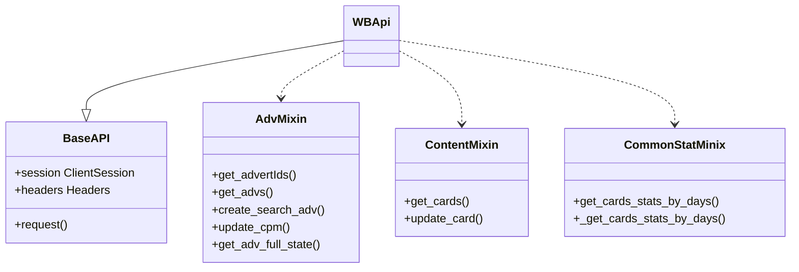
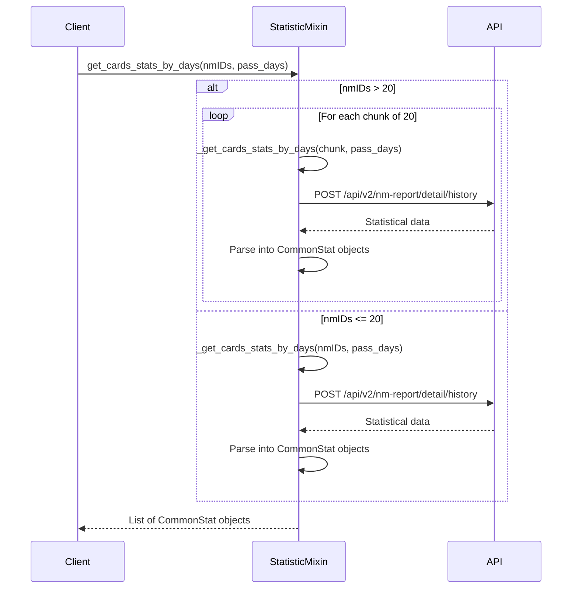

# Mixin Pattern Implementation

<cite>
**Referenced Files in This Document**   
- [statistic_mixin.py](file://app/core/wb_api/mixins/statistic_mixin/statistic_mixin.py)
- [wb_statistic_obj.py](file://app/core/wb_api/mixins/statistic_mixin/wb_statistic_obj.py)
- [adv.py](file://app/core/wb_api/mixins/adv.py)
- [campaigns_mixin.py](file://app/core/mp/wb/mixins/campaigns_mixin.py)
- [wb_api.py](file://app/modules/shop_runner/modules/wb_api/wb_api.py)
</cite>

## Table of Contents
1. [Introduction](#introduction)
2. [Core Mixin Components](#core-mixin-components)
3. [Mixin Composition in WBApi](#mixin-composition-in-wbapi)
4. [Detailed Analysis of StatisticMixin](#detailed-analysis-of-statisticmixin)
5. [Advantages Over Traditional Inheritance](#advantages-over-traditional-inheritance)
6. [Potential Issues and Mitigations](#potential-issues-and-mitigations)
7. [Guidelines for Creating New Mixins](#guidelines-for-creating-new-mixins)
8. [Conclusion](#conclusion)

## Introduction
The mixin pattern is a fundamental architectural approach used throughout the Wildberries API integration system to promote code reuse, separation of concerns, and flexible composition of behaviors. This document analyzes the implementation and usage of key mixins such as `CampaignsMixin`, `StatisticMixin`, and `AdvMixin` that encapsulate reusable behaviors for interacting with the Wildberries API. These mixins are composed into classes like `WBApi` and various updater components to provide modular functionality without deep inheritance hierarchies.

## Core Mixin Components

The core mixins in the system encapsulate specific domains of functionality related to Wildberries API interactions:

- **CampaignsMixin**: Provides functionality for retrieving and managing advertising campaigns through the Wildberries API
- **StatisticMixin**: Handles statistical data retrieval and processing for product cards and advertising performance
- **AdvMixin**: Implements core advertising operations including campaign management, bid updates, and balance operations

These mixins follow the principle of single responsibility, each focusing on a specific aspect of the API interaction while being designed for composition rather than inheritance.

**Section sources**
- [campaigns_mixin.py](file://app/core/mp/wb/mixins/campaigns_mixin.py#L15-L95)
- [adv.py](file://app/core/wb_api/mixins/adv.py#L42-L405)

## Mixin Composition in WBApi

The `WBApi` class demonstrates the composition pattern by inheriting from multiple mixins to create a feature-rich API client. In the shop runner module, `WBApi` is defined as:

```python
class WBApi(BaseAPI, AdvMixin, ContentMixin, CommonStatMinix):
    pass
```

This composition allows the `WBApi` instance to access methods from all included mixins, creating a unified interface for various Wildberries API operations. The class inherits authentication, session management, and base request functionality from `BaseAPI`, while gaining specialized capabilities from each mixin.

The composition approach enables different modules to create their own `WBApi` variants by including only the mixins they require, promoting both code reuse and separation of concerns.



**Diagram sources**
- [wb_api.py](file://app/modules/shop_runner/modules/wb_api/wb_api.py#L6-L7)

**Section sources**
- [wb_api.py](file://app/modules/shop_runner/modules/wb_api/wb_api.py#L6-L7)

## Detailed Analysis of StatisticMixin

The `StatisticMixin` provides a concrete example of the mixin pattern's implementation and benefits. Located in `statistic_mixin.py`, this mixin encapsulates functionality for retrieving statistical data about product cards from the Wildberries analytics API.

The mixin defines two primary methods:
- `_get_cards_stats_by_days`: Private method that makes the actual API request to retrieve statistical data for a limited set of product IDs
- `get_cards_stats_by_days`: Public method that handles pagination by splitting large requests into chunks of 20 product IDs (respecting API limitations)

The mixin uses the `CommonStat` dataclass (defined in `wb_statistic_obj.py`) to encapsulate statistical data, providing a clean, structured representation of the API response. This separation of data modeling from API interaction demonstrates good separation of concerns.

The implementation includes proper error handling through the `try_except_decorator` and handles API rate limiting and pagination transparently, providing a simplified interface to consumers.



**Diagram sources**
- [statistic_mixin.py](file://app/core/wb_api/mixins/statistic_mixin/statistic_mixin.py#L1-L89)
- [wb_statistic_obj.py](file://app/core/wb_api/mixins/statistic_mixin/wb_statistic_obj.py#L1-L52)

**Section sources**
- [statistic_mixin.py](file://app/core/wb_api/mixins/statistic_mixin/statistic_mixin.py#L1-L89)
- [wb_statistic_obj.py](file://app/core/wb_api/mixins/statistic_mixin/wb_statistic_obj.py#L1-L52)

## Advantages Over Traditional Inheritance

The mixin pattern offers several advantages over traditional inheritance hierarchies:

**Flexibility**: Mixins can be combined in various ways to create classes with exactly the functionality needed, without being constrained by a fixed inheritance hierarchy. Different modules can compose `WBApi` with different sets of mixins based on their specific requirements.

**Separation of Concerns**: Each mixin focuses on a single responsibility (campaigns, statistics, advertising operations), making the codebase more maintainable and easier to understand. Changes to one domain of functionality don't affect unrelated areas.

**Testability**: Individual mixins can be tested in isolation, without requiring the full `WBApi` class to be instantiated. This enables more focused unit tests and easier mocking of dependencies.

**Avoidance of Deep Inheritance**: The mixin pattern prevents the creation of deep, complex inheritance hierarchies that can become difficult to understand and maintain. Instead, it promotes a flatter, more modular structure.

**Code Reuse**: Functionality can be reused across different classes without requiring them to share a common ancestor beyond the basic API client functionality.

## Potential Issues and Mitigations

While the mixin pattern provides significant benefits, it also introduces potential challenges:

**Method Resolution Order (MRO) Conflicts**: When multiple mixins define methods with the same name, Python's MRO determines which method takes precedence. This can lead to unexpected behavior if not carefully managed.

**Naming Collisions**: Similar to MRO conflicts, attribute or method name collisions between mixins can cause issues. The current implementation mitigates this through careful naming conventions and clear separation of responsibilities.

**Increased Complexity**: For developers unfamiliar with the pattern, understanding how functionality is composed across multiple mixins can be challenging initially.

**Debugging Difficulty**: Tracing the flow of execution across multiple mixin classes can be more complex than following a traditional inheritance hierarchy.

These issues are mitigated through:
- Clear documentation of each mixin's responsibilities
- Consistent naming conventions
- Comprehensive testing
- Careful design to minimize overlapping functionality between mixins

## Guidelines for Creating New Mixins

When creating new mixins for the system, follow these guidelines:

1. **Single Responsibility**: Each mixin should focus on a single domain of functionality
2. **Clear Naming**: Use descriptive names that clearly indicate the mixin's purpose (e.g., `StatisticMixin`, `CampaignsMixin`)
3. **Minimal Dependencies**: Minimize dependencies on other mixins or components outside the core API client
4. **Consistent Interface**: Follow the same patterns for error handling, authentication, and request formatting as existing mixins
5. **Documentation**: Provide clear docstrings for all methods, explaining parameters, return values, and potential exceptions
6. **Testing**: Include comprehensive unit tests that can run independently of other components
7. **Avoid State**: Minimize instance state within mixins; prefer passing data through method parameters
8. **Composition Over Inheritance**: Design mixins to be composed with other mixins rather than creating inheritance chains between mixins

## Conclusion

The mixin pattern is effectively used throughout the Wildberries API integration system to create flexible, maintainable, and reusable code. By encapsulating specific domains of functionality in mixins like `CampaignsMixin`, `StatisticMixin`, and `AdvMixin`, the system achieves excellent separation of concerns while enabling powerful composition in classes like `WBApi`. This approach provides significant advantages over traditional inheritance, including greater flexibility, improved testability, and better code organization. While potential issues like MRO conflicts exist, they are mitigated through careful design and adherence to established patterns. The mixin architecture supports the system's scalability and maintainability, making it easier to extend functionality and adapt to changing requirements.