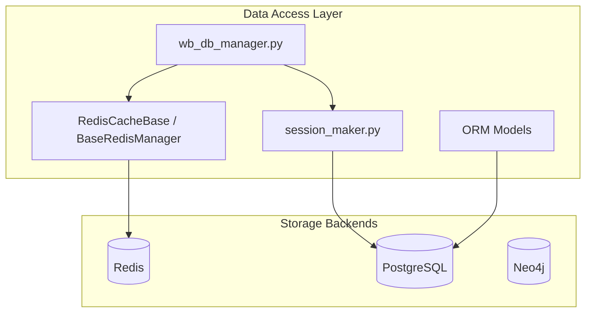
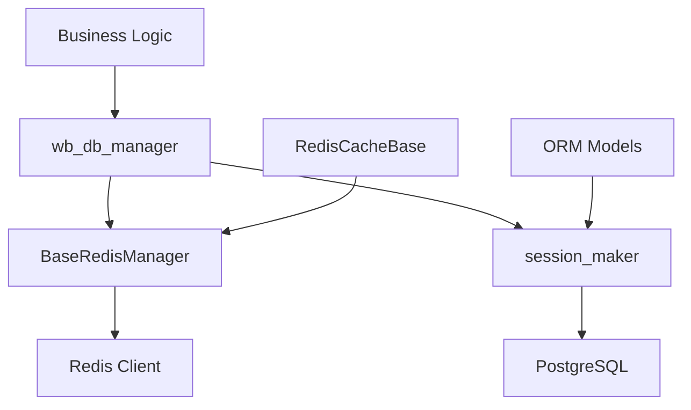
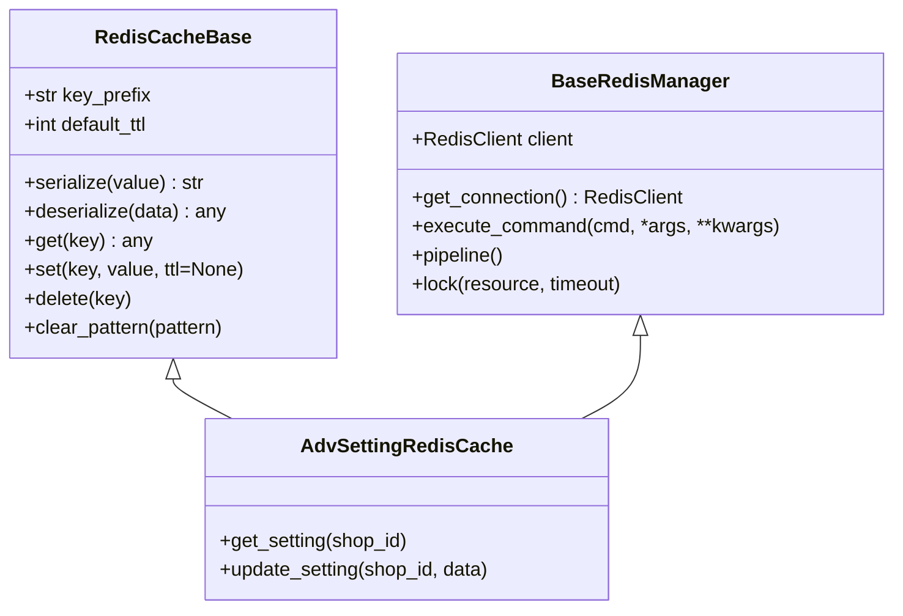
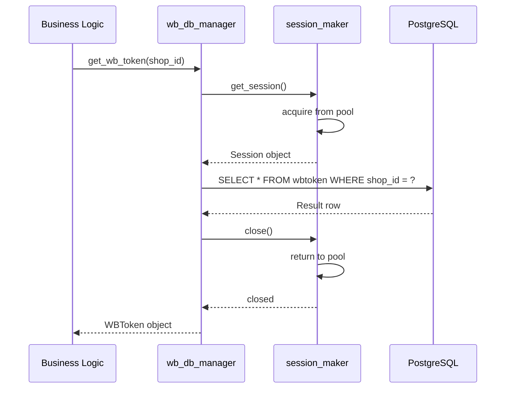
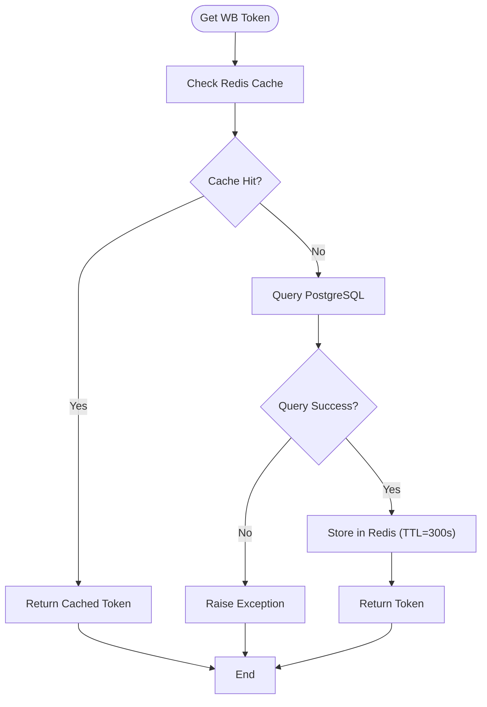
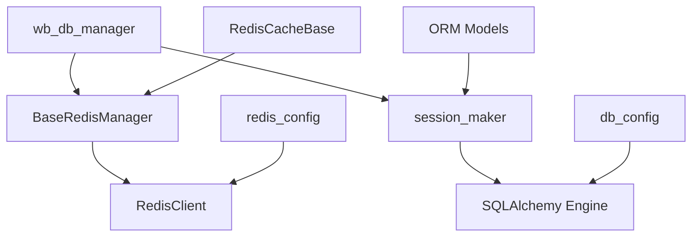

# Repository Pattern and Data Access Layer

<cite>
**Referenced Files in This Document**   
- [app/core/redis_cache/redis_cache_base.py](file://app/core/redis_cache/redis_cache_base.py)
- [app/core/redis_manager/base_redis_manager.py](file://app/core/redis_manager/base_redis_manager.py)
- [app/utils/db/session_maker.py](file://app/utils/db/session_maker.py)
- [app/modules/common_slaves/wildberries/wb_db_manager.py](file://app/modules/common_slaves/wildberries/wb_db_manager.py)
- [app/core/configs/infrastructure_config/redis_config.py](file://app/core/configs/infrastructure_config/redis_config.py)
- [app/core/configs/infrastructure_config/neo4j_config.py](file://app/core/configs/infrastructure_config/neo4j_config.py)
- [app/utils/db/models.py](file://app/utils/db/models.py)
- [app/modules/common_slaves/wildberries/models/models.py](file://app/modules/common_slaves/wildberries/models/models.py)
- [app/core/redis_manager/redis_client.py](file://app/core/redis_manager/redis_client.py)
- [app/utils/db/base.py](file://app/utils/db/base.py)
</cite>

## Table of Contents
1. [Introduction](#introduction)
2. [Project Structure](#project-structure)
3. [Core Components](#core-components)
4. [Architecture Overview](#architecture-overview)
5. [Detailed Component Analysis](#detailed-component-analysis)
6. [Dependency Analysis](#dependency-analysis)
7. [Performance Considerations](#performance-considerations)
8. [Troubleshooting Guide](#troubleshooting-guide)
9. [Conclusion](#conclusion)

## Introduction
The adv-bot system implements a robust repository pattern to abstract data access across multiple storage backends, primarily PostgreSQL via SQLAlchemy and Redis for caching and state management. This document details how base classes such as `BaseRedisManager` and `RedisCacheBase` standardize interactions with Redis, while SQLAlchemy ORM models and session management through `session_maker.py` provide structured access to PostgreSQL. The design enables business logic decoupling, transaction safety, and efficient caching strategies with TTL and invalidation workflows.

## Project Structure
The data access layer is organized across several key directories:
- `app/core/redis_cache` and `app/core/redis_manager`: Contain base Redis abstraction classes
- `app/utils/db`: Houses SQLAlchemy session management and base model definitions
- `app/modules/common_slaves/wildberries`: Implements domain-specific data managers like `wb_db_manager.py`
- `app/core/configs/infrastructure_config`: Stores configuration for Redis, Neo4j, and other services

**Diagram sources**
- [app/core/redis_cache/redis_cache_base.py](file://app/core/redis_cache/redis_cache_base.py)
- [app/utils/db/session_maker.py](file://app/utils/db/session_maker.py)
- [app/modules/common_slaves/wildberries/wb_db_manager.py](file://app/modules/common_slaves/wildberries/wb_db_manager.py)

**Section sources**
- [app/core/redis_cache/redis_cache_base.py](file://app/core/redis_cache/redis_cache_base.py)
- [app/utils/db/session_maker.py](file://app/utils/db/session_maker.py)
- [app/modules/common_slaves/wildberries/wb_db_manager.py](file://app/modules/common_slaves/wildberries/wb_db_manager.py)

## Core Components
The core data access components include:
- `RedisCacheBase`: Abstract base class for Redis-backed caching with TTL and serialization
- `BaseRedisManager`: Provides structured Redis operations with connection handling
- `session_maker.py`: Centralized SQLAlchemy session factory with connection pooling
- ORM models in `utils/db/models.py` and domain-specific models in `common_slaves/wildberries/models`
- `wb_db_manager.py`: Business logic layer using repository pattern to interact with both DB and cache

**Section sources**
- [app/core/redis_cache/redis_cache_base.py](file://app/core/redis_cache/redis_cache_base.py)
- [app/core/redis_manager/base_redis_manager.py](file://app/core/redis_manager/base_redis_manager.py)
- [app/utils/db/session_maker.py](file://app/utils/db/session_maker.py)
- [app/modules/common_slaves/wildberries/wb_db_manager.py](file://app/modules/common_slaves/wildberries/wb_db_manager.py)

## Architecture Overview
The data access architecture follows a layered repository pattern where business logic interacts with data through abstracted managers. These managers use standardized base classes for Redis operations and SQLAlchemy sessions for PostgreSQL, ensuring consistent error handling, transaction management, and caching behavior.

**Diagram sources**
- [app/modules/common_slaves/wildberries/wb_db_manager.py](file://app/modules/common_slaves/wildberries/wb_db_manager.py)
- [app/core/redis_manager/base_redis_manager.py](file://app/core/redis_manager/base_redis_manager.py)
- [app/utils/db/session_maker.py](file://app/utils/db/session_maker.py)

## Detailed Component Analysis

### Redis Abstraction Layer
The Redis abstraction uses two complementary base classes: `RedisCacheBase` for caching semantics and `BaseRedisManager` for general Redis operations.

#### Class Diagram: Redis Base Classes

**Diagram sources**
- [app/core/redis_cache/redis_cache_base.py](file://app/core/redis_cache/redis_cache_base.py)
- [app/core/redis_manager/base_redis_manager.py](file://app/core/redis_manager/base_redis_manager.py)
- [app/core/redis_cache/mixins/main_objects_mixins/adv_setting_redis_cache.py](file://app/core/redis_cache/mixins/main_objects_mixins/adv_setting_redis_cache.py)

**Section sources**
- [app/core/redis_cache/redis_cache_base.py](file://app/core/redis_cache/redis_cache_base.py)
- [app/core/redis_manager/base_redis_manager.py](file://app/core/redis_manager/base_redis_manager.py)

### PostgreSQL Data Access
SQLAlchemy is used for PostgreSQL interactions with a centralized session factory that manages connection pooling and transaction boundaries.

#### Sequence Diagram: Database Query Flow

**Diagram sources**
- [app/modules/common_slaves/wildberries/wb_db_manager.py](file://app/modules/common_slaves/wildberries/wb_db_manager.py)
- [app/utils/db/session_maker.py](file://app/utils/db/session_maker.py)

**Section sources**
- [app/utils/db/session_maker.py](file://app/utils/db/session_maker.py)
- [app/modules/common_slaves/wildberries/wb_db_manager.py](file://app/modules/common_slaves/wildberries/wb_db_manager.py)

### Business Logic Decoupling
The `wb_db_manager.py` exemplifies how business logic is decoupled from storage details by using repository methods that abstract both database and cache operations.

#### Flowchart: Cached Data Retrieval

**Diagram sources**
- [app/modules/common_slaves/wildberries/wb_db_manager.py](file://app/modules/common_slaves/wildberries/wb_db_manager.py)
- [app/core/redis_cache/redis_cache_base.py](file://app/core/redis_cache/redis_cache_base.py)

**Section sources**
- [app/modules/common_slaves/wildberries/wb_db_manager.py](file://app/modules/common_slaves/wildberries/wb_db_manager.py)

## Dependency Analysis
The data access layer has well-defined dependencies between components, with clear separation between caching, database access, and business logic.

**Diagram sources**
- [app/modules/common_slaves/wildberries/wb_db_manager.py](file://app/modules/common_slaves/wildberries/wb_db_manager.py)
- [app/core/redis_manager/base_redis_manager.py](file://app/core/redis_manager/base_redis_manager.py)
- [app/utils/db/session_maker.py](file://app/utils/db/session_maker.py)
- [app/core/configs/infrastructure_config/redis_config.py](file://app/core/configs/infrastructure_config/redis_config.py)

**Section sources**
- [app/core/redis_manager/base_redis_manager.py](file://app/core/redis_manager/base_redis_manager.py)
- [app/utils/db/session_maker.py](file://app/utils/db/session_maker.py)
- [app/core/configs/infrastructure_config/redis_config.py](file://app/core/configs/infrastructure_config/redis_config.py)

## Performance Considerations
The system employs several performance optimizations:
- **Connection pooling**: SQLAlchemy engine reuses database connections
- **Read/write separation**: Not explicitly implemented but possible through session routing
- **Indexing**: Alembic migrations show creation of indexes on frequently queried fields like `shop_id`
- **Caching strategies**: TTL-based expiration and pattern-based cache invalidation
- **Batch operations**: Redis pipelines used for multiple operations

The `session_maker.py` configures connection pool size and overflow settings, while Redis operations use pipelining in critical paths. Cache invalidation follows a write-through pattern where updates to PostgreSQL trigger corresponding cache invalidation.

**Section sources**
- [app/utils/db/session_maker.py](file://app/utils/db/session_maker.py)
- [app/core/redis_manager/base_redis_manager.py](file://app/core/redis_manager/base_redis_manager.py)
- [alembic/versions/42cfd1a692b5_add_shop_id_index_to_wbtoken.py](file://alembic/versions/42cfd1a692b5_add_shop_id_index_to_wbtoken.py)

## Troubleshooting Guide
Common issues and their solutions:
- **Redis connection timeouts**: Check `redis_config.py` settings and network connectivity
- **Database connection pool exhaustion**: Adjust pool size in `session_maker.py`
- **Cache stale data**: Verify TTL settings and invalidation logic in `RedisCacheBase`
- **Transaction failures**: Ensure proper session handling and error recovery in `wb_db_manager.py`
- **Serialization errors**: Confirm data types are compatible with Redis storage in `redis_cache_base.py`

**Section sources**
- [app/core/redis_cache/redis_cache_base.py](file://app/core/redis_cache/redis_cache_base.py)
- [app/utils/db/session_maker.py](file://app/utils/db/session_maker.py)
- [app/modules/common_slaves/wildberries/wb_db_manager.py](file://app/modules/common_slaves/wildberries/wb_db_manager.py)

## Conclusion
The adv-bot system implements a comprehensive repository pattern that effectively abstracts data access across Redis and PostgreSQL. The use of base classes like `RedisCacheBase` and `BaseRedisManager` standardizes caching operations, while SQLAlchemy session management provides reliable database interactions. Business logic in components like `wb_db_manager.py` remains decoupled from storage details, enabling maintainable and testable code. The architecture supports performance optimizations through connection pooling, indexing, and strategic caching with proper TTL and invalidation policies.