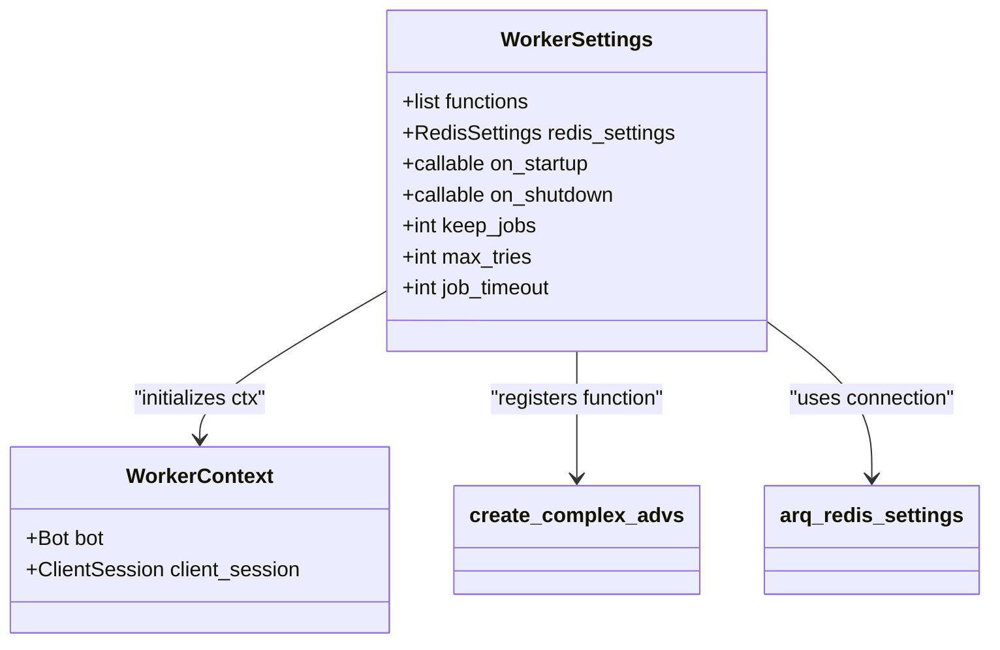
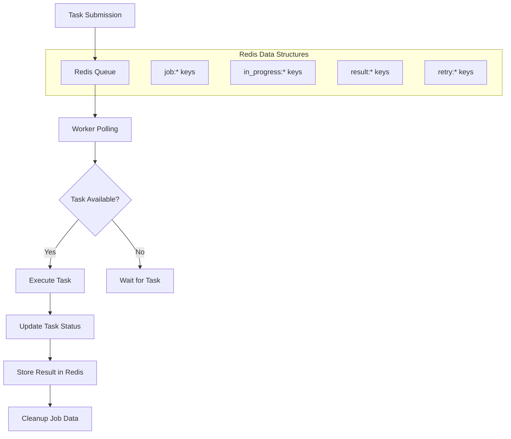
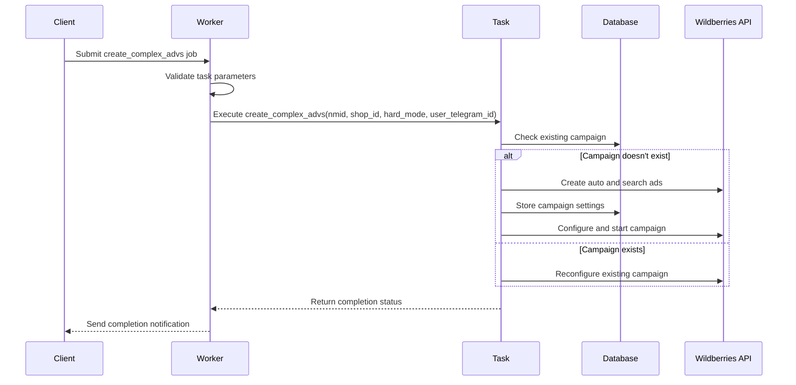
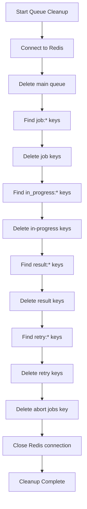
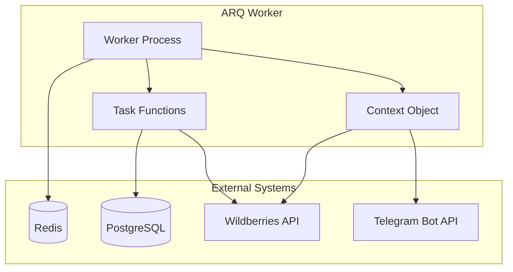
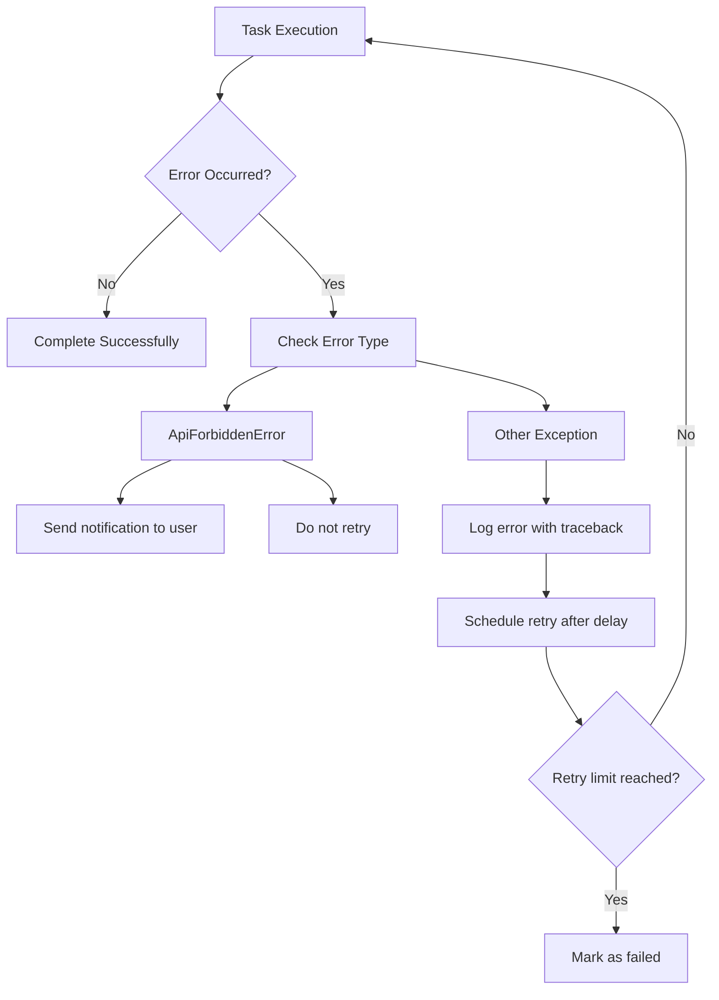
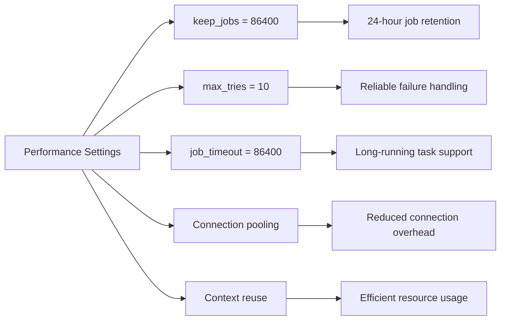

# ARQ Workers

<cite>
**Referenced Files in This Document**   
- [workers.py](file://app/arq_workers/workers.py)
- [arq_redis_settings.py](file://app/arq_workers/arq_redis_settings.py)
- [clear_queues.py](file://app/arq_workers/clear_queues.py)
- [tasks.py](file://app/modules/adv_creator/backend/tasks.py)
- [main_manager.py](file://app/modules/adv_creator/backend/main_manager.py)
</cite>

## Table of Contents
1. [Introduction](#introduction)
2. [Worker Architecture](#worker-architecture)
3. [Redis-Based Job Queuing](#redis-based-job-queuing)
4. [Task Definitions and Execution](#task-definitions-and-execution)
5. [Queue Maintenance](#queue-maintenance)
6. [System Integration](#system-integration)
7. [Error Handling and Retry Mechanisms](#error-handling-and-retry-mechanisms)
8. [Performance Optimization](#performance-optimization)
9. [Troubleshooting Common Issues](#troubleshooting-common-issues)
10. [Scaling and Monitoring](#scaling-and-monitoring)

## Introduction
The ARQ Workers module in the adv-bot system provides a robust asynchronous task processing framework for handling background operations such as campaign updates, data synchronization, and machine learning predictions. Built on the ARQ library with Redis as the message broker, this module enables reliable, fault-tolerant execution of long-running tasks while maintaining system responsiveness. The architecture is designed to handle high-load scenarios with configurable retry mechanisms, job persistence, and comprehensive error handling.

## Worker Architecture

The ARQ worker architecture is implemented in `workers.py` and follows a structured configuration pattern that defines worker behavior, lifecycle hooks, and task registration. The core component is the `WorkerSettings` class that configures the ARQ worker instance with essential parameters for operation.

**Diagram sources**
- [workers.py](file://app/arq_workers/workers.py#L34-L48)
- [arq_redis_settings.py](file://app/arq_workers/arq_redis_settings.py#L1-L6)

**Section sources**
- [workers.py](file://app/arq_workers/workers.py#L1-L50)

## Redis-Based Job Queuing

The ARQ workers use Redis as the backend for job queuing and state management. The connection settings are centralized in `arq_redis_settings.py`, which imports configuration from the application's settings module to establish the Redis connection with the master host.

**Diagram sources**
- [arq_redis_settings.py](file://app/arq_workers/arq_redis_settings.py#L1-L6)
- [clear_queues.py](file://app/arq_workers/clear_queues.py#L1-L70)

**Section sources**
- [arq_redis_settings.py](file://app/arq_workers/arq_redis_settings.py#L1-L8)

## Task Definitions and Execution

The ARQ workers execute registered functions asynchronously, with the primary task being `create_complex_advs` which handles the creation of complex advertising campaigns. This task is defined in the `tasks.py` module and is registered in the worker settings for execution.

**Diagram sources**
- [workers.py](file://app/arq_workers/workers.py#L34-L48)
- [tasks.py](file://app/modules/adv_creator/backend/tasks.py#L19-L38)
- [main_manager.py](file://app/modules/adv_creator/backend/main_manager.py#L118-L232)

**Section sources**
- [tasks.py](file://app/modules/adv_creator/backend/tasks.py#L19-L38)
- [main_manager.py](file://app/modules/adv_creator/backend/main_manager.py#L118-L232)

## Queue Maintenance

The `clear_queues.py` script provides essential maintenance functionality for the ARQ job system, allowing administrators to clean up Redis queues and remove stale job data. This is critical for preventing memory bloat and resolving task deadlocks.

**Diagram sources**
- [clear_queues.py](file://app/arq_workers/clear_queues.py#L1-L70)

**Section sources**
- [clear_queues.py](file://app/arq_workers/clear_queues.py#L1-L70)

## System Integration

The ARQ workers integrate with the core system through Redis for task queuing and PostgreSQL for persistent data storage. During startup, the worker initializes a Telegram bot instance and HTTP client session that are shared across all tasks via the context object.

**Diagram sources**
- [workers.py](file://app/arq_workers/workers.py#L15-L32)
- [tasks.py](file://app/modules/adv_creator/backend/tasks.py#L19-L38)

## Error Handling and Retry Mechanisms

The ARQ worker implements comprehensive error handling with automatic retry capabilities. The configuration specifies a maximum of 10 retry attempts with a job timeout of 24 hours, ensuring that transient failures do not result in permanent task failure.

**Diagram sources**
- [tasks.py](file://app/modules/adv_creator/backend/tasks.py#L19-L38)
- [workers.py](file://app/arq_workers/workers.py#L34-L48)

**Section sources**
- [tasks.py](file://app/modules/adv_creator/backend/tasks.py#L19-L38)

## Performance Optimization

The worker configuration includes several performance optimization settings to handle high-load scenarios efficiently. Jobs are retained in Redis for 24 hours, allowing for result retrieval and audit trails. The worker also manages resources carefully by properly closing HTTP sessions and bot connections during shutdown.

**Diagram sources**
- [workers.py](file://app/arq_workers/workers.py#L34-L48)

## Troubleshooting Common Issues

Common issues with the ARQ worker system include task deadlocks and Redis memory bloat. The `clear_queues.py` script provides a solution for both problems by completely clearing the job queues and associated data structures.

### Task Deadlock Resolution
When tasks become stuck in the "in_progress" state due to worker crashes, they can prevent new tasks from being processed. The resolution involves:
1. Identifying stuck tasks using Redis keys with the "in_progress:" prefix
2. Clearing the in-progress keys using the queue maintenance script
3. Restarting the worker process

### Redis Memory Bloat Prevention
To prevent Redis memory issues:
- Regularly run the queue cleanup script
- Monitor Redis memory usage
- Adjust the `keep_jobs` parameter based on retention requirements
- Implement monitoring for queue length

**Section sources**
- [clear_queues.py](file://app/arq_workers/clear_queues.py#L1-L70)

## Scaling and Monitoring

For production environments, the ARQ worker system can be scaled horizontally by running multiple worker processes. Each worker connects to the same Redis instance and processes jobs from the shared queue, providing load balancing and redundancy.

Monitoring should focus on:
- Queue length and growth rate
- Job processing time and success/failure rates
- Redis memory usage
- Worker process health

The system's design supports expert-level scaling strategies including:
- Dedicated worker pools for different task types
- Priority-based queuing
- Dynamic worker allocation based on load

**Section sources**
- [workers.py](file://app/arq_workers/workers.py#L1-L50)
- [clear_queues.py](file://app/arq_workers/clear_queues.py#L1-L70)