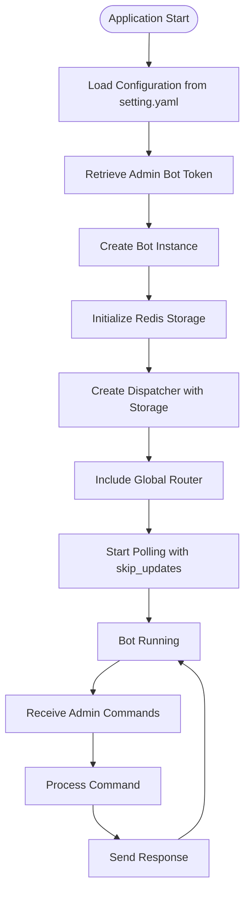
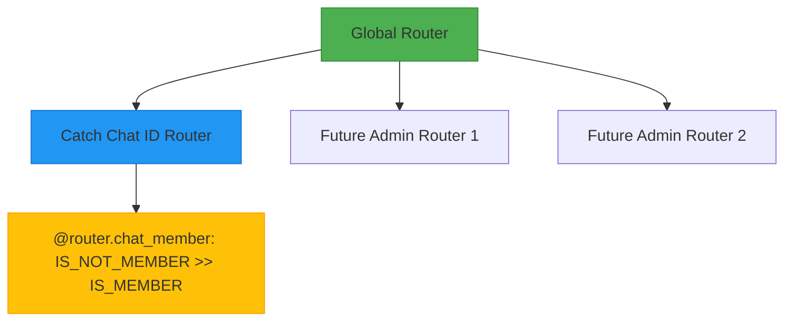
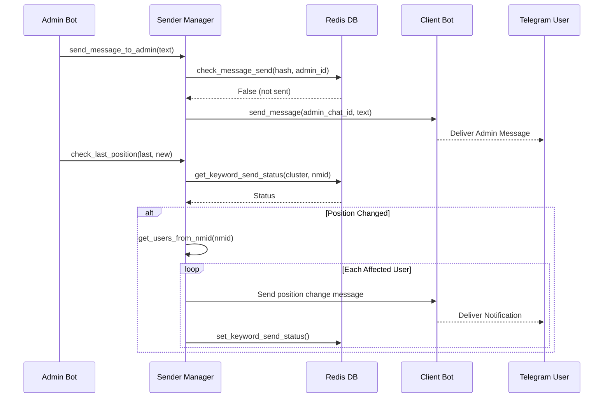
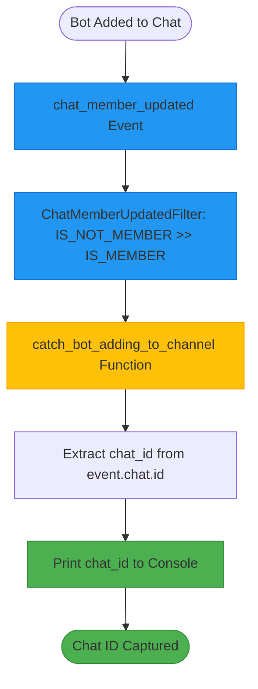
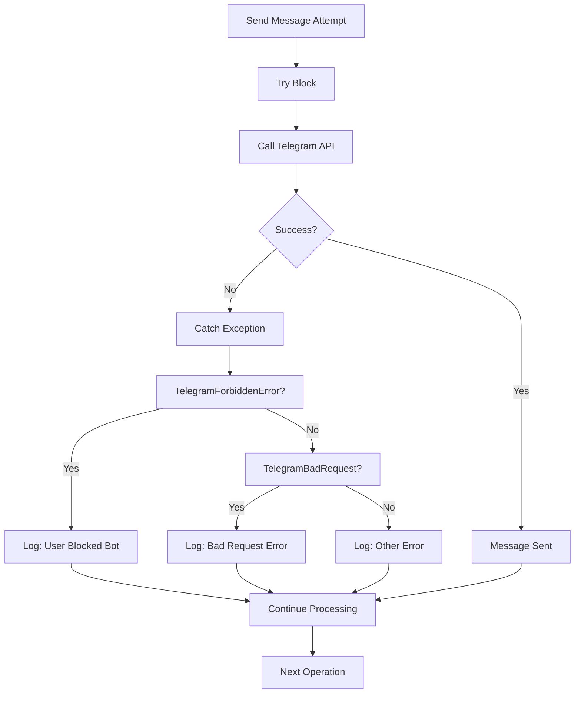

# Admin Bot

<cite>
**Referenced Files in This Document**   
- [bot_manager.py](file://app/admin_bot/bot_manager.py)
- [global_router.py](file://app/admin_bot/global_router.py)
- [catch_chat_id.py](file://app/admin_bot/catch_chat_id.py)
- [run.py](file://app/admin_bot/run.py)
- [sender/sender_manager.py](file://app/admin_bot/sender/sender_manager.py)
- [sender/redis_manager.py](file://app/admin_bot/sender/redis_manager.py)
- [sender/utils/db/models.py](file://app/admin_bot/sender/utils/db/models.py)
- [sender/utils/db/db.py](file://app/admin_bot/sender/utils/db/db.py)
</cite>

## Table of Contents
1. [Introduction](#introduction)
2. [Bot Lifecycle Management](#bot-lifecycle-management)
3. [Command Routing Architecture](#command-routing-architecture)
4. [Sender Subsystem for Bulk Messaging](#sender-subsystem-for-bulk-messaging)
5. [Chat ID Capture Mechanism](#chat-id-capture-mechanism)
6. [Database and Redis Integration](#database-and-redis-integration)
7. [Admin Command Implementation Patterns](#admin-command-implementation-patterns)
8. [Error Handling and Concurrency](#error-handling-and-concurrency)
9. [Security and Scalability Considerations](#security-and-scalability-considerations)
10. [Conclusion](#conclusion)

## Introduction

The Admin Bot module in the adv-bot system serves as the central administrative interface for system monitoring, operational control, and administrative functions. This module enables administrators to manage users, monitor service status, and coordinate system operations through a Telegram-based interface. The architecture is designed to support secure, scalable, and reliable administrative operations with robust error handling and message delivery mechanisms.

**Section sources**
- [bot_manager.py](file://app/admin_bot/bot_manager.py#L1-L9)
- [run.py](file://app/admin_bot/run.py#L1-L31)

## Bot Lifecycle Management

The Admin Bot's lifecycle is managed through the bot_manager.py and run.py modules, which handle initialization, configuration, and execution. The bot instance is created with credentials retrieved from external configuration files, ensuring secure access to the Telegram API. The run.py module implements the main execution loop using aiogram's Dispatcher with Redis-based storage for state management, enabling persistence across sessions.

The bot uses RedisStorage for FSM (Finite State Machine) storage, allowing it to maintain conversation states across interactions. This approach supports complex administrative workflows while ensuring reliability through persistent state storage. The configuration includes skip_updates=True during polling, which prevents processing outdated updates upon restart.



**Diagram sources**
- [bot_manager.py](file://app/admin_bot/bot_manager.py#L1-L9)
- [run.py](file://app/admin_bot/run.py#L1-L31)

**Section sources**
- [bot_manager.py](file://app/admin_bot/bot_manager.py#L1-L9)
- [run.py](file://app/admin_bot/run.py#L1-L31)

## Command Routing Architecture

The command routing system is implemented through the global_router.py module, which serves as the central routing hub for all administrative commands. This router follows a modular design pattern, importing and including specialized routers for different administrative functions. Currently, it includes the catch_chat_id router, demonstrating a scalable architecture that can accommodate additional administrative features.

The routing architecture uses aiogram's Router class to organize command handlers, enabling separation of concerns and maintainable code structure. This approach allows for easy extension of administrative capabilities by adding new routers for specific functions such as user management, service monitoring, or configuration changes.



**Diagram sources**
- [global_router.py](file://app/admin_bot/global_router.py#L1-L9)
- [catch_chat_id.py](file://app/admin_bot/catch_chat_id.py#L1-L12)

**Section sources**
- [global_router.py](file://app/admin_bot/global_router.py#L1-L9)
- [catch_chat_id.py](file://app/admin_bot/catch_chat_id.py#L1-L12)

## Sender Subsystem for Bulk Messaging

The sender subsystem, implemented in sender_manager.py, provides comprehensive messaging capabilities for administrative notifications and bulk communications. This subsystem supports multiple messaging patterns including direct admin alerts, user-specific notifications, and position change alerts based on product indexing status.

The sender manager integrates with various system components including the client bot instance, data manager for user retrieval, and Redis for message deduplication. It implements sophisticated logic for detecting when products enter or exit indexing, triggering appropriate notifications to affected users. The system uses message hashing and Redis sets to prevent duplicate message delivery, ensuring efficient communication.



**Diagram sources**
- [sender/sender_manager.py](file://app/admin_bot/sender/sender_manager.py#L1-L127)

**Section sources**
- [sender/sender_manager.py](file://app/admin_bot/sender/sender_manager.py#L1-L127)

## Chat ID Capture Mechanism

The catch_chat_id.py module implements a specialized handler for capturing chat IDs when the bot is added to new channels or groups. This functionality is critical for administrative operations that require knowledge of specific chat contexts. The handler uses aiogram's chat_member_updated filter to detect when the bot transitions from not being a member to becoming a member of a chat.

When triggered, the handler extracts the chat ID from the update event and prints it to the console. This simple but effective mechanism allows administrators to easily obtain chat IDs for configuration purposes without requiring manual extraction. The captured chat IDs can then be used for targeted messaging, monitoring, or integration with other system components.



**Diagram sources**
- [catch_chat_id.py](file://app/admin_bot/catch_chat_id.py#L1-L12)

**Section sources**
- [catch_chat_id.py](file://app/admin_bot/catch_chat_id.py#L1-L12)

## Database and Redis Integration

The Admin Bot module integrates with both database and Redis systems to support its administrative functions. The sender subsystem uses SQLAlchemy models for storing Telegram file references in the database, while leveraging Redis for real-time coordination and message deduplication.

The database integration is implemented through the TelegramFile model, which stores file hashes and their corresponding Telegram file IDs. This allows for efficient file reference management and deduplication. The Redis integration provides fast, atomic operations for tracking message delivery status and preventing duplicate notifications.

```mermaid
erDiagram
TELEGRAM_FILE {
string file_telegram_id PK
string dhash
bigint bot_id
}
REDIS_DB {
string telegram_file_dhash:dhash
set send_telegram_messages
string keyword_send_status:cluster_name:nmid
}
TELEGRAM_FILE ||--o{ REDIS_DB : "references"
```

**Diagram sources**
- [sender/utils/db/models.py](file://app/admin_bot/sender/utils/db/models.py#L1-L12)
- [sender/utils/db/db.py](file://app/admin_bot/sender/utils/db/db.py#L1-L26)
- [sender/redis_manager.py](file://app/admin_bot/sender/redis_manager.py#L1-L29)

**Section sources**
- [sender/utils/db/models.py](file://app/admin_bot/sender/utils/db/models.py#L1-L12)
- [sender/utils/db/db.py](file://app/admin_bot/sender/utils/db/db.py#L1-L26)
- [sender/redis_manager.py](file://app/admin_bot/sender/redis_manager.py#L1-L29)

## Admin Command Implementation Patterns

The Admin Bot implements several design patterns for handling administrative commands. The modular router pattern separates concerns by delegating specific functionality to dedicated routers. The event-driven pattern captures system events like chat membership changes and triggers appropriate actions.

For messaging operations, the sender subsystem uses a template-based approach where message functions are passed as parameters to sender functions. This pattern enables flexible message composition while maintaining separation between message content and delivery logic. The system also implements a status tracking pattern using Redis to monitor the state of various operations and prevent redundant notifications.

The error handling pattern follows a defensive programming approach, with comprehensive exception handling around all external API calls. This ensures that transient failures do not disrupt the overall system operation. The implementation also includes logging for all critical operations, providing an audit trail for administrative actions.

**Section sources**
- [sender/sender_manager.py](file://app/admin_bot/sender/sender_manager.py#L1-L127)
- [catch_chat_id.py](file://app/admin_bot/catch_chat_id.py#L1-L12)
- [global_router.py](file://app/admin_bot/global_router.py#L1-L9)

## Error Handling and Concurrency

The Admin Bot implements robust error handling mechanisms to ensure reliable operation in production environments. The sender subsystem includes comprehensive exception handling around all Telegram API calls, with specific handling for common error types like TelegramForbiddenError (when users block the bot) and TelegramBadRequest.

For concurrency control, the system uses Redis to coordinate message delivery across multiple instances or processes. The check_message_send and set_message_send functions provide atomic operations to prevent duplicate message delivery. This is particularly important for bulk messaging operations that might be triggered simultaneously from different sources.

The implementation also includes rate limiting through asyncio.sleep(1) between messages, preventing the bot from exceeding Telegram's rate limits. This approach ensures compliance with API usage policies while maintaining reliable delivery.



**Diagram sources**
- [sender/sender_manager.py](file://app/admin_bot/sender/sender_manager.py#L1-L127)

**Section sources**
- [sender/sender_manager.py](file://app/admin_bot/sender/sender_manager.py#L1-L127)

## Security and Scalability Considerations

The Admin Bot architecture incorporates several security and scalability features. Configuration credentials are externalized and loaded from secure files, preventing hardcoded secrets in the source code. The use of Redis for coordination enables horizontal scaling of administrative functions across multiple instances.

The message deduplication system prevents spamming users with duplicate notifications, enhancing user experience and reducing API usage. The modular design allows for incremental addition of new administrative features without disrupting existing functionality.

For security, the system implements principle of least privilege by separating administrative functions into distinct modules with limited responsibilities. The chat ID capture mechanism provides a secure way to obtain chat identifiers without requiring administrators to manually extract them from URLs or other sources.

The architecture supports future enhancements such as authentication for administrative commands, role-based access control, and encrypted message storage.

**Section sources**
- [bot_manager.py](file://app/admin_bot/bot_manager.py#L1-L9)
- [run.py](file://app/admin_bot/run.py#L1-L31)
- [sender/sender_manager.py](file://app/admin_bot/sender/sender_manager.py#L1-L127)

## Conclusion

The Admin Bot module provides a comprehensive administrative interface for the adv-bot system, enabling efficient system management, monitoring, and operational control. Its modular architecture, robust error handling, and integration with database and Redis systems make it a reliable component for administrative tasks.

The implementation demonstrates best practices in bot development, including secure credential management, efficient message delivery, and scalable design patterns. The system's ability to capture chat IDs, send targeted notifications, and coordinate operations through Redis makes it well-suited for complex administrative workflows.

Future enhancements could include additional security features, more sophisticated notification rules, and expanded administrative capabilities through additional command routers.