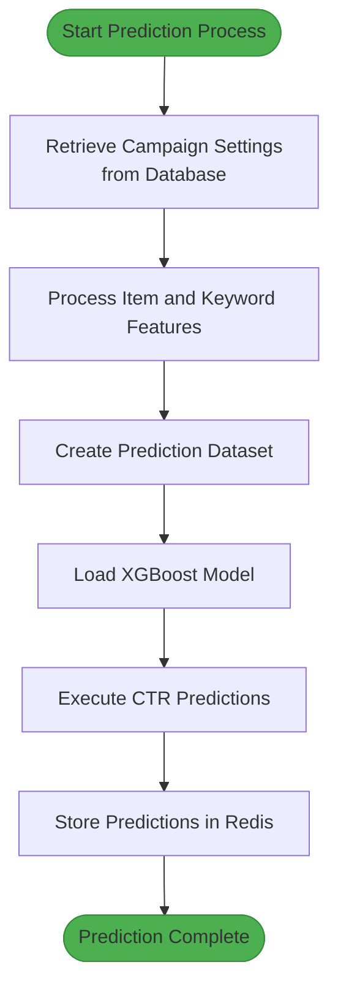
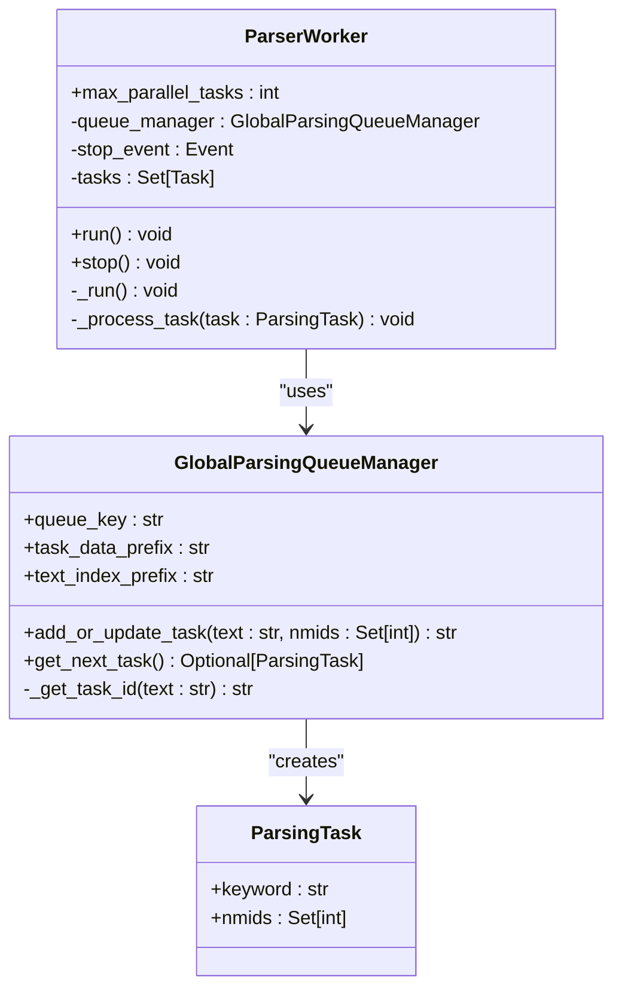
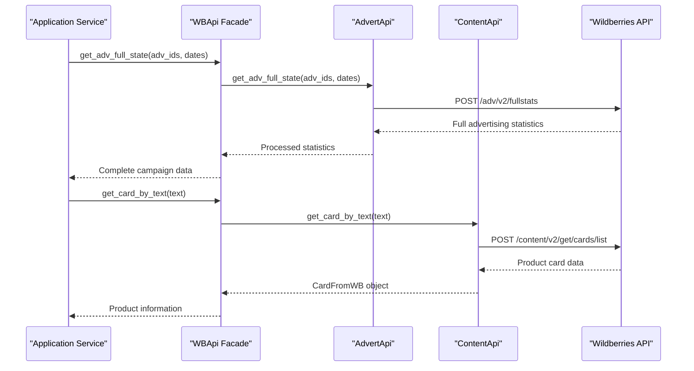
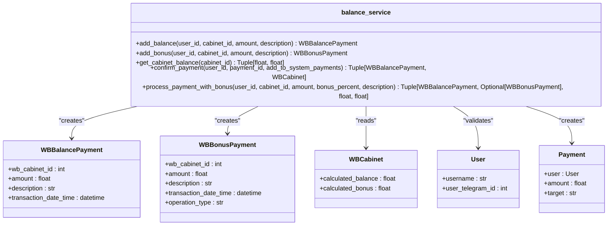

# Application Modules

<cite>
**Referenced Files in This Document**   
- [ML.py](file://app/modules/wb_adv_updater/ML.py)
- [parser_worker.py](file://app/modules/wb_keywords_parser/parser_worker.py)
- [api.py](file://app/modules/common_slaves/wildberries/api/api.py)
- [wb_shop.py](file://app/modules/shop_runner/wb_shop.py)
- [balance_service.py](file://app/modules/balance_manager/balance_service.py)
- [data_manager.py](file://app/modules/wb_adv_updater/data_manager.py)
- [global_parsing_queue_manager.py](file://app/modules/wb_keywords_parser/global_parsing_queue_manager.py)
- [settings_master.py](file://app/settings/settings_master.py)
</cite>

## Table of Contents
1. [Introduction](#introduction)
2. [wb_adv_updater Module](#wb_adv_updater-module)
3. [wb_keywords_parser Module](#wb_keywords_parser-module)
4. [common_slaves/wildberries Module](#common_slaveswildberries-module)
5. [shop_runner Module](#shop_runner-module)
6. [balance_manager Module](#balance_manager-module)
7. [Module Configuration and Extensibility](#module-configuration-and-extensibility)
8. [Common Issues and Solutions](#common-issues-and-solutions)
9. [Conclusion](#conclusion)

## Introduction
The adv-bot system consists of several key application modules that work together to automate advertising campaigns on the Wildberries platform. This document provides a detailed analysis of the core modules: wb_adv_updater for campaign automation, wb_keywords_parser for keyword extraction, common_slaves/wildberries for platform integration, shop_runner for shop-level operations, and balance_manager for financial transactions. Each module implements specific domain models, service interfaces, and interaction patterns with core services. The documentation includes workflow diagrams for beginners and technical details on algorithmic implementations and performance tuning for experienced developers.

## wb_adv_updater Module

The wb_adv_updater module implements automated bid optimization for advertising campaigns using machine learning algorithms. The core functionality is centered around the ML.py file which contains the Predictor class responsible for CTR (Click-Through Rate) prediction.

The module follows a data processing pipeline that begins with retrieving campaign settings from the database using SQLAlchemy queries. It then collects item features and keyword features to create a comprehensive dataset for prediction. The prediction process uses XGBoost models loaded from storage to forecast CTR values for different keyword-campaign combinations.

Bid optimization is performed through a multi-step process:
1. Data collection from both database and Redis cache
2. Feature engineering including average vector calculation for product items
3. CTR prediction using pre-trained machine learning models
4. Redis-based storage of predicted values for real-time access

The module implements asynchronous processing using asyncio to handle multiple campaigns concurrently while managing resource usage through semaphores. Error handling is comprehensive, with detailed logging at each processing stage to facilitate debugging and monitoring.



**Diagram sources**
- [ML.py](file://app/modules/wb_adv_updater/ML.py#L1-L257)

**Section sources**
- [ML.py](file://app/modules/wb_adv_updater/ML.py#L1-L257)

## wb_keywords_parser Module

The wb_keywords_parser module handles keyword extraction and position tracking through web scraping operations. The parser_worker.py file implements a worker-based architecture that processes parsing tasks from a global queue.

The module features a concurrent processing model with configurable parallelism (default: 3 tasks). Each ParserWorker instance manages its own task processing loop, retrieving tasks from the GlobalParsingQueueManager and executing parsing operations through the wb_parser component.

Key architectural elements include:
- Task-based processing model with ParsingTask objects
- Global queue management with Redis-backed persistence
- Rate limiting and delay configuration via settings
- Error handling with retry mechanisms for failed tasks

The parsing process involves searching for product positions across multiple pages of search results, with intelligent queue management that prioritizes previously found pages while systematically exploring new ones. The module integrates with Redis to cache parsing results and avoid redundant operations.



**Diagram sources**
- [parser_worker.py](file://app/modules/wb_keywords_parser/parser_worker.py#L1-L80)
- [global_parsing_queue_manager.py](file://app/modules/wb_keywords_parser/global_parsing_queue_manager.py#L1-L131)

**Section sources**
- [parser_worker.py](file://app/modules/wb_keywords_parser/parser_worker.py#L1-L80)
- [global_parsing_queue_manager.py](file://app/modules/wb_keywords_parser/global_parsing_queue_manager.py#L1-L131)

## common_slaves/wildberries Module

The common_slaves/wildberries module provides the primary integration layer with the Wildberries API. The api.py file implements a comprehensive client for interacting with Wildberries advertising endpoints, organized into specialized API classes.

The module architecture follows a service-oriented pattern with distinct API classes for different functionality domains:
- AdvertApi: Handles advertising campaign operations including CPM management, keyword settings, and campaign status
- ContentApi: Manages product content operations such as card retrieval and category information
- WBApi: Acts as a facade that composes the specialized APIs

Key features include:
- Decorator-based error handling with retry logic
- Type-safe data classes for API responses
- Batch processing for efficient API usage
- Authentication and authorization management

The API client supports critical operations such as retrieving full advertising statistics, managing keyword bids, and fetching product information. It implements pagination and batching strategies to handle large datasets efficiently while respecting API rate limits.



**Diagram sources**
- [api.py](file://app/modules/common_slaves/wildberries/api/api.py#L1-L477)

**Section sources**
- [api.py](file://app/modules/common_slaves/wildberries/api/api.py#L1-L477)

## shop_runner Module

The shop_runner module orchestrates shop-level operations through the WBShop class. This module serves as the execution engine for all automated processes related to a specific Wildberries shop.

The architecture follows an active object pattern where the WBShop instance runs multiple concurrent coroutines that handle different aspects of shop management. The run() method coordinates these coroutines using asyncio.gather(), ensuring they execute in parallel while sharing the same execution context.

Key responsibilities include:
- Maintaining shop connectivity through periodic ping operations
- Coordinating keyword parsing operations
- Synchronizing advertising data between Wildberries and the local database
- Managing CPM bid updates
- Updating comprehensive sales statistics
- Executing automated campaign updates

The module implements a heartbeat mechanism through the _alive_worker_run() method, which periodically updates the shop's presence in Redis to indicate it's still active. This prevents stale shop instances from accumulating in the system.

```mermaid
flowchart TD
WBShop([WBShop Instance]) --> CoroutinesManager["CoroutinesManager"]
WBShop --> RedisManager["RedisShopManager"]
CoroutinesManager --> Parsing["parsing_keywords_run()"]
CoroutinesManager --> AdvData["update_advs_data_from_wb_to_pg()"]
CoroutinesManager --> CardData["update_cards_data_from_wb_to_pg()"]
CoroutinesManager --> CPM["update_cpm_bid()"]
CoroutinesManager --> SaleStat["update_common_sale_stat()"]
CoroutinesManager --> FullAdv["update_full_adv_stat()"]
CoroutinesManager --> AutoUpdate["adv_settings_auto_update()"]
CoroutinesManager --> TopKey["update_top_key_in_advs()"]
WBShop --> AliveWorker["_alive_worker_run()"]
AliveWorker --> RedisManager:::highlight
RedisManager:::highlight --> "Renew TTL in Redis"
class WBShop:::highlight
class RedisManager:::highlight
style WBShop fill:#2196F3,stroke:#1976D2
style RedisManager:::highlight fill:#FFC107,stroke:#FFA000
style AliveWorker fill:#4CAF50,stroke:#388E3C
```

**Diagram sources**
- [wb_shop.py](file://app/modules/shop_runner/wb_shop.py#L1-L43)

**Section sources**
- [wb_shop.py](file://app/modules/shop_runner/wb_shop.py#L1-L43)

## balance_manager Module

The balance_manager module handles all financial transactions within the adv-bot system. The balance_service.py file implements a comprehensive service layer for managing user balances, cabinet balances, and payment processing.

The module follows a transactional design pattern with atomic operations that ensure data consistency across related database tables. Key entities include:
- WBBalancePayment: Records of balance additions
- WBBonusPayment: Records of bonus allocations
- Payment: General payment tracking
- WBCabinet: Represents Wildberries advertising cabinets

Core operations include:
- Adding balance to a cabinet with user verification
- Awarding bonus amounts with configurable percentages
- Retrieving current balance and bonus totals
- Confirming payments and integrating with the main payment system

The service implements comprehensive validation to prevent invalid operations, including checks for positive amounts, existing users, and valid cabinet references. It also provides a composite function (process_payment_with_bonus) that combines balance addition with bonus allocation in a single atomic operation.



**Diagram sources**
- [balance_service.py](file://app/modules/balance_manager/balance_service.py#L1-L236)

**Section sources**
- [balance_service.py](file://app/modules/balance_manager/balance_service.py#L1-L236)

## Module Configuration and Extensibility

The adv-bot system implements a flexible configuration system through the settings module, allowing for runtime customization of module behavior. Configuration options are primarily managed through environment variables and the settings_master.py file, enabling deployment-specific adjustments without code changes.

Key configuration points include:
- PAUSE_AFTER_PARSING: Controls delay between parsing operations to prevent API rate limiting
- MAX_PAGE_LIMIT_PARSER_WORKER: Limits the number of pages scanned during keyword position tracking
- Various timeout and retry settings for API operations

The modules are designed with extensibility in mind, following several patterns:
- Dependency injection through constructor parameters
- Abstract base classes (e.g., ABC_manager) for defining extension points
- Modular architecture with clearly defined interfaces
- Event-driven patterns for hooking into processing pipelines

Extension mechanisms include:
- Custom worker implementations that can be integrated into the shop_runner framework
- Additional API methods that can be added to the common_slaves/wildberries module
- New prediction algorithms that can replace or augment the ML.py implementation
- Alternative storage backends through the Redis manager abstractions

This design allows developers to customize and extend the system's functionality while maintaining compatibility with the core architecture.

## Common Issues and Solutions

The adv-bot system addresses several common operational challenges through implemented solutions:

**Parsing Failures**: The wb_keywords_parser module handles parsing failures through multiple mechanisms:
- Retry logic with exponential backoff for transient API errors
- Task prioritization that separates known and unknown pages
- Comprehensive logging for debugging failed parsing operations
- Circuit breaker patterns to prevent cascading failures

**Budget Overruns**: The system prevents budget overruns through:
- Pre-transaction balance validation
- Real-time balance tracking in Redis
- Transactional updates that ensure atomicity
- Notification systems for low balance conditions

**API Rate Limiting**: The common_slaves/wildberries module manages API rate limits by:
- Implementing configurable delays between requests
- Using batch operations to minimize API calls
- Caching responses to avoid redundant requests
- Monitoring API usage patterns

**Data Consistency**: The balance_manager ensures data consistency through:
- Database transactions for related operations
- Validation checks before processing
- Atomic updates using database constraints
- Regular reconciliation processes

**Concurrency Issues**: The shop_runner module handles concurrency through:
- Proper asyncio synchronization primitives
- Isolation of shop-level operations
- Connection pooling for database access
- Resource limiting to prevent overload

## Conclusion

The adv-bot system's application modules work together to provide a comprehensive solution for Wildberries advertising automation. Each module addresses specific functional domains while maintaining clear interfaces and separation of concerns. The wb_adv_updater enables intelligent bid optimization through machine learning, the wb_keywords_parser extracts valuable market intelligence through systematic scraping, the common_slaves/wildberries module provides robust platform integration, the shop_runner orchestrates shop-level operations, and the balance_manager ensures financial integrity.

The system's architecture balances performance requirements with maintainability, using asynchronous processing for scalability while providing clear extension points for customization. Error handling is comprehensive, with detailed logging and recovery mechanisms for common failure scenarios. The configuration system allows for deployment-specific tuning without code changes, making the system adaptable to different operational requirements.

For developers, the modular design provides clear entry points for extending functionality, whether through new prediction algorithms, additional API integrations, or enhanced financial processing capabilities. The combination of high-level workflow diagrams and detailed technical specifications makes the system accessible to both beginners and experienced developers.