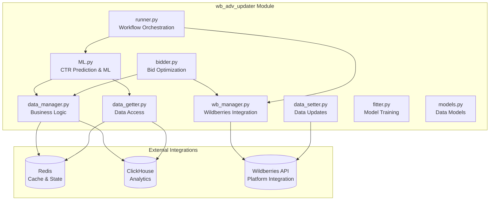
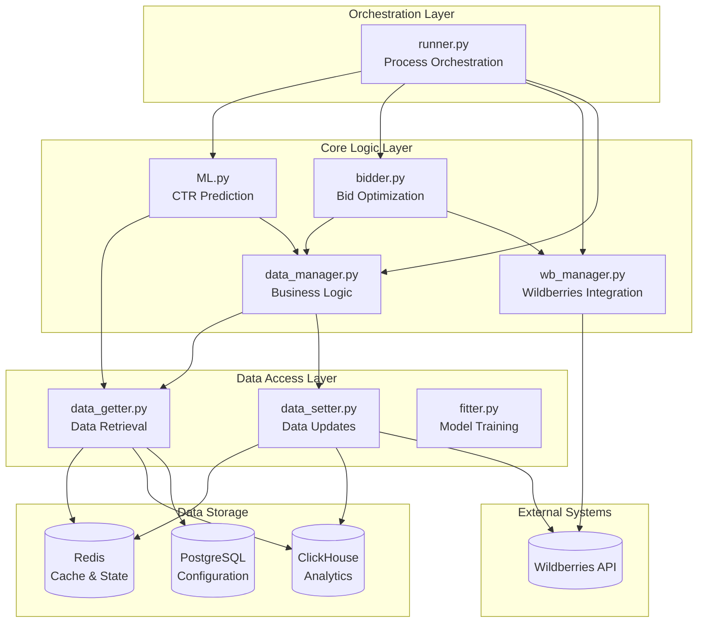
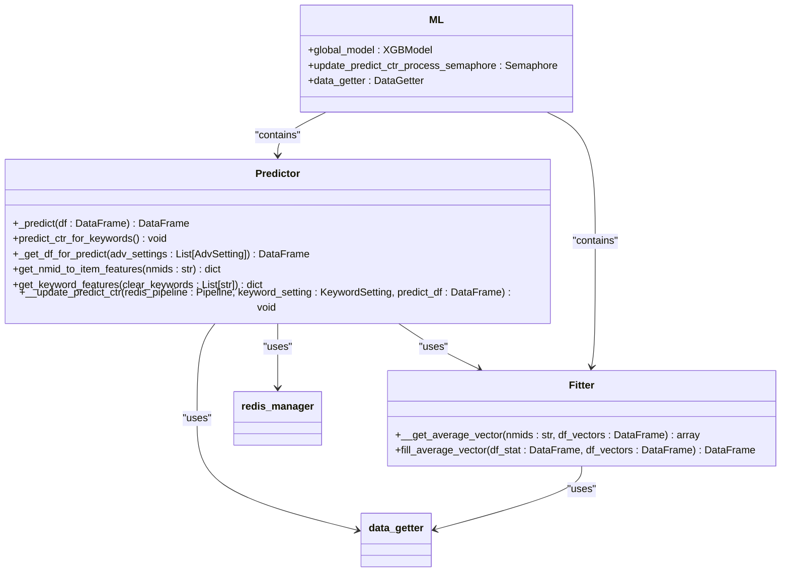
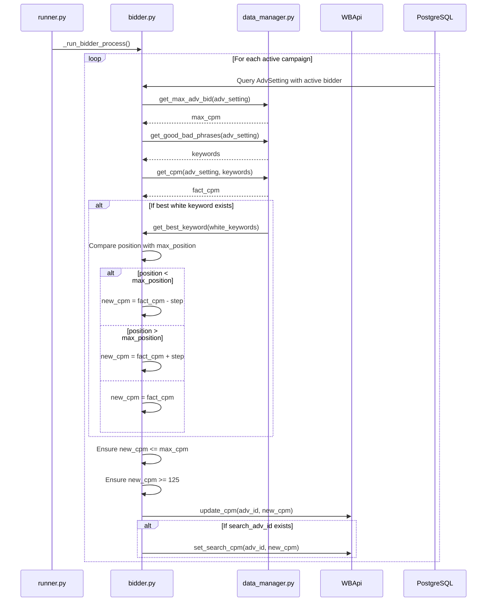
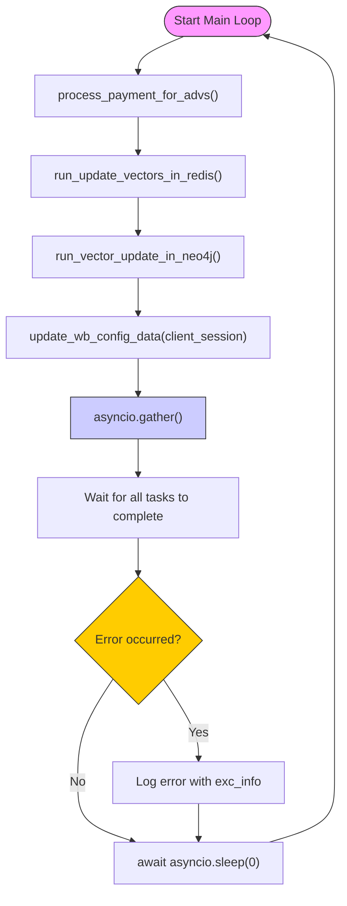
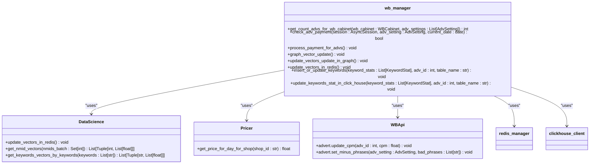
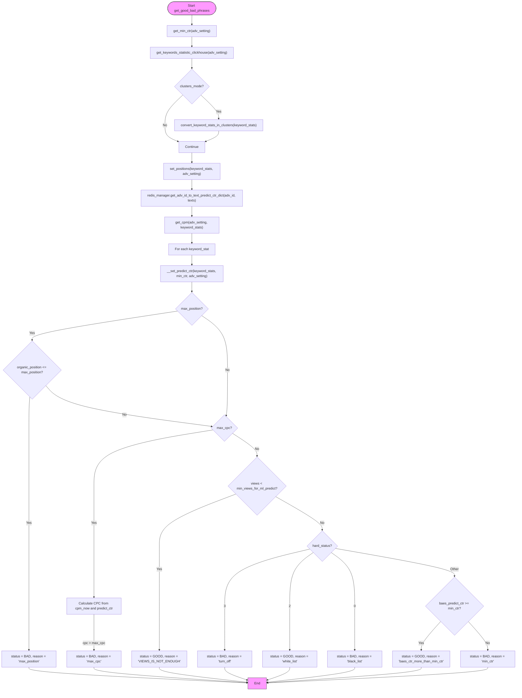
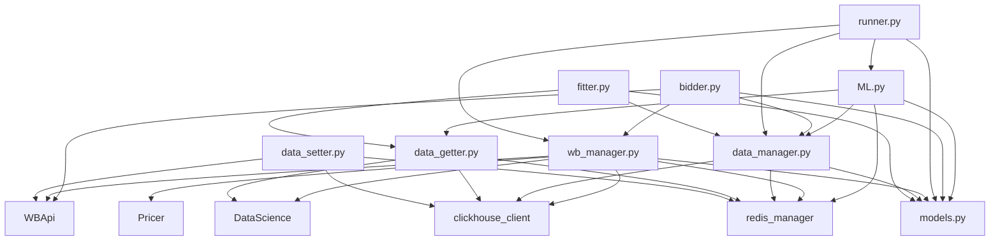

# Campaign Automation

<cite>
**Referenced Files in This Document**   
- [ML.py](file://app/modules/wb_adv_updater/ML.py)
- [bidder.py](file://app/modules/wb_adv_updater/bidder.py)
- [runner.py](file://app/modules/wb_adv_updater/runner.py)
- [wb_manager.py](file://app/modules/wb_adv_updater/wb_manager.py)
- [data_manager.py](file://app/modules/wb_adv_updater/data_manager.py)
- [models.py](file://app/modules/wb_adv_updater/models.py)
- [fitter.py](file://app/modules/wb_adv_updater/fitter.py)
- [ml_common_funcs.py](file://app/modules/wb_adv_updater/ml_common_funcs.py)
- [data_getter.py](file://app/modules/wb_adv_updater/data_getter.py)
- [data_setter.py](file://app/modules/wb_adv_updater/data_setter.py)
</cite>

## Table of Contents
1. [Introduction](#introduction)
2. [Project Structure](#project-structure)
3. [Core Components](#core-components)
4. [Architecture Overview](#architecture-overview)
5. [Detailed Component Analysis](#detailed-component-analysis)
6. [Dependency Analysis](#dependency-analysis)
7. [Performance Considerations](#performance-considerations)
8. [Troubleshooting Guide](#troubleshooting-guide)
9. [Conclusion](#conclusion)

## Introduction
The Campaign Automation module is a sophisticated system designed to manage and optimize advertising campaigns on the Wildberries platform. This document focuses on the wb_adv_updater implementation, which serves as the core engine for automated campaign management. The system integrates machine learning for bid optimization, real-time bidding logic, and comprehensive lifecycle management to maximize advertising effectiveness. The architecture is built around key components including ML.py for CTR prediction, bidder.py for dynamic bid adjustments, and runner.py for orchestrating the automation workflow. The system interacts with the Wildberries API through wb_manager.py and maintains state through Redis and ClickHouse databases. This documentation provides a detailed analysis of the domain model, integration patterns, configuration options, error handling mechanisms, and performance characteristics of the campaign automation system.

## Project Structure
The wb_adv_updater module is organized as a comprehensive system for managing advertising campaigns on Wildberries. The structure follows a modular approach with clear separation of concerns between different functional components. The core functionality is implemented in the wb_adv_updater directory, which contains specialized modules for machine learning, bidding, data management, and lifecycle operations. Supporting components include data models, utility functions, and integration layers for external systems like Redis, ClickHouse, and the Wildberries API. The architecture follows a layered pattern with distinct components for data access, business logic, and integration, enabling maintainability and extensibility of the campaign automation system.

**Diagram sources**
- [ML.py](file://app/modules/wb_adv_updater/ML.py)
- [bidder.py](file://app/modules/wb_adv_updater/bidder.py)
- [runner.py](file://app/modules/wb_adv_updater/runner.py)
- [wb_manager.py](file://app/modules/wb_adv_updater/wb_manager.py)
- [data_manager.py](file://app/modules/wb_adv_updater/data_manager.py)

**Section sources**
- [app/modules/wb_adv_updater](file://app/modules/wb_adv_updater)

## Core Components
The wb_adv_updater module consists of several core components that work together to automate advertising campaign management. The ML.py component implements machine learning functionality for CTR prediction, using XGBoost models trained on historical campaign data. The bidder.py module contains the real-time bidding logic that adjusts CPC bids based on campaign performance and target positions. The runner.py component serves as the orchestration layer, managing the execution of various automation processes. The wb_manager.py module provides integration with the Wildberries API, handling authentication and API requests. The data_manager.py component implements the core business logic for campaign analysis and decision-making, while data_getter.py and data_setter.py handle data access and updates respectively. These components work in concert to create a comprehensive campaign automation system that optimizes advertising performance through data-driven decision making.

**Section sources**
- [ML.py](file://app/modules/wb_adv_updater/ML.py#L1-L257)
- [bidder.py](file://app/modules/wb_adv_updater/bidder.py#L1-L130)
- [runner.py](file://app/modules/wb_adv_updater/runner.py#L1-L96)
- [wb_manager.py](file://app/modules/wb_adv_updater/wb_manager.py#L1-L443)
- [data_manager.py](file://app/modules/wb_adv_updater/data_manager.py#L1-L1810)

## Architecture Overview
The Campaign Automation system follows a modular architecture with clear separation between components responsible for different aspects of campaign management. The system is built around a core automation engine that coordinates various specialized modules for machine learning, bidding, data management, and API integration. The architecture follows a layered pattern with data access components at the foundation, business logic in the middle layer, and integration components at the top. The system leverages Redis for caching and state management, ClickHouse for analytics and historical data storage, and PostgreSQL for persistent configuration data. The workflow is orchestrated through the runner.py component, which manages the execution of various automation processes on a scheduled basis. The architecture is designed for scalability and reliability, with error handling and retry mechanisms built into critical components.

**Diagram sources**
- [runner.py](file://app/modules/wb_adv_updater/runner.py#L1-L96)
- [ML.py](file://app/modules/wb_adv_updater/ML.py#L1-L257)
- [bidder.py](file://app/modules/wb_adv_updater/bidder.py#L1-L130)
- [data_manager.py](file://app/modules/wb_adv_updater/data_manager.py#L1-L1810)
- [wb_manager.py](file://app/modules/wb_adv_updater/wb_manager.py#L1-L443)
- [data_getter.py](file://app/modules/wb_adv_updater/data_getter.py#L1-L54)
- [data_setter.py](file://app/modules/wb_adv_updater/data_setter.py#L1-L141)

## Detailed Component Analysis

### ML.py Analysis
The ML.py component implements the machine learning functionality for CTR prediction and model training. It uses XGBoost as the primary machine learning algorithm, with features derived from both item characteristics and keyword attributes. The component includes a Predictor class that loads trained models and generates CTR predictions for keywords, and a Fitter class that handles model training and feature engineering. The system integrates with Redis for feature caching and PostgreSQL for configuration data, creating a comprehensive machine learning pipeline for advertising optimization.

**Diagram sources**
- [ML.py](file://app/modules/wb_adv_updater/ML.py#L1-L257)

**Section sources**
- [ML.py](file://app/modules/wb_adv_updater/ML.py#L1-L257)

### bidder.py Analysis
The bidder.py component implements the real-time bidding logic for campaign optimization. It contains functions for managing bid adjustment processes, with logic to increase or decrease CPC bids based on campaign performance and target positions. The component integrates with the Wildberries API through WBApi to execute bid changes and retrieves campaign data from the database through SQLAlchemy. The bidding strategy is based on monitoring keyword positions and adjusting bids in increments defined by the BIDDER_STEP configuration parameter, with safeguards to prevent bids from exceeding maximum limits.

**Diagram sources**
- [bidder.py](file://app/modules/wb_adv_updater/bidder.py#L1-L130)
- [data_manager.py](file://app/modules/wb_adv_updater/data_manager.py#L1-L1810)
- [wb_manager.py](file://app/modules/wb_adv_updater/wb_manager.py#L1-L443)

**Section sources**
- [bidder.py](file://app/modules/wb_adv_updater/bidder.py#L1-L130)

### runner.py Analysis
The runner.py component serves as the orchestration layer for the campaign automation system, managing the execution of various background processes. It contains functions for running periodic tasks such as CTR prediction updates, keyword synchronization with Wildberries, vector updates in Redis and Neo4j, and payment processing for campaigns. The component uses asyncio for concurrent execution of multiple processes and includes error handling and retry mechanisms to ensure reliability. The main_loop function coordinates the execution of these processes, creating a comprehensive automation workflow that runs continuously.

**Diagram sources**
- [runner.py](file://app/modules/wb_adv_updater/runner.py#L1-L96)
- [wb_manager.py](file://app/modules/wb_adv_updater/wb_manager.py#L1-L443)

**Section sources**
- [runner.py](file://app/modules/wb_adv_updater/runner.py#L1-L96)

### wb_manager.py Analysis
The wb_manager.py component provides integration with the Wildberries platform, handling API requests and data synchronization. It contains functions for processing campaign payments, updating keyword vectors in Redis and Neo4j, and synchronizing campaign data with the Wildberries API. The component manages the financial aspects of campaign automation, including balance and bonus payments, and ensures that campaigns remain active by processing daily payments. It also handles the vectorization of keywords and items, updating these representations in both Redis and Neo4j for use in machine learning models.

**Diagram sources**
- [wb_manager.py](file://app/modules/wb_adv_updater/wb_manager.py#L1-L443)
- [data_manager.py](file://app/modules/wb_adv_updater/data_manager.py#L1-L1810)
- [models.py](file://app/modules/wb_adv_updater/models.py#L1-L58)

**Section sources**
- [wb_manager.py](file://app/modules/wb_adv_updater/wb_manager.py#L1-L443)

### data_manager.py Analysis
The data_manager.py component implements the core business logic for campaign analysis and decision-making. It contains functions for retrieving and processing campaign data from various sources, including ClickHouse for historical statistics and Redis for real-time data. The component handles the calculation of key metrics such as CTR, CPC, and campaign performance, and implements logic for determining which keywords should be included or excluded from campaigns. It also manages the conversion of individual keywords into clusters for more effective campaign management and provides utilities for working with campaign data across the system.

**Diagram sources**
- [data_manager.py](file://app/modules/wb_adv_updater/data_manager.py#L1-L1810)
- [redis_manager.py](file://app/core/redis_manager/base_redis_manager.py#L1-L50)
- [clickhouse_client.py](file://app/utils/click_house/client.py#L1-L50)

**Section sources**
- [data_manager.py](file://app/modules/wb_adv_updater/data_manager.py#L1-L1810)

## Dependency Analysis
The wb_adv_updater module has a well-defined dependency structure that enables modularity and separation of concerns. The core components depend on utility modules for data access and external integrations, while maintaining loose coupling between functional areas. The ML.py component depends on data_getter.py for feature retrieval and data_manager.py for campaign data, while bidder.py depends on data_manager.py for campaign analysis and wb_manager.py for API integration. The runner.py component orchestrates the execution of other components, creating a dependency on ML.py, wb_manager.py, and other modules. Data access components like data_getter.py and data_setter.py depend on external systems like Redis, ClickHouse, and the Wildberries API, while business logic components depend on data models defined in models.py. This dependency structure enables independent development and testing of components while maintaining a cohesive system architecture.

**Diagram sources**
- [ML.py](file://app/modules/wb_adv_updater/ML.py#L1-L257)
- [bidder.py](file://app/modules/wb_adv_updater/bidder.py#L1-L130)
- [runner.py](file://app/modules/wb_adv_updater/runner.py#L1-L96)
- [wb_manager.py](file://app/modules/wb_adv_updater/wb_manager.py#L1-L443)
- [data_manager.py](file://app/modules/wb_adv_updater/data_manager.py#L1-L1810)
- [data_getter.py](file://app/modules/wb_adv_updater/data_getter.py#L1-L54)
- [data_setter.py](file://app/modules/wb_adv_updater/data_setter.py#L1-L141)
- [fitter.py](file://app/modules/wb_adv_updater/fitter.py#L1-L282)

**Section sources**
- [app/modules/wb_adv_updater](file://app/modules/wb_adv_updater)

## Performance Considerations
The wb_adv_updater system is designed with performance and scalability in mind, particularly given the high-frequency nature of advertising campaign updates. The system leverages Redis for caching frequently accessed data such as keyword vectors and campaign statistics, reducing database load and improving response times. ClickHouse is used for analytics and historical data storage, providing fast query performance for large datasets. The system uses asyncio for concurrent execution of multiple processes, enabling efficient use of system resources. The ML.py component uses threading for CPU-intensive operations like model prediction and training, preventing these operations from blocking the event loop. The bidder.py component implements rate limiting and error handling to prevent overwhelming the Wildberries API with requests. The data_manager.py component includes optimizations for batch processing of campaign data, reducing the number of database queries required for analysis. These performance considerations ensure that the system can handle the demands of real-time campaign optimization at scale.

**Section sources**
- [ML.py](file://app/modules/wb_adv_updater/ML.py#L1-L257)
- [bidder.py](file://app/modules/wb_adv_updater/bidder.py#L1-L130)
- [data_manager.py](file://app/modules/wb_adv_updater/data_manager.py#L1-L1810)
- [data_getter.py](file://app/modules/wb_adv_updater/data_getter.py#L1-L54)

## Troubleshooting Guide
The wb_adv_updater system includes comprehensive error handling and logging to facilitate troubleshooting of common issues. When encountering problems with campaign automation, the first step is to check the application logs for error messages and stack traces. Common issues include rate limiting by the Wildberries API, insufficient campaign budgets, and model prediction failures. For rate limiting issues, the system implements retry mechanisms with exponential backoff, but persistent issues may require adjusting the frequency of API requests. Budget exhaustion can be addressed by ensuring sufficient funds are available in the associated Wildberries cabinet or by adjusting campaign spending limits. Model prediction failures may occur due to missing feature data or model loading issues, which can be resolved by verifying the integrity of the model file and feature data in Redis. When troubleshooting, it's important to examine the specific error messages and context to identify the root cause and apply the appropriate solution.

**Section sources**
- [bidder.py](file://app/modules/wb_adv_updater/bidder.py#L1-L130)
- [wb_manager.py](file://app/modules/wb_adv_updater/wb_manager.py#L1-L443)
- [data_manager.py](file://app/modules/wb_adv_updater/data_manager.py#L1-L1810)
- [ML.py](file://app/modules/wb_adv_updater/ML.py#L1-L257)

## Conclusion
The wb_adv_updater module provides a comprehensive solution for automated campaign management on the Wildberries platform. By integrating machine learning for CTR prediction, real-time bidding logic, and comprehensive lifecycle management, the system enables data-driven optimization of advertising campaigns. The modular architecture with clear separation of concerns facilitates maintainability and extensibility, while the use of Redis, ClickHouse, and PostgreSQL provides a robust data management foundation. The system's design considerations for performance, reliability, and error handling ensure that it can operate effectively in a production environment. Future enhancements could include more sophisticated machine learning models, additional optimization strategies, and expanded integration with other advertising platforms. Overall, the wb_adv_updater module represents a sophisticated and effective solution for automating and optimizing advertising campaigns.