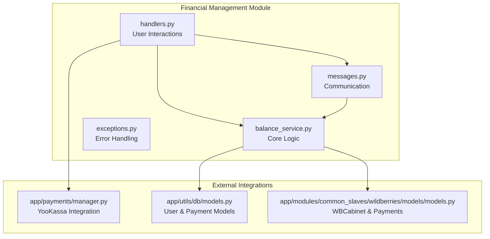
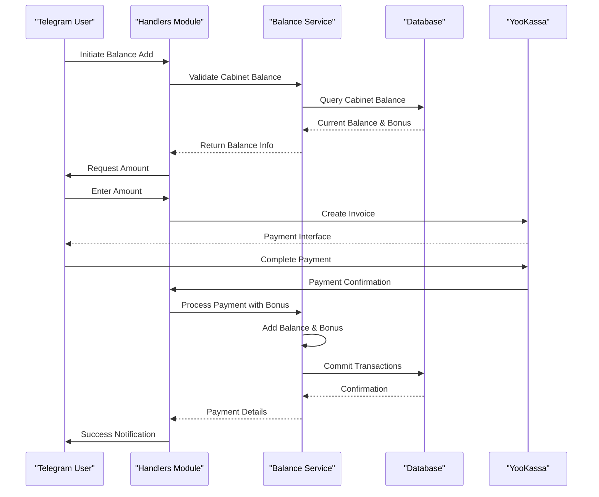
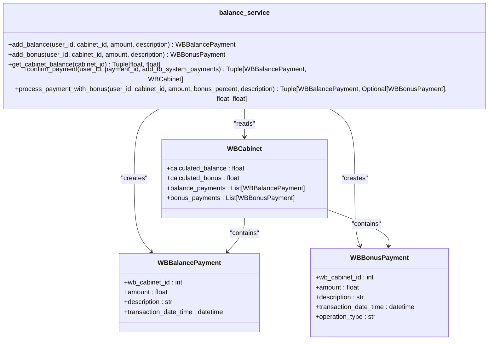
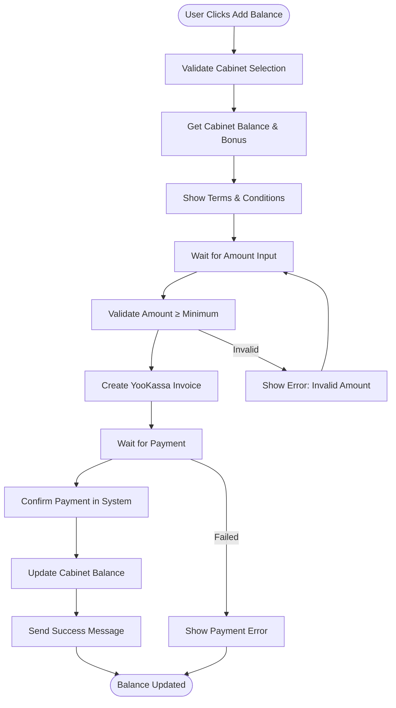
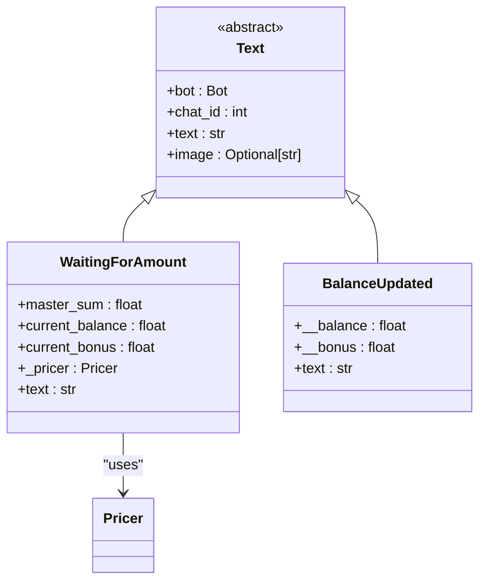
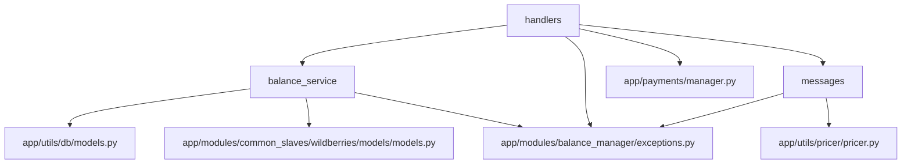

# Financial Management

<cite>
**Referenced Files in This Document**   
- [balance_service.py](file://app/modules/balance_manager/balance_service.py)
- [handlers.py](file://app/modules/balance_manager/handlers.py)
- [messages.py](file://app/modules/balance_manager/messages.py)
- [exceptions.py](file://app/modules/balance_manager/exceptions.py)
- [manager.py](file://app/payments/manager.py)
- [models.py](file://app/utils/db/models.py)
- [models.py](file://app/payments/db/models.py)
- [WBCabinet.py](file://app/modules/common_slaves/wildberries/models/models.py)
</cite>

## Table of Contents
1. [Introduction](#introduction)
2. [Project Structure](#project-structure)
3. [Core Components](#core-components)
4. [Architecture Overview](#architecture-overview)
5. [Detailed Component Analysis](#detailed-component-analysis)
6. [Dependency Analysis](#dependency-analysis)
7. [Performance Considerations](#performance-considerations)
8. [Troubleshooting Guide](#troubleshooting-guide)
9. [Conclusion](#conclusion)

## Introduction
This document provides a comprehensive analysis of the Financial Management module within the adv-bot system, with a primary focus on the balance_manager implementation. The module handles financial transaction processing, balance management, user interactions, and integration with external payment systems. It plays a critical role in managing user funds, processing payments, and maintaining accurate financial records for Wildberries cabinet operations. The system is designed to handle balance updates, transaction validation, bonus processing, and reconciliation workflows while ensuring data integrity and security.

## Project Structure
The Financial Management module is organized within the app/modules/balance_manager directory and consists of four core components: balance_service.py for business logic, handlers.py for user interaction handling, messages.py for communication templates, and exceptions.py for error management. The module integrates with the payment system through app/payments/manager.py and relies on database models defined in app/utils/db/models.py and app/payments/db/models.py. The structure follows a clean separation of concerns, with service functions handling core logic, handlers managing Telegram bot interactions, and message classes providing user-facing content.

**Diagram sources**
- [balance_service.py](file://app/modules/balance_manager/balance_service.py)
- [handlers.py](file://app/modules/balance_manager/handlers.py)
- [messages.py](file://app/modules/balance_manager/messages.py)
- [manager.py](file://app/payments/manager.py)

**Section sources**
- [balance_service.py](file://app/modules/balance_manager/balance_service.py)
- [handlers.py](file://app/modules/balance_manager/handlers.py)
- [messages.py](file://app/modules/balance_manager/messages.py)
- [exceptions.py](file://app/modules/balance_manager/exceptions.py)

## Core Components
The Financial Management module consists of several interconnected components that work together to process financial transactions. The balance_service.py module contains the core business logic for balance operations, including adding funds, processing payments, and calculating cabinet balances. The handlers.py module handles user interactions through the Telegram bot interface, managing the payment flow from initiation to completion. The messages.py module provides templated responses to users, while exceptions.py defines the error hierarchy for financial operations. These components work in concert with the payment system integration to create a robust financial processing pipeline.

**Section sources**
- [balance_service.py](file://app/modules/balance_manager/balance_service.py#L1-L235)
- [handlers.py](file://app/modules/balance_manager/handlers.py#L1-L199)
- [messages.py](file://app/modules/balance_manager/messages.py#L1-L49)

## Architecture Overview
The Financial Management architecture follows a layered approach with clear separation between presentation, business logic, and data access layers. User interactions are initiated through the Telegram bot interface and processed by handler functions that validate input and coordinate with service functions. The balance_service module contains the core financial logic, interacting with database models to persist transactions and calculate balances. All financial operations are atomic and use database transactions to ensure consistency. The system integrates with YooKassa for payment processing and maintains separate records for balance payments and bonus payments, allowing for flexible financial management.

**Diagram sources**
- [balance_service.py](file://app/modules/balance_manager/balance_service.py)
- [handlers.py](file://app/modules/balance_manager/handlers.py)
- [messages.py](file://app/modules/balance_manager/messages.py)

## Detailed Component Analysis

### Balance Service Analysis
The balance_service.py module implements the core financial logic for the system, providing functions to add balance, add bonuses, get cabinet balances, confirm payments, and process payments with bonus calculations. These functions use asynchronous database operations to ensure non-blocking performance and maintain data consistency through atomic transactions. The service layer validates all inputs and raises appropriate exceptions for error conditions, ensuring robust error handling throughout the financial workflow.

**Diagram sources**
- [balance_service.py](file://app/modules/balance_manager/balance_service.py#L1-L235)
- [models.py](file://app/modules/common_slaves/wildberries/models/models.py)

**Section sources**
- [balance_service.py](file://app/modules/balance_manager/balance_service.py#L1-L235)

### Handlers Analysis
The handlers.py module manages the user interaction flow for balance operations through the Telegram bot interface. It implements a state-based workflow that guides users through the balance addition process, from initial request to payment confirmation. The handlers coordinate with the balance service to retrieve current balance information, validate user input, and process successful payments. The module integrates with the YooKassa payment system to handle the payment lifecycle and uses message templates to provide consistent user communication.

**Diagram sources**
- [handlers.py](file://app/modules/balance_manager/handlers.py#L1-L199)

**Section sources**
- [handlers.py](file://app/modules/balance_manager/handlers.py#L1-L199)

### Messages Analysis
The messages.py module provides templated responses for user communication during financial operations. It implements message classes that dynamically generate content based on current financial data, such as displaying the current balance and bonus amounts when requesting a top-up. The module integrates with the Pricer utility to format financial information consistently and provides specialized messages for different stages of the balance update workflow, ensuring clear and informative user communication.

**Diagram sources**
- [messages.py](file://app/modules/balance_manager/messages.py#L1-L49)

**Section sources**
- [messages.py](file://app/modules/balance_manager/messages.py#L1-L49)

## Dependency Analysis
The Financial Management module has well-defined dependencies that enable its functionality while maintaining separation of concerns. The balance_service depends on database models for WBCabinet, WBBalancePayment, and WBBonusPayment, as well as user and payment models from the core application. The handlers module depends on the balance_service for business logic, the messages module for user communication, and the payment manager for external payment processing. All modules share a common exception hierarchy that provides consistent error handling across the financial system.

**Diagram sources**
- [balance_service.py](file://app/modules/balance_manager/balance_service.py)
- [handlers.py](file://app/modules/balance_manager/handlers.py)
- [messages.py](file://app/modules/balance_manager/messages.py)
- [manager.py](file://app/payments/manager.py)

**Section sources**
- [balance_service.py](file://app/modules/balance_manager/balance_service.py)
- [handlers.py](file://app/modules/balance_manager/handlers.py)
- [messages.py](file://app/modules/balance_manager/messages.py)

## Performance Considerations
The Financial Management module is designed with performance in mind, using asynchronous database operations to prevent blocking during financial transactions. The system minimizes database queries by using selectinload to eagerly load related payment records when calculating cabinet balances. The balance calculation is optimized by storing pre-calculated values in the WBCabinet model, reducing the need for expensive aggregation queries during frequent balance checks. The payment processing workflow is designed to be idempotent, allowing for safe retry mechanisms in case of transient failures. The system also implements caching strategies through Redis for frequently accessed financial data, though this is not directly visible in the analyzed code.

## Troubleshooting Guide
The Financial Management module includes comprehensive error handling through a well-defined exception hierarchy. Common issues and their solutions include:

- **UserNotFoundError**: Occurs when attempting financial operations for non-existent users. Verify the user ID and ensure the user is properly registered in the system.
- **CabinetNotFoundError**: Indicates an invalid cabinet ID. Check that the cabinet exists and is properly linked to the user account.
- **PaymentNotFoundError**: Appears when confirming non-existent payments. Validate the payment ID and ensure the payment was created successfully.
- **InvalidAmountError**: Triggered by zero or negative amounts. Ensure all financial amounts are positive values.
- **InsufficientBalanceError**: Prevents operations when funds are inadequate. Check the current balance before initiating transactions.

For payment processing issues, verify the YooKassa configuration in app/payments/manager.py and ensure the AccountId and SecretKey are correctly set. Monitor the system logs for payment confirmation errors and validate that webhooks are properly configured to handle asynchronous payment notifications.

**Section sources**
- [exceptions.py](file://app/modules/balance_manager/exceptions.py#L1-L28)
- [handlers.py](file://app/modules/balance_manager/handlers.py#L1-L199)
- [balance_service.py](file://app/modules/balance_manager/balance_service.py#L1-L235)

## Conclusion
The Financial Management module provides a robust foundation for handling financial transactions within the adv-bot system. Its well-structured architecture separates concerns between service logic, user interaction, and communication, making it maintainable and extensible. The integration with YooKassa enables secure payment processing, while the comprehensive error handling ensures reliability. The module effectively manages balance operations, bonus calculations, and financial record-keeping, providing essential functionality for the advertising management platform. Future enhancements could include more sophisticated reconciliation processes, enhanced fraud detection, and improved audit logging capabilities.