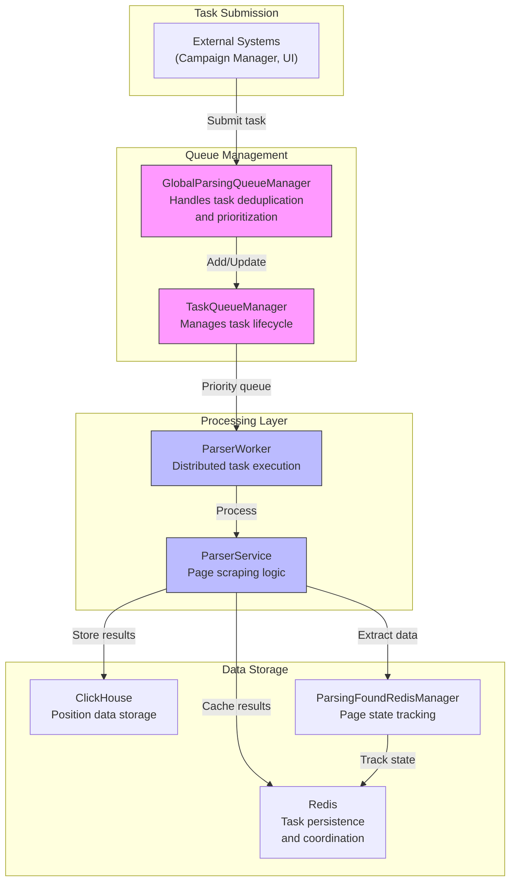
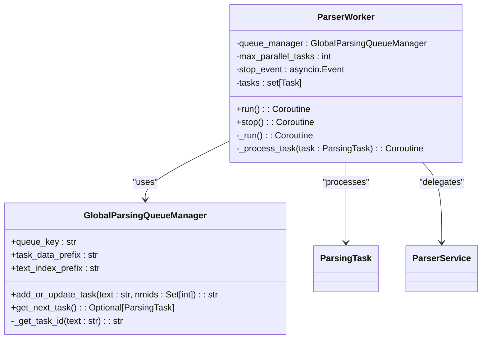
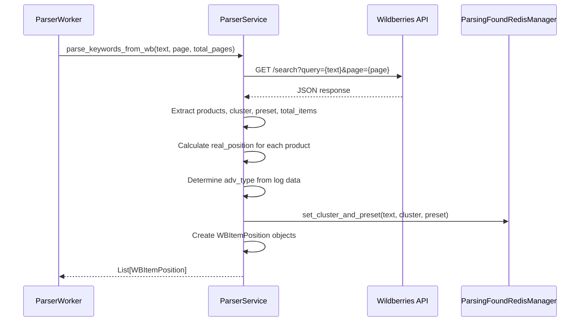
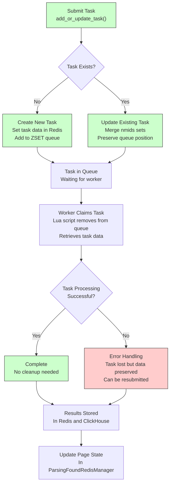
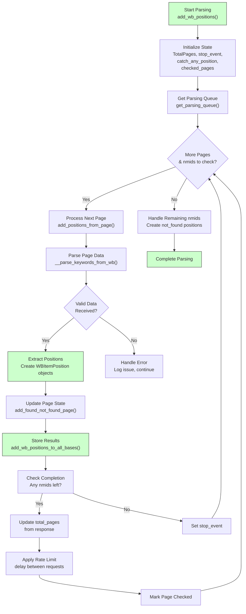
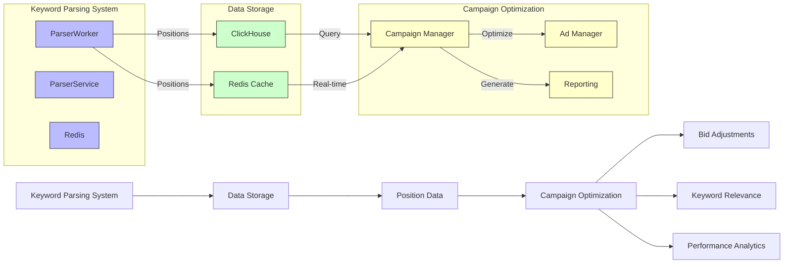

# Keyword Parsing

<cite>
**Referenced Files in This Document**   
- [parsing_task.py](file://app/modules/wb_keywords_parser/parsing_task.py)
- [parser_worker.py](file://app/modules/wb_keywords_parser/parser_worker.py)
- [global_parsing_queue_manager.py](file://app/modules/wb_keywords_parser/global_parsing_queue_manager.py)
- [task_queue_manager.py](file://app/modules/wb_keywords_parser/task_queue_manager.py)
- [parser.py](file://app/modules/wb_keywords_parser/wb_parser/parser.py)
- [parsing_page_queue_manager.py](file://app/modules/wb_keywords_parser/wb_parser/parsing_page_queue_manager.py)
- [parsing_found_redis_manager.py](file://app/modules/wb_keywords_parser/parsing_found_redis_manager.py)
- [parsing_queue_settings.py](file://app/settings/parsing_queue_settings.py)
</cite>

## Table of Contents
1. [Introduction](#introduction)
2. [Core Components](#core-components)
3. [Architecture Overview](#architecture-overview)
4. [Detailed Component Analysis](#detailed-component-analysis)
5. [Task Lifecycle and Queue Management](#task-lifecycle-and-queue-management)
6. [Parsing Workflow and Data Enrichment](#parsing-workflow-and-data-enrichment)
7. [Redis Integration and Fault Tolerance](#redis-integration-and-fault-tolerance)
8. [Error Handling Strategies](#error-handling-strategies)
9. [Performance Considerations](#performance-considerations)
10. [Configuration and Scaling](#configuration-and-scaling)
11. [Integration with Campaign Optimization](#integration-with-campaign-optimization)

## Introduction
The Keyword Parsing module is a critical component of the advertising automation system, responsible for extracting and analyzing keyword positioning data from Wildberries search results. This document provides a comprehensive analysis of the wb_keywords_parser implementation, detailing the scraping architecture, distributed task execution, and integration with downstream campaign optimization systems. The system is designed for high reliability, fault tolerance, and scalability, leveraging Redis for task persistence and distributed coordination.

## Core Components

The Keyword Parsing module consists of several interconnected components that work together to process keyword parsing tasks efficiently. The core components include the parsing task model, distributed worker architecture, queue management systems, and page-level parsing logic. These components are designed to handle large volumes of keyword parsing requests while maintaining data integrity and system reliability.

**Section sources**
- [parsing_task.py](file://app/modules/wb_keywords_parser/parsing_task.py#L1-L23)
- [parser_worker.py](file://app/modules/wb_keywords_parser/parser_worker.py#L1-L80)
- [global_parsing_queue_manager.py](file://app/modules/wb_keywords_parser/global_parsing_queue_manager.py#L1-L131)

## Architecture Overview

The keyword parsing architecture follows a distributed worker pattern with centralized queue management. Tasks are submitted to a Redis-backed priority queue, where they are processed by multiple parser workers running in parallel. The architecture is designed for horizontal scalability, allowing additional workers to be added as parsing demand increases.



**Diagram sources**
- [global_parsing_queue_manager.py](file://app/modules/wb_keywords_parser/global_parsing_queue_manager.py#L1-L131)
- [task_queue_manager.py](file://app/modules/wb_keywords_parser/task_queue_manager.py#L1-L176)
- [parser_worker.py](file://app/modules/wb_keywords_parser/parser_worker.py#L1-L80)
- [parser.py](file://app/modules/wb_keywords_parser/wb_parser/parser.py#L1-L343)

## Detailed Component Analysis

### Parsing Task Model
The ParsingTask dataclass represents the fundamental unit of work in the keyword parsing system. Each task contains a keyword to search for, a set of nmids (product identifiers) to track, and an optional advertising order ID for campaign association.

```mermaid
classDiagram
class ParsingTask {
+keyword : str
+nmids : Set[int]
+adv_id_order : Optional[str]
+id : str
}
note right of ParsingTask
Represents a single keyword parsing request
keyword : search term to parse
nmids : product IDs to track in results
adv_id_order : optional campaign association
id : SHA1 hash of keyword (first 12 chars)
end
```

**Diagram sources**
- [parsing_task.py](file://app/modules/wb_keywords_parser/parsing_task.py#L1-L23)

### Parser Worker Implementation
The ParserWorker class manages the distributed execution of parsing tasks. It maintains a pool of concurrent workers that pull tasks from the global queue and process them using the ParserService.



**Diagram sources**
- [parser_worker.py](file://app/modules/wb_keywords_parser/parser_worker.py#L1-L80)
- [global_parsing_queue_manager.py](file://app/modules/wb_keywords_parser/global_parsing_queue_manager.py#L1-L131)

### Page-Level Parsing Logic
The ParserService handles the actual HTTP requests to Wildberries search endpoints and extracts position data from the responses. It manages pagination and processes the JSON response to create structured position records.



**Diagram sources**
- [parser.py](file://app/modules/wb_keywords_parser/wb_parser/parser.py#L1-L343)
- [parsing_found_redis_manager.py](file://app/modules/wb_keywords_parser/parsing_found_redis_manager.py#L1-L31)

## Task Lifecycle and Queue Management

The task lifecycle in the keyword parsing system follows a well-defined flow from submission to completion. Tasks are managed through a combination of the TaskQueueManager and GlobalParsingQueueManager, which provide different levels of queue functionality.



**Diagram sources**
- [task_queue_manager.py](file://app/modules/wb_keywords_parser/task_queue_manager.py#L1-L176)
- [global_parsing_queue_manager.py](file://app/modules/wb_keywords_parser/global_parsing_queue_manager.py#L1-L131)
- [parsing_found_redis_manager.py](file://app/modules/wb_keywords_parser/parsing_found_redis_manager.py#L1-L31)

**Section sources**
- [task_queue_manager.py](file://app/modules/wb_keywords_parser/task_queue_manager.py#L1-L176)
- [global_parsing_queue_manager.py](file://app/modules/wb_keywords_parser/global_parsing_queue_manager.py#L1-L131)

## Parsing Workflow and Data Enrichment

The parsing workflow is designed to efficiently extract keyword positioning data while minimizing redundant requests. The system uses intelligent page queue management to prioritize pages based on previous parsing results.



**Diagram sources**
- [parser.py](file://app/modules/wb_keywords_parser/wb_parser/parser.py#L1-L343)
- [parsing_page_queue_manager.py](file://app/modules/wb_keywords_parser/wb_parser/parsing_page_queue_manager.py#L1-L68)

**Section sources**
- [parser.py](file://app/modules/wb_keywords_parser/wb_parser/parser.py#L1-L343)
- [parsing_page_queue_manager.py](file://app/modules/wb_keywords_parser/wb_parser/parsing_page_queue_manager.py#L1-L68)

## Redis Integration and Fault Tolerance

Redis plays a central role in the keyword parsing system, providing task persistence, distributed coordination, and state management. The system is designed to be resilient to failures, with multiple mechanisms to ensure data integrity.

```mermaid
erDiagram
TASK_QUEUE ||--o{ TASK_DATA : contains
TASK_QUEUE ||--o{ TEXT_INDEX : indexes
PAGE_STATE ||--o{ FOUND_PAGES : tracks
PAGE_STATE ||--o{ NOT_FOUND_PAGES : tracks
TASK_QUEUE {
string queue_key PK
int task_id FK
timestamp score
}
TASK_DATA {
string task_id PK
string text
int[] nmids
}
TEXT_INDEX {
string text_hash PK
string task_id FK
}
FOUND_PAGES {
string key PK
int page
timestamp score
}
NOT_FOUND_PAGES {
string key PK
int page
timestamp score
}
note as RedisNote
Redis keys:
parser:task:queue - ZSET with task IDs and timestamps
parser:task:data:{task_id} - JSON task data
parser:task:index:text:{text} - SET with task IDs
found_pages:{text}:{nmid} - ZSET with page numbers
not_found_pages:{text}:{nmid} - ZSET with page numbers
end
```

**Diagram sources**
- [global_parsing_queue_manager.py](file://app/modules/wb_keywords_parser/global_parsing_queue_manager.py#L1-L131)
- [task_queue_manager.py](file://app/modules/wb_keywords_parser/task_queue_manager.py#L1-L176)
- [parsing_found_redis_manager.py](file://app/modules/wb_keywords_parser/parsing_found_redis_manager.py#L1-L31)

## Error Handling Strategies

The system implements comprehensive error handling to deal with various failure scenarios, including network issues, API changes, and system errors. The error handling strategy prioritizes data preservation and task resiliency.

```mermaid
stateDiagram-v2
[*] --> Idle
Idle --> ProcessingTask : get_next_task()
ProcessingTask --> ExtractData : parse_keywords_from_wb()
ExtractData --> HandleNetworkError : HTTP request fails
ExtractData --> ProcessResponse : Response received
ProcessResponse --> ValidateData : Check payloadVersion
ValidateData --> HandleParseError : Invalid data format
ValidateData --> ExtractProducts : Data valid
ExtractProducts --> CreatePositions : Process each product
CreatePositions --> UpdateState : add_found_not_found_page()
CreatePositions --> HandleKeyError : Missing required fields
HandleNetworkError --> Retry : wait and retry
HandleParseError --> LogError : Record issue
HandleKeyError --> SkipProduct : Continue with next product
Retry --> ExtractData : retry request
LogError --> UpdateState : Continue processing
SkipProduct --> CreatePositions : Next product
UpdateState --> StoreResults : add_wb_positions_to_all_bases()
StoreResults --> CheckCompletion : Any nmids left?
CheckCompletion --> SetStopEvent : No nmids left
CheckCompletion --> Continue : More nmids to check
SetStopEvent --> Complete : Finish task
Continue --> CheckPageLimit : Page limit reached?
CheckPageLimit --> ProcessNextPage : Get next page
CheckPageLimit --> Complete : Limit reached
ProcessNextPage --> ExtractData : Next page
Complete --> [*]
note right of HandleNetworkError
Retries with exponential backoff
Preserves task in queue
end
note right of HandleParseError
Logs detailed error info
Continues with available data
end
```

**Diagram sources**
- [parser.py](file://app/modules/wb_keywords_parser/wb_parser/parser.py#L1-L343)
- [parser_worker.py](file://app/modules/wb_keywords_parser/parser_worker.py#L1-L80)
- [global_parsing_queue_manager.py](file://app/modules/wb_keywords_parser/global_parsing_queue_manager.py#L1-L131)

**Section sources**
- [parser.py](file://app/modules/wb_keywords_parser/wb_parser/parser.py#L1-L343)
- [parser_worker.py](file://app/modules/wb_keywords_parser/parser_worker.py#L1-L80)

## Performance Considerations

The keyword parsing system is designed with performance and scalability in mind. Several mechanisms are in place to optimize resource usage and handle high volumes of parsing requests.

```mermaid
graph TD
A["Performance Optimization"] --> B["Concurrency Control"]
A --> C["Rate Limiting"]
A --> D["Intelligent Page Ordering"]
A --> E["Task Deduplication"]
A --> F["Efficient Redis Operations"]
B --> B1["max_parallel_tasks"]
B --> B2["asyncio.Lock for queue access"]
B --> B3["Parallel worker processes"]
C --> C1["delay parameter"]
C --> C2["worker_sleep_interval"]
C --> C3["Respect API limits"]
D --> D1["Prioritize found pages"]
D --> D2["Randomize unknown pages"]
D --> D3["Check not-found pages last"]
E --> E1["SHA1 task ID generation"]
E --> E2["Merge nmids on duplicate tasks"]
E --> E3["Atomic Redis operations"]
F --> F1["Pipeline operations"]
F --> F2["Lua scripts for atomicity"]
F --> F3["Efficient data structures"]
style B fill:#cfc,stroke:#333
style C fill:#cfc,stroke:#333
style D fill:#cfc,stroke:#333
style E fill:#cfc,stroke:#333
style F fill:#cfc,stroke:#333
```



**Diagram sources**
- [parsing_queue_settings.py](file://app/settings/parsing_queue_settings.py#L1-L31)
- [parser_worker.py](file://app/modules/wb_keywords_parser/parser_worker.py#L1-L80)
- [parser.py](file://app/modules/wb_keywords_parser/wb_parser/parser.py#L1-L343)

**Section sources**
- [parsing_queue_settings.py](file://app/settings/parsing_queue_settings.py#L1-L31)
- [parser_worker.py](file://app/modules/wb_keywords_parser/parser_worker.py#L1-L80)

## Configuration and Scaling

The system provides configurable parameters to adjust performance characteristics based on deployment requirements and resource availability. These settings allow the system to be tuned for different environments and scaling needs.

```mermaid
classDiagram
class ParsingQueueSettings {
+redis_queue_key : str
+redis_task_data_prefix : str
+redis_text_index_prefix : str
+worker_sleep_interval : float
+worker_concurrency : int
+worker_max_retries : int
+worker_retry_delay : float
+task_ttl_seconds : int
+arq_queue_name : str
+arq_default_priority : int
}
note right of ParsingQueueSettings
Configuration options :
- Redis key prefixes
- Worker concurrency and timing
- Task TTL and retry policies
- ARQ integration settings
Configurable via environment variables
with PARSING_QUEUE_ prefix
end
```

**Diagram sources**
- [parsing_queue_settings.py](file://app/settings/parsing_queue_settings.py#L1-L31)

**Section sources**
- [parsing_queue_settings.py](file://app/settings/parsing_queue_settings.py#L1-L31)

## Integration with Campaign Optimization

The parsed keyword data feeds directly into campaign optimization systems, providing real-time insights into keyword performance and enabling automated bidding strategies. The integration is designed to be seamless and reliable.



**Diagram sources**
- [parser.py](file://app/modules/wb_keywords_parser/wb_parser/parser.py#L1-L343)
- [parsing_found_redis_manager.py](file://app/modules/wb_keywords_parser/parsing_found_redis_manager.py#L1-L31)

**Section sources**
- [parser.py](file://app/modules/wb_keywords_parser/wb_parser/parser.py#L1-L343)
- [parsing_found_redis_manager.py](file://app/modules/wb_keywords_parser/parsing_found_redis_manager.py#L1-L31)