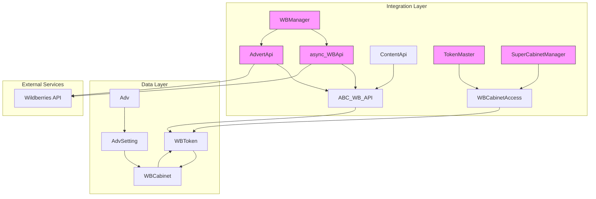
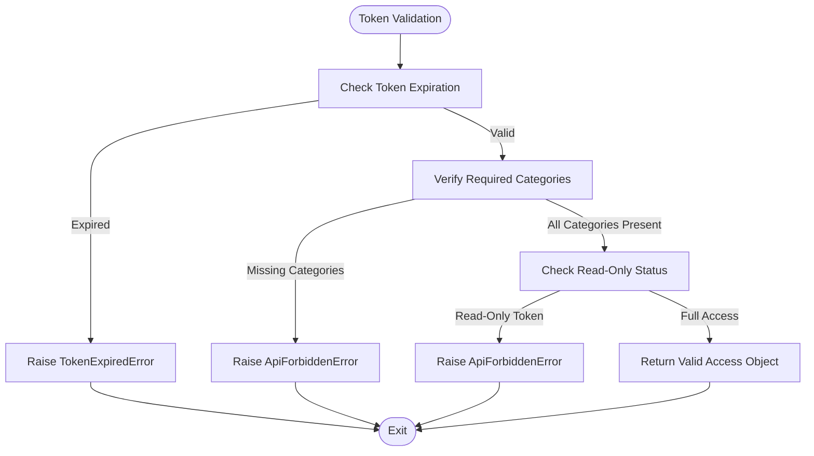
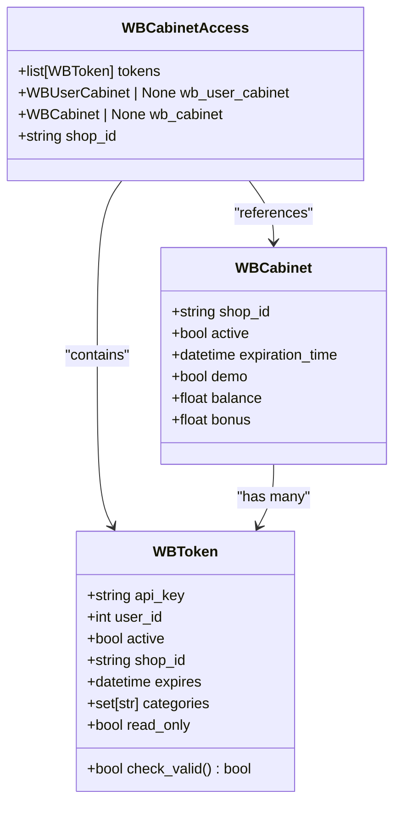
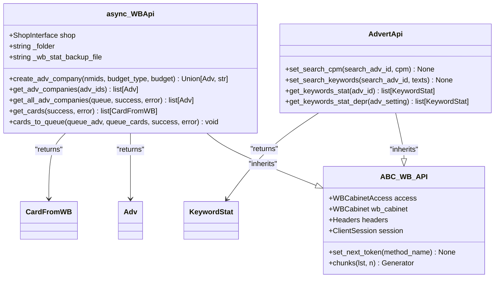
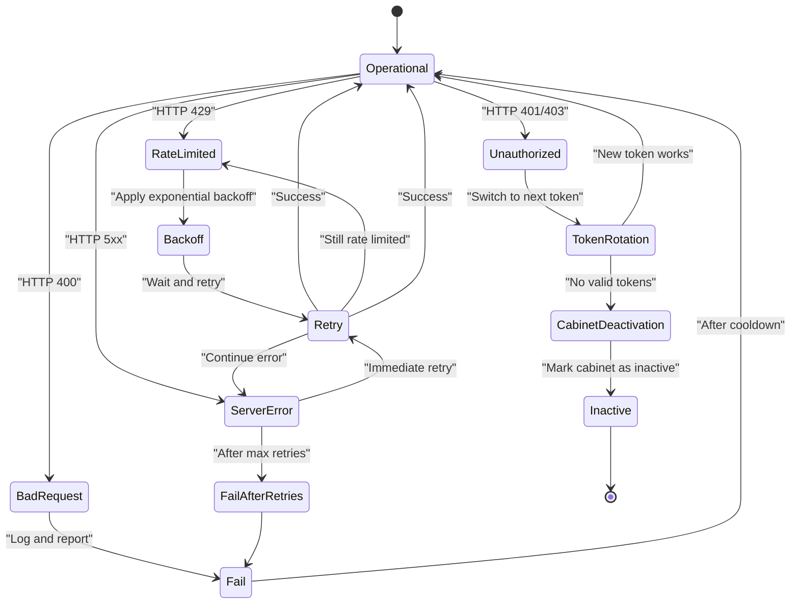
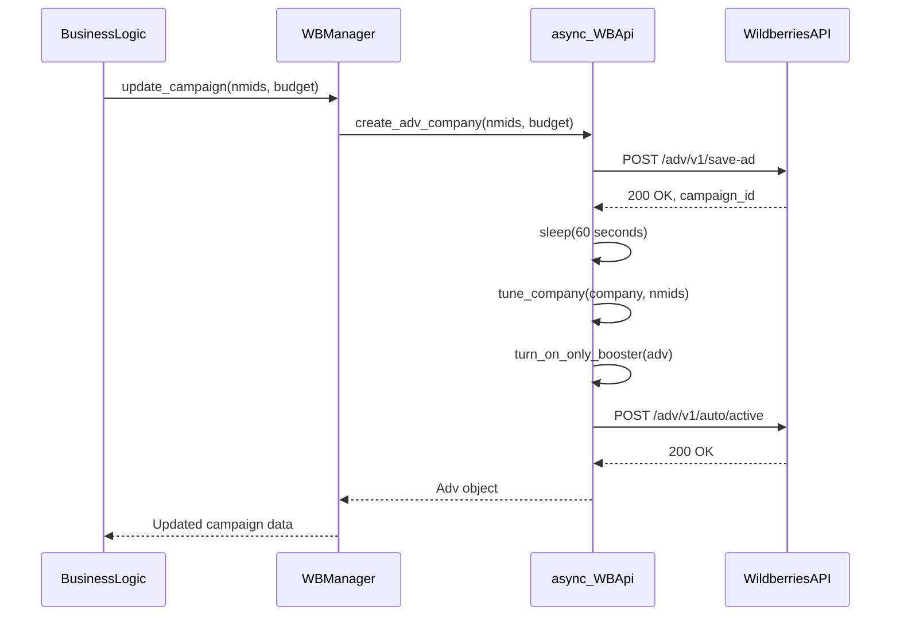
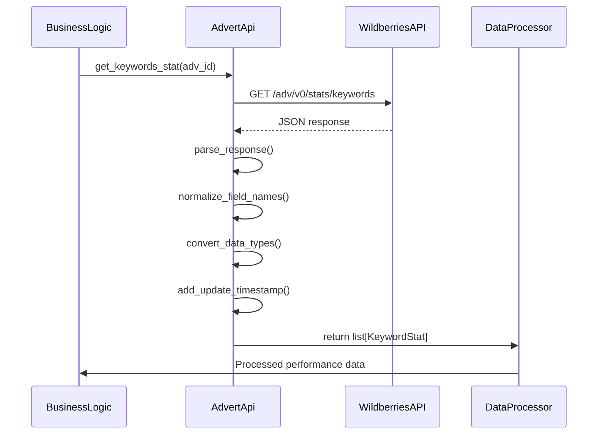

# Platform Integration

<cite>
**Referenced Files in This Document**   
- [async_WBApi.py](file://app/modules/common_slaves/wildberries/async_WBApi.py)
- [api.py](file://app/modules/common_slaves/wildberries/api.py)
- [token_master.py](file://app/modules/common_slaves/wildberries/token_master.py)
- [super_cabinet_manager.py](file://app/modules/common_slaves/wildberries/super_cabinet_manager.py)
- [manager.py](file://app/modules/common_slaves/wildberries/manager.py)
- [ABC_WB_API.py](file://app/modules/common_slaves/wildberries/ABC_WB_API.py)
- [data_classes/adv.py](file://app/modules/common_slaves/wildberries/data_classes/adv.py)
- [models/models.py](file://app/modules/common_slaves/wildberries/models/models.py)
- [exceptions.py](file://app/modules/common_slaves/wildberries/exceptions.py)
- [http_request.py](file://app/modules/common_slaves/wildberries/http_request.py)
</cite>

## Table of Contents
1. [Introduction](#introduction)
2. [Architecture Overview](#architecture-overview)
3. [Core Components](#core-components)
4. [Authentication and Token Management](#authentication-and-token-management)
5. [Request Orchestration and API Communication](#request-orchestration-and-api-communication)
6. [Error Handling and Resilience Patterns](#error-handling-and-resilience-patterns)
7. [Data Normalization and Processing](#data-normalization-and-processing)
8. [Critical Operations Sequence Diagrams](#critical-operations-sequence-diagrams)
9. [Integration with Business Logic](#integration-with-business-logic)
10. [Common Integration Issues and Solutions](#common-integration-issues-and-solutions)

## Introduction
This document provides comprehensive documentation for the Platform Integration module, specifically focusing on the Wildberries API integration implementation. The system enables asynchronous communication with Wildberries' advertising API through a sophisticated architecture that handles authentication, request orchestration, error recovery, and data normalization. The integration layer serves as a critical bridge between the application's business logic and Wildberries' external services, enabling campaign management, performance data retrieval, and automated advertising operations.

## Architecture Overview

**Diagram sources**
- [async_WBApi.py](file://app/modules/common_slaves/wildberries/async_WBApi.py#L1-L317)
- [api.py](file://app/modules/common_slaves/wildberries/api.py#L1-L480)
- [super_cabinet_manager.py](file://app/modules/common_slaves/wildberries/super_cabinet_manager.py#L1-L95)
- [manager.py](file://app/modules/common_slaves/wildberries/manager.py#L1-L7)
- [ABC_WB_API.py](file://app/modules/common_slaves/wildberries/ABC_WB_API.py#L1-L126)

**Section sources**
- [async_WBApi.py](file://app/modules/common_slaves/wildberries/async_WBApi.py#L1-L317)
- [api.py](file://app/modules/common_slaves/wildberries/api.py#L1-L480)

## Core Components

The Wildberries integration module consists of several core components that work together to provide a robust interface to the Wildberries API. The architecture follows a layered approach with clear separation of concerns between authentication, API communication, data management, and business logic integration.

The foundation of the integration is built on the ABC_WB_API class, which provides the base functionality for API requests, token management, and error handling. This abstract base class is extended by specialized API clients such as async_WBApi and AdvertApi, each focusing on specific aspects of the Wildberries API.

Data classes like Adv and CardFromWB provide structured representations of Wildberries API responses, enabling type-safe operations and data normalization across the application. The models module contains SQLAlchemy models that persist integration state and configuration in the database, creating a bridge between the external API and internal data storage.

**Section sources**
- [data_classes/adv.py](file://app/modules/common_slaves/wildberries/data_classes/adv.py#L1-L255)
- [models/models.py](file://app/modules/common_slaves/wildberries/models/models.py#L1-L654)
- [ABC_WB_API.py](file://app/modules/common_slaves/wildberries/ABC_WB_API.py#L1-L126)

## Authentication and Token Management

### Token Validation and Rights Checking

**Diagram sources**
- [token_master.py](file://app/modules/common_slaves/wildberries/token_master.py#L1-L39)
- [super_cabinet_manager.py](file://app/modules/common_slaves/wildberries/super_cabinet_manager.py#L1-L95)
- [models/models.py](file://app/modules/common_slaves/wildberries/models/models.py#L1-L654)

The authentication flow for Wildberries API integration is managed through a multi-layered approach that ensures secure and reliable access to the API. The process begins with token validation in the token_master.py module, which verifies that tokens are not expired and contain the necessary permissions for advertising operations.

The system requires tokens with both "Content" and "Promotion" rights, while explicitly rejecting tokens marked as "read-only". This validation is performed using JWT decoding to extract token payload information without requiring signature verification, allowing for efficient validation of token properties.

**Diagram sources**
- [super_cabinet_manager.py](file://app/modules/common_slaves/wildberries/super_cabinet_manager.py#L1-L95)
- [models/models.py](file://app/modules/common_slaves/wildberries/models/models.py#L1-L654)

Cabinet-level access is managed by the super_cabinet_manager.py module, which aggregates multiple tokens for a single shop and provides a unified access interface. The get_access_for_wb_cabinet function retrieves all valid tokens for a specific shop ID, filtering out expired or invalid tokens. This approach enables redundancy and failover capabilities, as the system can automatically switch between multiple valid tokens if one becomes unavailable.

The WBCabinetAccess dataclass serves as the central access object, containing validated tokens, cabinet information, and utility methods for accessing shop-specific data. This abstraction layer decouples the API clients from the underlying token management complexity, allowing them to focus on API operations rather than authentication details.

**Section sources**
- [token_master.py](file://app/modules/common_slaves/wildberries/token_master.py#L1-L39)
- [super_cabinet_manager.py](file://app/modules/common_slaves/wildberries/super_cabinet_manager.py#L1-L95)
- [models/models.py](file://app/modules/common_slaves/wildberries/models/models.py#L1-L654)

## Request Orchestration and API Communication

### Asynchronous API Communication

**Diagram sources**
- [async_WBApi.py](file://app/modules/common_slaves/wildberries/async_WBApi.py#L1-L317)
- [api.py](file://app/modules/common_slaves/wildberries/api.py#L1-L480)
- [ABC_WB_API.py](file://app/modules/common_slaves/wildberries/ABC_WB_API.py#L1-L126)
- [data_classes/adv.py](file://app/modules/common_slaves/wildberries/data_classes/adv.py#L1-L255)

The Wildberries API integration employs an asynchronous communication model using aiohttp for non-blocking HTTP requests. The async_WBApi class provides specialized methods for campaign management operations such as creating advertising companies, retrieving campaign data, and managing product cards. These methods are designed to handle the specific requirements of Wildberries' advertising API endpoints.

Rate limiting is implemented through the get_pause function from python_modules.pause_func, which calculates appropriate delays between requests based on the maximum allowed requests per minute. The get_all_adv_companies method demonstrates this approach, implementing exponential backoff when encountering rate limit errors (HTTP 429). This ensures compliance with API rate limits while maintaining robustness in the face of temporary throttling.

The integration uses a token rotation mechanism through the set_next_token method in the ABC_WB_API class. When a token becomes invalid or returns authorization errors, the system automatically switches to the next available token from the pool. If no valid tokens remain, the associated cabinet is deactivated to prevent further failed requests. This circuit breaker pattern protects both the application and the Wildberries API from excessive error conditions.

**Section sources**
- [async_WBApi.py](file://app/modules/common_slaves/wildberries/async_WBApi.py#L1-L317)
- [api.py](file://app/modules/common_slaves/wildberries/api.py#L1-L480)
- [ABC_WB_API.py](file://app/modules/common_slaves/wildberries/ABC_WB_API.py#L1-L126)
- [http_request.py](file://app/modules/common_slaves/wildberries/http_request.py#L1-L100)

## Error Handling and Resilience Patterns

### Error Classification and Recovery

**Diagram sources**
- [async_WBApi.py](file://app/modules/common_slaves/wildberries/async_WBApi.py#L1-L317)
- [ABC_WB_API.py](file://app/modules/common_slaves/wildberries/ABC_WB_API.py#L1-L126)
- [exceptions.py](file://app/modules/common_slaves/wildberries/exceptions.py#L1-L71)

The integration implements a comprehensive error handling strategy that classifies and responds appropriately to different types of API errors. Errors are categorized into several types, each with specific recovery mechanisms:

1. **Rate Limiting (HTTP 429)**: Handled with exponential backoff in methods like get_all_adv_companies. The pause duration is doubled after each failed attempt, preventing aggressive retry patterns that could exacerbate rate limiting.

2. **Authentication Errors (HTTP 401/403)**: Trigger the token rotation mechanism via set_next_token. If all tokens fail, the cabinet is deactivated to prevent further authorization failures.

3. **Client Errors (HTTP 400)**: Treated as permanent failures that require intervention, such as invalid request parameters or malformed data.

4. **Server Errors (HTTP 5xx)**: Handled with immediate retries, assuming temporary server-side issues.

The system also implements circuit breaker patterns at the cabinet level. When all tokens for a cabinet become invalid, the cabinet is automatically deactivated by setting its active status to false in the database. This prevents the system from continuously attempting requests with invalid credentials and provides a clear signal for administrative intervention.

**Section sources**
- [async_WBApi.py](file://app/modules/common_slaves/wildberries/async_WBApi.py#L1-L317)
- [ABC_WB_API.py](file://app/modules/common_slaves/wildberries/ABC_WB_API.py#L1-L126)
- [exceptions.py](file://app/modules/common_slaves/wildberries/exceptions.py#L1-L71)

## Data Normalization and Processing

The integration layer performs extensive data normalization to transform Wildberries API responses into a consistent format suitable for internal processing. This normalization occurs at multiple levels:

1. **Field Name Standardization**: API response fields are mapped to consistent internal names (e.g., "sum" becomes "spend" in KeywordStat objects).

2. **Data Type Conversion**: String-based numeric values and timestamps are converted to appropriate Python types (int, float, datetime).

3. **Status Translation**: Numeric status codes from the API are translated to descriptive string representations (e.g., status 4 becomes "ready_for_start").

4. **Structure Flattening**: Nested JSON structures are flattened into simpler, more accessible object hierarchies.

The Adv class demonstrates this normalization approach, providing properties that abstract away the underlying API response structure. For example, the nmids property attempts to extract product identifiers from multiple possible locations in the API response, including direct NMID lists and pattern matching in campaign names. This resilience ensures reliable data extraction even when API responses vary in structure.

Date and time handling follows a consistent pattern using UTC+3 (Moscow time) for all date-related operations, ensuring alignment with Wildberries' time zone conventions. The update_timestamp property is added to all statistical data, providing an audit trail for when data was retrieved from the API.

**Section sources**
- [data_classes/adv.py](file://app/modules/common_slaves/wildberries/data_classes/adv.py#L1-L255)
- [api.py](file://app/modules/common_slaves/wildberries/api.py#L1-L480)
- [data_classes/keywordstat.py](file://app/modules/common_slaves/wildberries/data_classes/keywordstat.py#L1-L50)

## Critical Operations Sequence Diagrams

### Campaign Update Operation

**Diagram sources**
- [async_WBApi.py](file://app/modules/common_slaves/wildberries/async_WBApi.py#L1-L317)
- [manager.py](file://app/modules/common_slaves/wildberries/manager.py#L1-L7)

### Performance Data Retrieval

**Diagram sources**
- [api.py](file://app/modules/common_slaves/wildberries/api.py#L1-L480)
- [data_classes/keywordstat.py](file://app/modules/common_slaves/wildberries/data_classes/keywordstat.py#L1-L50)

## Integration with Business Logic

The manager.py module serves as the primary interface between the Wildberries integration layer and the application's business logic. The WBManager class provides a simplified API for higher-level operations, abstracting away the complexities of direct API communication.

Business logic modules interact with the integration layer through well-defined interfaces that encapsulate specific operations:

1. **Campaign Management**: Creating, updating, and monitoring advertising campaigns
2. **Performance Analytics**: Retrieving and processing campaign performance data
3. **Keyword Optimization**: Managing search keywords and their performance metrics
4. **Budget Management**: Monitoring and allocating advertising budgets

The integration layer exposes both synchronous and asynchronous methods, allowing business logic to choose the appropriate communication pattern based on performance requirements and user experience considerations. For time-sensitive operations, asynchronous methods prevent blocking the main application thread, while synchronous methods provide simpler interfaces for background processing tasks.

**Section sources**
- [manager.py](file://app/modules/common_slaves/wildberries/manager.py#L1-L7)
- [async_WBApi.py](file://app/modules/common_slaves/wildberries/async_WBApi.py#L1-L317)
- [api.py](file://app/modules/common_slaves/wildberries/api.py#L1-L480)

## Common Integration Issues and Solutions

### Token Expiration Handling

The system implements proactive token expiration monitoring through the expires property in the WBToken model. Before each API request, the system verifies that the token has not expired by comparing the expiration timestamp with the current time. When a token is found to be expired, it is automatically removed from the active token pool, and the next available token is used.

For scenarios where all tokens are expired, the system raises a TokenExpiredError exception, which triggers administrative notifications and user-facing alerts. This allows users to update their tokens before advertising operations are disrupted.

### API Schema Changes

To mitigate the impact of API schema changes, the integration employs several defensive programming techniques:

1. **Graceful Degradation**: When expected fields are missing from API responses, the system attempts to extract data from alternative locations or uses default values.

2. **Flexible Parsing**: Regular expressions and pattern matching are used to extract critical information (like campaign IDs) from text fields when structured data is unavailable.

3. **Comprehensive Logging**: All API responses are logged for debugging purposes, enabling rapid identification and resolution of schema change issues.

4. **Data Validation**: Pydantic models are used to validate API response structure, providing clear error messages when schema changes break expected formats.

The system's modular architecture allows for targeted updates when API changes occur, minimizing the impact on unrelated functionality. The separation between API communication (async_WBApi, AdvertApi) and data modeling (Adv, KeywordStat) enables updates to one component without affecting others.

**Section sources**
- [token_master.py](file://app/modules/common_slaves/wildberries/token_master.py#L1-L39)
- [models/models.py](file://app/modules/common_slaves/wildberries/models/models.py#L1-L654)
- [data_classes/adv.py](file://app/modules/common_slaves/wildberries/data_classes/adv.py#L1-L255)
- [exceptions.py](file://app/modules/common_slaves/wildberries/exceptions.py#L1-L71)