# Shop Operations

<cite>
**Referenced Files in This Document**   
- [wb_shop.py](file://app/modules/shop_runner/wb_shop.py)
- [manager.py](file://app/modules/shop_runner/service_manager/manager.py)
- [worker.py](file://app/modules/shop_runner/shop_run_worker/worker/worker.py)
- [data_classes.py](file://app/modules/shop_runner/data_classes.py)
- [run_process_func.py](file://app/modules/shop_runner/run_process_func.py)
- [redis_manager.py](file://app/modules/shop_runner/shop_run_worker/redis_manager/redis_manager.py)
- [wb_shop_data_manager.py](file://app/modules/shop_runner/service_manager/wb_shop_data_manager/wb_shop_data_manager.py)
</cite>

## Table of Contents
1. [Introduction](#introduction)
2. [Core Components](#core-components)
3. [Architecture Overview](#architecture-overview)
4. [Detailed Component Analysis](#detailed-component-analysis)
5. [Execution Flow and Scheduling](#execution-flow-and-scheduling)
6. [State Synchronization and Error Isolation](#state-synchronization-and-error-isolation)
7. [Resource Allocation and Health Monitoring](#resource-allocation-and-health-monitoring)
8. [Operational Issues and Recovery Procedures](#operational-issues-and-recovery-procedures)
9. [Configuration and Command Propagation](#configuration-and-command-propagation)
10. [Conclusion](#conclusion)

## Introduction
The Shop Operations module provides a comprehensive automation framework for managing multiple Wildberries shops concurrently. This system enables automated advertising management, keyword parsing, bid optimization, and performance monitoring through a distributed worker architecture. The implementation centers on the shop_runner module, which coordinates shop-level operations through a sophisticated combination of asynchronous processing, Redis-based state management, and PostgreSQL-backed data persistence.

**Section sources**
- [wb_shop.py](file://app/modules/shop_runner/wb_shop.py#L1-L42)

## Core Components
The Shop Operations module consists of several interconnected components that work together to automate shop management tasks. The core components include the WBShop class for shop entity management, the CoroutinesManager for operational coordination, the ShopWorker for process execution, and supporting data models and utility classes.

**Section sources**
- [wb_shop.py](file://app/modules/shop_runner/wb_shop.py#L1-L42)
- [manager.py](file://app/modules/shop_runner/service_manager/manager.py#L1-L262)
- [worker.py](file://app/modules/shop_runner/shop_run_worker/worker/worker.py#L1-L79)
- [data_classes.py](file://app/modules/shop_runner/data_classes.py#L1-L13)

## Architecture Overview

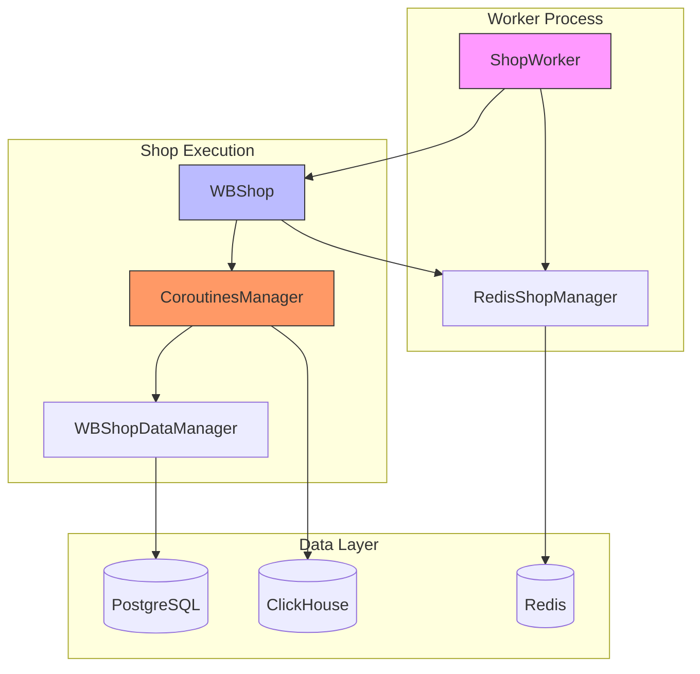

**Diagram sources**
- [wb_shop.py](file://app/modules/shop_runner/wb_shop.py#L1-L42)
- [manager.py](file://app/modules/shop_runner/service_manager/manager.py#L1-L262)
- [worker.py](file://app/modules/shop_runner/shop_run_worker/worker/worker.py#L1-L79)
- [redis_manager.py](file://app/modules/shop_runner/shop_run_worker/redis_manager/redis_manager.py#L1-L81)

## Detailed Component Analysis

### WBShop Implementation
The WBShop class serves as the primary container for shop-level automation, coordinating multiple concurrent operations through asynchronous coroutines. It maintains references to the WBApi instance for Wildberries API interactions and the RedisShopManager for state persistence.

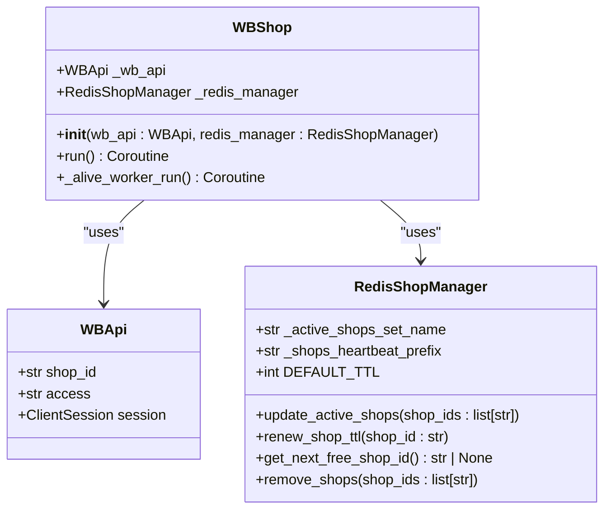

**Diagram sources**
- [wb_shop.py](file://app/modules/shop_runner/wb_shop.py#L1-L42)
- [redis_manager.py](file://app/modules/shop_runner/shop_run_worker/redis_manager/redis_manager.py#L1-L81)

**Section sources**
- [wb_shop.py](file://app/modules/shop_runner/wb_shop.py#L1-L42)

### Service Manager and Operational Coordination
The CoroutinesManager class in manager.py orchestrates various operational tasks for shop automation, including bid updates, statistics collection, and keyword parsing. It implements a decorator-based scheduling system that controls the frequency of operations.

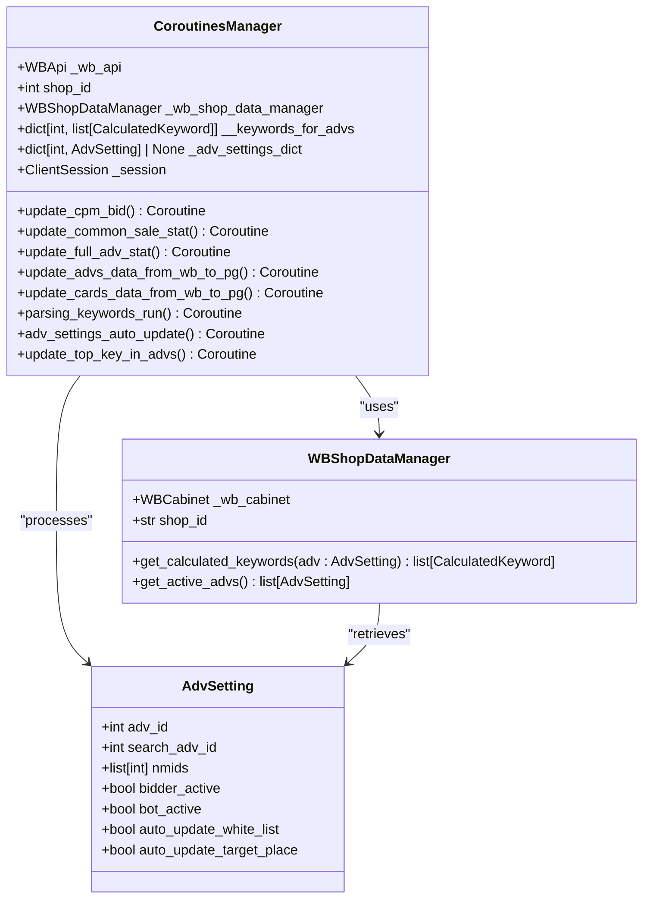

**Diagram sources**
- [manager.py](file://app/modules/shop_runner/service_manager/manager.py#L1-L262)
- [wb_shop_data_manager.py](file://app/modules/shop_runner/service_manager/wb_shop_data_manager/wb_shop_data_manager.py#L1-L49)

**Section sources**
- [manager.py](file://app/modules/shop_runner/service_manager/manager.py#L1-L262)

### Worker Process Implementation
The ShopWorker class manages the lifecycle of shop processing tasks, handling task creation, completion callbacks, and error cleanup. It maintains a dictionary of active tasks and coordinates with Redis to distribute work across multiple workers.

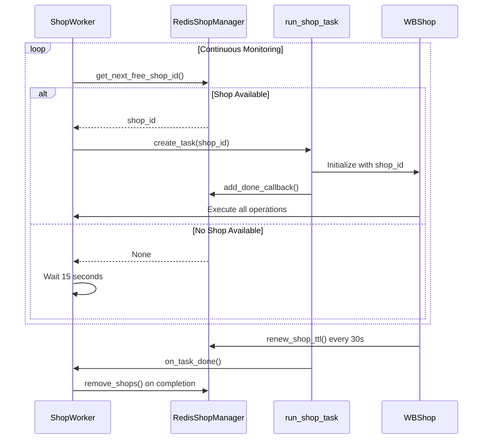

**Diagram sources**
- [worker.py](file://app/modules/shop_runner/shop_run_worker/worker/worker.py#L1-L79)
- [redis_manager.py](file://app/modules/shop_runner/shop_run_worker/redis_manager/redis_manager.py#L1-L81)

**Section sources**
- [worker.py](file://app/modules/shop_runner/shop_run_worker/worker/worker.py#L1-L79)

### Data Models
The data model for shop operations includes the ComplexAdv dataclass that combines advertising settings with their associated keywords, enabling coordinated processing of ad campaigns and their keyword sets.

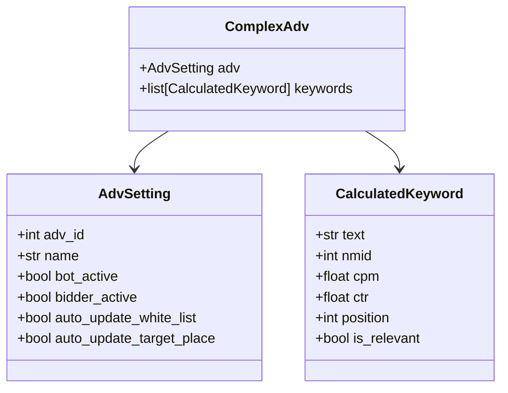

**Diagram sources**
- [data_classes.py](file://app/modules/shop_runner/data_classes.py#L1-L13)
- [manager.py](file://app/modules/shop_runner/service_manager/manager.py#L1-L262)

**Section sources**
- [data_classes.py](file://app/modules/shop_runner/data_classes.py#L1-L13)

## Execution Flow and Scheduling

### Process Execution Flow
The execution flow begins with the main run() function that initializes the worker process and continuously monitors for shops that require processing. When a shop is identified, a dedicated task is created to handle all its operations.

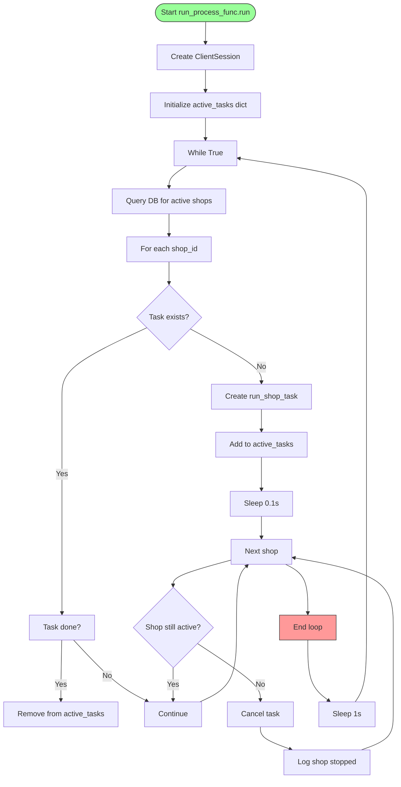

**Diagram sources**
- [run_process_func.py](file://app/modules/shop_runner/run_process_func.py#L1-L102)

**Section sources**
- [run_process_func.py](file://app/modules/shop_runner/run_process_func.py#L1-L102)

### Scheduling Mechanism
The system uses a decorator-based scheduling mechanism (@while_coroutine_decorator) to control the frequency of various operations. Different tasks have different update intervals based on their resource requirements and data freshness needs.

```mermaid
graph TD
Scheduling[Scheduling Intervals] --> UpdateCPM["update_cpm_bid: 3 times/min"]
Scheduling --> Keywords["parsing_keywords_run: 1 time/min"]
Scheduling --> CommonStat["update_common_sale_stat: 5 min"]
Scheduling --> FullStat["update_full_adv_stat: 5 min"]
Scheduling --> AdvData["update_advs_data_from_wb_to_pg: 1 min"]
Scheduling --> CardData["update_cards_data_from_wb_to_pg: 15 min"]
Scheduling --> SettingsUpdate["adv_settings_auto_update: 5 min"]
Scheduling --> TopKey["update_top_key_in_advs: 1 time/min"]
style UpdateCPM fill:#ff9,stroke:#333
style Keywords fill:#ff9,stroke:#333
style CommonStat fill:#9ff,stroke:#333
style FullStat fill:#9ff,stroke:#333
style AdvData fill:#9ff,stroke:#333
style CardData fill:#9ff,stroke:#333
style SettingsUpdate fill:#9ff,stroke:#333
style TopKey fill:#ff9,stroke:#333
```

**Diagram sources**
- [manager.py](file://app/modules/shop_runner/service_manager/manager.py#L1-L262)

## State Synchronization and Error Isolation

### State Synchronization with Redis
The system uses Redis for state synchronization across multiple worker processes, implementing a heartbeat mechanism to track active shops and prevent duplicate processing.

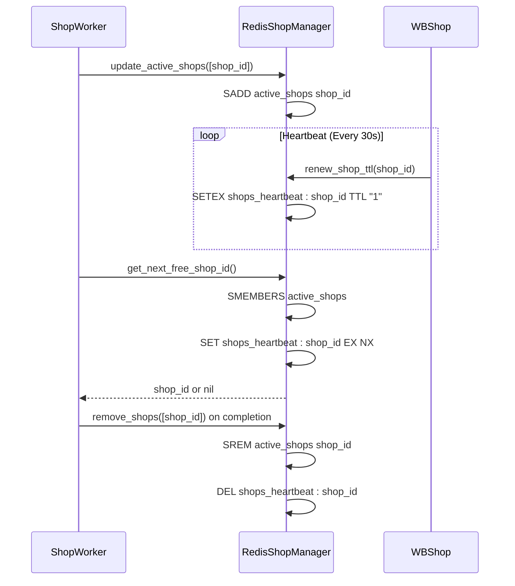

**Diagram sources**
- [redis_manager.py](file://app/modules/shop_runner/shop_run_worker/redis_manager/redis_manager.py#L1-L81)
- [wb_shop.py](file://app/modules/shop_runner/wb_shop.py#L1-L42)

**Section sources**
- [redis_manager.py](file://app/modules/shop_runner/shop_run_worker/redis_manager/redis_manager.py#L1-L81)

### Error Isolation and Handling
The system implements comprehensive error isolation to ensure that failures in one shop's processing do not affect others. Each shop runs in its own task with dedicated exception handling.

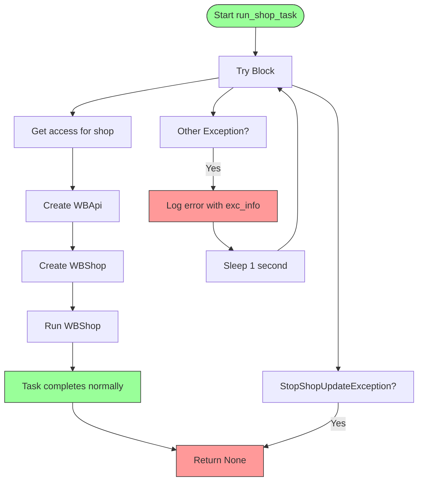

**Diagram sources**
- [run_process_func.py](file://app/modules/shop_runner/run_process_func.py#L1-L102)
- [worker.py](file://app/modules/shop_runner/shop_run_worker/worker/worker.py#L1-L79)

## Resource Allocation and Health Monitoring

### Resource Allocation Strategy
The system implements a distributed resource allocation strategy using Redis as a coordination point, ensuring that multiple worker processes can operate concurrently without conflict.

```mermaid
graph TD
subgraph "Worker 1"
W1[ShopWorker]
R1[RedisShopManager]
end
subgraph "Worker 2"
W2[ShopWorker]
R2[RedisShopManager]
end
subgraph "Redis"
ActiveShops[active_shops Set]
Heartbeats[shops_heartbeat:* Keys]
end
W1 --> R1
W2 --> R2
R1 --> ActiveShops
R2 --> ActiveShops
R1 --> Heartbeats
R2 --> Heartbeats
W1->>ActiveShops: get_next_free_shop_id()
W2->>ActiveShops: get_next_free_shop_id()
ActiveShops --> >W1: Returns shop_id if available
ActiveShops --> >W2: Returns nil if locked
style W1 fill:#f9f,stroke:#333
style W2 fill:#f9f,stroke:#333
style ActiveShops fill:#ff9,stroke:#333
style Heartbeats fill:#ff9,stroke:#333
```

**Diagram sources**
- [redis_manager.py](file://app/modules/shop_runner/shop_run_worker/redis_manager/redis_manager.py#L1-L81)
- [worker.py](file://app/modules/shop_runner/shop_run_worker/worker/worker.py#L1-L79)

### Health Monitoring Capabilities
The system includes built-in health monitoring through heartbeat mechanisms and comprehensive logging, allowing operators to track the status of all shop processing activities.

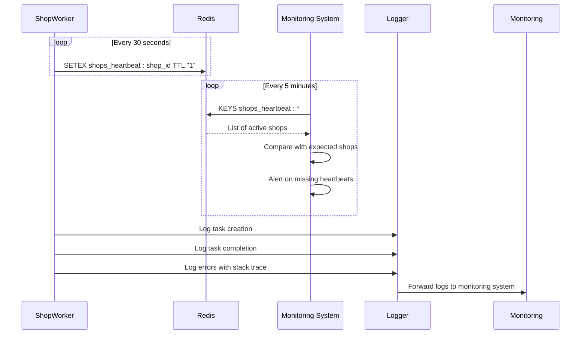

**Diagram sources**
- [wb_shop.py](file://app/modules/shop_runner/wb_shop.py#L1-L42)
- [redis_manager.py](file://app/modules/shop_runner/shop_run_worker/redis_manager/redis_manager.py#L1-L81)

## Operational Issues and Recovery Procedures

### Process Crash Recovery
The system is designed to recover gracefully from process crashes through its Redis-based state management and heartbeat system.

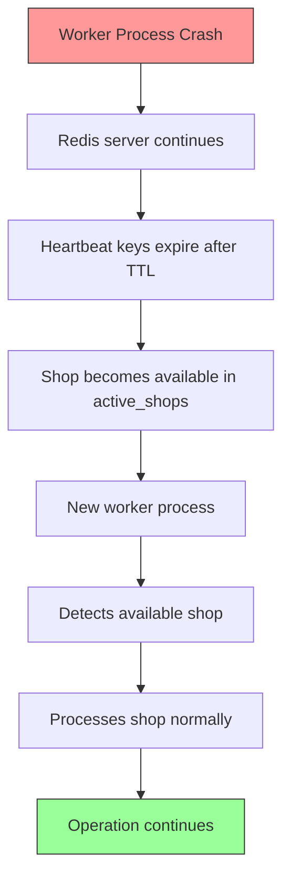

**Section sources**
- [redis_manager.py](file://app/modules/shop_runner/shop_run_worker/redis_manager/redis_manager.py#L1-L81)
- [wb_shop.py](file://app/modules/shop_runner/wb_shop.py#L1-L42)

### Data Inconsistency Handling
The system includes mechanisms to handle data inconsistencies, particularly in the shop configuration and advertising settings.

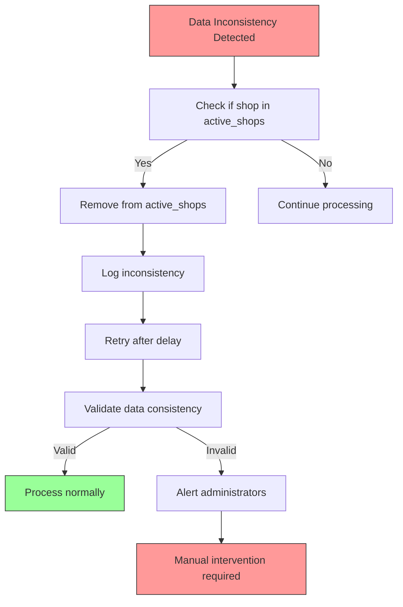

**Section sources**
- [run_process_func.py](file://app/modules/shop_runner/run_process_func.py#L1-L102)
- [manager.py](file://app/modules/shop_runner/service_manager/manager.py#L1-L262)

## Configuration and Command Propagation

### Shop Configuration Example
Shop configuration is managed through database records that define the operational parameters for each shop.

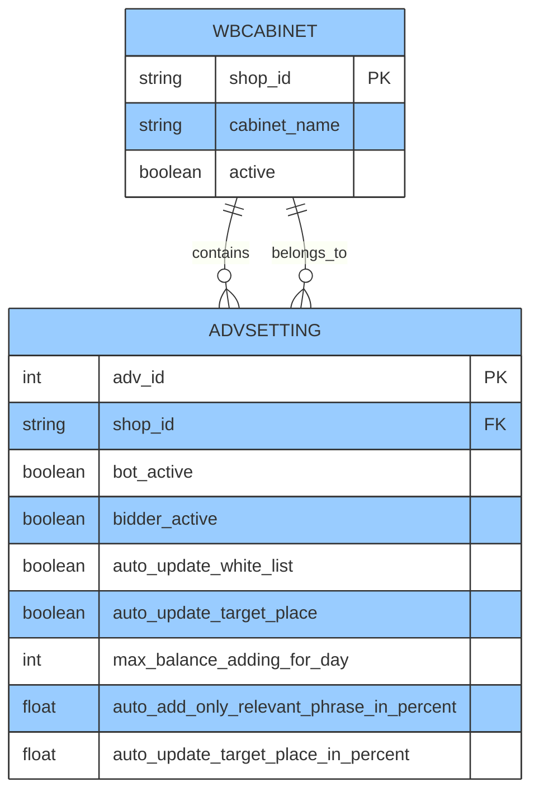

**Section sources**
- [manager.py](file://app/modules/shop_runner/service_manager/manager.py#L1-L262)

### Command Propagation Flow
Operational commands propagate from user interfaces through the database to execution workers, enabling real-time control of shop operations.

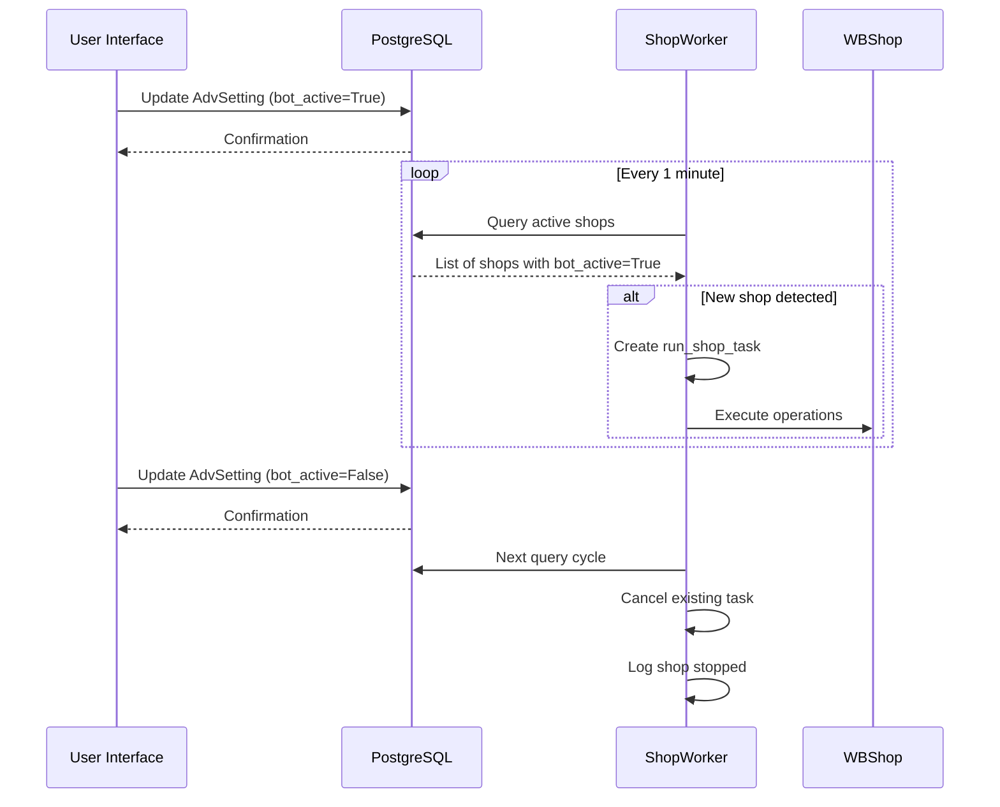

**Diagram sources**
- [run_process_func.py](file://app/modules/shop_runner/run_process_func.py#L1-L102)
- [manager.py](file://app/modules/shop_runner/service_manager/manager.py#L1-L262)

## Conclusion
The Shop Operations module provides a robust and scalable solution for automating Wildberries shop management. Through its distributed architecture, the system can concurrently manage multiple shops while maintaining isolation between them. The combination of Redis for state synchronization and PostgreSQL for persistent storage ensures data consistency and fault tolerance. The modular design allows for easy extension of functionality, while the comprehensive error handling and recovery mechanisms ensure reliable operation even in the face of failures. This architecture effectively balances performance, reliability, and maintainability for large-scale shop automation.