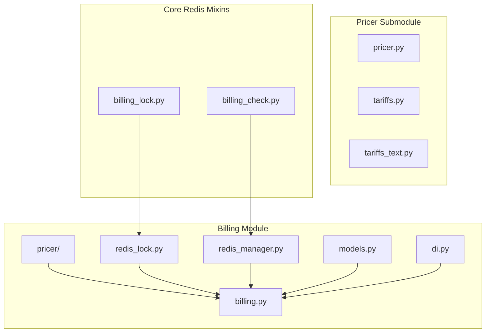
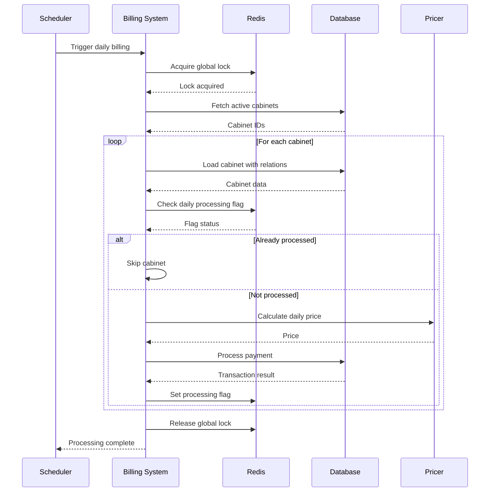
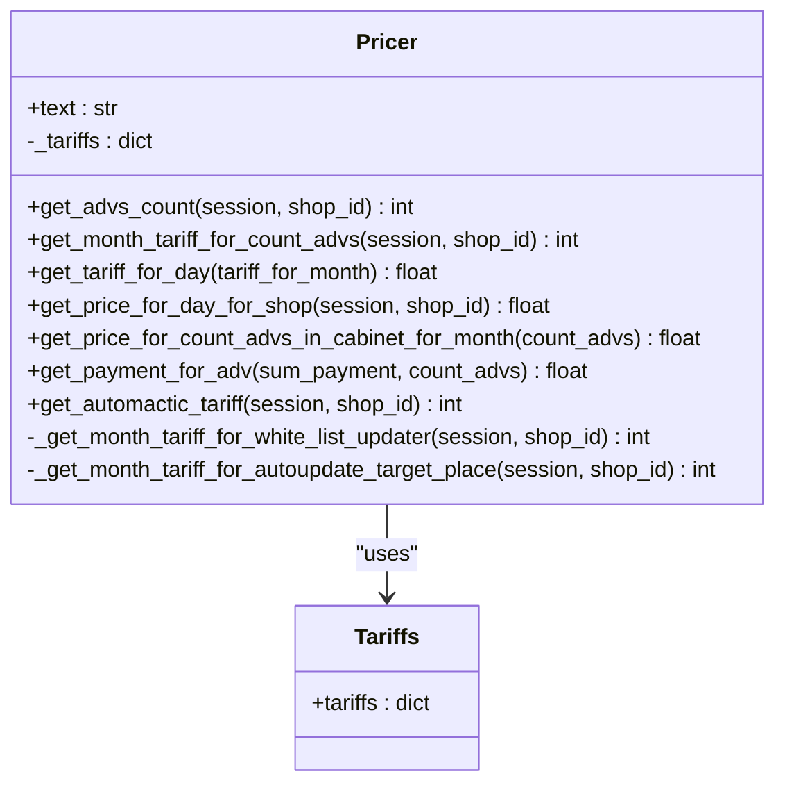
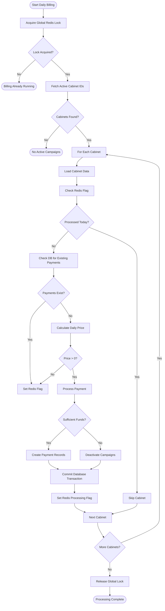
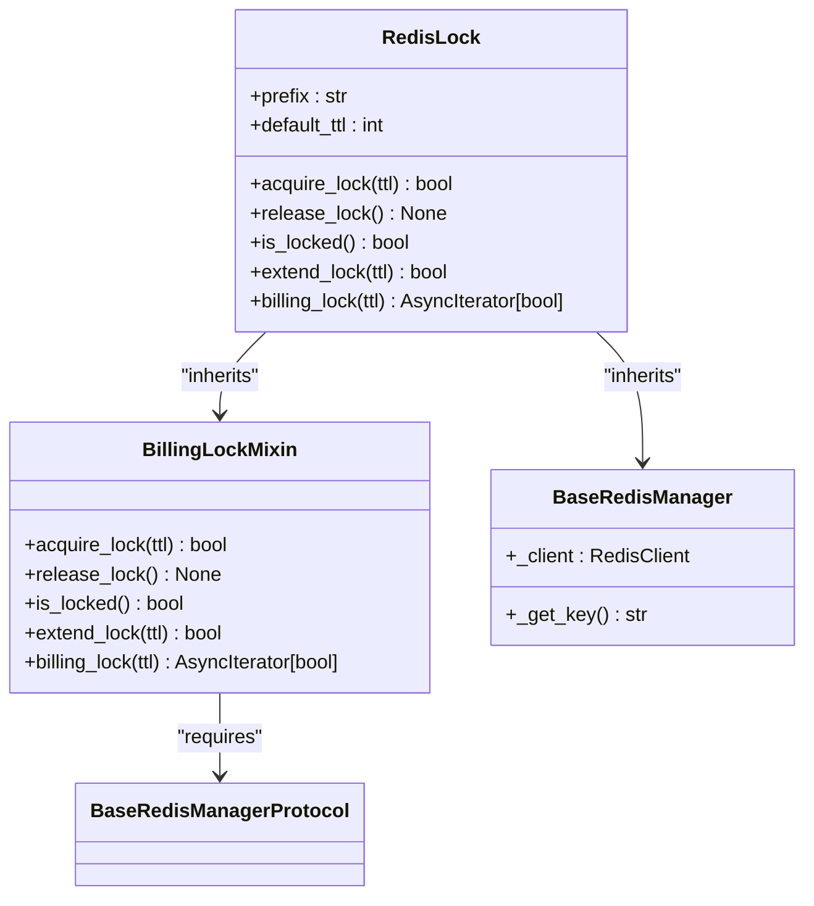
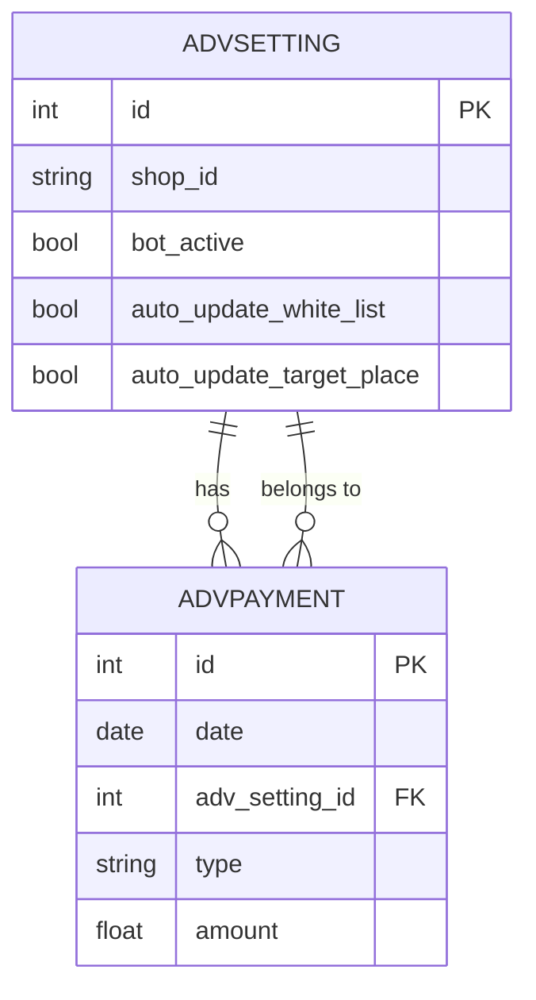
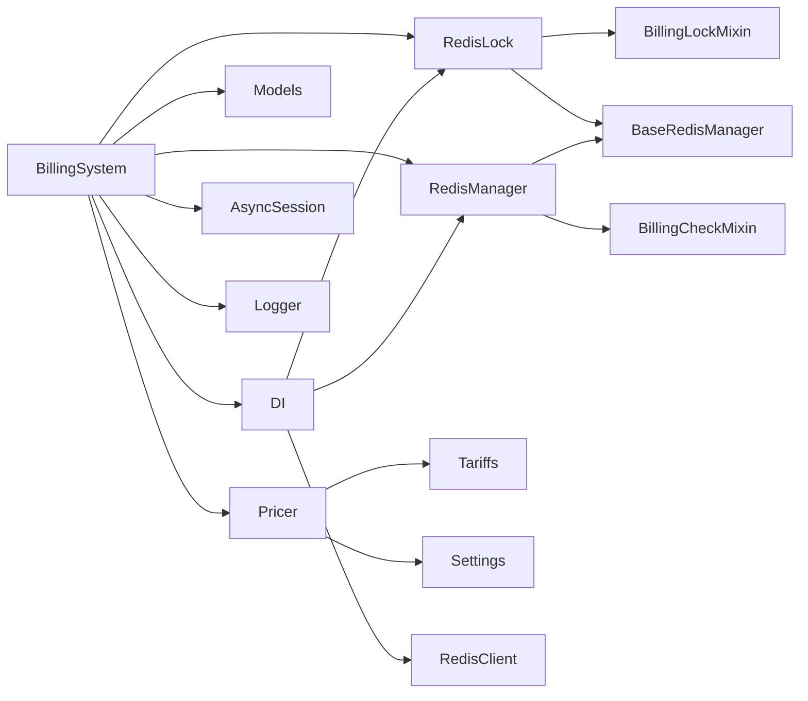

# Billing System

<cite>
**Referenced Files in This Document**   
- [pricer.py](file://app/modules/billing/pricer/pricer.py)
- [tariffs.py](file://app/modules/billing/pricer/tariffs.py)
- [billing.py](file://app/modules/billing/billing.py)
- [models.py](file://app/modules/billing/models.py)
- [redis_lock.py](file://app/modules/billing/redis_lock.py)
- [redis_manager.py](file://app/modules/billing/redis_manager.py)
- [di.py](file://app/modules/billing/di.py)
- [billing_lock.py](file://app/core/redis_manager_v2/mixins/billing_lock.py)
- [billing_check.py](file://app/core/redis_manager_v2/mixins/billing_check.py)
- [settings_master.py](file://app/settings/settings_master.py)
</cite>

## Table of Contents
1. [Introduction](#introduction)
2. [Project Structure](#project-structure)
3. [Core Components](#core-components)
4. [Architecture Overview](#architecture-overview)
5. [Detailed Component Analysis](#detailed-component-analysis)
6. [Dependency Analysis](#dependency-analysis)
7. [Performance Considerations](#performance-considerations)
8. [Troubleshooting Guide](#troubleshooting-guide)
9. [Conclusion](#conclusion)

## Introduction
The Billing System module is responsible for managing daily billing operations for advertising campaigns in the platform. It handles usage tracking, pricing calculations based on tariff models, and payment processing for active campaigns. The system ensures accurate billing through a combination of database transactions and Redis-based locking mechanisms to prevent race conditions. This document provides a comprehensive overview of the architecture, implementation details, and operational characteristics of the billing system.

## Project Structure
The Billing System is organized within the `app/modules/billing` directory with a clear separation of concerns. The module contains subcomponents for pricing calculations, billing processing, data models, and Redis integration.

**Diagram sources**
- [app/modules/billing](file://app/modules/billing)
- [app/modules/billing/pricer](file://app/modules/billing/pricer)
- [app/core/redis_manager_v2/mixins](file://app/core/redis_manager_v2/mixins)

**Section sources**
- [app/modules/billing](file://app/modules/billing)
- [app/modules/billing/pricer](file://app/modules/billing/pricer)

## Core Components
The Billing System consists of several core components that work together to process daily billing for advertising campaigns. The system calculates pricing based on the number of active campaigns and additional services, processes payments from user balances or bonuses, and maintains billing records. Key components include the Pricer for tariff calculations, the billing processor for payment execution, Redis-based locking mechanisms to prevent concurrent execution, and data models for storing billing records.

**Section sources**
- [pricer.py](file://app/modules/billing/pricer/pricer.py)
- [billing.py](file://app/modules/billing/billing.py)
- [models.py](file://app/modules/billing/models.py)
- [redis_lock.py](file://app/modules/billing/redis_lock.py)
- [redis_manager.py](file://app/modules/billing/redis_manager.py)

## Architecture Overview
The Billing System follows a modular architecture with clear separation between pricing logic, payment processing, and infrastructure components. The system operates on a daily cycle, processing billing for all active advertising campaigns. It uses a global Redis lock to ensure only one instance runs at a time, preventing race conditions in billing operations.

**Diagram sources**
- [billing.py](file://app/modules/billing/billing.py#L290-L329)
- [redis_lock.py](file://app/modules/billing/redis_lock.py)
- [redis_manager.py](file://app/modules/billing/redis_manager.py)

## Detailed Component Analysis

### Pricer Implementation
The Pricer component is responsible for calculating billing costs based on tariff models and the number of active advertising campaigns. It implements tiered pricing where the cost per campaign decreases as the number of campaigns increases.

**Diagram sources**
- [pricer.py](file://app/modules/billing/pricer/pricer.py)
- [tariffs.py](file://app/modules/billing/pricer/tariffs.py)

**Section sources**
- [pricer.py](file://app/modules/billing/pricer/pricer.py#L0-L103)
- [tariffs.py](file://app/modules/billing/pricer/tariffs.py#L0-L9)

### Billing Processing Workflow
The billing processing workflow handles the end-to-end execution of daily billing operations, including payment processing, balance management, and record keeping.

**Diagram sources**
- [billing.py](file://app/modules/billing/billing.py#L290-L367)
- [redis_manager.py](file://app/modules/billing/redis_manager.py)

**Section sources**
- [billing.py](file://app/modules/billing/billing.py#L0-L367)

### Redis Locking Mechanism
The Redis locking mechanism ensures that only one instance of the billing process runs at a time, preventing race conditions and duplicate billing.

**Diagram sources**
- [redis_lock.py](file://app/modules/billing/redis_lock.py)
- [billing_lock.py](file://app/core/redis_manager_v2/mixins/billing_lock.py)
- [base_redis_manager.py](file://app/core/redis_manager_v2/base_redis_manager.py)

**Section sources**
- [redis_lock.py](file://app/modules/billing/redis_lock.py#L0-L26)
- [billing_lock.py](file://app/core/redis_manager_v2/mixins/billing_lock.py#L0-L98)

### Data Models
The data models define the structure of billing records stored in the database, including payment information for advertising campaigns.

**Diagram sources**
- [models.py](file://app/modules/billing/models.py)
- [common_slaves/wildberries/models.py](file://app/modules/common_slaves/wildberries/models.py)

**Section sources**
- [models.py](file://app/modules/billing/models.py#L0-L29)

## Dependency Analysis
The Billing System has dependencies on several external components and services, including database connections, Redis for locking and caching, and configuration settings.

**Diagram sources**
- [di.py](file://app/modules/billing/di.py)
- [billing.py](file://app/modules/billing/billing.py)
- [redis_lock.py](file://app/modules/billing/redis_lock.py)
- [redis_manager.py](file://app/modules/billing/redis_manager.py)

**Section sources**
- [di.py](file://app/modules/billing/di.py#L0-L42)
- [billing.py](file://app/modules/billing/billing.py)

## Performance Considerations
The Billing System is designed with performance and reliability in mind. It uses asynchronous processing to handle multiple cabinets concurrently, reducing overall processing time. The system implements a two-level idempotency mechanism using both Redis flags and database checks to prevent duplicate processing. The global Redis lock ensures that only one billing process runs at a time, preventing resource contention. Database operations are optimized with read-only sessions for initial queries and short-lived transactions for updates. The system also implements best-effort Redis flag setting, where successful database commits are not dependent on Redis operations, making the system resilient to Redis failures.

**Section sources**
- [billing.py](file://app/modules/billing/billing.py#L260-L291)
- [redis_manager.py](file://app/modules/billing/redis_manager.py#L0-L7)

## Troubleshooting Guide
Common issues in the Billing System typically relate to payment processing, locking mechanisms, and configuration settings. For billing inaccuracies, verify the tariff configuration in the settings and ensure the pricer is correctly calculating costs based on the number of active campaigns. For subscription management issues, check the campaign status in the database and verify that the auto-update features are properly configured. Payment failures can occur due to insufficient funds in the bonus or balance accounts; the system will automatically deactivate campaigns when funds are insufficient. If billing processes are not running, verify that the global Redis lock is not held by another process and check the scheduler configuration. For Redis-related issues, ensure that the Redis connection is stable and that the TTL settings are appropriate for the deployment environment.

**Section sources**
- [billing.py](file://app/modules/billing/billing.py#L96-L124)
- [settings_master.py](file://app/settings/settings_master.py#L342-L350)
- [test_billing.py](file://tests/modules/billing/test_billing.py)
- [test_billing_parallel.py](file://tests/modules/billing/test_billing_parallel.py)

## Conclusion
The Billing System provides a robust and reliable solution for managing daily billing operations for advertising campaigns. Its modular architecture separates concerns between pricing, payment processing, and infrastructure components, making it maintainable and extensible. The system's use of Redis for locking and idempotency ensures data consistency and prevents race conditions. The tiered pricing model implemented in the Pricer component allows for flexible tariff management based on the number of active campaigns. With its comprehensive error handling and idempotent design, the system can recover gracefully from failures and ensure accurate billing. The architecture supports future enhancements such as integration with external payment gateways and more sophisticated pricing models.