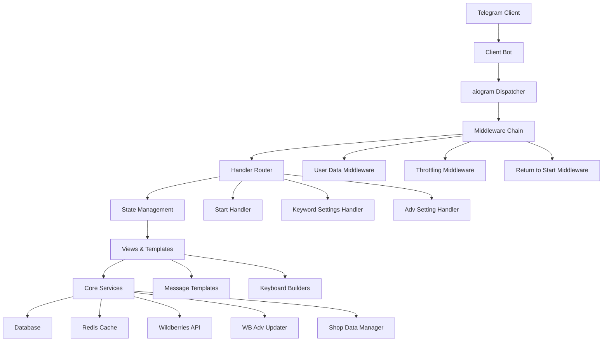
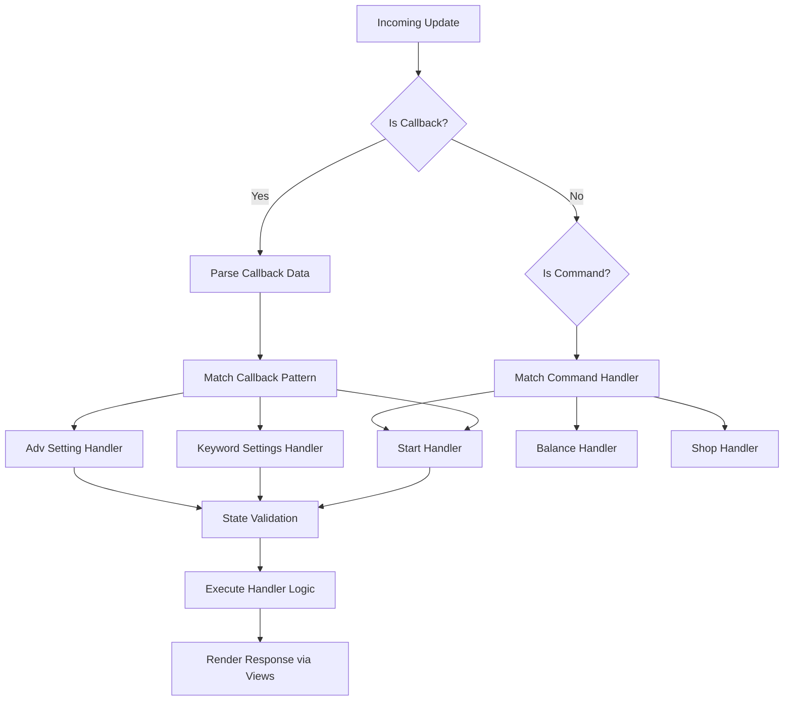
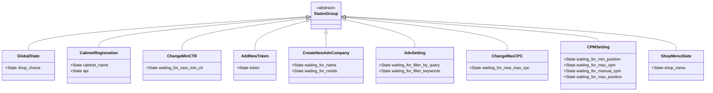
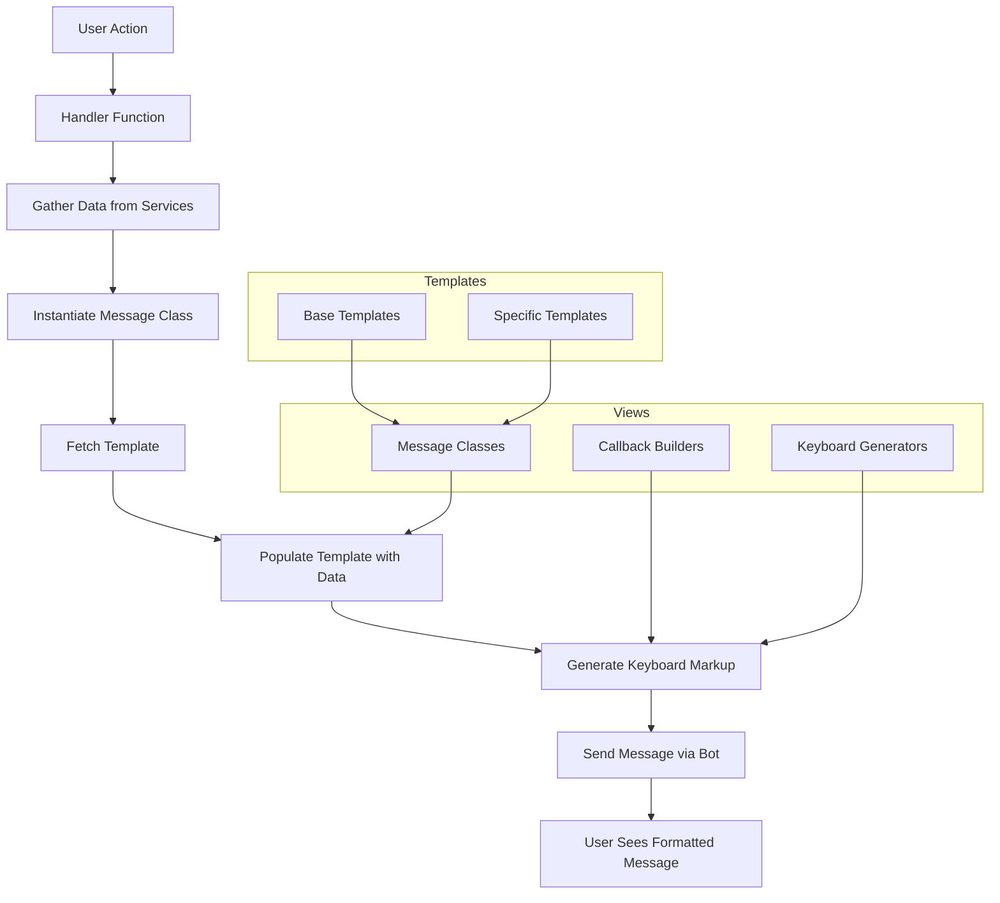
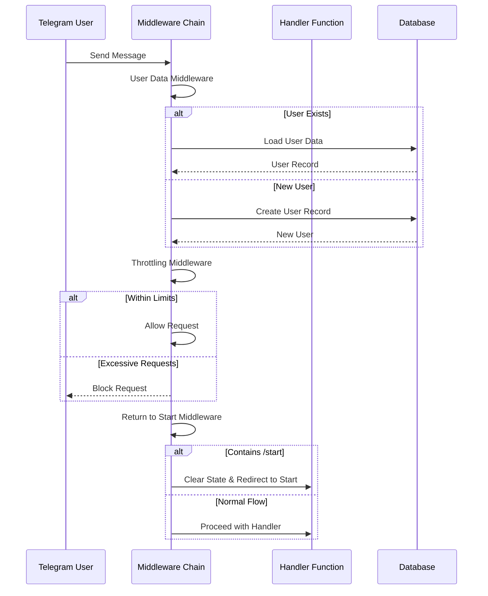
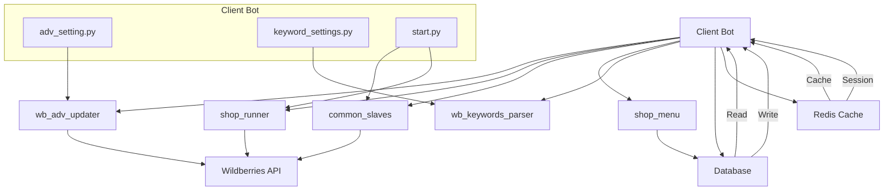
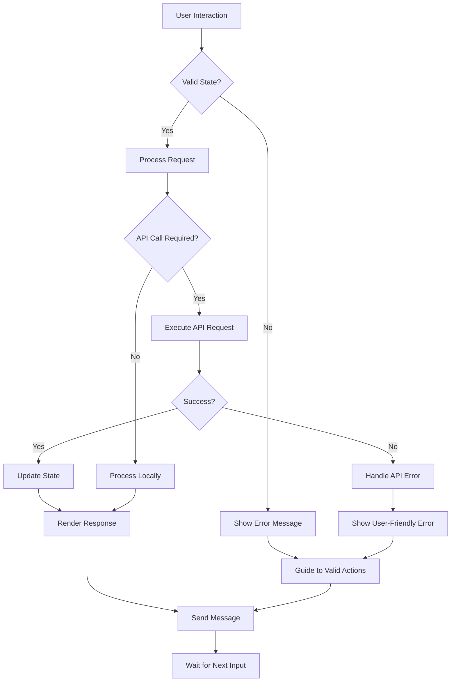

# Client Bot

<cite>
**Referenced Files in This Document**   
- [bot.py](file://app/client_bot/bot.py)
- [states.py](file://app/client_bot/user_interface/states.py)
- [start.py](file://app/client_bot/user_interface/handlers/start/start.py)
- [keyword_settings.py](file://app/client_bot/user_interface/handlers/keyword_settings.py)
- [user_data.py](file://app/client_bot/middlewars/user_data.py)
- [throtting.py](file://app/client_bot/middlewars/throtting.py)
- [return_to_start_from_state.py](file://app/client_bot/middlewars/return_to_start_from_state.py)
- [messages.py](file://app/client_bot/user_interface/views/messages/messages.py)
</cite>

## Table of Contents
1. [Introduction](#introduction)
2. [Architecture Overview](#architecture-overview)
3. [Handler Routing with aiogram](#handler-routing-with-aiogram)
4. [State Management with Finite State Machine](#state-management-with-finite-state-machine)
5. [Message Rendering via Views and Templates](#message-rendering-via-views-and-templates)
6. [Middleware for Security and UX Enhancement](#middleware-for-security-and-ux-enhancement)
7. [Integration with Core Services](#integration-with-core-services)
8. [Common Issues and Flow Management](#common-issues-and-flow-management)
9. [Conclusion](#conclusion)

## Introduction
The Client Bot module serves as the primary Telegram interface for end users managing Wildberries advertising campaigns in the adv-bot system. It enables users to configure advertising settings, manage keywords, monitor campaign performance, and interact with various system features through a conversational interface. Built on the aiogram framework, the bot provides a structured, stateful experience that guides users through complex workflows while maintaining security and usability.

This document details the architecture and functionality of the Client Bot, focusing on its handler routing mechanism, state management system, message rendering pipeline, middleware components, and integration points with core services. The content is designed to be accessible to beginners with practical usage examples while providing technical depth for developers extending the system with new features.

## Architecture Overview

**Diagram sources**
- [bot.py](file://app/client_bot/bot.py)
- [global_router.py](file://app/client_bot/global_router.py)
- [states.py](file://app/client_bot/user_interface/states.py)

**Section sources**
- [bot.py](file://app/client_bot/bot.py)
- [global_router.py](file://app/client_bot/global_router.py)

## Handler Routing with aiogram

The Client Bot utilizes aiogram's router system to direct incoming Telegram messages and callbacks to appropriate handler functions. The routing architecture is organized around specific user actions and interface components, with dedicated handler modules for different functional areas.

Handler registration follows a structured pattern where callback queries are filtered by specific data patterns that identify the intended action. For example, the keyword settings handler uses callback data filtering to distinguish between different types of keyword management operations such as filtering by query, viewing active keywords, or sorting by CTR (Click-Through Rate).

The routing system integrates with aiogram's state management to ensure that handlers are only invoked when the user is in the appropriate state for a given operation. This prevents invalid state transitions and maintains the integrity of multi-step workflows.

**Diagram sources**
- [start.py](file://app/client_bot/user_interface/handlers/start/start.py)
- [keyword_settings.py](file://app/client_bot/user_interface/handlers/keyword_settings.py)
- [global_router.py](file://app/client_bot/global_router.py)

**Section sources**
- [start.py](file://app/client_bot/user_interface/handlers/start/start.py)
- [keyword_settings.py](file://app/client_bot/user_interface/handlers/keyword_settings.py)

## State Management with Finite State Machine

The Client Bot implements a Finite State Machine (FSM) pattern using aiogram's state management system to handle multi-step user interactions. The states are defined in the `states.py` file as state groups, with each group representing a specific workflow or form-filling process.

Each state group contains one or more states that represent sequential steps in a process. For example, the `CabinetRegistration` state group manages the process of adding a new Wildberries cabinet, with states for entering the cabinet name and API token. Similarly, the `AdvSetting` state group handles advertising configuration workflows.

The state machine ensures that users progress through workflows in a controlled manner, preventing invalid transitions and maintaining context between messages. State data is stored in aiogram's FSM context, allowing handlers to access and update workflow-specific data throughout the interaction.

**Diagram sources**
- [states.py](file://app/client_bot/user_interface/states.py)

**Section sources**
- [states.py](file://app/client_bot/user_interface/states.py)

## Message Rendering via Views and Templates

The Client Bot employs a structured approach to message rendering through its views and message_templates components. This separation of concerns allows for consistent UI presentation while enabling dynamic content generation based on application state and user data.

The rendering system consists of two main components: message classes that encapsulate the logic for creating specific message types, and templates that define the textual content. Message classes in the `views/messages` directory handle the construction of complete Telegram messages, including text content, reply markup (keyboards), and media attachments when applicable.

Message templates in the `message_templates` directory contain the textual content for various interface elements, supporting both static messages and dynamic content with placeholders for runtime data substitution. This architecture enables localization and consistent styling across the bot's interface.

**Diagram sources**
- [messages.py](file://app/client_bot/user_interface/views/messages/messages.py)
- [templates.py](file://app/client_bot/user_interface/message_templates/templates.py)
- [keyboards.py](file://app/client_bot/user_interface/views/keyboards.py)

**Section sources**
- [messages.py](file://app/client_bot/user_interface/views/messages/messages.py)
- [templates.py](file://app/client_bot/user_interface/message_templates/templates.py)

## Middleware for Security and UX Enhancement

The Client Bot implements several middleware components to enhance security, improve user experience, and maintain system stability. These middleware functions intercept incoming updates before they reach the handler functions, allowing for cross-cutting concerns to be addressed consistently across all interactions.

The `user_data.py` middleware automatically loads or creates user records in the database, ensuring that user context is available to all handlers without requiring repetitive database queries. This middleware also handles user registration by creating database entries for new users upon their first interaction with the bot.

The `throtting.py` middleware prevents abuse and excessive API usage by implementing rate limiting for user interactions. It uses TTL (Time-To-Live) caches to track user activity and block excessive requests within defined time windows, with different thresholds for different types of operations.

The `return_to_start_from_state.py` middleware provides a seamless way for users to reset their current workflow by detecting "/start" commands even when they are in the middle of a multi-step process. This enhances usability by allowing users to easily recover from errors or change their intended action.

**Diagram sources**
- [user_data.py](file://app/client_bot/middlewars/user_data.py)
- [throtting.py](file://app/client_bot/middlewars/throtting.py)
- [return_to_start_from_state.py](file://app/client_bot/middlewars/return_to_start_from_state.py)

**Section sources**
- [user_data.py](file://app/client_bot/middlewars/user_data.py)
- [throtting.py](file://app/client_bot/middlewars/throtting.py)
- [return_to_start_from_state.py](file://app/client_bot/middlewars/return_to_start_from_state.py)

## Integration with Core Services

The Client Bot integrates with various core services to provide functionality for managing Wildberries advertising campaigns. These integrations enable the bot to retrieve data, execute operations, and maintain synchronization between the Telegram interface and backend systems.

Key integration points include the `wb_adv_updater` module, which handles updates to advertising configurations on the Wildberries platform. When users modify settings through the bot interface, these changes are propagated to the `wb_adv_updater` service for execution. The bot also interacts with the `shop_runner` module to manage shop-specific operations and configurations.

Data persistence is handled through integration with the database layer, using SQLAlchemy for ORM operations. The bot queries user cabinets, advertising settings, and keyword configurations from the database to populate interface elements and validate user actions. Redis is used for caching frequently accessed data and managing temporary state information.

**Diagram sources**
- [adv_setting.py](file://app/client_bot/user_interface/handlers/adv_setting.py)
- [keyword_settings.py](file://app/client_bot/user_interface/handlers/keyword_settings.py)
- [start.py](file://app/client_bot/user_interface/handlers/start/start.py)

**Section sources**
- [adv_setting.py](file://app/client_bot/user_interface/handlers/adv_setting.py)
- [keyword_settings.py](file://app/client_bot/user_interface/handlers/keyword_settings.py)

## Common Issues and Flow Management

The Client Bot addresses common issues in conversational interfaces through proactive flow management and error handling strategies. One frequent challenge in Telegram bots is conversation flow interruption, where users may navigate away from a multi-step process or send unexpected commands.

The `return_to_start_from_state.py` middleware specifically addresses this issue by intercepting "/start" commands regardless of the current state, allowing users to easily reset their workflow. This design choice prioritizes user convenience over strict state enforcement, recognizing that users may need to change their intended action mid-process.

For handling invalid inputs, handlers implement validation logic that provides immediate feedback to users. For example, when registering a new cabinet, the system validates that the cabinet name is not empty and does not exceed length limits, providing specific error messages when validation fails.

The bot also manages API-related errors gracefully, particularly when interacting with Wildberries services. Invalid token errors are caught and communicated to users with clear instructions for correction, preventing the application from crashing and maintaining a smooth user experience.

**Diagram sources**
- [return_to_start_from_state.py](file://app/client_bot/middlewars/return_to_start_from_state.py)
- [start.py](file://app/client_bot/user_interface/handlers/start/start.py)
- [exceptions.py](file://app/client_bot/user_interface/handlers/exceptions.py)

**Section sources**
- [return_to_start_from_state.py](file://app/client_bot/middlewars/return_to_start_from_state.py)
- [start.py](file://app/client_bot/user_interface/handlers/start/start.py)

## Conclusion
The Client Bot module provides a comprehensive Telegram interface for managing Wildberries advertising campaigns, combining a user-friendly conversational design with robust technical architecture. By leveraging aiogram's capabilities for handler routing and state management, the bot delivers a structured experience that guides users through complex advertising configuration workflows.

The middleware system enhances security and usability through user data management, rate limiting, and flexible state handling. The separation of concerns between handlers, views, and templates enables maintainable code and consistent user interface presentation. Integration with core services like `wb_adv_updater` ensures that user actions in the Telegram interface translate to real changes in advertising campaigns on the Wildberries platform.

For developers extending the system, the modular architecture provides clear patterns for adding new features: defining appropriate states, creating handler functions with proper routing, implementing message classes for user interaction, and integrating with backend services as needed. The existing codebase serves as a comprehensive example of building sophisticated Telegram bots for complex business applications.