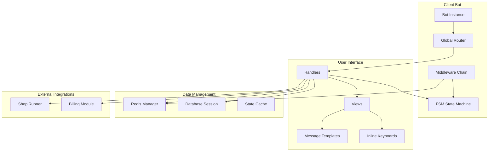
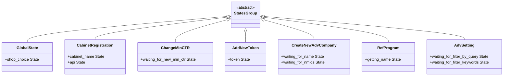
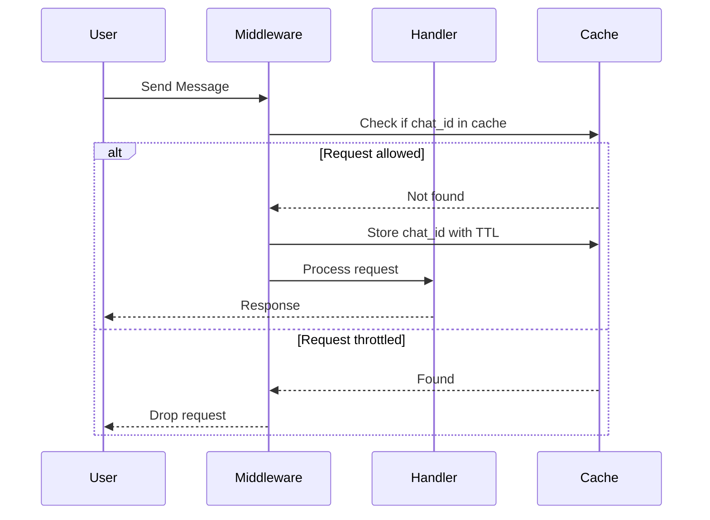
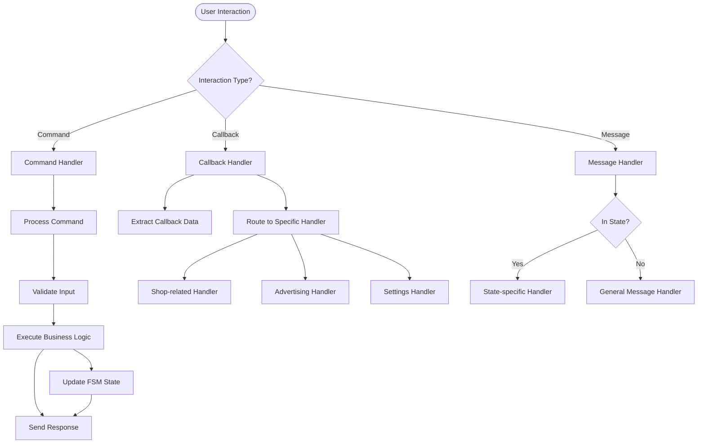
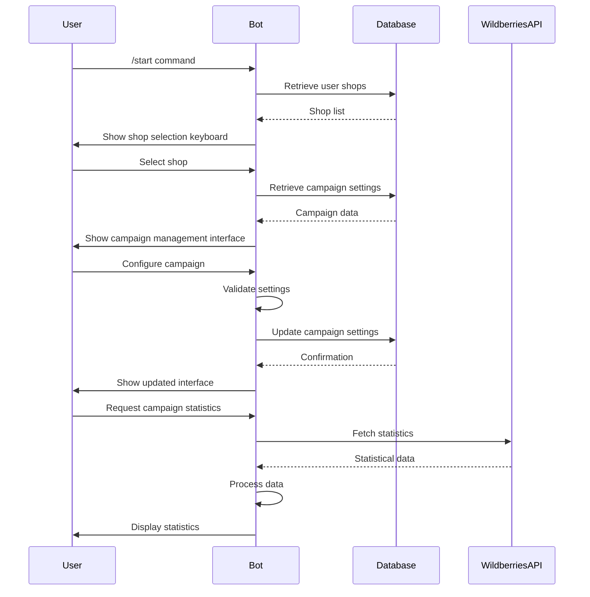
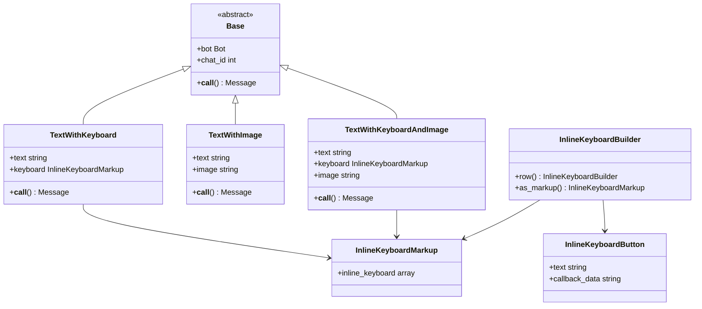
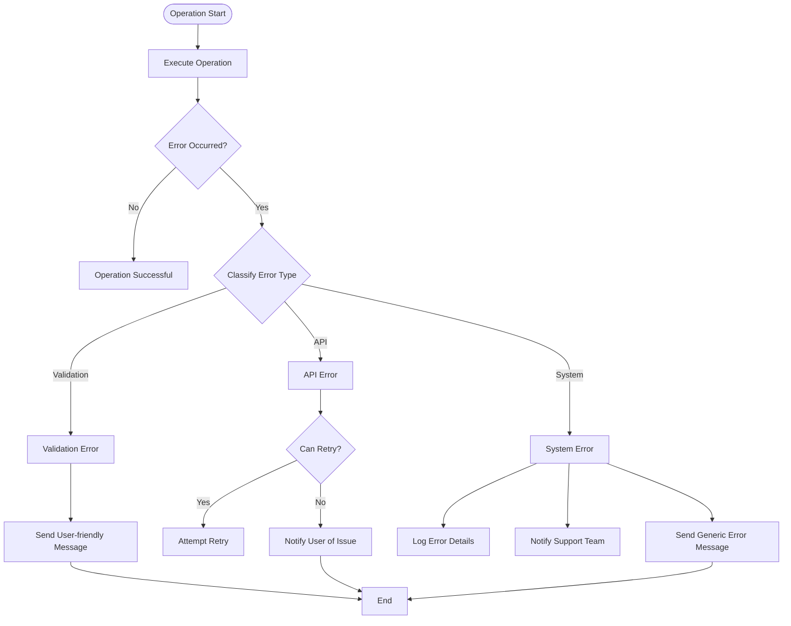
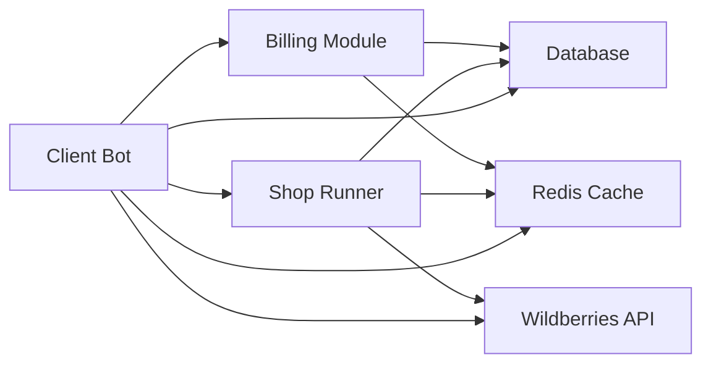
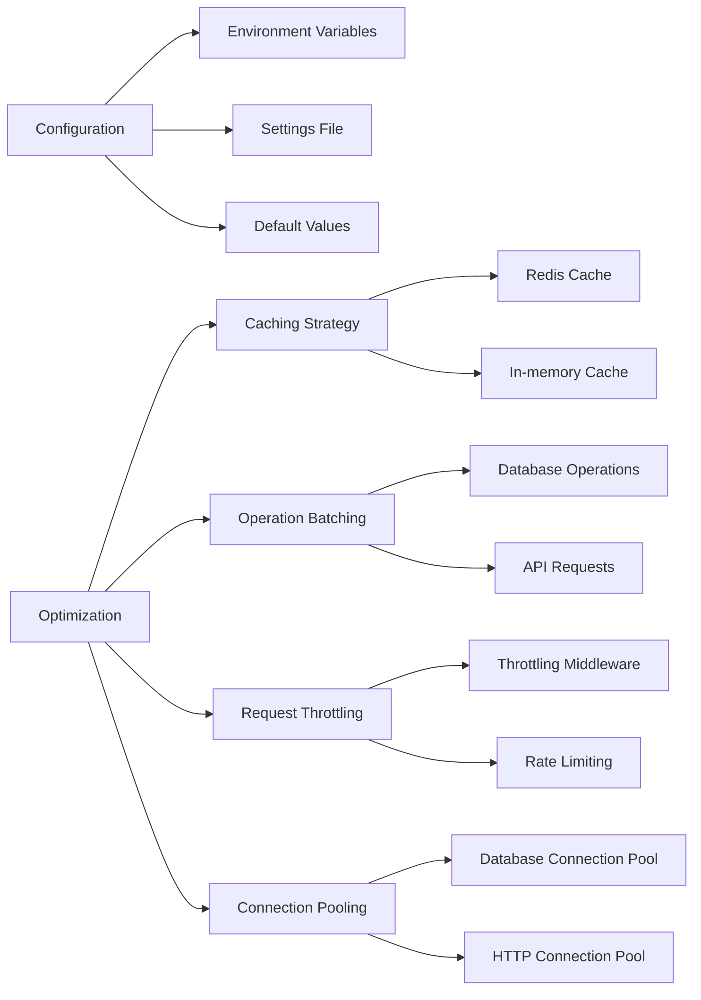

# Client Bot

<cite>
**Referenced Files in This Document**   
- [bot.py](file://app/client_bot/bot.py)
- [global_router.py](file://app/client_bot/global_router.py)
- [common_routers.py](file://app/client_bot/common_routers.py)
- [states.py](file://app/client_bot/user_interface/states.py)
- [start.py](file://app/client_bot/user_interface/handlers/start/start.py)
- [adv_setting.py](file://app/client_bot/user_interface/handlers/adv_setting.py)
- [throtting.py](file://app/client_bot/middlewars/throtting.py)
- [keyboards.py](file://app/client_bot/user_interface/views/keyboards.py)
- [templates.py](file://app/client_bot/user_interface/message_templates/templates.py)
- [shop_choice_message.py](file://app/client_bot/user_interface/handlers/shop_choice_message.py)
- [messages.py](file://app/client_bot/user_interface/views/messages/messages.py)
- [redis_manager.py](file://app/client_bot/redis_manager.py)
- [utils.py](file://app/client_bot/utils.py)
</cite>

## Table of Contents
1. [Introduction](#introduction)
2. [Architecture Overview](#architecture-overview)
3. [State Management](#state-management)
4. [Middleware Implementation](#middleware-implementation)
5. [Handler Organization](#handler-organization)
6. [User Interaction Flow](#user-interaction-flow)
7. [Message Templates and Keyboards](#message-templates-and-keyboards)
8. [Error Handling](#error-handling)
9. [Integration with Core Modules](#integration-with-core-modules)
10. [Configuration and Optimization](#configuration-and-optimization)

## Introduction
The Client Bot module serves as the Telegram interface for end-users, providing a comprehensive interface for managing advertising campaigns on Wildberries. Built on the aiogram framework, the bot enables users to register shops, configure advertising settings, manage keywords, and monitor campaign performance through an intuitive conversational interface. This document details the architecture, implementation, and integration points of the Client Bot, focusing on its state management, middleware, handler organization, and interaction flows.

**Section sources**
- [bot.py](file://app/client_bot/bot.py)
- [global_router.py](file://app/client_bot/global_router.py)

## Architecture Overview

**Diagram sources**
- [bot.py](file://app/client_bot/bot.py)
- [global_router.py](file://app/client_bot/global_router.py)
- [common_routers.py](file://app/client_bot/common_routers.py)

**Section sources**
- [bot.py](file://app/client_bot/bot.py)
- [global_router.py](file://app/client_bot/global_router.py)
- [common_routers.py](file://app/client_bot/common_routers.py)

## State Management

The Client Bot implements a comprehensive Finite State Machine (FSM) using aiogram's state management system to handle complex user interactions that span multiple messages. The state system is organized into multiple state groups, each dedicated to specific workflows such as shop registration, cabinet management, and advertising settings configuration.

The state management system enables the bot to maintain context across user interactions, allowing for multi-step processes like shop registration where the bot must remember the user's progress through the registration flow. States are defined as classes inheriting from StatesGroup, with each state representing a specific step in a workflow.

**Diagram sources**
- [states.py](file://app/client_bot/user_interface/states.py)

**Section sources**
- [states.py](file://app/client_bot/user_interface/states.py)
- [start.py](file://app/client_bot/user_interface/handlers/start/start.py)

## Middleware Implementation

The Client Bot employs a middleware system to handle cross-cutting concerns such as request throttling, state management, and message processing. Middleware components are registered at the router level and execute before or after handler functions, enabling consistent processing across all handlers.

The throttling middleware prevents users from overwhelming the system with rapid-fire requests by implementing rate limiting based on user chat IDs. This is particularly important for operations that involve external API calls or database operations that could be resource-intensive.

**Diagram sources**
- [throtting.py](file://app/client_bot/middlewars/throtting.py)

**Section sources**
- [throtting.py](file://app/client_bot/middlewars/throtting.py)
- [common_routers.py](file://app/client_bot/common_routers.py)

## Handler Organization

The Client Bot organizes its handlers in a modular structure, grouping related functionality into dedicated modules. The handler system follows a hierarchical routing approach, with the global router serving as the entry point that delegates to specialized routers based on the type of interaction.

Handler organization follows the Single Responsibility Principle, with each handler function focusing on a specific user action or callback. The system uses aiogram's callback query filtering to route interactions to the appropriate handler based on the callback data structure.

**Section sources**
- [global_router.py](file://app/client_bot/global_router.py)
- [common_routers.py](file://app/client_bot/common_routers.py)
- [adv_setting.py](file://app/client_bot/user_interface/handlers/adv_setting.py)

## User Interaction Flow

The Client Bot implements a comprehensive user interaction flow that guides users through the process of setting up and managing their advertising campaigns. The flow begins with shop registration and progresses through campaign selection, configuration, and monitoring.

The interaction flow is designed to be intuitive and user-friendly, with clear navigation options and contextual help. The bot uses a combination of text messages, inline keyboards, and callback queries to create a rich interactive experience that mimics a graphical user interface within the Telegram messaging environment.

**Section sources**
- [start.py](file://app/client_bot/user_interface/handlers/start/start.py)
- [adv_setting.py](file://app/client_bot/user_interface/handlers/adv_setting.py)
- [messages.py](file://app/client_bot/user_interface/views/messages/messages.py)

## Message Templates and Keyboards

The Client Bot utilizes a sophisticated system of message templates and inline keyboards to provide a consistent and professional user interface. Message templates are implemented as classes that encapsulate the text content, formatting, and associated keyboard, enabling reuse across different handlers.

Inline keyboards are dynamically generated based on the current state of the user's campaigns and permissions, providing contextually relevant options. The keyboard system supports pagination for lists of items, such as campaigns or keywords, allowing users to navigate through large datasets efficiently.

**Diagram sources**
- [templates.py](file://app/client_bot/user_interface/message_templates/templates.py)
- [keyboards.py](file://app/client_bot/user_interface/views/keyboards.py)

**Section sources**
- [templates.py](file://app/client_bot/user_interface/message_templates/templates.py)
- [keyboards.py](file://app/client_bot/user_interface/views/keyboards.py)
- [messages.py](file://app/client_bot/user_interface/views/messages/messages.py)

## Error Handling

The Client Bot implements a comprehensive error handling system to manage both expected and unexpected errors gracefully. The system distinguishes between validation errors, API errors, and system errors, providing appropriate responses and recovery options for each type.

Error handling is integrated throughout the handler chain, with try-catch blocks protecting external API calls and database operations. The bot logs detailed error information for debugging while presenting user-friendly error messages that guide users toward resolution.

**Section sources**
- [start.py](file://app/client_bot/user_interface/handlers/start/start.py)
- [adv_setting.py](file://app/client_bot/user_interface/handlers/adv_setting.py)
- [messages.py](file://app/client_bot/user_interface/views/messages/messages.py)

## Integration with Core Modules

The Client Bot integrates with several core modules to provide comprehensive functionality for managing advertising campaigns. These integrations enable the bot to access business logic, data storage, and external services required for its operations.

The most critical integrations are with the shop_runner module, which handles the actual campaign management and optimization, and the billing module, which manages user subscriptions and payments. These integrations are implemented through direct imports and function calls, allowing the bot to trigger complex business processes from user interactions.

**Section sources**
- [start.py](file://app/client_bot/user_interface/handlers/start/start.py)
- [adv_setting.py](file://app/client_bot/user_interface/handlers/adv_setting.py)
- [shop_choice_message.py](file://app/client_bot/user_interface/handlers/shop_choice_message.py)

## Configuration and Optimization

The Client Bot includes several configuration options and optimization techniques to ensure reliable performance and adaptability to different deployment environments. Configuration is managed through environment variables and settings files, allowing for easy customization without code changes.

Performance optimization focuses on reducing response times and minimizing resource usage, particularly important for handling high message volumes. Techniques include caching frequently accessed data, batching database operations, and implementing efficient state management.

**Section sources**
- [bot.py](file://app/client_bot/bot.py)
- [redis_manager.py](file://app/client_bot/redis_manager.py)
- [utils.py](file://app/client_bot/utils.py)
- [throtting.py](file://app/client_bot/middlewars/throtting.py)