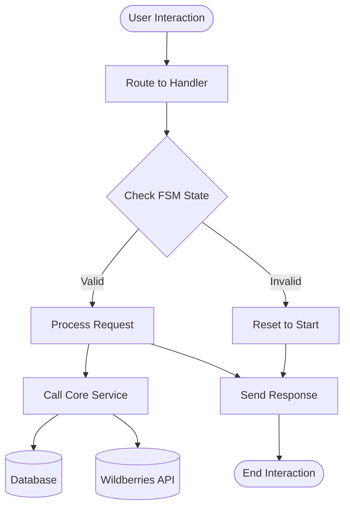
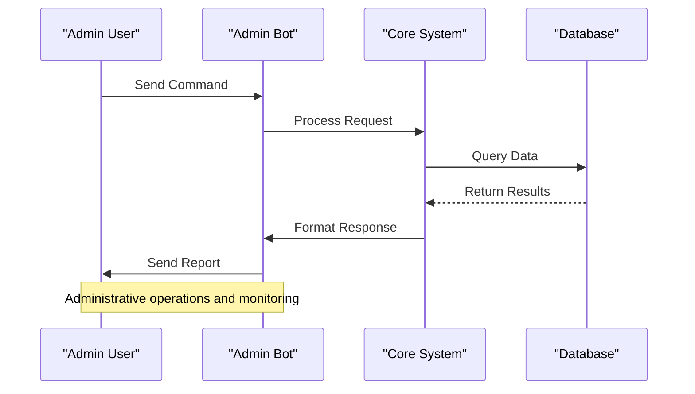
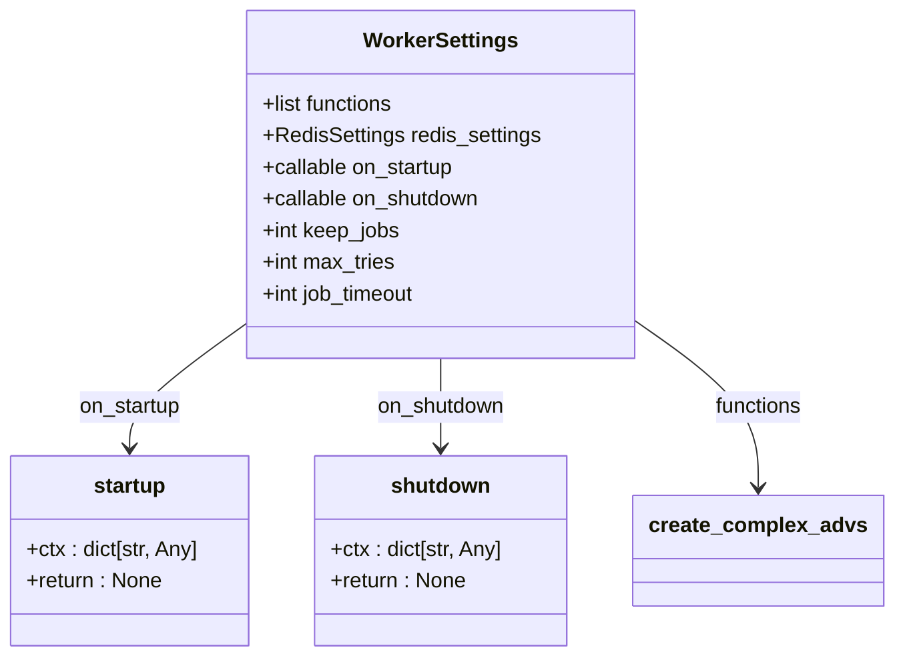
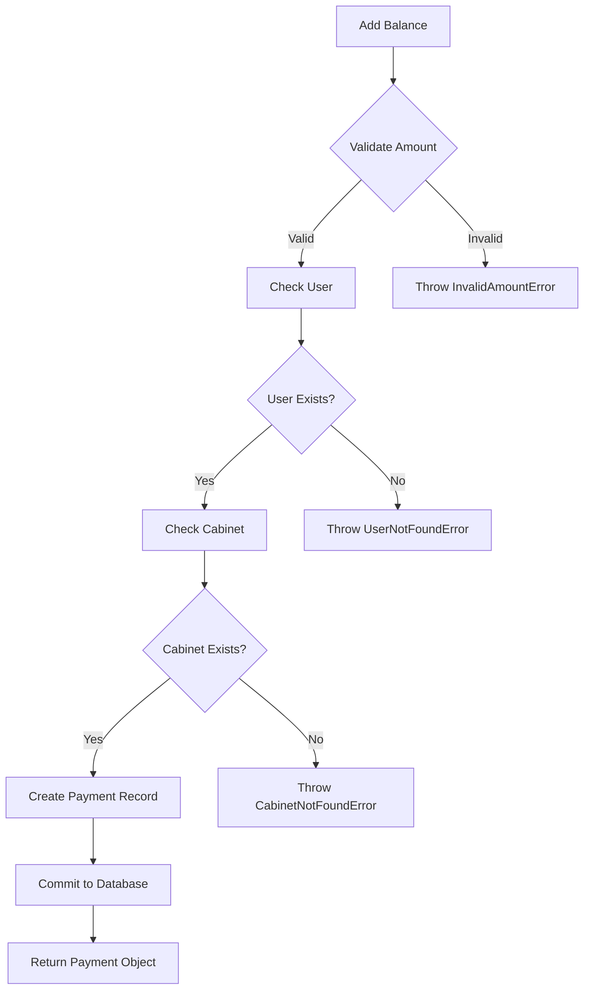
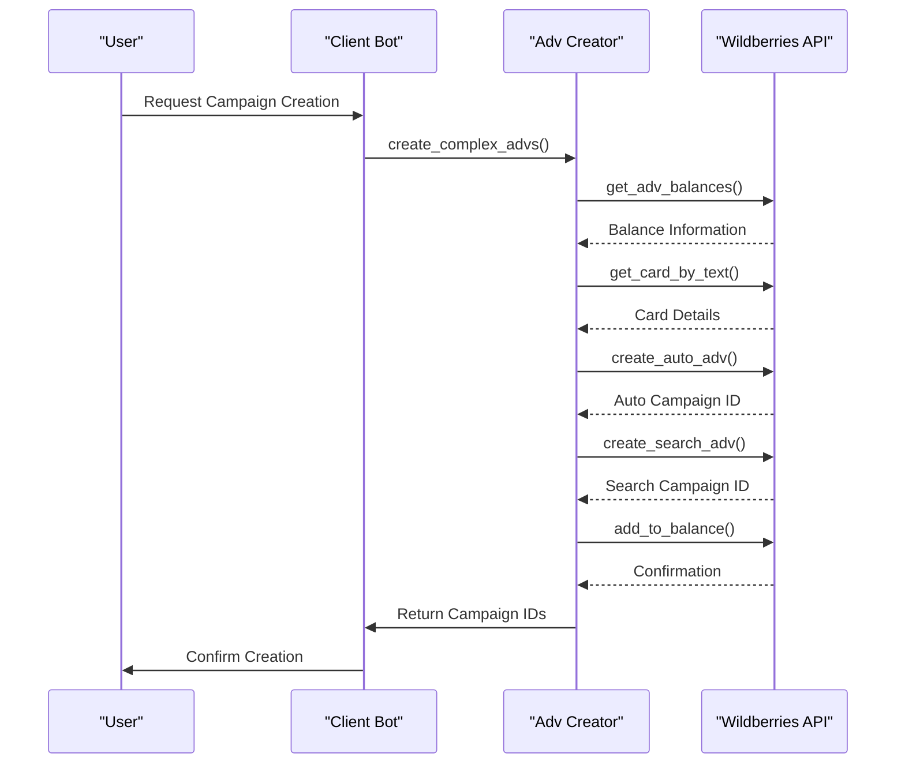
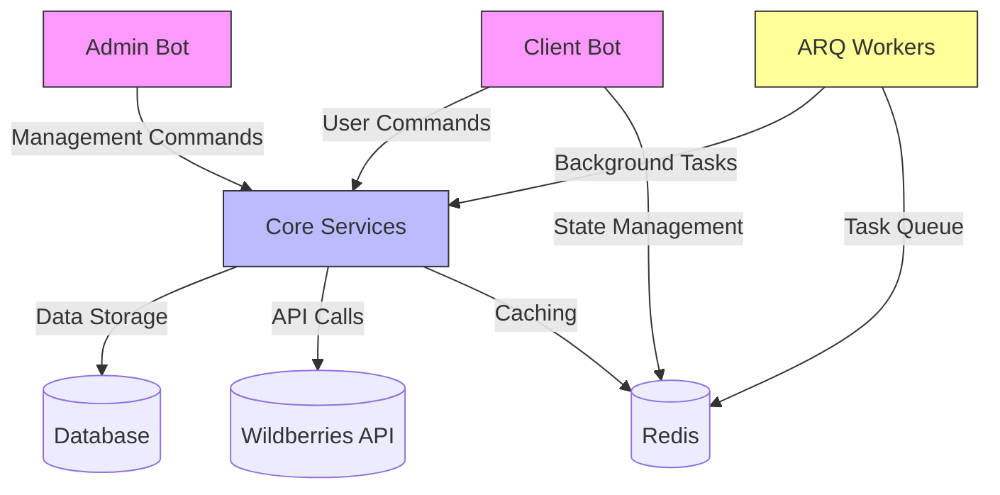

# Core Modules

<cite>
**Referenced Files in This Document**   
- [app/client_bot/bot.py](file://app/client_bot/bot.py)
- [app/admin_bot/run.py](file://app/admin_bot/run.py)
- [app/arq_workers/workers.py](file://app/arq_workers/workers.py)
- [app/client_bot/user_interface/handlers/start/start.py](file://app/client_bot/user_interface/handlers/start/start.py)
- [app/modules/shop_runner/service_manager/modules/adv_manager/adv_manager.py](file://app/modules/shop_runner/service_manager/modules/adv_manager/adv_manager.py)
- [app/modules/balance_manager/balance_service.py](file://app/modules/balance_manager/balance_service.py)
- [app/modules/wb_adv_updater/data_manager.py](file://app/modules/wb_adv_updater/data_manager.py)
- [app/modules/adv_creator/backend/main_manager.py](file://app/modules/adv_creator/backend/main_manager.py)
</cite>

## Table of Contents
1. [Introduction](#introduction)
2. [Client Bot Module](#client-bot-module)
3. [Admin Bot Module](#admin-bot-module)
4. [ARQ Workers Module](#arq-workers-module)
5. [Core Services Module](#core-services-module)
6. [Module Relationships and Integration](#module-relationships-and-integration)
7. [Configuration and Parameters](#configuration-and-parameters)
8. [Common Issues and Solutions](#common-issues-and-solutions)

## Introduction
The adv-bot system is a comprehensive Wildberries advertising management platform consisting of several core modules that work together to provide automated advertising campaign management, user interaction through Telegram, and background task processing. This document details the implementation and integration of the main application modules including client_bot for user-facing interactions, admin_bot for system administration, arq_workers for background processing, and core services that provide foundational functionality across the system.

## Client Bot Module

The client_bot module serves as the primary interface between users and the adv-bot system through Telegram. It handles user registration, cabinet management, advertising settings, and provides various analytical features.

The module is initialized in `app/client_bot/bot.py` where it creates a shared Bot instance using the Telegram API token from settings. This singleton pattern ensures consistent bot behavior across different handlers and components.



**Diagram sources**
- [app/client_bot/bot.py](file://app/client_bot/bot.py#L1-L15)
- [app/client_bot/user_interface/handlers/start/start.py](file://app/client_bot/user_interface/handlers/start/start.py#L1-L200)

The user interface handlers in `app/client_bot/user_interface/handlers` implement a state-based navigation system using aiogram's FSM (Finite State Machine) functionality. Key handlers include:

- **Start handlers**: Manage user registration and cabinet setup
- **Keyword position handlers**: Handle keyword tracking and history
- **Advertising setting handlers**: Manage CPC, CPM, and targeting configurations
- **Shop management handlers**: Handle multiple shop configurations

The module implements middleware for throttling, user data management, and state preservation to ensure reliable user interactions even during bot restarts.

**Section sources**
- [app/client_bot/bot.py](file://app/client_bot/bot.py#L1-L15)
- [app/client_bot/user_interface/handlers/start/start.py](file://app/client_bot/user_interface/handlers/start/start.py#L1-L200)

## Admin Bot Module

The admin_bot module provides system management capabilities for administrators, allowing oversight and control of the entire adv-bot system.

Implemented in `app/admin_bot/run.py`, this module creates a separate Telegram bot instance specifically for administrative functions. It uses Redis storage for FSM state persistence and connects to the admin bot API token retrieved from configuration files.



**Diagram sources**
- [app/admin_bot/run.py](file://app/admin_bot/run.py#L1-L30)

Key features of the admin_bot include:
- System status monitoring
- User management and oversight
- Payment processing verification
- Bulk operations and notifications
- Error reporting and logging access

The module uses a global router pattern to organize administrative commands and maintain separation from the client-facing bot functionality.

**Section sources**
- [app/admin_bot/run.py](file://app/admin_bot/run.py#L1-L30)

## ARQ Workers Module

The arq_workers module handles background task processing for the adv-bot system, enabling asynchronous execution of resource-intensive operations without blocking user interactions.

The worker configuration in `app/arq_workers/workers.py` defines the WorkerSettings class that specifies:
- Functions to be executed as background tasks
- Redis connection settings
- Startup and shutdown handlers
- Job retention and retry policies



**Diagram sources**
- [app/arq_workers/workers.py](file://app/arq_workers/workers.py#L1-L50)

Key aspects of the ARQ workers implementation:
- **Startup handler**: Initializes the bot instance and HTTP client session when the worker starts
- **Shutdown handler**: Properly closes connections when the worker stops
- **Task queue**: Uses Redis as a message broker for task distribution
- **Error handling**: Configured with 10 maximum retry attempts and 24-hour job retention

The primary background task registered is `create_complex_advs` from the adv_creator module, which handles the creation of comprehensive advertising campaigns.

**Section sources**
- [app/arq_workers/workers.py](file://app/arq_workers/workers.py#L1-L50)

## Core Services Module

The core services module contains foundational functionality used across the adv-bot system, including balance management, advertising operations, and data processing.

### Balance Management Service

The balance_manager service in `app/modules/balance_manager/balance_service.py` provides comprehensive financial operations for user accounts and advertising budgets.



**Diagram sources**
- [app/modules/balance_manager/balance_service.py](file://app/modules/balance_manager/balance_service.py#L1-L50)

Key functions include:
- `add_balance()`: Adds funds to a cabinet with validation and error handling
- `add_bonus()`: Awards bonus amounts with configurable descriptions
- `get_cabinet_balance()`: Retrieves current balance and bonus amounts
- `confirm_payment()`: Finalizes payments and updates system records
- `process_payment_with_bonus()`: Combines payment processing with bonus calculation

The service implements robust error handling with custom exceptions for various failure scenarios and ensures data consistency through database transactions.

### Advertising Creator Service

The adv_creator service in `app/modules/adv_creator/backend/main_manager.py` manages the creation and configuration of complex advertising campaigns on Wildberries.



**Diagram sources**
- [app/modules/adv_creator/backend/main_manager.py](file://app/modules/adv_creator/backend/main_manager.py#L1-L50)

The MainAdvManager class orchestrates the creation of both auto and search advertising campaigns, handling:
- Balance verification before campaign creation
- Card information retrieval from Wildberries
- Sequential creation of auto and search campaigns
- Budget allocation between campaign types
- Database persistence of campaign settings

The service includes retry logic for handling API latency and implements defensive programming to manage various edge cases.

### Data Management Service

The wb_adv_updater module in `app/modules/wb_adv_updater/data_manager.py` handles data synchronization between the system and Wildberries, including keyword statistics, position tracking, and performance analytics.

Key responsibilities:
- Retrieving keyword statistics from ClickHouse database
- Managing keyword blacklists and whitelists
- Calculating performance metrics like CTR and CPC
- Synchronizing advertising data between systems
- Handling referral tracking and bonus calculations

The module implements caching strategies and performance monitoring to ensure efficient data processing.

**Section sources**
- [app/modules/balance_manager/balance_service.py](file://app/modules/balance_manager/balance_service.py#L1-L200)
- [app/modules/adv_creator/backend/main_manager.py](file://app/modules/adv_creator/backend/main_manager.py#L1-L200)
- [app/modules/wb_adv_updater/data_manager.py](file://app/modules/wb_adv_updater/data_manager.py#L1-L50)

## Module Relationships and Integration

The adv-bot system modules are designed with clear separation of concerns while maintaining seamless integration through well-defined interfaces.



**Diagram sources**
- [app/client_bot/bot.py](file://app/client_bot/bot.py#L1-L15)
- [app/admin_bot/run.py](file://app/admin_bot/run.py#L1-L30)
- [app/arq_workers/workers.py](file://app/arq_workers/workers.py#L1-L50)

Key integration patterns:
- **Dependency Injection**: Services receive required dependencies (database sessions, API clients) through parameters
- **Shared Configuration**: All modules access configuration through the settings module
- **Common Data Models**: Shared database models ensure consistency across modules
- **Unified Error Handling**: Consistent exception handling patterns across the system

The client_bot handlers frequently invoke services in the modules package, such as balance operations and advertising creation, creating a clear separation between user interface logic and business logic.

**Section sources**
- [app/client_bot/bot.py](file://app/client_bot/bot.py#L1-L15)
- [app/admin_bot/run.py](file://app/admin_bot/run.py#L1-L30)
- [app/arq_workers/workers.py](file://app/arq_workers/workers.py#L1-L50)

## Configuration and Parameters

The adv-bot system uses a comprehensive configuration system to manage settings across different environments and deployment scenarios.

Key configuration files and parameters:
- **settings/settings_master.py**: Central configuration management
- **.env files**: Environment-specific variables
- **YAML configuration files**: Structured configuration data
- **Database-stored settings**: User-specific and dynamic configurations

Configuration parameters include:
- Telegram bot API tokens
- Database connection strings
- Redis connection details
- Wildberries API endpoints
- Default advertising settings
- Rate limiting thresholds
- Background task scheduling

The system implements configuration validation and fallback mechanisms to ensure reliable operation even when specific settings are missing or invalid.

## Common Issues and Solutions

### State Management in Telegram Conversations

One common challenge in Telegram bots is maintaining conversation state across messages and bot restarts.

**Issue**: Users may lose their place in multi-step processes when the bot restarts or experiences connectivity issues.

**Solution**: The adv-bot system implements Redis-based FSM storage to persist user states:

```python
# Example from admin_bot/run.py
storage = RedisStorage.from_url('redis://localhost:6379/5', 
                               key_builder=DefaultKeyBuilder(with_destiny=True))
```

Additional strategies include:
- **State timeouts**: Automatically reset stale states after inactivity
- **Return to start middleware**: Allow users to reset to the main menu from any state
- **Context preservation**: Store relevant data in state even during transitions

### Error Handling and Recovery

**Issue**: External API failures (particularly Wildberries) can disrupt user workflows.

**Solution**: Implement comprehensive error handling with:
- Retry mechanisms for transient failures
- Graceful degradation when features are unavailable
- Clear user messaging about error conditions
- Detailed logging for troubleshooting

### Performance Optimization

**Issue**: Data-intensive operations can block the main event loop.

**Solution**: Use background workers for:
- Advertising campaign creation
- Bulk data synchronization
- Complex calculations
- External API integrations

The ARQ worker system ensures these operations don't impact user experience.

**Section sources**
- [app/client_bot/middlewars/return_to_start_from_state.py](file://app/client_bot/middlewars/return_to_start_from_state.py)
- [app/arq_workers/workers.py](file://app/arq_workers/workers.py#L1-L50)
- [app/client_bot/user_interface/handlers/start/start.py](file://app/client_bot/user_interface/handlers/start/start.py#L1-L200)