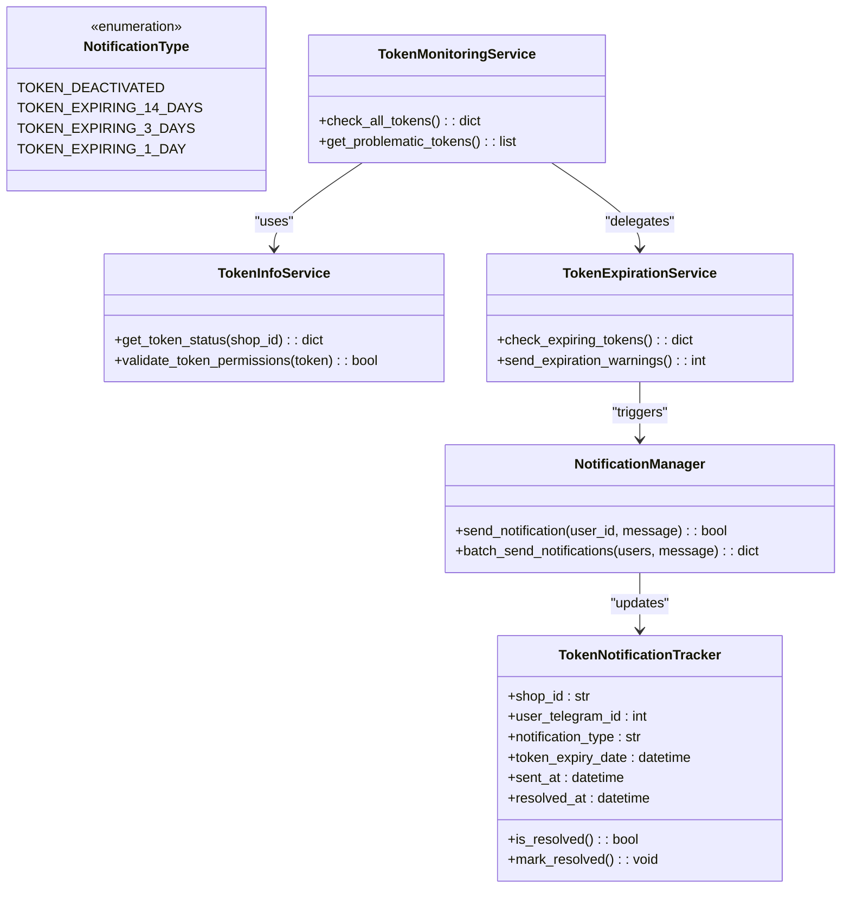
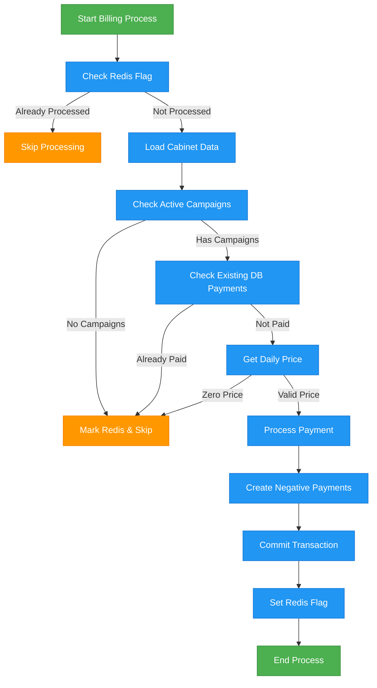
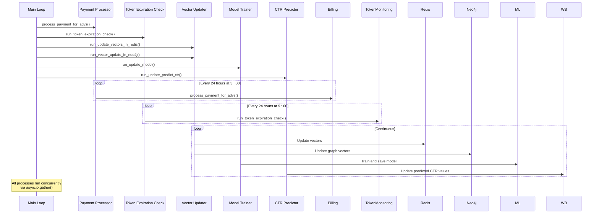
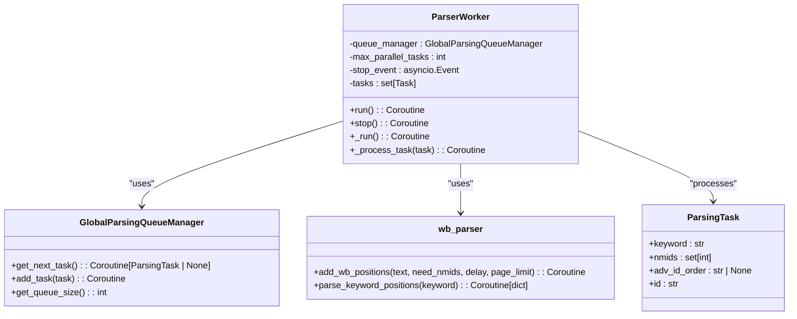
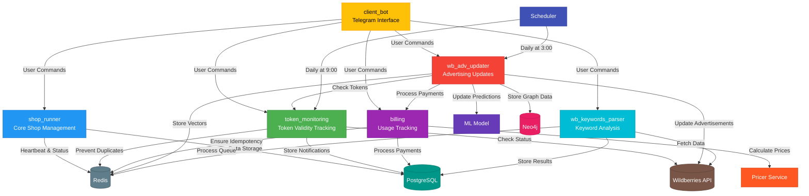

# Core Modules

<cite>
**Referenced Files in This Document**   
- [client_bot/bot.py](file://app/client_bot/bot.py)
- [client_bot/common_routers.py](file://app/client_bot/common_routers.py)
- [modules/shop_runner/wb_shop.py](file://app/modules/shop_runner/wb_shop.py)
- [modules/token_monitoring/__init__.py](file://app/modules/token_monitoring/__init__.py)
- [modules/token_monitoring/models.py](file://app/modules/token_monitoring/models.py)
- [modules/billing/billing.py](file://app/modules/billing/billing.py)
- [modules/wb_adv_updater/runner.py](file://app/modules/wb_adv_updater/runner.py)
- [modules/wb_adv_updater/ml_data_manager.py](file://app/modules/wb_adv_updater/ml_data_manager.py)
- [modules/wb_keywords_parser/parser_worker.py](file://app/modules/wb_keywords_parser/parser_worker.py)
- [modules/wb_keywords_parser/parsing_task.py](file://app/modules/wb_keywords_parser/parsing_task.py)
</cite>

## Table of Contents
1. [Introduction](#introduction)
2. [Client Bot Module](#client-bot-module)
3. [Shop Runner Module](#shop-runner-module)
4. [Token Monitoring Module](#token-monitoring-module)
5. [Billing Module](#billing-module)
6. [WB Adv Updater Module](#wb-adv-updater-module)
7. [WB Keywords Parser Module](#wb-keywords-parser-module)
8. [Module Interactions and Invocation Relationships](#module-interactions-and-invocation-relationships)
9. [Common Issues and Solutions](#common-issues-and-solutions)

## Introduction
The adv-bot system is a comprehensive Wildberries advertising management platform with multiple specialized modules working together to provide automated advertising optimization, monitoring, and user interaction. This document details the core modules of the system, explaining their purpose, functionality, implementation details, and interactions. Each module serves a specific role in the ecosystem, from user interface handling to automated advertising updates and financial tracking.

## Client Bot Module

The client_bot module serves as the Telegram interface for user interaction with the adv-bot system. It handles all incoming and outgoing communications between users and the system, providing a conversational interface for managing advertising campaigns.

The module is built on the aiogram framework and consists of several key components:
- **bot.py**: Initializes the Telegram bot instance using the token from application settings
- **common_routers.py**: Aggregates and includes routers from various functional modules
- **user_interface/handlers**: Contains handlers for specific user interactions and commands
- **middlewars**: Implements middleware for request processing and state management

The client_bot uses a modular routing system where different functionality is encapsulated in separate routers that are then included in the main common_router. This allows for clean separation of concerns and easy extension of functionality. The module handles user authentication, command processing, and response generation, serving as the primary entry point for user-initiated actions.

**Section sources**
- [client_bot/bot.py](file://app/client_bot/bot.py#L1-L15)
- [client_bot/common_routers.py](file://app/client_bot/common_routers.py#L1-L112)

## Shop Runner Module

The shop_runner module is the core shop management component responsible for orchestrating various automated processes for Wildberries advertising campaigns. It serves as the central coordinator for shop-related operations and maintains the state of shop activities.

The main class WBShop in wb_shop.py initializes with a WBApi instance and Redis manager, then runs multiple concurrent coroutines for different shop management tasks:

```mermaid
flowchart TD
WBShop["WBShop.run()"] --> AliveWorker["alive_worker_run()"]
WBShop --> ParsingKeywords["parsing_keywords_run()"]
WBShop --> UpdateAdvsData["update_advs_data_from_wb_to_pg()"]
WBShop --> UpdateCardsData["update_cards_data_from_wb_to_pg()"]
WBShop --> UpdateCPMBid["update_cpm_bid()"]
WBShop --> UpdateCommonSaleStat["update_common_sale_stat()"]
WBShop --> UpdateFullAdvStat["update_full_adv_stat()"]
WBShop --> AdvSettingsAutoUpdate["adv_settings_auto_update()"]
WBShop --> UpdateTopKeyInAdvs["update_top_key_in_advs()"]
WBShop --> UpdatePredictCTR["update_predict_ctr()"]
style WBShop fill:#4CAF50,stroke:#388E3C,color:white
style AliveWorker fill:#2196F3,stroke:#1976D2,color:white
style ParsingKeywords fill:#2196F3,stroke:#1976D2,color:white
style UpdateAdvsData fill:#2196F3,stroke:#1976D2,color:white
style UpdateCardsData fill:#2196F3,stroke:#1976D2,color:white
style UpdateCPMBid fill:#2196F3,stroke:#1976D2,color:white
style UpdateCommonSaleStat fill:#2196F3,stroke:#1976D2,color:white
style UpdateFullAdvStat fill:#2196F3,stroke:#1976D2,color:white
style AdvSettingsAutoUpdate fill:#2196F3,stroke:#1976D2,color:white
style UpdateTopKeyInAdvs fill:#2196F3,stroke:#1976D2,color:white
style UpdatePredictCTR fill:#2196F3,stroke:#1976D2,color:white
```

**Diagram sources**
- [modules/shop_runner/wb_shop.py](file://app/modules/shop_runner/wb_shop.py#L1-L42)

The _alive_worker_run method periodically updates the shop's TTL (time-to-live) in Redis, effectively serving as a heartbeat mechanism to indicate the shop is active. The module coordinates with other components through the CoroutinesManager, which manages the execution of various shop-related tasks.

**Section sources**
- [modules/shop_runner/wb_shop.py](file://app/modules/shop_runner/wb_shop.py#L1-L42)

## Token Monitoring Module

The token_monitoring module is responsible for tracking API token validity and sending notifications about token status changes. It ensures that the system can detect and respond to token expiration or deactivation issues.

The module includes several key components:
- **TokenNotificationTracker**: Database model for tracking sent notifications
- **NotificationType**: Enumeration of different notification types
- **TokenInfoService**: Service for retrieving token information
- **TokenMonitoringService**: Main service for monitoring token status
- **NotificationManager**: Handles sending notifications to users
- **TokenExpirationService**: Specifically handles expiration-related checks

The TokenNotificationTracker model includes fields for shop_id, user_telegram_id, notification_type, token_expiry_date, sent_at, and resolved_at. It has a unique constraint to prevent duplicate notifications for the same shop, user, and notification type combination.

**Diagram sources**
- [modules/token_monitoring/models.py](file://app/modules/token_monitoring/models.py#L1-L80)
- [modules/token_monitoring/__init__.py](file://app/modules/token_monitoring/__init__.py#L1-L62)

The module provides a comprehensive system for token lifecycle management, with scheduled checks and appropriate notifications based on the severity and timing of token issues.

**Section sources**
- [modules/token_monitoring/models.py](file://app/modules/token_monitoring/models.py#L1-L80)
- [modules/token_monitoring/__init__.py](file://app/modules/token_monitoring/__init__.py#L1-L62)

## Billing Module

The billing module handles usage tracking and pricing for advertising campaigns. It implements a daily charging system that processes payments for active cabinets while ensuring idempotency through Redis and database checks.

Key features of the billing module:
- Daily processing of active cabinets with payment calculations
- Idempotency through Redis flags and database checks
- Redis locks to prevent concurrent processing
- Integration with Pricer for calculating daily prices
- Comprehensive error handling and logging

The core function _process_single_cabinet handles the billing logic for individual cabinets:
1. Checks Redis for a processing flag to ensure idempotency
2. Loads cabinet data with related entities (balance payments, bonus payments, campaign settings)
3. Verifies active campaigns exist
4. Checks for existing payments in the current day
5. Calculates the price using the Pricer service
6. Processes payment by creating negative balance or bonus payments
7. Commits the transaction and sets Redis flags

**Diagram sources**
- [modules/billing/billing.py](file://app/modules/billing/billing.py#L1-L199)

The module ensures financial integrity by using short database transactions, proper error handling with rollbacks, and redundant idempotency checks through both Redis and database queries.

**Section sources**
- [modules/billing/billing.py](file://app/modules/billing/billing.py#L1-L199)

## WB Adv Updater Module

The wb_adv_updater module handles advertising data updates with machine learning capabilities. It's responsible for updating advertising phrases, managing ML models, and coordinating various update processes.

Key components and functions:
- **runner.py**: Contains main coroutine functions for periodic tasks
- **ml_data_manager.py**: Manages ML model training and data processing
- **wb_manager.py**: Coordinates advertising updates
- **fitter.py**: Handles model fitting and training
- **gds_object.py**: Manages graph database connections
- **word_to_vec_object.py**: Handles word vectorization

The module implements several critical processes:
- **run_update_predict_ctr**: Updates predicted CTR values for advertisements
- **run_update_all_keywords_on_wb**: Continuously updates keywords on Wildberries
- **process_payment_for_advs**: Processes payments for advertisements (scheduled for 3:00 daily)
- **process_token_expiration_check**: Checks token expiration (scheduled for 9:00 daily)
- **run_update_vectors_in_redis**: Updates vectors in Redis cache
- **run_vector_update_in_neo4j**: Updates vectors in Neo4j graph database
- **run_update_model**: Continuously updates the ML model

**Diagram sources**
- [modules/wb_adv_updater/runner.py](file://app/modules/wb_adv_updater/runner.py#L1-L144)
- [modules/wb_adv_updater/ml_data_manager.py](file://app/modules/wb_adv_updater/ml_data_manager.py#L1-L199)

The ml_data_manager.py file contains functions for processing product data, updating cards in the graph database, and managing ML model updates. It integrates with Neo4j for graph storage and uses FAISS for similarity searches.

**Section sources**
- [modules/wb_adv_updater/runner.py](file://app/modules/wb_adv_updater/runner.py#L1-L144)
- [modules/wb_adv_updater/ml_data_manager.py](file://app/modules/wb_adv_updater/ml_data_manager.py#L1-L199)

## WB Keywords Parser Module

The wb_keywords_parser module handles keyword analysis by parsing and processing keyword data from Wildberries. It manages a queue of parsing tasks and processes them using worker processes.

Key components:
- **parser_worker.py**: Contains the ParserWorker class that processes parsing tasks
- **parsing_task.py**: Defines the ParsingTask dataclass
- **global_parsing_queue_manager.py**: Manages the global queue of parsing tasks
- **parsing_queue_manager.py**: Manages individual parsing queues
- **wb_parser/parser.py**: Contains the actual parsing logic

The ParserWorker class implements a worker pattern with the following characteristics:
- Configurable number of parallel tasks (default: 3)
- Uses an asyncio.Lock to prevent concurrent queue access
- Processes tasks from the GlobalParsingQueueManager
- Handles errors gracefully with logging
- Can be stopped gracefully using a stop event

**Diagram sources**
- [modules/wb_keywords_parser/parser_worker.py](file://app/modules/wb_keywords_parser/parser_worker.py#L1-L79)
- [modules/wb_keywords_parser/parsing_task.py](file://app/modules/wb_keywords_parser/parsing_task.py#L1-L24)

The parsing process involves:
1. Worker retrieves a task from the global queue
2. Processes the task by calling the parser.add_wb_positions method
3. Handles any exceptions and logs errors
4. Continues to the next task or waits if the queue is empty

**Section sources**
- [modules/wb_keywords_parser/parser_worker.py](file://app/modules/wb_keywords_parser/parser_worker.py#L1-L79)
- [modules/wb_keywords_parser/parsing_task.py](file://app/modules/wb_keywords_parser/parsing_task.py#L1-L24)

## Module Interactions and Invocation Relationships

The core modules of the adv-bot system interact in a coordinated manner to provide a comprehensive advertising management solution. The following diagram illustrates the key invocation relationships between modules:

**Diagram sources**
- [client_bot/bot.py](file://app/client_bot/bot.py#L1-L15)
- [modules/shop_runner/wb_shop.py](file://app/modules/shop_runner/wb_shop.py#L1-L42)
- [modules/token_monitoring/__init__.py](file://app/modules/token_monitoring/__init__.py#L1-L62)
- [modules/billing/billing.py](file://app/modules/billing/billing.py#L1-L199)
- [modules/wb_adv_updater/runner.py](file://app/modules/wb_adv_updater/runner.py#L1-L144)
- [modules/wb_keywords_parser/parser_worker.py](file://app/modules/wb_keywords_parser/parser_worker.py#L1-L79)

The system follows a modular architecture where each component has a well-defined responsibility. The client_bot serves as the user-facing interface, while the other modules handle specific backend functions. The wb_adv_updater acts as a central coordinator for periodic tasks, integrating with other modules like billing and token_monitoring for comprehensive system management.

## Common Issues and Solutions

### Token Expiration Notifications Not Sent
**Issue**: Users are not receiving notifications about expiring tokens.
**Solution**: 
1. Verify that the token_monitoring scheduler is running (check process_token_expiration_check in wb_adv_updater/runner.py)
2. Check that the NotificationManager is properly configured
3. Verify Redis connectivity for the token_notification_tracker flag
4. Ensure the unique constraint in the TokenNotificationTracker table is not preventing new notifications

### Billing Processing Failures
**Issue**: Daily billing processes are failing or not completing.
**Solution**:
1. Check the Redis connection for the billing lock and process flags
2. Verify database transaction isolation levels
3. Ensure the Pricer service is available and returning valid prices
4. Check for exceptions in the _safe_commit function that might cause rollbacks
5. Verify that the process_payment_for_advs coroutine is running in wb_adv_updater/runner.py

### Keyword Parsing Queue Backlog
**Issue**: The keyword parsing queue is growing with unprocessed tasks.
**Solution**:
1. Increase the max_parallel_tasks parameter in ParserWorker
2. Check for exceptions in the _process_task method that might cause worker crashes
3. Verify connectivity to the Wildberries API
4. Monitor Redis performance as the queue manager depends on Redis
5. Check the page_limit setting in settings (MAX_PAGE_LIMIT_PARSER_WORKER)

### ML Model Update Failures
**Issue**: The ML model is not updating or training fails.
**Solution**:
1. Verify that the update_model function in ml_data_manager.py is being called
2. Check for sufficient training data in the database
3. Verify connectivity to Neo4j for graph data access
4. Ensure the word2vec and image_master services are available
5. Check disk space for FAISS index storage

### Shop Runner Coroutines Not Executing
**Issue**: Shop management coroutines are not running as expected.
**Solution**:
1. Verify that the WBShop.run() method is being called
2. Check Redis connectivity for the TTL updates
3. Verify that the CoroutinesManager is properly initialized
4. Check for exceptions in individual coroutine functions
5. Ensure the shop's bot_active flag is set to true in the database

### Redis Connection Issues
**Issue**: Multiple modules are failing due to Redis connectivity problems.
**Solution**:
1. Verify Redis server is running and accessible
2. Check Redis connection settings in configs/infrastructure_config/redis_config.py
3. Monitor Redis memory usage and consider eviction policies
4. Implement retry logic for Redis operations
5. Consider using Redis Sentinel or Cluster for high availability

**Section sources**
- [modules/token_monitoring/services/token_expiration_service.py](file://app/modules/token_monitoring/services/token_expiration_service.py)
- [modules/billing/billing.py](file://app/modules/billing/billing.py#L1-L199)
- [modules/wb_keywords_parser/parser_worker.py](file://app/modules/wb_keywords_parser/parser_worker.py#L1-L79)
- [modules/wb_adv_updater/ml_data_manager.py](file://app/modules/wb_adv_updater/ml_data_manager.py#L1-L199)
- [modules/shop_runner/wb_shop.py](file://app/modules/shop_runner/wb_shop.py#L1-L42)
- [configs/infrastructure_config/redis_config.py](file://app/configs/infrastructure_config/redis_config.py)