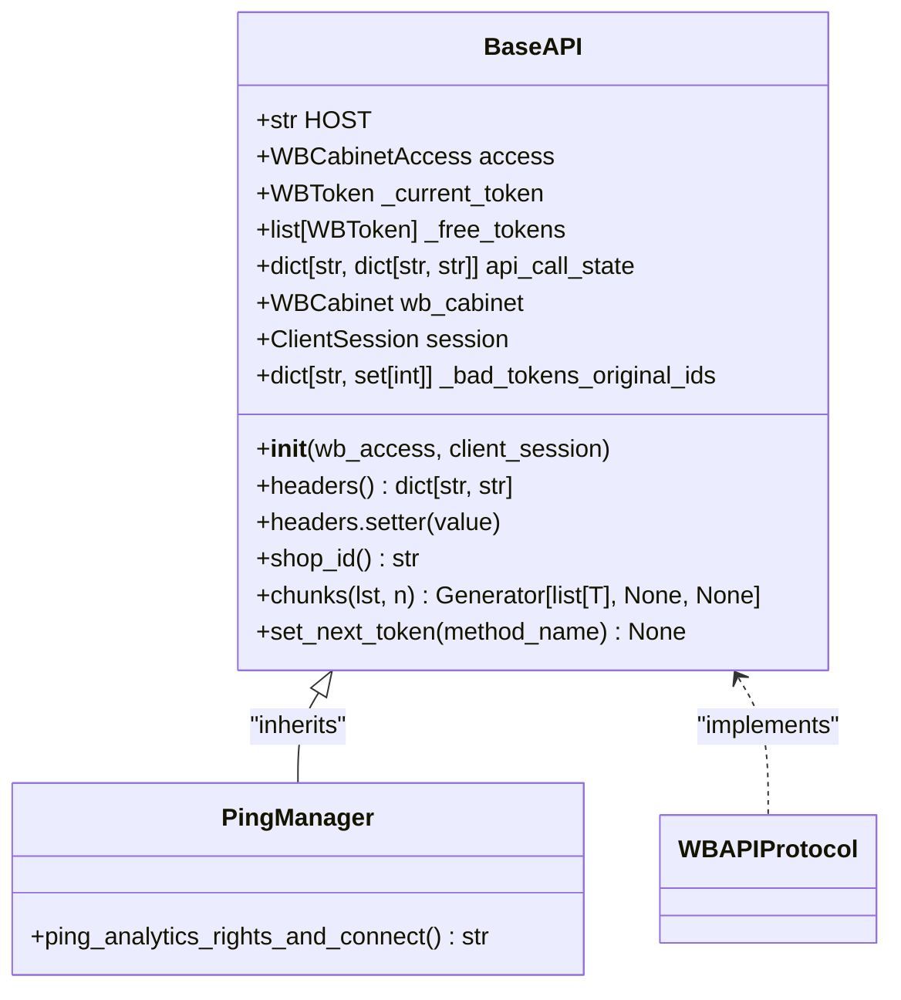
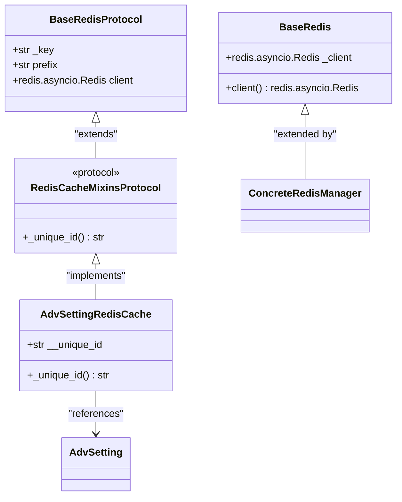
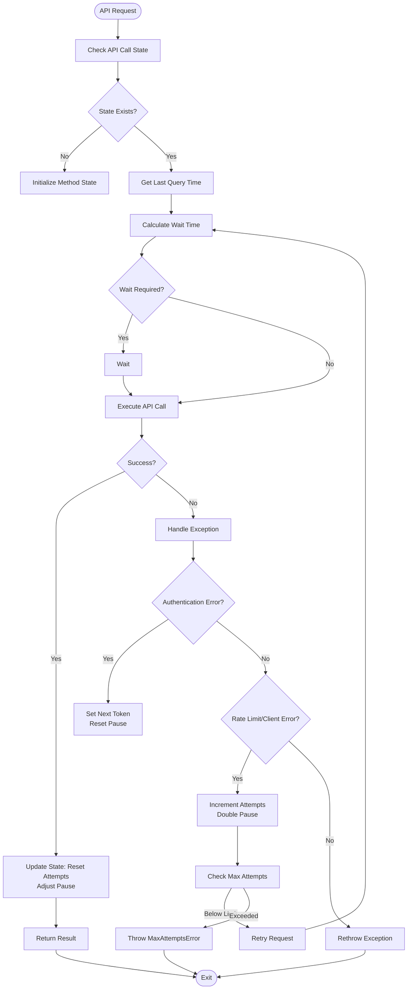

# Core Services

<cite>
**Referenced Files in This Document**   
- [base.py](file://app/core/wb_api/base.py)
- [http_request.py](file://app/core/wb_api/http_request.py)
- [ping_manager.py](file://app/core/wb_api/ping_manager.py)
- [ping.py](file://app/core/wb_api/mixins/ping.py)
- [base_redis_manager.py](file://app/core/redis_manager/base_redis_manager.py)
- [redis_client.py](file://app/core/redis_manager/redis_client.py)
- [adv_setting_redis_cache.py](file://app/core/redis_cache/mixins/main_objects_mixins/adv_setting_redis_cache.py)
- [mixins_protocol.py](file://app/core/redis_cache/mixins/mixins_protocol.py)
- [events.py](file://app/core/telegram/event_send_message_manager/events.py)
- [protocols.py](file://app/core/wb_api/protocols.py)
</cite>

## Table of Contents
1. [Introduction](#introduction)
2. [Core Services Architecture](#core-services-architecture)
3. [Wildberries API Integration](#wildberries-api-integration)
4. [Redis Management System](#redis-management-system)
5. [Telegram Event Handling](#telegram-event-handling)
6. [Service Composition and Consumption](#service-composition-and-consumption)
7. [Error Resilience and Rate Limiting](#error-resilience-and-rate-limiting)
8. [Architectural Patterns](#architectural-patterns)
9. [Practical Examples](#practical-examples)
10. [Conclusion](#conclusion)

## Introduction

The Core Services module forms the foundational infrastructure of the adv-bot system, providing reusable components for Wildberries API integration, Redis management, and Telegram event handling. This module enables consistent, reliable, and scalable interactions across various bot components including client_bot, admin_bot, and multiple service modules. The architecture emphasizes reusability, error resilience, and efficient resource management through well-defined abstractions and protocol-based design patterns.

**Section sources**
- [base.py](file://app/core/wb_api/base.py#L1-L112)
- [base_redis_manager.py](file://app/core/redis_manager/base_redis_manager.py#L1-L24)

## Core Services Architecture

The Core Services module is organized into three primary subsystems: Wildberries API integration, Redis management, and Telegram event handling. These subsystems are designed with clear separation of concerns while enabling seamless integration through dependency injection and protocol-based interfaces.

```mermaid
graph TB
subgraph "Core Services"
WB[Wildberries API]
Redis[Redis Management]
Telegram[Telegram Events]
end
WB --> |HTTP Requests| HTTP[http_request.py]
WB --> |Token Management| BaseAPI[base.py]
WB --> |Ping Operations| Ping[PingManager]
Redis --> |Client| RedisClient[redis_client.py]
Redis --> |Base Manager| BaseRedis[base_redis_manager.py]
Redis --> |Cache Mixins| CacheMixins[adv_setting_redis_cache.py]
Telegram --> |Event Manager| Events[events.py]
WB < --> |Shared Protocols| Protocols[protocols.py]
Redis < --> |Shared Protocols| Protocols
ClientBot[client_bot] --> CoreServices
AdminBot[admin_bot] --> CoreServices
Modules[modules] --> CoreServices
```

**Diagram sources**
- [base.py](file://app/core/wb_api/base.py#L1-L112)
- [redis_client.py](file://app/core/redis_manager/redis_client.py#L1-L11)
- [events.py](file://app/core/telegram/event_send_message_manager/events.py#L1-L50)

## Wildberries API Integration

The Wildberries API integration is centered around the `BaseAPI` class in `base.py`, which provides a foundation for all Wildberries API interactions. This class handles authentication, token management, and request routing across multiple Wildberries endpoints.

The `BaseAPI` class implements a token rotation mechanism through the `set_next_token` method, which automatically switches to alternative tokens when the current one becomes invalid. This ensures continuous API access even when individual tokens expire or are revoked.



**Diagram sources**
- [base.py](file://app/core/wb_api/base.py#L1-L112)
- [ping_manager.py](file://app/core/wb_api/ping_manager.py#L1-L6)
- [ping.py](file://app/core/wb_api/mixins/ping.py#L1-L29)

**Section sources**
- [base.py](file://app/core/wb_api/base.py#L1-L112)
- [ping_manager.py](file://app/core/wb_api/ping_manager.py#L1-L6)

## Redis Management System

The Redis management system provides a structured approach to Redis operations through a layered architecture. At its foundation is the `redis_client` singleton, which establishes the connection to the Redis server using environment configuration.

The `BaseRedis` class in `base_redis_manager.py` provides a standardized interface for accessing the Redis client across all components. This base class ensures consistent connection handling and error management throughout the application.



**Diagram sources**
- [base_redis_manager.py](file://app/core/redis_manager/base_redis_manager.py#L1-L24)
- [redis_client.py](file://app/core/redis_manager/redis_client.py#L1-L11)
- [adv_setting_redis_cache.py](file://app/core/redis_cache/mixins/main_objects_mixins/adv_setting_redis_cache.py#L1-L13)
- [mixins_protocol.py](file://app/core/redis_cache/mixins/mixins_protocol.py#L1-L10)

**Section sources**
- [base_redis_manager.py](file://app/core/redis_manager/base_redis_manager.py#L1-L24)
- [redis_client.py](file://app/core/redis_manager/redis_client.py#L1-L11)

## Telegram Event Handling

The Telegram event handling system is implemented in `events.py` within the `event_send_message_manager` module. This component provides an event-driven messaging framework that enables asynchronous communication between different parts of the application.

The event system allows various modules to publish messages that are then processed by subscribers, creating a decoupled architecture where components can communicate without direct dependencies. This pattern is particularly useful for notification systems, logging, and cross-module coordination.

**Section sources**
- [events.py](file://app/core/telegram/event_send_message_manager/events.py#L1-L50)

## Service Composition and Consumption

Core services are consumed across multiple components of the adv-bot system, including client_bot, admin_bot, and various modules. The architecture enables service composition through dependency injection, where services are passed to components rather than being instantiated internally.

For example, the `PingManager` combines the base API functionality with ping-specific operations through mixin inheritance. This pattern allows for flexible service extension without deep inheritance chains or code duplication.

The Redis cache mixins provide reusable caching patterns for different types of data, with `AdvSettingRedisCache` offering a specialized implementation for advertising settings. These mixins can be easily composed with other components to add caching capabilities.

**Section sources**
- [ping_manager.py](file://app/core/wb_api/ping_manager.py#L1-L6)
- [adv_setting_redis_cache.py](file://app/core/redis_cache/mixins/main_objects_mixins/adv_setting_redis_cache.py#L1-L13)

## Error Resilience and Rate Limiting

The error resilience system is implemented through the `try_except_decorator` in `http_request.py`, which provides comprehensive error handling for API requests. This decorator handles various types of exceptions including rate limiting (429), authentication errors (401), and network issues.

The decorator implements an exponential backoff strategy with adaptive pausing, gradually increasing the delay between retry attempts when errors occur. It also tracks the state of API calls per method and shop, allowing for fine-grained control over request timing.



**Diagram sources**
- [http_request.py](file://app/core/wb_api/http_request.py#L1-L199)

**Section sources**
- [http_request.py](file://app/core/wb_api/http_request.py#L1-L199)
- [base.py](file://app/core/wb_api/base.py#L1-L112)

## Architectural Patterns

The Core Services module employs several key architectural patterns to ensure maintainability, scalability, and reliability.

### Protocol-Based Design

The system uses protocol-based design through the `WBAPIProtocol` in `protocols.py`, which defines a contract for Wildberries API implementations. This allows for type checking and ensures consistent interfaces across different API clients.

### Dependency Injection

Services are designed to receive their dependencies (such as the aiohttp ClientSession and Redis client) rather than creating them internally. This promotes testability and allows for easier configuration in different environments.

### Mixin Pattern

The mixin pattern is extensively used to compose functionality. For example, the `WBAdvPingMixin` adds ping capabilities to any class that implements the `WBAPIProtocol`, enabling reusable functionality without deep inheritance hierarchies.

### Singleton Pattern

The Redis client is implemented as a singleton, ensuring that all components share the same connection pool and reducing resource consumption.

**Section sources**
- [protocols.py](file://app/core/wb_api/protocols.py#L1-L50)
- [base.py](file://app/core/wb_api/base.py#L1-L112)
- [redis_client.py](file://app/core/redis_manager/redis_client.py#L1-L11)

## Practical Examples

### HTTP Request Handling

The `requests` function in `http_request.py` provides a robust wrapper for HTTP operations with comprehensive error handling and logging. It automatically parses responses and raises appropriate exceptions based on HTTP status codes and response content.

### Redis Cache Mixins

The `AdvSettingRedisCache` mixin demonstrates how Redis caching can be added to domain objects. By implementing the `RedisCacheMixinsProtocol`, it ensures consistent caching behavior across different types of entities while providing type-specific implementations.

### Service Extension

New integrations can be created by combining existing components. For example, a new service could inherit from `BaseAPI` and include additional mixins for specific Wildberries API endpoints, while using the same error handling and rate limiting mechanisms.

**Section sources**
- [http_request.py](file://app/core/wb_api/http_request.py#L1-L199)
- [adv_setting_redis_cache.py](file://app/core/redis_cache/mixins/main_objects_mixins/adv_setting_redis_cache.py#L1-L13)

## Conclusion

The Core Services module provides a robust foundation for the adv-bot system, offering well-structured abstractions for Wildberries API integration, Redis management, and Telegram event handling. Through thoughtful architectural patterns like protocol-based design, dependency injection, and mixin composition, the system achieves high reusability and maintainability.

The error resilience mechanisms, particularly the adaptive retry logic in the HTTP request handler, ensure reliable operation even under challenging network conditions or API rate limiting. The Redis management system provides efficient caching capabilities that can be easily extended to new data types.

This core infrastructure enables rapid development of new features while maintaining system stability and performance, serving as a model for scalable service-oriented architecture in Python applications.