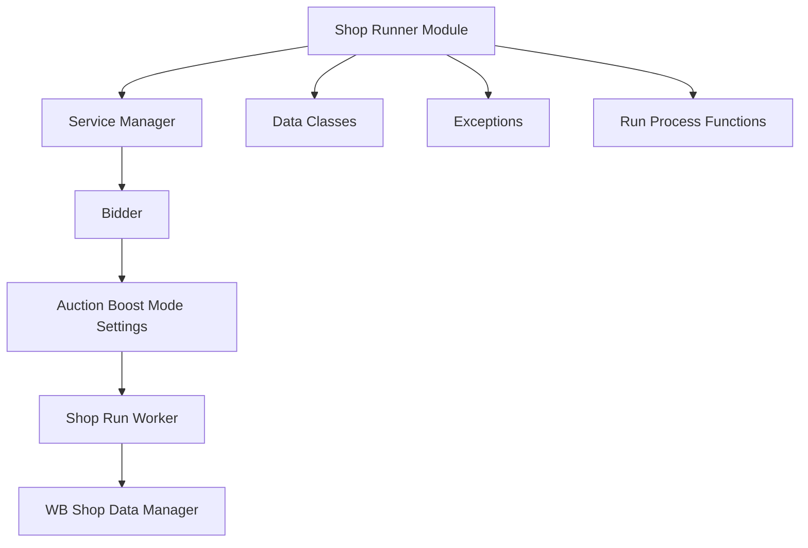
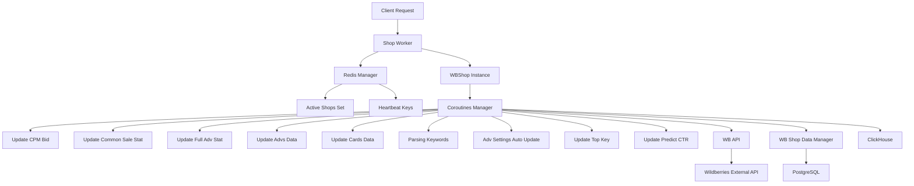
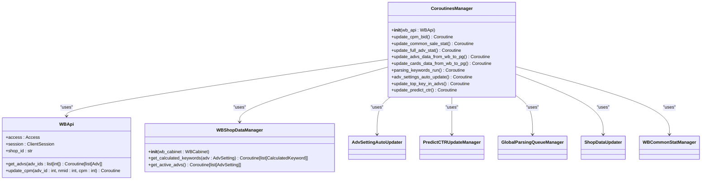
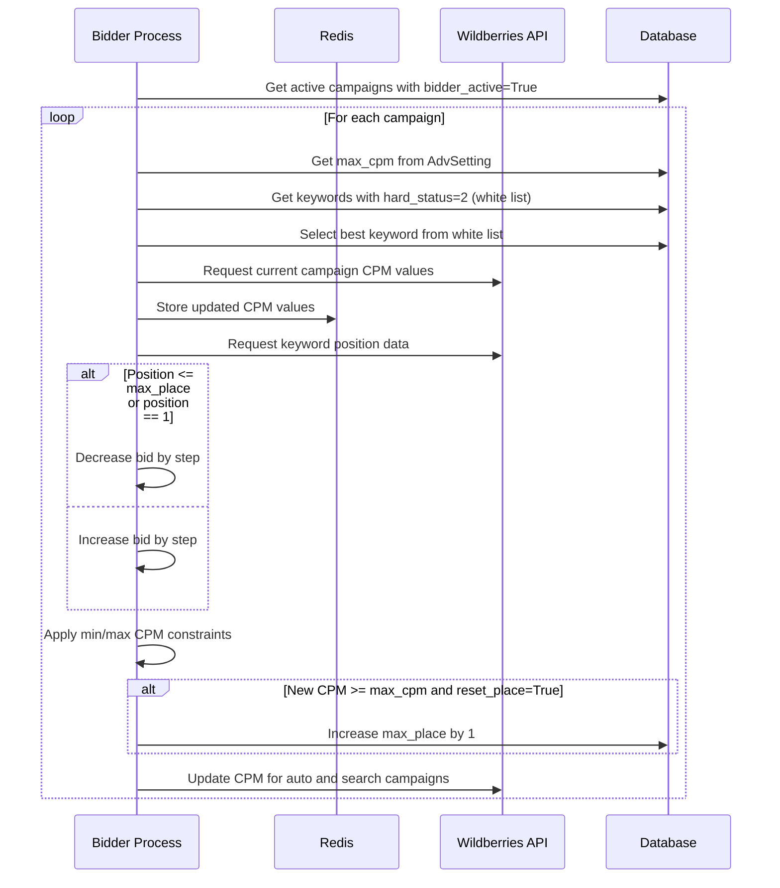
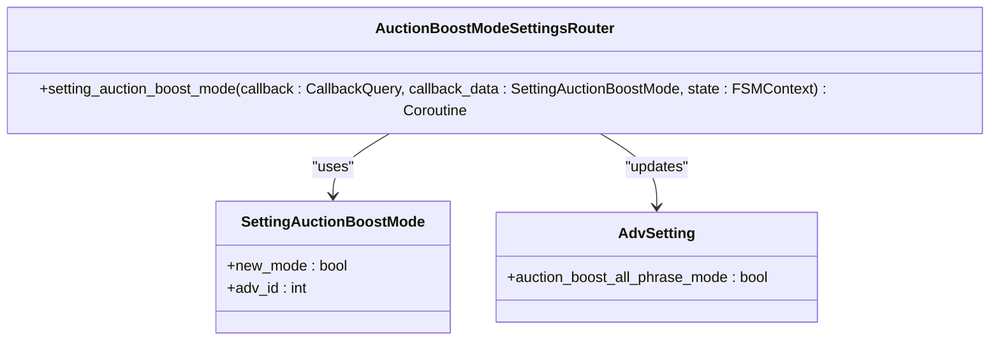
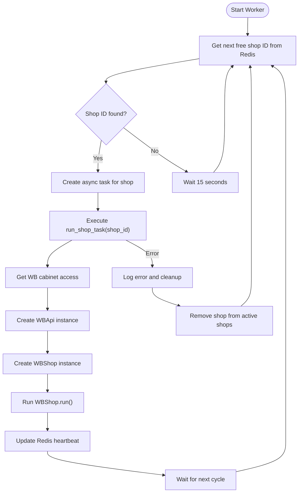

# Shop Runner

<cite>
**Referenced Files in This Document**   
- [wb_shop.py](file://app/modules/shop_runner/wb_shop.py)
- [service_manager/manager.py](file://app/modules/shop_runner/service_manager/manager.py)
- [bidder/bidder_func.py](file://app/modules/shop_runner/bidder/bidder_func.py)
- [service_manager/wb_shop_data_manager/wb_shop_data_manager.py](file://app/modules/shop_runner/service_manager/wb_shop_data_manager/wb_shop_data_manager.py)
- [shop_run_worker/worker/worker.py](file://app/modules/shop_runner/shop_run_worker/worker/worker.py)
- [shop_run_worker/update_active_shop_ids_in_redis.py](file://app/modules/shop_runner/shop_run_worker/update_active_shop_ids_in_redis.py)
- [shop_run_worker/redis_manager/redis_manager.py](file://app/modules/shop_runner/shop_run_worker/redis_manager/redis_manager.py)
- [run_process_func.py](file://app/modules/shop_runner/run_process_func.py)
- [data_classes.py](file://app/modules/shop_runner/data_classes.py)
- [auction_boost_mode_settings/telegram/handlers.py](file://app/modules/shop_runner/auction_boost_mode_settings/telegram/handlers.py)
- [auction_boost_mode_settings/telegram/callbacks.py](file://app/modules/shop_runner/auction_boost_mode_settings/telegram/callbacks.py)
- [exceptions.py](file://app/modules/shop_runner/exceptions.py)
</cite>

## Table of Contents
1. [Introduction](#introduction)
2. [Project Structure](#project-structure)
3. [Core Components](#core-components)
4. [Architecture Overview](#architecture-overview)
5. [Detailed Component Analysis](#detailed-component-analysis)
6. [Dependency Analysis](#dependency-analysis)
7. [Performance Considerations](#performance-considerations)
8. [Troubleshooting Guide](#troubleshooting-guide)
9. [Conclusion](#conclusion)

## Introduction
The Shop Runner module is a critical component of the advertising automation system for Wildberries shops. It orchestrates advertising campaign execution, bid management, and synchronization across multiple shops. This document provides a comprehensive analysis of the Shop Runner's architecture, functionality, and integration points, focusing on its service manager architecture, bidder functionality, auction boost mode settings, and error handling mechanisms.

## Project Structure
The Shop Runner module is organized into several key subcomponents that work together to manage Wildberries shop operations. The structure follows a modular design pattern with clear separation of concerns between different functional areas.



**Diagram sources**
- [wb_shop.py](file://app/modules/shop_runner/wb_shop.py)
- [service_manager/manager.py](file://app/modules/shop_runner/service_manager/manager.py)

**Section sources**
- [wb_shop.py](file://app/modules/shop_runner/wb_shop.py)
- [service_manager/manager.py](file://app/modules/shop_runner/service_manager/manager.py)

## Core Components
The Shop Runner module consists of several core components that work together to manage Wildberries shop operations. The main components include the WBShop class, CoroutinesManager, Bidder functionality, and various service managers that handle specific aspects of shop management and campaign execution.

The module orchestrates advertising activities through a coordinated system of coroutines that handle bid management, campaign updates, and data synchronization. It integrates with Redis for state management and Neo4j for relationship tracking, ensuring efficient processing of large shop volumes while maintaining data consistency.

**Section sources**
- [wb_shop.py](file://app/modules/shop_runner/wb_shop.py#L1-L42)
- [service_manager/manager.py](file://app/modules/shop_runner/service_manager/manager.py#L1-L277)
- [bidder/bidder_func.py](file://app/modules/shop_runner/bidder/bidder_func.py#L1-L163)

## Architecture Overview
The Shop Runner implements a service-oriented architecture with a central coroutines manager that coordinates multiple asynchronous processes for shop management and campaign optimization.



**Diagram sources**
- [wb_shop.py](file://app/modules/shop_runner/wb_shop.py#L1-L42)
- [service_manager/manager.py](file://app/modules/shop_runner/service_manager/manager.py#L1-L277)
- [shop_run_worker/worker/worker.py](file://app/modules/shop_runner/shop_run_worker/worker/worker.py#L1-L82)

## Detailed Component Analysis

### Service Manager Architecture
The CoroutinesManager class serves as the central orchestrator for all shop-related operations. It manages multiple concurrent processes that handle different aspects of shop management and campaign optimization.



**Diagram sources**
- [service_manager/manager.py](file://app/modules/shop_runner/service_manager/manager.py#L1-L277)
- [service_manager/wb_shop_data_manager/wb_shop_data_manager.py](file://app/modules/shop_runner/service_manager/wb_shop_data_manager/wb_shop_data_manager.py#L1-L49)

**Section sources**
- [service_manager/manager.py](file://app/modules/shop_runner/service_manager/manager.py#L1-L277)

### Bidder Functionality
The bidder component implements an automated bidding strategy that adjusts campaign bids based on keyword performance and position data. It follows a feedback loop approach to optimize campaign performance.



**Diagram sources**
- [bidder/bidder_func.py](file://app/modules/shop_runner/bidder/bidder_func.py#L1-L163)
- [service_manager/manager.py](file://app/modules/shop_runner/service_manager/manager.py#L1-L277)

**Section sources**
- [bidder/bidder_func.py](file://app/modules/shop_runner/bidder/bidder_func.py#L1-L163)

### Auction Boost Mode Settings
The auction boost mode settings component provides functionality to configure whether bidding should apply to fixed phrases only or to all phrases in a campaign.



**Diagram sources**
- [auction_boost_mode_settings/telegram/handlers.py](file://app/modules/shop_runner/auction_boost_mode_settings/telegram/handlers.py#L1-L36)
- [auction_boost_mode_settings/telegram/callbacks.py](file://app/modules/shop_runner/auction_boost_mode_settings/telegram/callbacks.py#L1-L5)

**Section sources**
- [auction_boost_mode_settings/telegram/handlers.py](file://app/modules/shop_runner/auction_boost_mode_settings/telegram/handlers.py#L1-L36)

### Shop Update Workflows
The shop update workflow is managed by a worker process that coordinates the execution of shop tasks using Redis for state management and task distribution.



**Diagram sources**
- [shop_run_worker/worker/worker.py](file://app/modules/shop_runner/shop_run_worker/worker/worker.py#L1-L82)
- [run_process_func.py](file://app/modules/shop_runner/run_process_func.py#L1-L102)
- [shop_run_worker/redis_manager/redis_manager.py](file://app/modules/shop_runner/shop_run_worker/redis_manager/redis_manager.py#L1-L81)

**Section sources**
- [shop_run_worker/worker/worker.py](file://app/modules/shop_runner/shop_run_worker/worker/worker.py#L1-L82)

## Dependency Analysis
The Shop Runner module has several key dependencies that enable its functionality, including database connections, Redis for state management, and external API integrations.

```mermaid
graph TD
ShopRunner --> PostgreSQL[(PostgreSQL)]
ShopRunner --> Redis[(Redis)]
ShopRunner --> ClickHouse[(ClickHouse)]
ShopRunner --> WildberriesAPI[Wildberries API]
PostgreSQL --> AdvSetting[AdvSetting Model]
PostgreSQL --> WBCabinet[WBCabinet Model]
PostgreSQL --> CalculatedKeyword[CalculatedKeyword Model]
Redis --> ActiveShops[active_shops set]
Redis --> Heartbeat[shops_heartbeat:* keys]
Redis --> KeywordPositions[keyword_positions hash]
Redis --> MaxBets[max_bets hash]
ClickHouse --> FullAdvStat[FullAdvStat table]
WildberriesAPI --> AdvsEndpoint[/adv/stat]
WildberriesAPI --> PositionsEndpoint[/positions]
WildberriesAPI --> AnalyticsEndpoint[/analytics]
```

**Diagram sources**
- [service_manager/manager.py](file://app/modules/shop_runner/service_manager/manager.py#L1-L277)
- [shop_run_worker/redis_manager/redis_manager.py](file://app/modules/shop_runner/shop_run_worker/redis_manager/redis_manager.py#L1-L81)
- [wb_shop.py](file://app/modules/shop_runner/wb_shop.py#L1-L42)

**Section sources**
- [service_manager/manager.py](file://app/modules/shop_runner/service_manager/manager.py#L1-L277)
- [shop_run_worker/redis_manager/redis_manager.py](file://app/modules/shop_runner/shop_run_worker/redis_manager/redis_manager.py#L1-L81)

## Performance Considerations
The Shop Runner module implements several performance optimization strategies to handle large volumes of shops and campaigns efficiently:

1. **Concurrency Control**: Uses asyncio.gather to run multiple coroutines concurrently while managing resource usage through rate limiting.
2. **Caching**: Leverages Redis for caching frequently accessed data like keyword positions and maximum bids.
3. **Batch Processing**: Groups operations where possible to minimize database and API calls.
4. **Rate Limiting**: Implements delays between API calls to avoid hitting Wildberries API rate limits.
5. **Connection Pooling**: Uses aiohttp ClientSession for efficient HTTP connection management.

The module also includes configuration options for shop processing through settings like SHOP_FILTER_LIST and SHOPS_WORKS_TLL, allowing administrators to control which shops are processed and how frequently.

## Troubleshooting Guide
The Shop Runner module includes comprehensive error handling mechanisms to address common issues:

**Section sources**
- [exceptions.py](file://app/modules/shop_runner/exceptions.py#L1-L15)
- [run_process_func.py](file://app/modules/shop_runner/run_process_func.py#L1-L102)
- [service_manager/manager.py](file://app/modules/shop_runner/service_manager/manager.py#L1-L277)

Common issues and their solutions:

1. **Shop Synchronization Failures**: 
   - Check Redis connectivity and ensure the Redis server is running
   - Verify that shop IDs are correctly added to the active_shops set
   - Ensure the update_active_shop_ids_in_redis.py process is running

2. **Rate Limiting with Wildberries API**:
   - Adjust the PARSING_KEYWORDS_DELAY_BETWEEN_TASKS setting to increase delays between requests
   - Monitor API usage and implement exponential backoff for failed requests
   - Use the while_coroutine_decorator to control execution frequency

3. **Concurrency Control Issues**:
   - Verify Redis Lua script functionality for shop locking
   - Check that DEFAULT_TTL settings are appropriate for the workload
   - Monitor for race conditions in shop task assignment

4. **Bidder Failures**:
   - Ensure max_cpm is set for campaigns with bidder_active=True
   - Verify that white list keywords exist and have valid positions
   - Check that nmids are properly configured for campaigns

## Conclusion
The Shop Runner module provides a comprehensive solution for managing Wildberries shop operations and advertising campaigns. Its service-oriented architecture with the CoroutinesManager at its core enables efficient orchestration of multiple processes including bid management, campaign updates, and data synchronization. The integration with Redis for state management and ClickHouse for analytics provides a robust foundation for handling large shop volumes. The module's error handling mechanisms and performance optimizations ensure reliable operation even under challenging conditions. With its modular design and clear separation of concerns, the Shop Runner can be extended to support additional features and optimization strategies as needed.