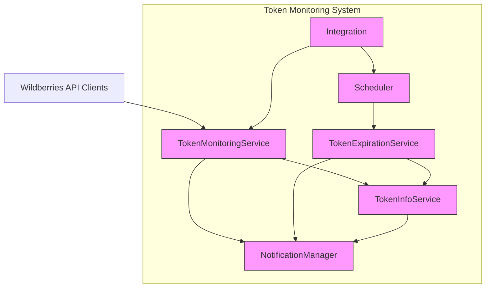
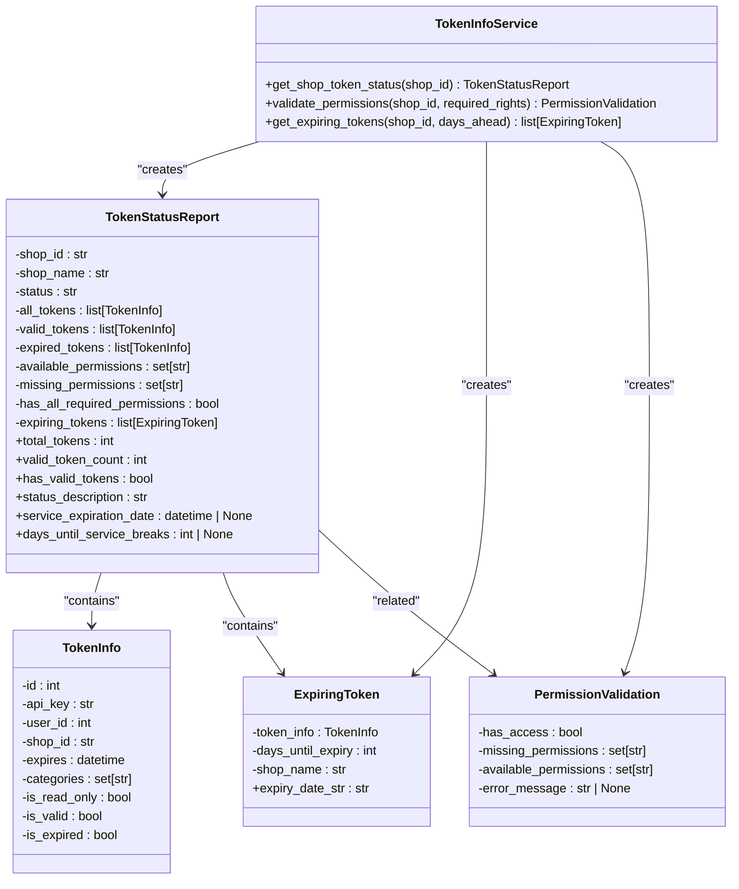
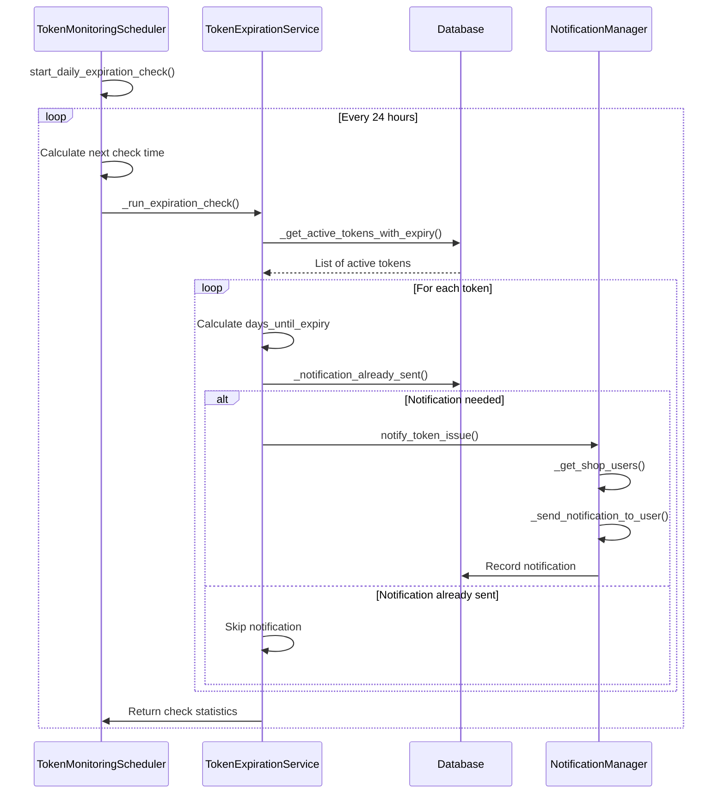
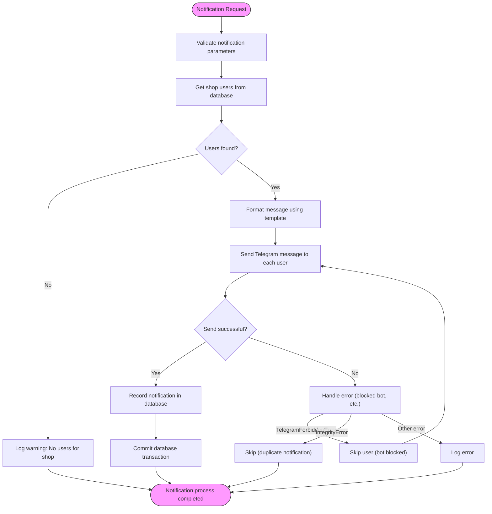
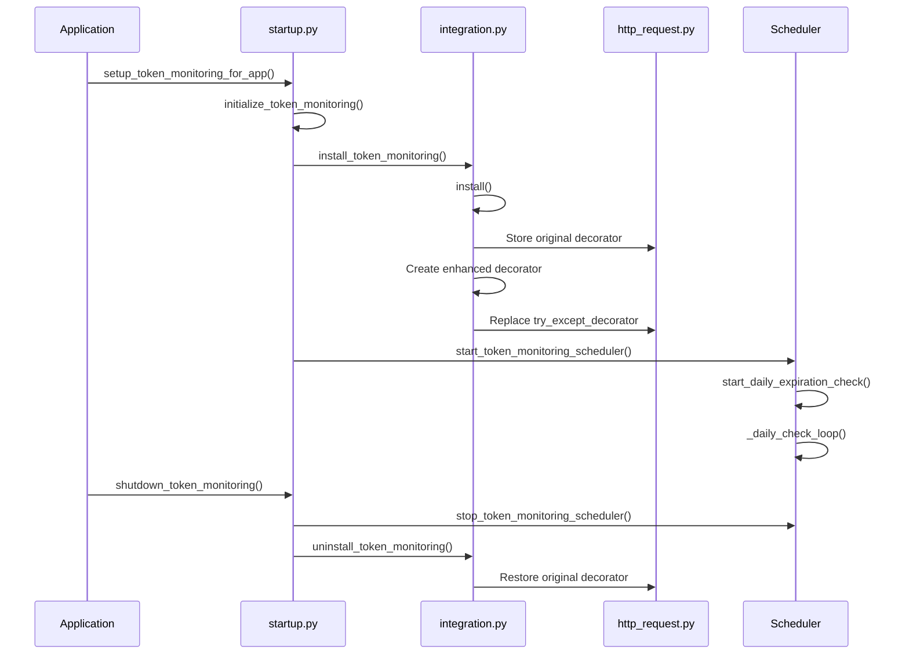
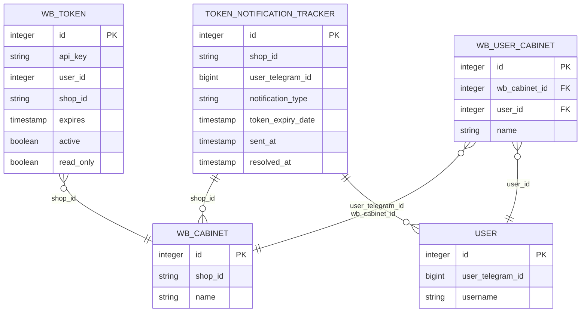
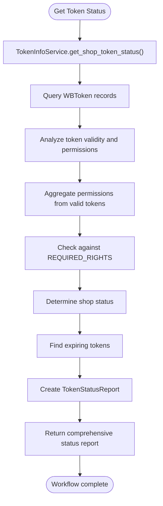

# Token Monitoring

<cite>
**Referenced Files in This Document**   
- [models.py](file://app/modules/token_monitoring/models.py)
- [scheduler.py](file://app/modules/token_monitoring/scheduler.py)
- [token_monitoring_service.py](file://app/modules/token_monitoring/services/token_monitoring_service.py)
- [token_expiration_service.py](file://app/modules/token_monitoring/services/token_expiration_service.py)
- [notification_manager.py](file://app/modules/token_monitoring/services/notification_manager.py)
- [startup.py](file://app/modules/token_monitoring/startup.py)
- [integration.py](file://app/modules/token_monitoring/integration.py)
- [token_info_service.py](file://app/modules/token_monitoring/services/token_info_service.py)
- [f8e1d9c2a3b4_add_token_notification_tracker_table.py](file://alembic/versions/f8e1d9c2a3b4_add_token_notification_tracker_table.py)
- [README.md](file://app/modules/token_monitoring/README.md)
</cite>

## Table of Contents
1. [Introduction](#introduction)
2. [Architecture Overview](#architecture-overview)
3. [Core Components](#core-components)
4. [Token Status Checking and Permission Validation](#token-status-checking-and-permission-validation)
5. [Expiration Prediction and Scheduling](#expiration-prediction-and-scheduling)
6. [Notification System](#notification-system)
7. [Service Layer Implementation](#service-layer-implementation)
8. [Integration and Startup](#integration-and-startup)
9. [Data Models and Database Schema](#data-models-and-database-schema)
10. [Redis Caching Strategy](#redis-caching-strategy)
11. [Common Issues and Solutions](#common-issues-and-solutions)
12. [Configuration Options](#configuration-options)
13. [Usage Examples](#usage-examples)

## Introduction
The Token Monitoring module is a comprehensive system designed to track Wildberries API token validity, permissions, and expiration status. This system provides proactive monitoring of token health, detects deactivation events, predicts expiration, and sends timely notifications to users. The module integrates with the application's HTTP request layer to monitor API calls and implements a scheduled background service for periodic token status checks. It ensures that users are alerted to potential service disruptions before they occur, maintaining uninterrupted access to Wildberries API services.

## Architecture Overview

**Diagram sources**
- [README.md](file://app/modules/token_monitoring/README.md#L26-L47)

**Section sources**
- [README.md](file://app/modules/token_monitoring/README.md)

## Core Components

The Token Monitoring module consists of several interconnected services that work together to provide comprehensive token monitoring capabilities. The system is designed with a modular architecture that separates concerns between token information retrieval, expiration monitoring, notification management, and system integration. Each component has a specific responsibility and communicates with others through well-defined interfaces. The architecture follows a service-oriented design pattern, allowing for independent development, testing, and deployment of each component.

**Section sources**
- [models.py](file://app/modules/token_monitoring/models.py)
- [scheduler.py](file://app/modules/token_monitoring/scheduler.py)
- [token_monitoring_service.py](file://app/modules/token_monitoring/services/token_monitoring_service.py)

## Token Status Checking and Permission Validation

**Diagram sources**
- [token_info_service.py](file://app/modules/token_monitoring/services/token_info_service.py#L100-L353)

**Section sources**
- [token_info_service.py](file://app/modules/token_monitoring/services/token_info_service.py#L1-L353)

## Expiration Prediction and Scheduling

**Diagram sources**
- [scheduler.py](file://app/modules/token_monitoring/scheduler.py#L1-L185)
- [token_expiration_service.py](file://app/modules/token_monitoring/services/token_expiration_service.py#L1-L313)

**Section sources**
- [scheduler.py](file://app/modules/token_monitoring/scheduler.py#L1-L185)
- [token_expiration_service.py](file://app/modules/token_monitoring/services/token_expiration_service.py#L1-L313)

## Notification System

**Diagram sources**
- [notification_manager.py](file://app/modules/token_monitoring/services/notification_manager.py#L1-L335)

**Section sources**
- [notification_manager.py](file://app/modules/token_monitoring/services/notification_manager.py#L1-L335)

## Service Layer Implementation

The service layer implementation of the Token Monitoring module follows a clean, modular design with well-defined responsibilities. The TokenMonitoringService wraps the existing HTTP request decorator to detect token deactivation events during API calls. When a token deactivation is detected (typically through a 403 Forbidden response), the service triggers notifications through the NotificationManager. The TokenExpirationService handles proactive monitoring of token expiration dates, checking for tokens that will expire within predefined warning periods (14, 3, and 1 day). The NotificationManager coordinates the delivery of notifications to users via Telegram, ensuring that each user receives appropriate alerts based on their shop's token status. All services are designed to be stateless and can be easily integrated into the application's dependency injection system.

**Section sources**
- [token_monitoring_service.py](file://app/modules/token_monitoring/services/token_monitoring_service.py#L1-L208)
- [token_expiration_service.py](file://app/modules/token_monitoring/services/token_expiration_service.py#L1-L313)
- [notification_manager.py](file://app/modules/token_monitoring/services/notification_manager.py#L1-L335)

## Integration and Startup

**Diagram sources**
- [startup.py](file://app/modules/token_monitoring/startup.py#L1-L119)
- [integration.py](file://app/modules/token_monitoring/integration.py#L1-L111)

**Section sources**
- [startup.py](file://app/modules/token_monitoring/startup.py#L1-L119)
- [integration.py](file://app/modules/token_monitoring/integration.py#L1-L111)

## Data Models and Database Schema

**Diagram sources**
- [models.py](file://app/modules/token_monitoring/models.py#L1-L80)
- [f8e1d9c2a3b4_add_token_notification_tracker_table.py](file://alembic/versions/f8e1d9c2a3b4_add_token_notification_tracker_table.py#L1-L57)

**Section sources**
- [models.py](file://app/modules/token_monitoring/models.py#L1-L80)
- [f8e1d9c2a3b4_add_token_notification_tracker_table.py](file://alembic/versions/f8e1d9c2a3b4_add_token_notification_tracker_table.py#L1-L57)

## Redis Caching Strategy
The Token Monitoring module does not implement Redis caching for token status information. Instead, it relies on direct database queries to ensure the most current token status is always used. This design decision prioritizes accuracy over performance, as token status changes must be detected immediately to prevent service disruptions. The system leverages the application's existing Redis infrastructure for other purposes, such as rate limiting and session management, but maintains a direct connection to the database for token monitoring operations. This approach ensures that token expiration checks and permission validations always reflect the current state in the database without potential staleness from cached data.

**Section sources**
- [client_bot/redis_manager.py](file://app/client_bot/redis_manager.py)
- [arq_workers/arq_redis_settings.py](file://app/arq_workers/arq_redis_settings.py)

## Common Issues and Solutions

### False Expiration Alerts
False expiration alerts are prevented through the use of database constraints and state tracking. The TokenNotificationTracker table includes a unique constraint on (shop_id, user_telegram_id, notification_type) to prevent duplicate notifications. Additionally, each notification record includes a resolved_at timestamp that allows the system to track when a token issue has been resolved, preventing re-notification for the same issue.

### API Rate Limiting During Checks
API rate limiting is avoided by not making external API calls during token expiration checks. The system relies on stored token expiration dates in the database rather than validating tokens through the Wildberries API. This approach minimizes external requests while still providing accurate expiration monitoring based on the token's known lifespan.

### Handling Revoked Tokens
Revoked tokens are detected through the TokenMonitoringService, which wraps HTTP request decorators to catch 403 Forbidden responses. When a token is found to be invalid during an API call, the service triggers immediate notifications to users, alerting them to the revoked token status. The system also marks the token as inactive in the database to prevent future use.

**Section sources**
- [token_monitoring_service.py](file://app/modules/token_monitoring/services/token_monitoring_service.py#L1-L208)
- [token_expiration_service.py](file://app/modules/token_monitoring/services/token_expiration_service.py#L1-L313)
- [notification_manager.py](file://app/modules/token_monitoring/services/notification_manager.py#L1-L335)

## Configuration Options

### Monitoring Frequency
The token expiration monitoring frequency is configurable through the daily_check_time parameter in the TokenMonitoringScheduler. By default, checks run daily at 9:00 AM, but this can be adjusted to any time of day based on operational requirements.

### Notification Thresholds
Notification thresholds are defined by the WARNING_STAGES constant in the TokenExpirationService, which specifies the days before expiration when notifications should be sent (14, 3, and 1 day). These thresholds can be modified to adjust the timing of expiration warnings based on business needs.

### Service Activation
The token monitoring system can be selectively activated through configuration parameters in the initialize_token_monitoring function:
- enable_decorator_monitoring: Enables HTTP decorator monitoring for token deactivation detection
- enable_expiration_scheduler: Starts the expiration scheduler for proactive monitoring
- daily_check_time: Sets the time of day for daily expiration checks

**Section sources**
- [scheduler.py](file://app/modules/token_monitoring/scheduler.py#L1-L185)
- [token_expiration_service.py](file://app/modules/token_monitoring/services/token_expiration_service.py#L1-L313)
- [startup.py](file://app/modules/token_monitoring/startup.py#L1-L119)

## Usage Examples

### Token Validation Workflow

**Diagram sources**
- [token_info_service.py](file://app/modules/token_monitoring/services/token_info_service.py#L1-L353)

### Permission Checking Against Wildberries API
The system validates permissions by checking the categories field of stored WBToken records against the REQUIRED_RIGHTS set, which includes "Контент" (Content), "Статистика" (Statistics), "Аналитика" (Analytics), and "Продвижение" (Promotion). This validation occurs without making additional API calls by relying on permission data stored when tokens are initially created or updated. The TokenInfoService aggregates permissions from all valid tokens for a shop, providing a comprehensive view of available capabilities.

**Section sources**
- [token_info_service.py](file://app/modules/token_monitoring/services/token_info_service.py#L1-L353)
- [token_expiration_service.py](file://app/modules/token_monitoring/services/token_expiration_service.py#L1-L313)