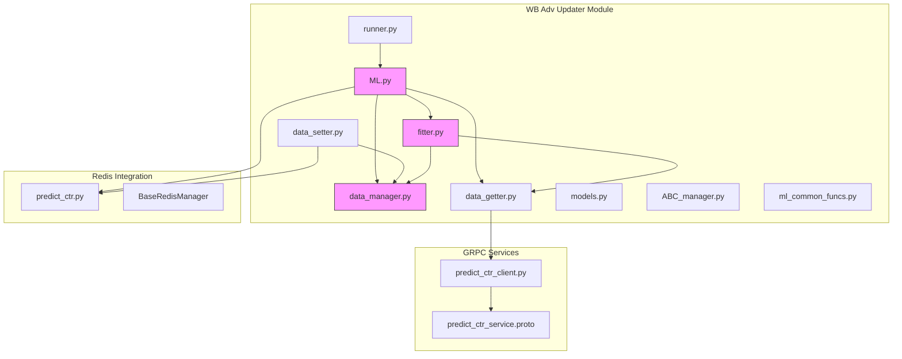
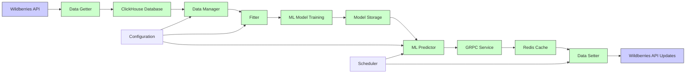
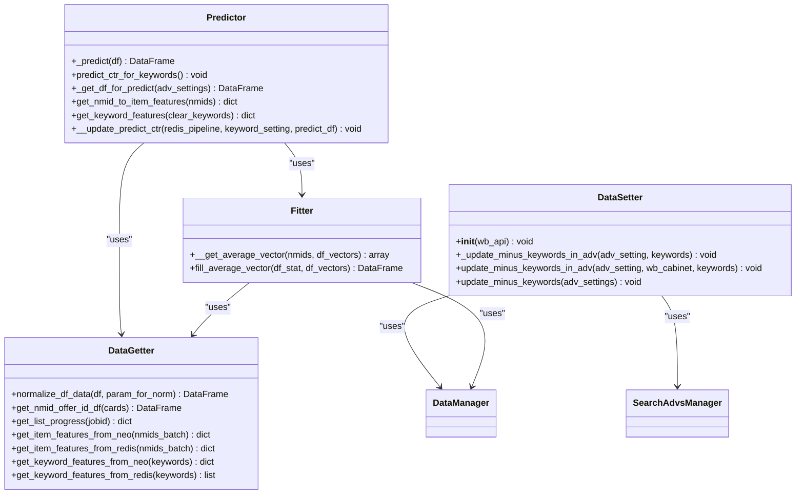
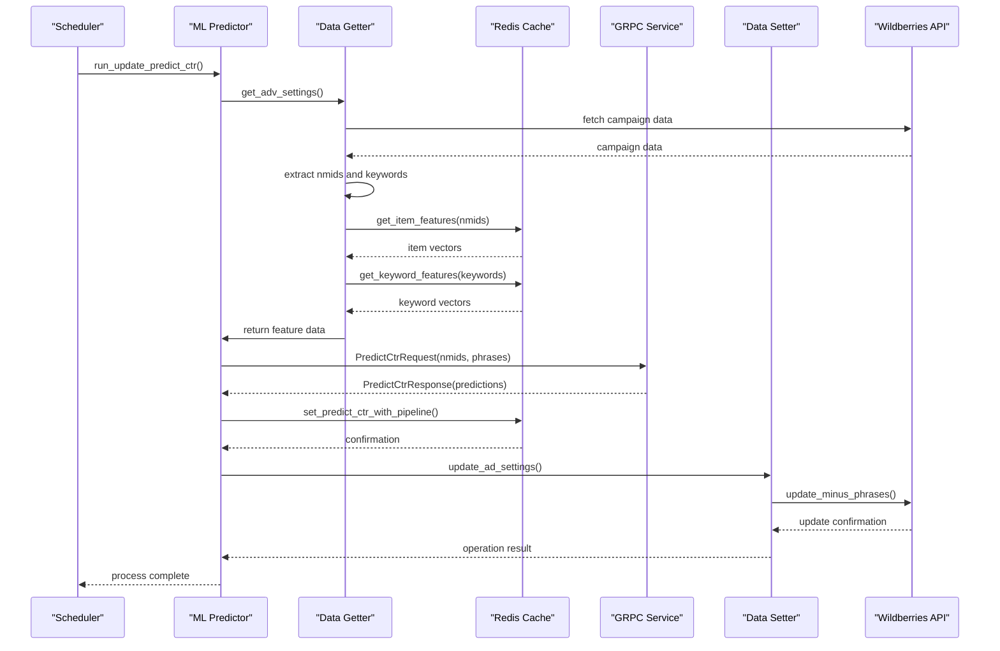
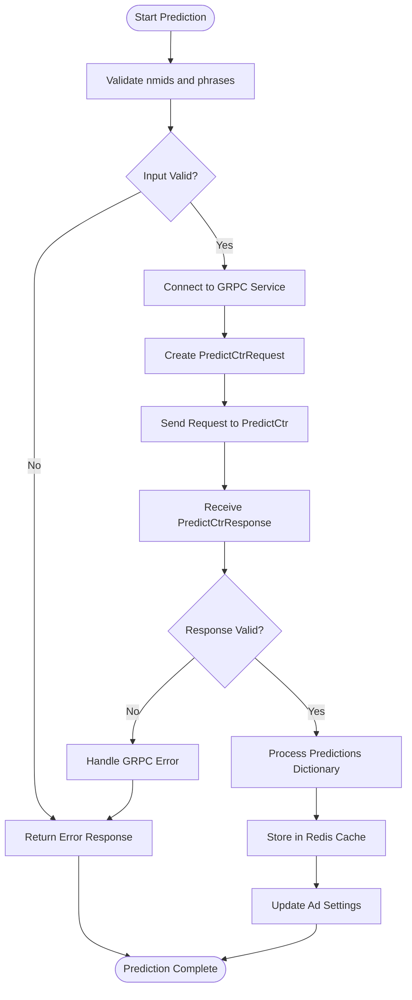
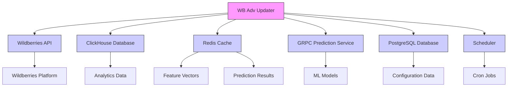

# WB Adv Updater

<cite>
**Referenced Files in This Document**   
- [ML.py](file://app/modules/wb_adv_updater/ML.py)
- [data_manager.py](file://app/modules/wb_adv_updater/data_manager.py)
- [fitter.py](file://app/modules/wb_adv_updater/fitter.py)
- [data_getter.py](file://app/modules/wb_adv_updater/data_getter.py)
- [data_setter.py](file://app/modules/wb_adv_updater/data_setter.py)
- [runner.py](file://app/modules/wb_adv_updater/runner.py)
- [predict_ctr_client.py](file://app/modules/grpcs/predict_ctr_service/predict_ctr_client/predict_ctr_client.py)
- [predict_ctr_service.proto](file://app/modules/grpcs/predict_ctr_service/grpc_service/predict_ctr_service.proto)
- [predict_ctr.py](file://app/core/redis_manager_v2/mixins/predict_ctr.py)
- [models.py](file://app/modules/wb_adv_updater/models.py)
</cite>

## Table of Contents
1. [Introduction](#introduction)
2. [Project Structure](#project-structure)
3. [Core Components](#core-components)
4. [Architecture Overview](#architecture-overview)
5. [Detailed Component Analysis](#detailed-component-analysis)
6. [Dependency Analysis](#dependency-analysis)
7. [Performance Considerations](#performance-considerations)
8. [Troubleshooting Guide](#troubleshooting-guide)
9. [Conclusion](#conclusion)

## Introduction
The WB Adv Updater module is a sophisticated advertising optimization system that integrates machine learning to enhance ad performance on the Wildberries platform. This document provides a comprehensive analysis of the module's architecture, functionality, and implementation details, focusing on its predictive analytics capabilities and automated adjustment mechanisms. The system leverages ML models to predict click-through rates (CTR) and optimize bidding strategies, enabling data-driven decisions for advertising campaigns.

## Project Structure
The WB Adv Updater module is organized within the application's modular structure, with dedicated components for machine learning, data management, and integration with external services. The module follows a clean separation of concerns, with distinct components handling data retrieval, model training, prediction, and ad updates.

**Diagram sources**
- [ML.py](file://app/modules/wb_adv_updater/ML.py)
- [data_manager.py](file://app/modules/wb_adv_updater/data_manager.py)
- [fitter.py](file://app/modules/wb_adv_updater/fitter.py)
- [data_getter.py](file://app/modules/wb_adv_updater/data_getter.py)
- [data_setter.py](file://app/modules/wb_adv_updater/data_setter.py)
- [runner.py](file://app/modules/wb_adv_updater/runner.py)
- [predict_ctr_client.py](file://app/modules/grpcs/predict_ctr_service/predict_ctr_client/predict_ctr_client.py)
- [predict_ctr_service.proto](file://app/modules/grpcs/predict_ctr_service/grpc_service/predict_ctr_service.proto)
- [predict_ctr.py](file://app/core/redis_manager_v2/mixins/predict_ctr.py)

**Section sources**
- [ML.py](file://app/modules/wb_adv_updater/ML.py)
- [data_manager.py](file://app/modules/wb_adv_updater/data_manager.py)

## Core Components

The WB Adv Updater module consists of several core components that work together to optimize advertising performance through machine learning. The system integrates with Wildberries' API to retrieve advertising data, applies ML models to predict CTR, and automatically adjusts bidding strategies based on these predictions. The architecture follows a pipeline approach, with data flowing from external sources through preprocessing, model inference, and finally to ad updates.

The ML component (ML.py) serves as the central orchestrator, coordinating data retrieval, model prediction, and result storage. It works in conjunction with the fitter module for model training and the data manager for handling advertising statistics. The GRPC prediction service enables integration with external ML models, allowing for scalable and efficient CTR prediction.

**Section sources**
- [ML.py](file://app/modules/wb_adv_updater/ML.py)
- [fitter.py](file://app/modules/wb_adv_updater/fitter.py)
- [data_manager.py](file://app/modules/wb_adv_updater/data_manager.py)

## Architecture Overview

The WB Adv Updater follows a microservices-inspired architecture with clear separation between data processing, machine learning, and ad management components. The system is designed to be asynchronous and non-blocking, leveraging Python's asyncio framework for efficient resource utilization.

**Diagram sources**
- [data_getter.py](file://app/modules/wb_adv_updater/data_getter.py)
- [data_manager.py](file://app/modules/wb_adv_updater/data_manager.py)
- [fitter.py](file://app/modules/wb_adv_updater/fitter.py)
- [ML.py](file://app/modules/wb_adv_updater/ML.py)
- [predict_ctr_client.py](file://app/modules/grpcs/predict_ctr_service/predict_ctr_client/predict_ctr_client.py)
- [predict_ctr.py](file://app/core/redis_manager_v2/mixins/predict_ctr.py)
- [data_setter.py](file://app/modules/wb_adv_updater/data_setter.py)

## Detailed Component Analysis

### ML Component Analysis
The ML component is the central processing unit of the WB Adv Updater, responsible for coordinating CTR prediction and model management. It implements a comprehensive pipeline for feature extraction, model inference, and result storage.

#### ML Class Diagram

**Diagram sources**
- [ML.py](file://app/modules/wb_adv_updater/ML.py)
- [data_getter.py](file://app/modules/wb_adv_updater/data_getter.py)
- [fitter.py](file://app/modules/wb_adv_updater/fitter.py)
- [data_setter.py](file://app/modules/wb_adv_updater/data_setter.py)
- [data_manager.py](file://app/modules/wb_adv_updater/data_manager.py)

#### CTR Prediction Workflow

**Diagram sources**
- [ML.py](file://app/modules/wb_adv_updater/ML.py)
- [data_getter.py](file://app/modules/wb_adv_updater/data_getter.py)
- [predict_ctr_client.py](file://app/modules/grpcs/predict_ctr_service/predict_ctr_client/predict_ctr_client.py)
- [predict_ctr.py](file://app/core/redis_manager_v2/mixins/predict_ctr.py)
- [data_setter.py](file://app/modules/wb_adv_updater/data_setter.py)

### GRPC Prediction Service Integration
The GRPC prediction service provides a scalable interface for CTR prediction, enabling the system to leverage external ML models without tight coupling.

#### GRPC Service Flowchart

**Diagram sources**
- [predict_ctr_client.py](file://app/modules/grpcs/predict_ctr_service/predict_ctr_client/predict_ctr_client.py)
- [predict_ctr_service.proto](file://app/modules/grpcs/predict_ctr_service/grpc_service/predict_ctr_service.proto)
- [predict_ctr.py](file://app/core/redis_manager_v2/mixins/predict_ctr.py)

**Section sources**
- [predict_ctr_client.py](file://app/modules/grpcs/predict_ctr_service/predict_ctr_client/predict_ctr_client.py)
- [predict_ctr_service.proto](file://app/modules/grpcs/predict_ctr_service/grpc_service/predict_ctr_service.proto)

## Dependency Analysis

The WB Adv Updater module has a well-defined dependency structure, with clear relationships between components. The system relies on several external services and databases to function effectively.

**Diagram sources**
- [data_getter.py](file://app/modules/wb_adv_updater/data_getter.py)
- [data_manager.py](file://app/modules/wb_adv_updater/data_manager.py)
- [predict_ctr_client.py](file://app/modules/grpcs/predict_ctr_service/predict_ctr_client/predict_ctr_client.py)
- [predict_ctr.py](file://app/core/redis_manager_v2/mixins/predict_ctr.py)
- [runner.py](file://app/modules/wb_adv_updater/runner.py)

**Section sources**
- [data_getter.py](file://app/modules/wb_adv_updater/data_getter.py)
- [data_manager.py](file://app/modules/wb_adv_updater/data_manager.py)
- [predict_ctr_client.py](file://app/modules/grpcs/predict_ctr_service/predict_ctr_client/predict_ctr_client.py)

## Performance Considerations

The WB Adv Updater is designed with performance in mind, implementing several optimization strategies to handle large volumes of advertising data efficiently. The system uses asynchronous processing to maximize throughput and minimize latency in the prediction pipeline.

Key performance optimizations include:
- Asynchronous I/O operations for database and API calls
- Batch processing of feature vectors and predictions
- Redis caching of frequently accessed data
- Parallel execution of independent tasks
- Efficient data structures for feature representation

The system also implements rate limiting and error handling to ensure stability under high load conditions. Configuration options allow for tuning of performance parameters based on specific deployment requirements.

## Troubleshooting Guide

Common issues with the WB Adv Updater typically fall into several categories: model drift, prediction accuracy degradation, and API integration problems.

### Model Drift and Accuracy Issues
- **Symptoms**: Decreasing prediction accuracy over time, CTR predictions diverging from actual performance
- **Causes**: Changes in market conditions, shifts in user behavior, outdated training data
- **Solutions**: Regular model retraining, monitoring prediction vs. actual performance, implementing model versioning

### API Integration Problems
- **Symptoms**: Failed updates, timeout errors, authentication issues
- **Causes**: Rate limiting, network connectivity issues, API changes
- **Solutions**: Implement retry logic with exponential backoff, monitor API status, maintain up-to-date API clients

### Configuration Issues
- **Symptoms**: Unexpected behavior, incorrect predictions, failed updates
- **Causes**: Incorrect parameter settings, missing configuration values
- **Solutions**: Validate configuration on startup, implement configuration validation, provide clear error messages

**Section sources**
- [ML.py](file://app/modules/wb_adv_updater/ML.py)
- [data_manager.py](file://app/modules/wb_adv_updater/data_manager.py)
- [fitter.py](file://app/modules/wb_adv_updater/fitter.py)
- [data_getter.py](file://app/modules/wb_adv_updater/data_getter.py)

## Conclusion

The WB Adv Updater module represents a sophisticated integration of machine learning and advertising optimization, providing automated CTR prediction and bid adjustment capabilities for Wildberries advertising campaigns. The system's modular architecture enables flexible configuration and maintenance, while its use of GRPC services allows for scalable ML inference.

Key strengths of the implementation include its comprehensive data pipeline, robust error handling, and efficient use of caching to minimize latency. The system effectively bridges the gap between raw advertising data and actionable insights, enabling data-driven optimization of ad performance.

Future enhancements could include more sophisticated ML models, real-time adaptation to market changes, and enhanced visualization of performance metrics to support strategic decision-making.