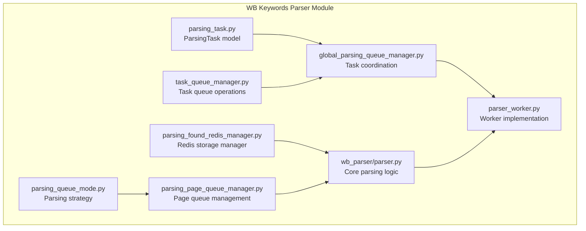
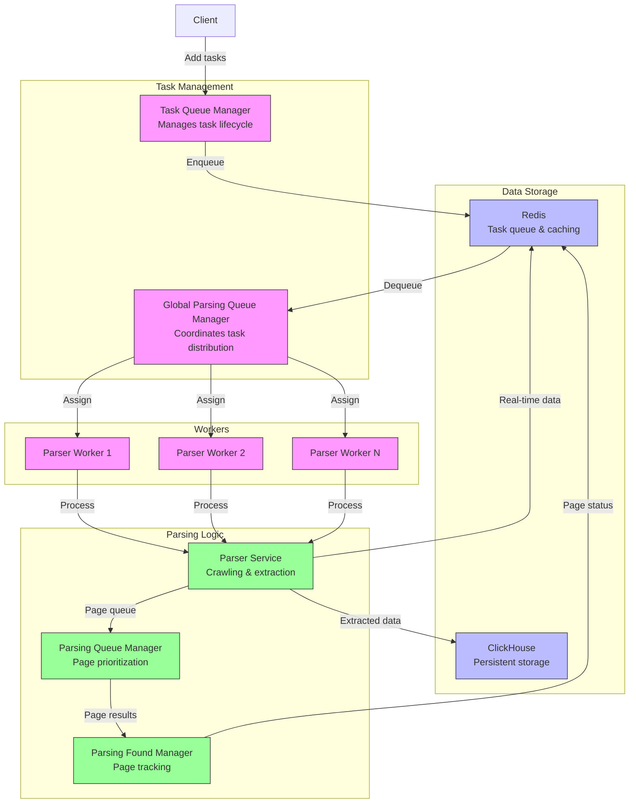
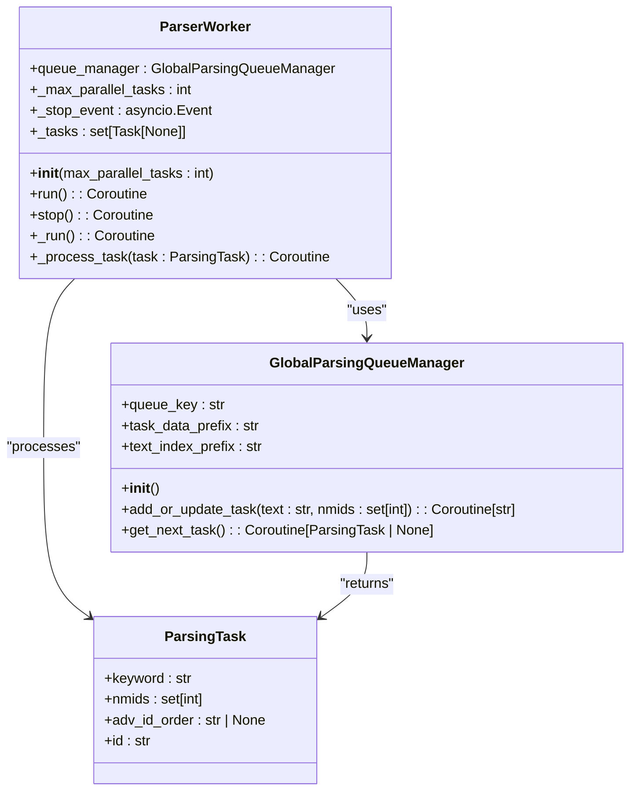
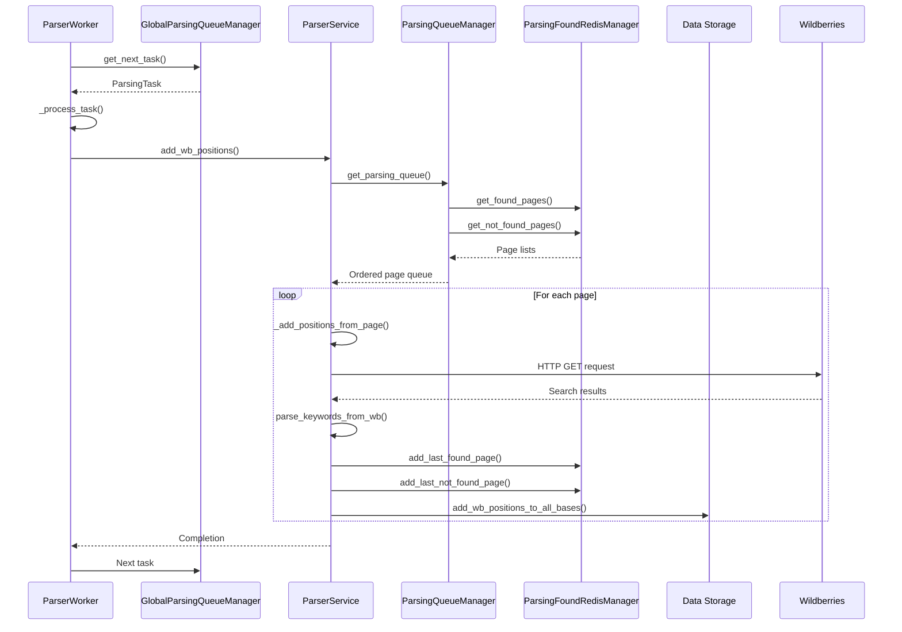
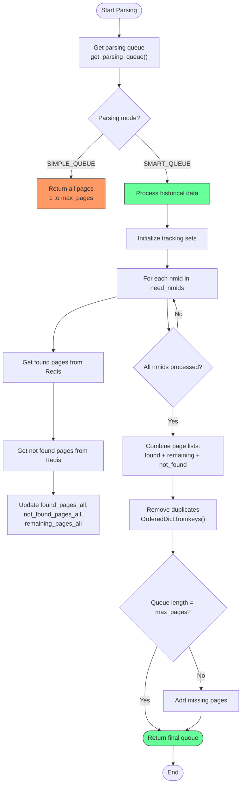
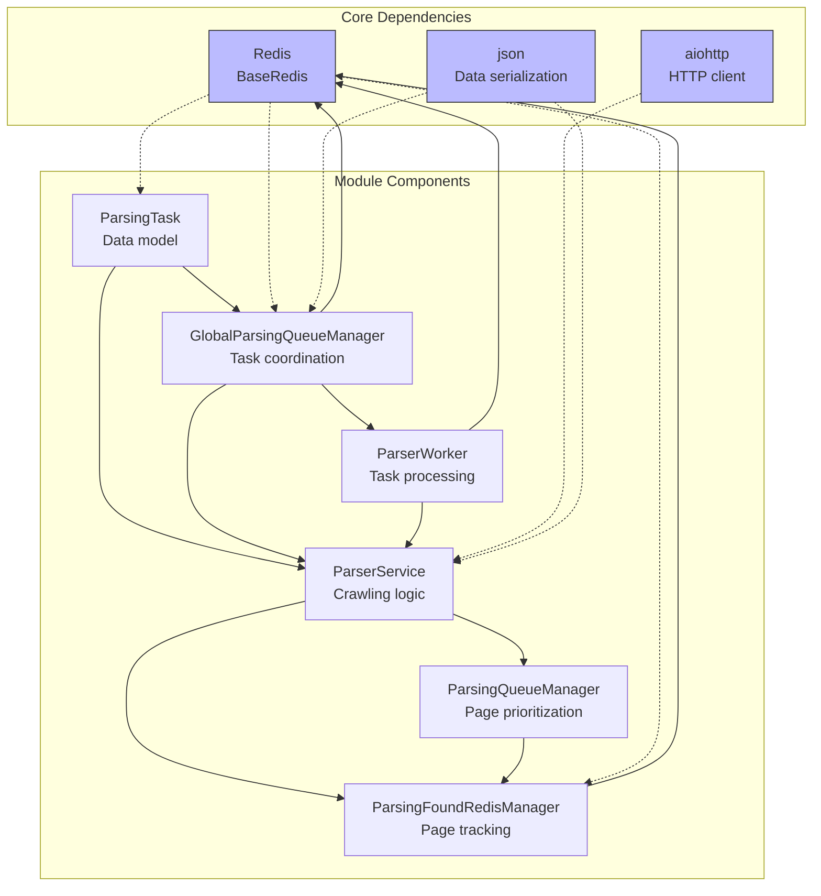

# WB Keywords Parser

<cite>
**Referenced Files in This Document**   
- [parser_worker.py](file://app/modules/wb_keywords_parser/parser_worker.py)
- [parsing_task.py](file://app/modules/wb_keywords_parser/parsing_task.py)
- [global_parsing_queue_manager.py](file://app/modules/wb_keywords_parser/global_parsing_queue_manager.py)
- [parser.py](file://app/modules/wb_keywords_parser/wb_parser/parser.py)
- [parsing_found_redis_manager.py](file://app/modules/wb_keywords_parser/parsing_found_redis_manager.py)
- [task_queue_manager.py](file://app/modules/wb_keywords_parser/task_queue_manager.py)
- [parsing_page_queue_manager.py](file://app/modules/wb_keywords_parser/wb_parser/parsing_page_queue_manager.py)
- [parsing_queue_mode.py](file://app/modules/wb_keywords_parser/wb_parser/parsing_queue_mode.py)
- [settings_master.py](file://app/settings/settings_master.py)
- [__init__.py](file://app/modules/shop_runner/service_manager/services/parsing_keywords_from_wb/__init__.py)
</cite>

## Table of Contents
1. [Introduction](#introduction)
2. [Project Structure](#project-structure)
3. [Core Components](#core-components)
4. [Architecture Overview](#architecture-overview)
5. [Detailed Component Analysis](#detailed-component-analysis)
6. [Dependency Analysis](#dependency-analysis)
7. [Performance Considerations](#performance-considerations)
8. [Troubleshooting Guide](#troubleshooting-guide)
9. [Conclusion](#conclusion)

## Introduction
The WB Keywords Parser module is a critical component of the Wildberries advertising automation system, responsible for extracting and analyzing keyword data from the Wildberries marketplace. This module implements a sophisticated parsing system that handles keyword extraction, position tracking, and data storage with high efficiency and reliability. The system is designed to manage large-scale keyword extraction operations while coordinating multiple workers through Redis-based task distribution. It features intelligent parsing queue management, dynamic page crawling, and robust error handling to ensure reliable operation in the face of marketplace changes, rate limiting, and other challenges.

## Project Structure
The WB Keywords Parser module is organized in a modular structure within the application's modules directory. The core functionality is contained in the `wb_keywords_parser` package, which includes several subcomponents for different aspects of the parsing process.

**Diagram sources**
- [parsing_task.py](file://app/modules/wb_keywords_parser/parsing_task.py#L1-L25)
- [global_parsing_queue_manager.py](file://app/modules/wb_keywords_parser/global_parsing_queue_manager.py#L1-L131)
- [parser_worker.py](file://app/modules/wb_keywords_parser/parser_worker.py#L1-L80)
- [parser.py](file://app/modules/wb_keywords_parser/wb_parser/parser.py#L1-L352)
- [parsing_found_redis_manager.py](file://app/modules/wb_keywords_parser/parsing_found_redis_manager.py#L1-L30)
- [parsing_page_queue_manager.py](file://app/modules/wb_keywords_parser/wb_parser/parsing_page_queue_manager.py#L1-L86)
- [task_queue_manager.py](file://app/modules/wb_keywords_parser/task_queue_manager.py#L1-L177)
- [parsing_queue_mode.py](file://app/modules/wb_keywords_parser/wb_parser/parsing_queue_mode.py#L1-L7)

**Section sources**
- [app/modules/wb_keywords_parser](file://app/modules/wb_keywords_parser)

## Core Components
The WB Keywords Parser module consists of several core components that work together to extract and analyze keyword data from the Wildberries marketplace. The system is built around a worker-based architecture that processes parsing tasks from a Redis-backed queue. Each parsing task contains a keyword and a set of nmids (product identifiers) to track. The parser makes HTTP requests to Wildberries search endpoints to retrieve product listings and extract position data for the specified keywords and products. The extracted data is then stored in both Redis and ClickHouse databases for fast access and long-term analysis. The system implements intelligent queue management that prioritizes pages based on previous parsing results, optimizing the parsing process by focusing on pages where products were previously found or not found.

**Section sources**
- [parser_worker.py](file://app/modules/wb_keywords_parser/parser_worker.py#L1-L80)
- [parsing_task.py](file://app/modules/wb_keywords_parser/parsing_task.py#L1-L25)
- [parser.py](file://app/modules/wb_keywords_parser/wb_parser/parser.py#L1-L352)

## Architecture Overview
The WB Keywords Parser follows a distributed worker architecture with Redis serving as the central coordination point. The system consists of multiple parser workers that consume tasks from a shared Redis queue, process them by crawling Wildberries search results, and store the extracted data in persistent storage.

**Diagram sources**
- [parser_worker.py](file://app/modules/wb_keywords_parser/parser_worker.py#L1-L80)
- [global_parsing_queue_manager.py](file://app/modules/wb_keywords_parser/global_parsing_queue_manager.py#L1-L131)
- [parser.py](file://app/modules/wb_keywords_parser/wb_parser/parser.py#L1-L352)
- [parsing_page_queue_manager.py](file://app/modules/wb_keywords_parser/wb_parser/parsing_page_queue_manager.py#L1-L86)
- [parsing_found_redis_manager.py](file://app/modules/wb_keywords_parser/parsing_found_redis_manager.py#L1-L30)

## Detailed Component Analysis

### Parser Worker Implementation
The ParserWorker class is responsible for processing parsing tasks from the queue and executing the actual crawling operations. It runs multiple concurrent workers to maximize throughput while respecting rate limits.

**Diagram sources**
- [parser_worker.py](file://app/modules/wb_keywords_parser/parser_worker.py#L1-L80)
- [global_parsing_queue_manager.py](file://app/modules/wb_keywords_parser/global_parsing_queue_manager.py#L1-L131)
- [parsing_task.py](file://app/modules/wb_keywords_parser/parsing_task.py#L1-L25)

### Keyword Parsing Workflow
The keyword parsing process follows a structured workflow that begins with task retrieval and ends with data persistence. The system implements a sophisticated page crawling strategy that adapts based on previous parsing results.

**Diagram sources**
- [parser_worker.py](file://app/modules/wb_keywords_parser/parser_worker.py#L1-L80)
- [parser.py](file://app/modules/wb_keywords_parser/wb_parser/parser.py#L1-L352)
- [parsing_page_queue_manager.py](file://app/modules/wb_keywords_parser/wb_parser/parsing_page_queue_manager.py#L1-L86)
- [parsing_found_redis_manager.py](file://app/modules/wb_keywords_parser/parsing_found_redis_manager.py#L1-L30)

### Parsing Queue Management
The parsing system implements intelligent queue management that optimizes the crawling process by prioritizing pages based on historical data. This reduces unnecessary requests and improves parsing efficiency.

**Diagram sources**
- [parsing_page_queue_manager.py](file://app/modules/wb_keywords_parser/wb_parser/parsing_page_queue_manager.py#L1-L86)
- [parsing_found_redis_manager.py](file://app/modules/wb_keywords_parser/parsing_found_redis_manager.py#L1-L30)
- [parsing_queue_mode.py](file://app/modules/wb_keywords_parser/wb_parser/parsing_queue_mode.py#L1-L7)

## Dependency Analysis
The WB Keywords Parser module has a well-defined dependency structure that separates concerns and enables modular development. The core dependencies are centered around Redis for coordination and data storage, with clear interfaces between components.

**Diagram sources**
- [parsing_task.py](file://app/modules/wb_keywords_parser/parsing_task.py#L1-L25)
- [global_parsing_queue_manager.py](file://app/modules/wb_keywords_parser/global_parsing_queue_manager.py#L1-L131)
- [parser_worker.py](file://app/modules/wb_keywords_parser/parser_worker.py#L1-L80)
- [parser.py](file://app/modules/wb_keywords_parser/wb_parser/parser.py#L1-L352)
- [parsing_page_queue_manager.py](file://app/modules/wb_keywords_parser/wb_parser/parsing_page_queue_manager.py#L1-L86)
- [parsing_found_redis_manager.py](file://app/modules/wb_keywords_parser/parsing_found_redis_manager.py#L1-L30)
- [app/core/redis_manager/base_redis_manager.py](file://app/core/redis_manager/base_redis_manager.py)

## Performance Considerations
The WB Keywords Parser is designed with performance optimization in mind, particularly for large-scale keyword extraction operations. The system implements several strategies to maximize efficiency while minimizing resource usage and avoiding rate limiting by the Wildberries platform.

The worker configuration allows for adjustable concurrency levels through the `max_parallel_tasks` parameter, which controls how many parsing tasks can run simultaneously. This can be tuned based on system resources and Wildberries rate limits. The parsing delay between requests is configurable through environment variables, allowing fine-tuning of the request rate to avoid being blocked by the marketplace.

The smart queue mode significantly improves performance by prioritizing pages that are more likely to contain relevant products, based on historical parsing data. This reduces the number of unnecessary HTTP requests and focuses crawling efforts on the most promising pages. The system also implements caching of parsing results in Redis, enabling quick retrieval of recent position data without additional HTTP requests.

For large-scale operations, the distributed worker architecture allows horizontal scaling by adding more parser worker instances. Each worker independently processes tasks from the shared Redis queue, enabling the system to handle high volumes of keyword extraction requests in parallel.

**Section sources**
- [parser_worker.py](file://app/modules/wb_keywords_parser/parser_worker.py#L1-L80)
- [settings_master.py](file://app/settings/settings_master.py#L1-L434)
- [parser.py](file://app/modules/wb_keywords_parser/wb_parser/parser.py#L1-L352)

## Troubleshooting Guide
The WB Keywords Parser includes several mechanisms for handling common issues that may arise during operation. Understanding these issues and their solutions is critical for maintaining reliable parsing operations.

### Parsing Failures
When parsing fails for a specific page or keyword, the system logs detailed error information and continues with other tasks. Common causes include network connectivity issues, malformed responses from Wildberries, or temporary service outages. The system automatically retries failed tasks when they are re-added to the queue. To diagnose parsing failures, check the application logs for error messages containing "Ошибка при парсинге" (parsing error) and examine the associated stack traces.

### Rate Limiting by Wildberries
Wildberries may rate limit excessive requests from the parser. Symptoms include HTTP 429 responses or connection timeouts. The system mitigates this through configurable delays between requests, controlled by the `PARSING_KEYWORDS_DELAY_BETWEEN_TASKS` environment variable. If rate limiting occurs, increase this value to reduce request frequency. The system also uses multiple IP addresses through proxy configurations to distribute requests.

### CAPTCHA Handling
The Wildberries platform may present CAPTCHAs when it detects automated access patterns. The current system does not have built-in CAPTCHA solving capabilities. To address this, implement rotating user agents, vary request patterns, and ensure adequate delays between requests. Consider using CAPTCHA solving services if this becomes a persistent issue.

### Configuration Issues
Ensure all required environment variables are properly set, particularly Redis connection parameters and parsing limits. Key configuration options include:
- `MAX_PAGE_LIMIT_PARSER_WORKER`: Maximum number of pages to parse per keyword
- `PARSING_QUEUE_MODE`: Queue strategy (simple_queue or smart_queue)
- `MAX_THREAD_PARSER`: Maximum number of parser threads
- `PARSING_KEYWORDS_DELAY_BETWEEN_TASKS`: Delay between parsing tasks in seconds

**Section sources**
- [parser.py](file://app/modules/wb_keywords_parser/wb_parser/parser.py#L1-L352)
- [parser_worker.py](file://app/modules/wb_keywords_parser/parser_worker.py#L1-L80)
- [settings_master.py](file://app/settings/settings_master.py#L1-L434)
- [__init__.py](file://app/modules/shop_runner/service_manager/services/parsing_keywords_from_wb/__init__.py#L1-L93)

## Conclusion
The WB Keywords Parser module provides a robust and scalable solution for extracting keyword data from the Wildberries marketplace. Its distributed architecture, intelligent queue management, and comprehensive error handling make it well-suited for large-scale keyword extraction operations. The system effectively balances performance and reliability through its worker-based design and Redis coordination. By implementing smart page prioritization and configurable parsing parameters, the module optimizes resource usage while adapting to the dynamic nature of the marketplace. Future enhancements could include CAPTCHA solving capabilities, more sophisticated rate limit detection, and enhanced data analysis features to provide deeper insights from the extracted keyword data.