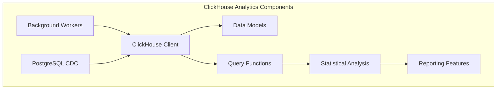
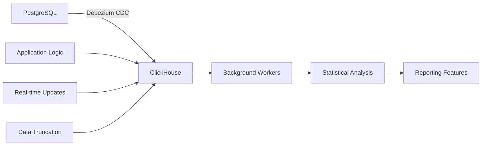
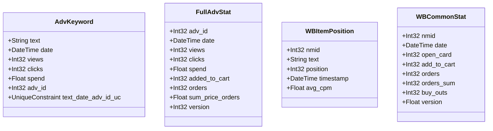
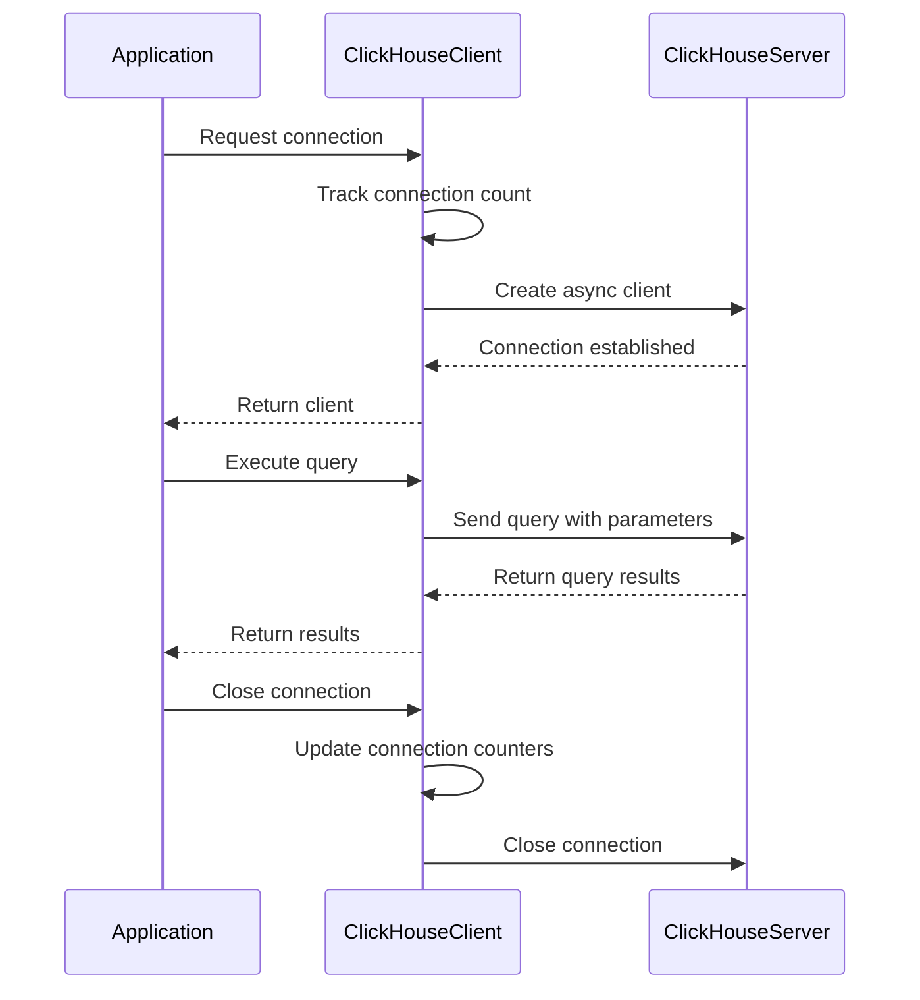
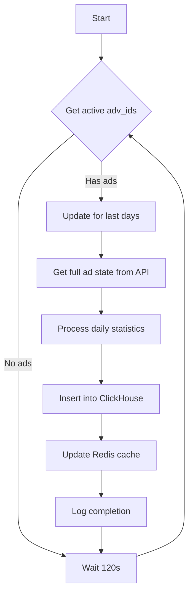
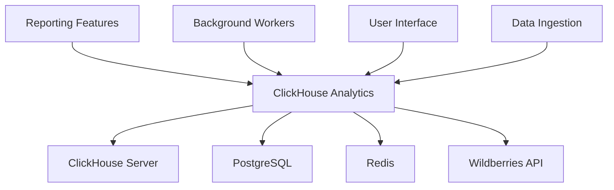

# ClickHouse Analytics Model

<cite>
**Referenced Files in This Document**   
- [models.py](file://app/utils/click_house/models.py)
- [client.py](file://app/utils/click_house/client.py)
- [full_wb_adv_stat.py](file://app/modules/shop_runner/wb_stat_manager/clickhouse_manager/full_wb_adv_stat.py)
- [trunc_system_log_in_clickhouse.py](file://trunc_system_log_in_clickhouse.py)
- [settings_master.py](file://app/settings/settings_master.py)
- [common_stat_manager.py](file://app/modules/shop_runner/wb_statistic_manager/backend/common_stat_manager.py)
- [data_manager.py](file://app/modules/wb_adv_updater/data_manager.py)
- [full_adv_stat.py](file://app/modules/full_stat_adv_updater/types/full_adv_stat.py)
- [debezium-postgres-connector.json](file://debezium-postgres-connector.json)
</cite>

## Table of Contents
1. [Introduction](#introduction)
2. [Project Structure](#project-structure)
3. [Core Components](#core-components)
4. [Architecture Overview](#architecture-overview)
5. [Detailed Component Analysis](#detailed-component-analysis)
6. [Dependency Analysis](#dependency-analysis)
7. [Performance Considerations](#performance-considerations)
8. [Troubleshooting Guide](#troubleshooting-guide)
9. [Conclusion](#conclusion)

## Introduction
The ClickHouse analytics model in this system is designed to store and query high-volume advertising performance data for an advertising automation platform. The model focuses on storing daily ad statistics, keyword positions, and spend metrics for advertising campaigns on the Wildberries marketplace. The system ingests data from PostgreSQL through Debezium CDC (Change Data Capture) and processes it through background workers for real-time updates. The analytics model supports complex queries for reporting features such as graphical position tracking and daily performance analysis. This documentation details the schema design, ingestion patterns, query optimization techniques, and operational procedures for managing the ClickHouse analytics system.

## Project Structure
The ClickHouse analytics components are organized within the repository as follows:
- `app/utils/click_house/` - Core ClickHouse client and model definitions
- `app/modules/shop_runner/wb_stat_manager/clickhouse_manager/` - ClickHouse data access and management for advertising statistics
- `app/modules/full_stat_adv_updater/` - Background worker for updating advertising statistics
- `app/modules/wb_adv_updater/` - Data manager with ClickHouse query functions
- `app/modules/shop_runner/wb_statistic_manager/backend/` - Backend components for common statistics management

The structure follows a modular approach where ClickHouse interactions are encapsulated in dedicated modules, with clear separation between data models, client connections, and business logic that uses the analytics data.

**Diagram sources**
- [client.py](file://app/utils/click_house/client.py#L1-L211)
- [models.py](file://app/utils/click_house/models.py#L1-L15)

**Section sources**
- [app/utils/click_house/](file://app/utils/click_house/)
- [app/modules/shop_runner/wb_stat_manager/clickhouse_manager/](file://app/modules/shop_runner/wb_stat_manager/clickhouse_manager/)

## Core Components
The ClickHouse analytics model consists of several core components that work together to store, process, and retrieve advertising performance data. The primary components include data models for advertising keywords and statistics, a connection client for managing ClickHouse interactions, query functions for retrieving aggregated data, and background processes for data ingestion and maintenance. The system is designed to handle high-volume data with efficient storage and fast query performance, supporting real-time analytics for advertising campaign optimization.

**Section sources**
- [models.py](file://app/utils/click_house/models.py#L1-L15)
- [client.py](file://app/utils/click_house/client.py#L1-L211)
- [full_wb_adv_stat.py](file://app/modules/shop_runner/wb_stat_manager/clickhouse_manager/full_wb_adv_stat.py#L1-L351)

## Architecture Overview
The ClickHouse analytics architecture follows a data pipeline pattern where data flows from PostgreSQL through CDC to ClickHouse, then to reporting and analysis components. The architecture includes connection pooling, query optimization, and data aggregation layers that enable efficient processing of advertising performance data. Background workers continuously update statistics, while retention policies and maintenance scripts ensure optimal storage usage.

**Diagram sources**
- [debezium-postgres-connector.json](file://debezium-postgres-connector.json#L1-L21)
- [client.py](file://app/utils/click_house/client.py#L1-L211)
- [trunc_system_log_in_clickhouse.py](file://trunc_system_log_in_clickhouse.py#L1-L43)

## Detailed Component Analysis

### Data Models
The ClickHouse data models are designed to efficiently store advertising performance metrics with appropriate data types and constraints. The primary model is the AdvKeyword table which stores daily statistics for advertising keywords.

**Diagram sources**
- [models.py](file://app/utils/click_house/models.py#L1-L15)
- [full_wb_adv_stat.py](file://app/modules/shop_runner/wb_stat_manager/clickhouse_manager/full_wb_adv_stat.py#L1-L351)
- [common_stat_manager.py](file://app/modules/shop_runner/wb_statistic_manager/backend/common_stat_manager.py#L140-L176)

### ClickHouse Client
The ClickHouse client implementation provides asynchronous connection management with connection pooling and monitoring capabilities. It uses clickhouse_connect for async operations and includes comprehensive logging and error handling.

**Diagram sources**
- [client.py](file://app/utils/click_house/client.py#L1-L211)

### Data Ingestion and Processing
The data ingestion process involves background workers that retrieve advertising statistics from external APIs and store them in ClickHouse. The full_stat_adv_updater module coordinates this process, while the wb_stat_manager handles ClickHouse-specific operations.

**Diagram sources**
- [full_wb_adv_stat.py](file://app/modules/shop_runner/wb_stat_manager/clickhouse_manager/full_wb_adv_stat.py#L1-L351)
- [main.py](file://app/modules/full_stat_adv_updater/main.py#L1-L88)
- [db_data_manager.py](file://app/modules/full_stat_adv_updater/db_data_manager.py#L1-L20)

## Dependency Analysis
The ClickHouse analytics components have dependencies on several external systems and internal modules. The primary dependencies include the ClickHouse database server, PostgreSQL for source data, Redis for caching, and Wildberries APIs for raw advertising data. The internal dependencies follow a layered architecture where higher-level modules depend on lower-level data access components.

**Diagram sources**
- [client.py](file://app/utils/click_house/client.py#L1-L211)
- [settings_master.py](file://app/settings/settings_master.py#L80-L279)
- [debezium-postgres-connector.json](file://debezium-postgres-connector.json#L1-L21)

## Performance Considerations
The ClickHouse analytics model is optimized for high-performance querying of advertising data. Key performance considerations include:

- **Connection Pooling**: The client implementation uses connection pooling with configurable limits to prevent resource exhaustion.
- **Query Optimization**: Queries use window functions with ROW_NUMBER() to get the latest version of records, and aggregate functions to summarize data efficiently.
- **Data Types**: Appropriate data types are used (Int32, Float, DateTime) to minimize storage and maximize query performance.
- **Asynchronous Operations**: All database operations are performed asynchronously to maximize throughput.
- **Batch Processing**: Data is inserted in batches to reduce the number of round trips to the database.

The system is configured with environment variables that control performance parameters such as CH_MAX_THREAD (maximum threads) and CLICKHOUSE_PORT (connection port), allowing for tuning based on the deployment environment.

**Section sources**
- [client.py](file://app/utils/click_house/client.py#L1-L211)
- [settings_master.py](file://app/settings/settings_master.py#L80-L279)

## Troubleshooting Guide
Common issues with the ClickHouse analytics model and their solutions:

1. **Connection Issues**: Verify ClickHouse host, port, username, and password in environment variables. Check network connectivity to the ClickHouse server.

2. **Query Performance Problems**: Monitor query execution times and optimize queries by ensuring proper filtering and aggregation. Consider adding appropriate indexes if available.

3. **Data Ingestion Failures**: Check the background worker logs for errors retrieving data from the Wildberries API. Verify that the full_stat_adv_updater is running and has access to active advertising IDs.

4. **Storage Growth**: Monitor the size of ClickHouse tables and verify that the trunc_system_log_in_clickhouse.py script is running to truncate system logs every 10 minutes.

5. **Data Consistency Issues**: Check that the Debezium CDC connector is properly configured and running to ensure data is replicated from PostgreSQL to ClickHouse.

The system includes comprehensive logging that can be used to diagnose issues. Error messages are logged with stack traces to facilitate troubleshooting.

**Section sources**
- [client.py](file://app/utils/click_house/client.py#L1-L211)
- [full_wb_adv_stat.py](file://app/modules/shop_runner/wb_stat_manager/clickhouse_manager/full_wb_adv_stat.py#L1-L351)
- [trunc_system_log_in_clickhouse.py](file://trunc_system_log_in_clickhouse.py#L1-L43)

## Conclusion
The ClickHouse analytics model provides a robust foundation for storing and querying high-volume advertising performance data. The schema design efficiently captures daily ad statistics, keyword positions, and spend metrics with appropriate data types and constraints. Data ingestion from PostgreSQL via Debezium CDC ensures that the analytics system has access to up-to-date information, while background workers provide real-time updates to advertising statistics. Query optimization techniques including partitioning, indexing, and aggregation strategies enable fast retrieval of data for reporting and analysis. The system supports key use cases such as retrieving daily stats through the full_stat_adv_updater and wb_stat_manager modules, with retention policies and data truncation procedures in place to manage storage costs. Future enhancements could include more sophisticated indexing strategies, additional aggregation tables for common queries, and enhanced monitoring of query performance.