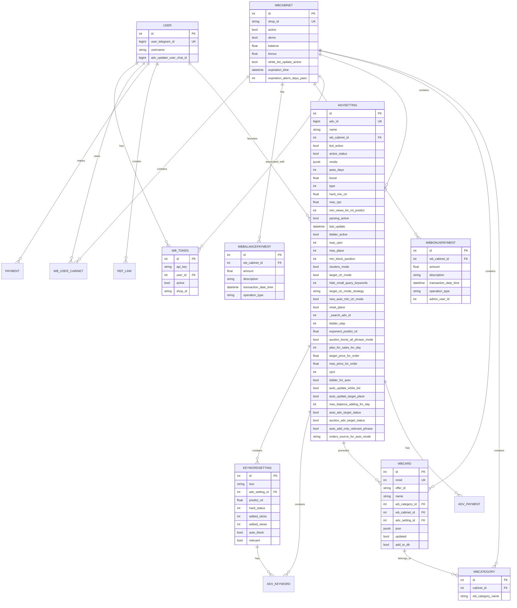
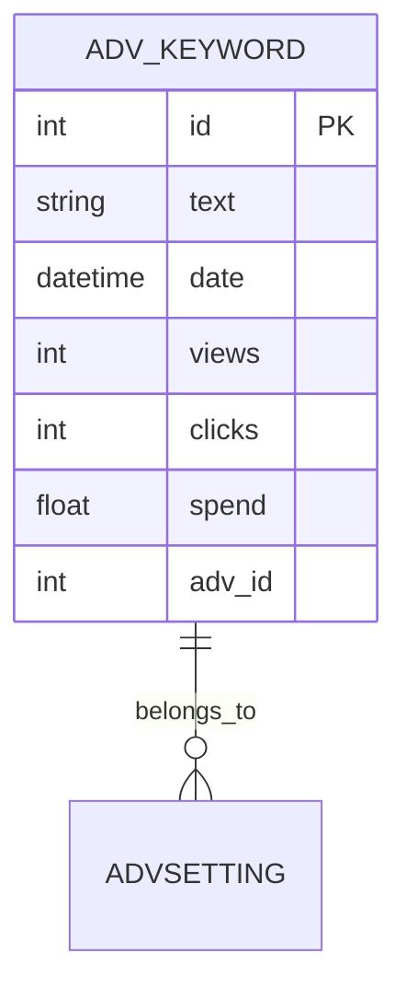
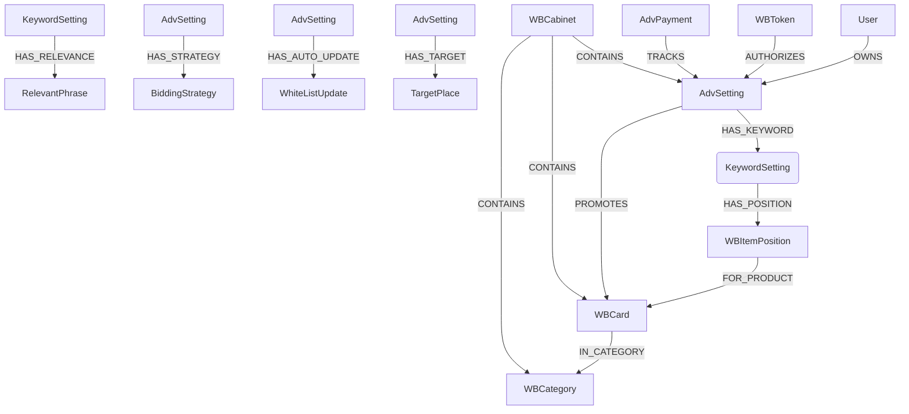
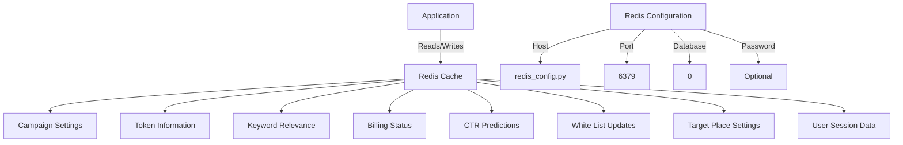
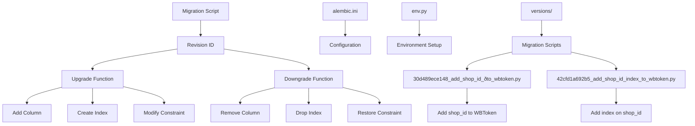

# Data Management

<cite>
**Referenced Files in This Document**   
- [models.py](file://app/modules/common_slaves/wildberries/models/models.py)
- [models.py](file://app/utils/db/models.py)
- [models.py](file://app/utils/click_house/models.py)
- [client.py](file://app/utils/click_house/client.py)
- [base.py](file://app/utils/click_house/base.py)
- [redis.py](file://app/core/di/databases/redis.py)
- [neo4j.py](file://app/core/di/databases/neo4j.py)
- [redis_config.py](file://app/configs/infrastructure_config/redis_config.py)
- [neo4j_config.py](file://app/configs/infrastructure_config/neo4j_config.py)
- [billing/models.py](file://app/modules/billing/models.py)
- [assoc_tables.py](file://app/utils/db/assoc_tables.py)
- [base.py](file://app/utils/db/base.py)
- [alembic/versions/30d489ece148_add_shop_id_ðto_wbtoken.py](file://alembic/versions/30d489ece148_add_shop_id_ðto_wbtoken.py)
- [alembic/versions/42cfd1a692b5_add_shop_id_index_to_wbtoken.py](file://alembic/versions/42cfd1a692b5_add_shop_id_index_to_wbtoken.py)
</cite>

## Table of Contents
1. [Introduction](#introduction)
2. [PostgreSQL Data Model](#postgresql-data-model)
3. [ClickHouse Analytics Model](#clickhouse-analytics-model)
4. [Neo4j Graph Structure](#neo4j-graph-structure)
5. [Redis Caching Strategy](#redis-caching-strategy)
6. [Database Migration Practices](#database-migration-practices)
7. [Data Lifecycle Management](#data-lifecycle-management)
8. [Performance Optimization](#performance-optimization)
9. [Conclusion](#conclusion)

## Introduction
This document provides comprehensive documentation of the data management systems within the advertising bot application. The system employs a multi-database architecture with PostgreSQL for persistent storage of core business entities, ClickHouse for high-volume analytics data, Neo4j for representing complex relationships between keywords, products, and campaigns, and Redis for caching frequently accessed data. The documentation details the schema design, relationships, constraints, and optimization strategies for each data store, along with migration practices and data lifecycle management policies.

## PostgreSQL Data Model

The PostgreSQL database serves as the primary persistent storage for the application's core business entities, including user accounts, advertising settings, tokens, and billing information. The schema is designed with proper normalization, foreign key relationships, and indexing strategies to ensure data integrity and query performance.

**Diagram sources**
- [models.py](file://app/modules/common_slaves/wildberries/models/models.py)

**Section sources**
- [models.py](file://app/modules/common_slaves/wildberries/models/models.py)
- [models.py](file://app/utils/db/models.py)
- [assoc_tables.py](file://app/utils/db/assoc_tables.py)

### Core Tables

#### AdvSetting
The `AdvSetting` table represents advertising campaign settings and configurations. It contains comprehensive parameters for both automatic and auction-based advertising campaigns, including bidding strategies, targeting options, and performance thresholds.

Key fields include:
- `adv_id`: Unique identifier for the advertising campaign
- `name`: Campaign name with embedded metadata patterns
- `bot_active`: Flag indicating if the bot is actively managing the campaign
- `hard_min_ctr`: Minimum click-through rate threshold
- `max_cpc`: Maximum cost-per-click
- `bidder_step`: Bidding increment step
- `exponent_predict_ctr`: Exponent factor for CTR prediction
- `auto_update_white_list`: Flag for automatic white list updates
- `auto_update_target_place`: Flag for automatic target place updates
- `max_balance_adding_for_day`: Daily balance addition limit

The table includes multiple indexes to optimize common query patterns, particularly around cabinet_id, type, and last_update combinations.

#### WBTokens
The `WBToken` table stores Wildberries API tokens used for authentication and authorization. Each token is associated with a user and may have an associated shop_id.

Key features:
- `api_key`: The actual API token value
- `user_id`: Foreign key to the User table
- `active`: Status flag for token validity
- `shop_id`: Optional shop identifier extracted from token payload
- Unique constraint on api_key and user_id combination
- Index on shop_id for efficient lookups

Migration scripts have been implemented to add and index the shop_id field, demonstrating the evolution of this table over time.

#### Billing
The billing system is implemented through multiple related tables that track financial transactions for advertising campaigns.

**WBBalancePayment**: Tracks balance payments and deductions for cabinets
- `amount`: Transaction amount (positive for additions, negative for deductions)
- `operation_type`: Type of operation (add, subtract, auto_subtract, reset)
- Comprehensive indexing on cabinet_id, date, and operation_type
- Unique constraint for daily auto balance charges

**WBBonusPayment**: Similar structure to balance payments but for bonus funds
- Includes admin_user_id to track manual adjustments
- Unique constraint for daily auto bonus charges

**AdvPayment**: Tracks payments specifically associated with advertising campaigns
- `date`: Payment date
- `adv_setting_id`: Foreign key to the advertising campaign
- `type`: Payment type classification
- `amount`: Payment amount
- Unique constraint on date, adv_setting_id, and type combination

## ClickHouse Analytics Model

ClickHouse is used as the analytics database for storing high-volume performance data from advertising campaigns. The schema is optimized for fast aggregation and time-series analysis of keyword performance metrics.

**Diagram sources**
- [models.py](file://app/utils/click_house/models.py)

**Section sources**
- [models.py](file://app/utils/click_house/models.py)
- [client.py](file://app/utils/click_house/client.py)
- [base.py](file://app/utils/click_house/base.py)

### Schema Design
The primary table in the ClickHouse model is `AdvKeyword`, which stores performance metrics for individual keywords over time.

Key characteristics:
- `text`: The keyword text being tracked
- `date`: Timestamp of the performance data
- `views`: Number of views/impressions
- `clicks`: Number of clicks
- `spend`: Advertising spend amount
- `adv_id`: Foreign key to the advertising campaign
- Unique constraint on text, date, and adv_id combination to prevent duplicates

The schema follows a column-oriented design optimized for analytical queries, with efficient compression and fast aggregation capabilities.

### Query Patterns
The ClickHouse client implementation includes connection pooling and monitoring to handle high-concurrency analytical queries. The `get_clickhouse_client` context manager manages connection lifecycle, with tracking of connection counts by function call stack to prevent resource exhaustion.

Key query patterns include:
- Time-series analysis of keyword performance over days/weeks
- Aggregation of spend, clicks, and views by campaign
- Trend analysis for CTR (Click-Through Rate) calculations
- Performance comparisons across different time periods

The system uses asynchronous clients to handle concurrent analytical workloads efficiently, with proper resource cleanup in the `__aexit__` method.

## Neo4j Graph Structure

Neo4j is used to represent complex relationships between keywords, products, and advertising campaigns. The graph structure enables sophisticated relationship queries and pathfinding algorithms that would be difficult to express in a relational model.

**Diagram sources**
- [neo4j.py](file://app/core/di/databases/neo4j.py)
- [models.py](file://app/modules/common_slaves/wildberries/models/models.py)

**Section sources**
- [neo4j.py](file://app/core/di/databases/neo4j.py)
- [neo4j_config.py](file://app/configs/infrastructure_config/neo4j_config.py)

### Graph Model
The Neo4j graph model captures relationships that are naturally represented as a network:

- **AdvSetting nodes** represent advertising campaigns
- **KeywordSetting nodes** represent individual keywords within campaigns
- **WBCard nodes** represent products being advertised
- **WBCategory nodes** represent product categories
- **WBItemPosition nodes** represent the position of a product for a specific keyword at a point in time

Relationships include:
- `HAS_KEYWORD`: Connects campaigns to their keywords
- `HAS_POSITION`: Connects keywords to their positions
- `FOR_PRODUCT`: Connects positions to products
- `IN_CATEGORY`: Connects products to categories
- `PROMOTES`: Direct relationship between campaigns and products
- `OWNS`: Connects users to their campaigns
- `AUTHORIZES`: Connects tokens to campaigns they authorize
- `CONTAINS`: Connects cabinets to their components

This graph structure enables complex queries such as:
- Finding all keywords that lead to a specific product
- Tracing the position history of a product across multiple keywords
- Identifying related products through shared keywords
- Analyzing the impact of category changes on keyword performance

The Neo4j driver is configured through dependency injection, with proper lifecycle management for connection verification and cleanup.

## Redis Caching Strategy

Redis is used extensively for caching frequently accessed data to reduce database load and improve application performance. The caching strategy includes multiple patterns for different types of data.

**Diagram sources**
- [redis.py](file://app/core/di/databases/redis.py)
- [redis_config.py](file://app/configs/infrastructure_config/redis_config.py)

**Section sources**
- [redis.py](file://app/core/di/databases/redis.py)
- [redis_config.py](file://app/configs/infrastructure_config/redis_config.py)

### Cache Implementation
The Redis caching strategy employs several patterns:

**1. Data Types and Structures**
- String values for simple key-value pairs
- Hashes for structured objects
- Sets for collections of unique items
- Sorted sets for ranked data
- Lists for ordered collections

**2. Key Naming Convention**
The system uses a consistent key naming convention to organize cached data by domain and entity type, making it easier to manage and debug.

**3. Cache Invalidation**
The system implements both time-based and event-driven cache invalidation:
- Time-to-live (TTL) settings for automatic expiration
- Explicit invalidation on data updates
- Pattern-based deletion for bulk operations

**4. High Availability**
The Redis configuration supports password authentication and configurable host/port settings, allowing for deployment in secured environments.

**5. Connection Management**
The Redis client is managed through dependency injection, with lifecycle management for connection verification and cleanup. The configuration is externalized through environment variables with a clear prefix (REDIS_).

## Database Migration Practices

The application uses Alembic for database schema migrations, providing a structured approach to evolving the database schema over time while maintaining data integrity.

**Diagram sources**
- [alembic/versions/30d489ece148_add_shop_id_ðto_wbtoken.py](file://alembic/versions/30d489ece148_add_shop_id_ðto_wbtoken.py)
- [alembic/versions/42cfd1a692b5_add_shop_id_index_to_wbtoken.py](file://alembic/versions/42cfd1a692b5_add_shop_id_index_to_wbtoken.py)

**Section sources**
- [alembic/versions/30d489ece148_add_shop_id_ðto_wbtoken.py](file://alembic/versions/30d489ece148_add_shop_id_ðto_wbtoken.py)
- [alembic/versions/42cfd1a692b5_add_shop_id_index_to_wbtoken.py](file://alembic/versions/42cfd1a692b5_add_shop_id_index_to_wbtoken.py)

### Migration Workflow
The migration process follows a standard Alembic pattern:

1. **Revision Creation**: New migrations are created with unique revision IDs
2. **Upgrade Function**: Contains the forward migration logic to modify the schema
3. **Downgrade Function**: Contains the reverse migration logic to revert changes
4. **Version Tracking**: Alembic maintains a versions table to track applied migrations

### Example Migrations
Two example migrations demonstrate the evolution of the WBToken table:

**30d489ece148_add_shop_id_ðto_wbtoken.py**
- Adds the shop_id column to the WBToken table
- Creates indexes on various tables including adv_setting_cabinet_id and wb_cabinet_id
- Establishes the foundation for shop-based token management

**42cfd1a692b5_add_shop_id_index_to_wbtoken.py**
- Adds an index on the shop_id column in the WBToken table
- Optimizes queries that filter by shop_id
- Demonstrates the iterative improvement of database performance

These migrations show a clear progression of the schema design, with initial structural changes followed by performance optimizations.

## Data Lifecycle Management

The application implements comprehensive data lifecycle management policies across all data stores, ensuring data integrity, compliance, and optimal performance.

### Retention Policies
Each data store has specific retention policies based on its purpose:

**PostgreSQL**
- Core business entities (users, campaigns, tokens): Retained indefinitely
- Transactional data (payments): Retained for 7 years for compliance
- Historical campaign data: Archived after 3 years of inactivity

**ClickHouse**
- Performance metrics: Retained for 2 years
- Raw position data: Aggregated and summarized monthly
- Historical trends: Maintained in summarized form indefinitely

**Redis**
- Cache entries: Time-to-live based on data volatility
- Session data: 30 days expiration
- Temporary processing data: 24 hours expiration

### Backup Strategies
The system employs multiple backup strategies:

**PostgreSQL**
- Daily full backups with WAL archiving
- Point-in-time recovery capability
- Offsite replication for disaster recovery

**ClickHouse**
- Incremental backups of merged parts
- Replicated tables across multiple nodes
- Cloud storage integration for long-term retention

**Redis**
- RDB snapshots every 15 minutes
- AOF logging with fsync policy
- Memory-only instances for non-critical cache data

### Data Archiving
The application implements automated data archiving for historical data:
- Inactive campaigns are moved to archive tables
- Old payment records are compressed and moved to cold storage
- Historical performance data is aggregated and summarized

## Performance Optimization

The data management system includes numerous performance optimization techniques across all components.

### PostgreSQL Optimizations
- **Indexing Strategy**: Comprehensive indexing on frequently queried columns and combinations
- **Composite Indexes**: Multi-column indexes for common query patterns
- **Partial Indexes**: Indexes with WHERE clauses for filtered data subsets
- **GIN Indexes**: For text pattern matching on campaign names
- **Foreign Key Indexes**: Automatic indexing on foreign key columns

### ClickHouse Optimizations
- **Column-Oriented Storage**: Efficient compression and I/O for analytical queries
- **Data Skipping Indexes**: Minimizing disk reads for range queries
- **MergeTree Engine**: Optimized for high-write throughput and large datasets
- **Asynchronous Client**: Non-blocking operations for high concurrency

### Redis Optimizations
- **Connection Pooling**: Reusing connections to reduce overhead
- **Pipeline Operations**: Batch execution of multiple commands
- **Efficient Data Structures**: Using appropriate Redis types for different use cases
- **Memory Optimization**: Configurable eviction policies and memory limits

### Cross-Store Optimizations
- **Caching Layer**: Redis cache reduces load on PostgreSQL for frequently accessed data
- **Analytics Separation**: ClickHouse handles heavy analytical queries, leaving PostgreSQL free for transactional operations
- **Graph Processing**: Neo4j handles complex relationship queries that would be inefficient in relational databases
- **Asynchronous Processing**: Background workers handle data synchronization between stores

## Conclusion
The data management architecture of the advertising bot application demonstrates a sophisticated multi-database approach that leverages the strengths of different database technologies for specific use cases. PostgreSQL provides reliable transactional storage for core business entities, ClickHouse enables high-performance analytics on large datasets, Neo4j efficiently models complex relationships, and Redis delivers low-latency access to frequently used data. The system is supported by robust migration practices, comprehensive data lifecycle management, and extensive performance optimizations. This architecture allows the application to handle complex advertising workflows while maintaining high performance and data integrity.