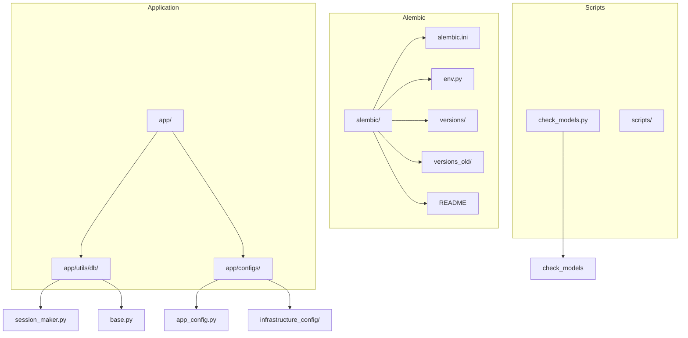
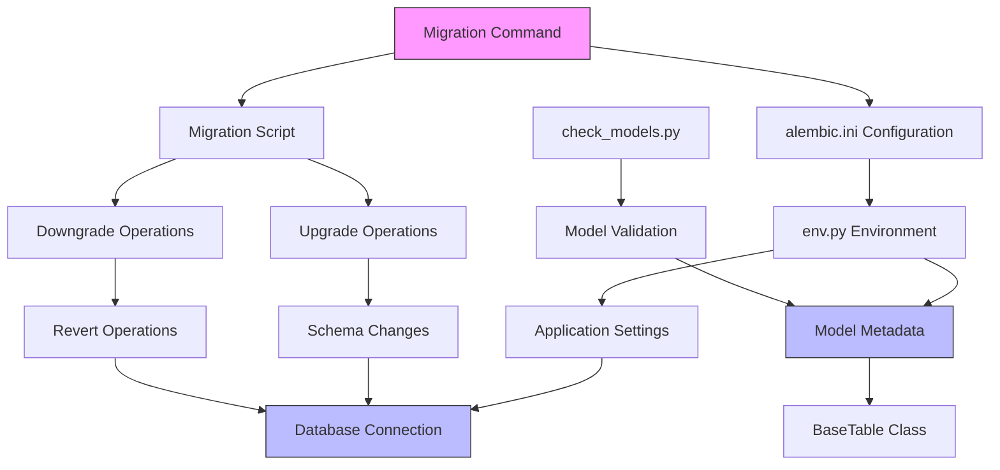
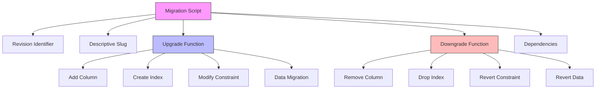
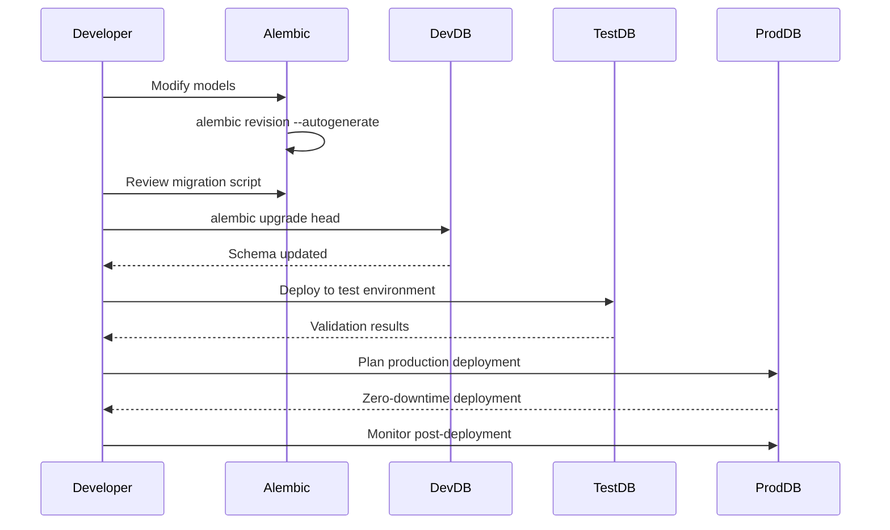
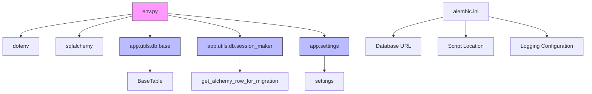

# Database Migrations

<cite>
**Referenced Files in This Document**   
- [env.py](file://alembic/env.py)
- [alembic.ini](file://alembic.ini)
- [check_models.py](file://check_models.py)
- [session_maker.py](file://app/utils/db/session_maker.py)
- [base.py](file://app/utils/db/base.py)
- [app_config.py](file://app/configs/app_config.py)
- [infrastructure_config.py](file://app/configs/infrastructure_config/infrastructure_config.py)
- [redis_config.py](file://app/configs/infrastructure_config/redis_config.py)
- [wb_config.py](file://app/configs/infrastructure_config/wb_config.py)
- [neo4j_config.py](file://app/configs/infrastructure_config/neo4j_config.py)
- [versions/563a95f2f3bb_add_auto_update_white_list_to_advsetting.py](file://alembic/versions/563a95f2f3bb_add_auto_update_white_list_to_advsetting.py)
- [versions/42cfd1a692b5_add_shop_id_index_to_wbtoken.py](file://alembic/versions/42cfd1a692b5_add_shop_id_index_to_wbtoken.py)
- [versions/30d489ece148_add_shop_id_ðto_wbtoken.py](file://alembic/versions/30d489ece148_add_shop_id_ðto_wbtoken.py)
</cite>

## Table of Contents
1. [Introduction](#introduction)
2. [Project Structure](#project-structure)
3. [Core Components](#core-components)
4. [Architecture Overview](#architecture-overview)
5. [Detailed Component Analysis](#detailed-component-analysis)
6. [Dependency Analysis](#dependency-analysis)
7. [Performance Considerations](#performance-considerations)
8. [Troubleshooting Guide](#troubleshooting-guide)
9. [Conclusion](#conclusion)

## Introduction
This document provides comprehensive documentation for the database migration system using Alembic for PostgreSQL schema management in the adv-bot application. The system enables structured schema evolution from development to production environments through version-controlled migration scripts. The documentation covers the migration workflow, structure of migration scripts in the versions/ directory, configuration of env.py for integration with the application's dependency injection and async database access, best practices for writing reversible migrations, testing strategies, and team collaboration considerations.

## Project Structure



**Diagram sources**
- [alembic.ini](file://alembic.ini)
- [app/utils/db/session_maker.py](file://app/utils/db/session_maker.py)
- [app/configs/app_config.py](file://app/configs/app_config.py)

**Section sources**
- [alembic.ini](file://alembic.ini)
- [app/utils/db/session_maker.py](file://app/utils/db/session_maker.py)
- [app/configs/app_config.py](file://app/configs/app_config.py)

## Core Components

The database migration system consists of several core components that work together to manage schema changes. The Alembic framework serves as the foundation for database migrations, with configuration files and scripts organized in the alembic/ directory. The env.py file integrates with the application's configuration system to establish database connections, while the versions/ directory contains versioned migration scripts that represent incremental schema changes. The system leverages SQLAlchemy's ORM for model definition and metadata management, enabling autogeneration of migration scripts based on model changes.

**Section sources**
- [env.py](file://alembic/env.py)
- [alembic.ini](file://alembic.ini)
- [base.py](file://app/utils/db/base.py)

## Architecture Overview



**Diagram sources**
- [env.py](file://alembic/env.py)
- [alembic.ini](file://alembic.ini)
- [base.py](file://app/utils/db/base.py)
- [check_models.py](file://check_models.py)

## Detailed Component Analysis

### Migration Configuration Analysis

The Alembic configuration system consists of two main components: the alembic.ini file and the env.py script. The alembic.ini file contains the primary configuration settings, including the database connection URL, script location, and logging configuration. The env.py script serves as the runtime environment for Alembic, integrating with the application's configuration system to establish database connections and load model metadata.

```mermaid
classDiagram
class AlembicConfig {
+script_location : str
+prepend_sys_path : str
+sqlalchemy.url : str
+version_path_separator : str
}
class EnvironmentContext {
+config : Config
+target_metadata : MetaData
+run_migrations_offline()
+run_migrations_online()
}
class DatabaseConnection {
+get_alchemy_row_for_migration() str
+get_alchemy_row(read_only : bool) str
}
class ModelMetadata {
+BaseTable : Class
+__abstract__ : bool
+id : Mapped[int]
+__tablename__ : str
}
AlembicConfig --> EnvironmentContext : "configures"
EnvironmentContext --> DatabaseConnection : "uses"
EnvironmentContext --> ModelMetadata : "references"
DatabaseConnection --> "app.settings.settings" : "reads"
```

**Diagram sources**
- [alembic.ini](file://alembic.ini#L1-L111)
- [env.py](file://alembic/env.py#L1-L90)
- [session_maker.py](file://app/utils/db/session_maker.py#L1-L177)
- [base.py](file://app/utils/db/base.py#L1-L18)

**Section sources**
- [alembic.ini](file://alembic.ini#L1-L111)
- [env.py](file://alembic/env.py#L1-L90)
- [session_maker.py](file://app/utils/db/session_maker.py#L1-L177)
- [base.py](file://app/utils/db/base.py#L1-L18)

### Migration Script Structure

The versions/ directory contains migration scripts that represent incremental schema changes. Each migration script follows a standardized structure with upgrade() and downgrade() functions that define the forward and reverse operations. The naming convention includes a revision identifier and a descriptive slug, such as 563a95f2f3bb_add_auto_update_white_list_to_advsetting.py for adding the auto_update_white_list field to the advsetting table.



**Diagram sources**
- [versions/563a95f2f3bb_add_auto_update_white_list_to_advsetting.py](file://alembic/versions/563a95f2f3bb_add_auto_update_white_list_to_advsetting.py)
- [versions/42cfd1a692b5_add_shop_id_index_to_wbtoken.py](file://alembic/versions/42cfd1a692b5_add_shop_id_index_to_wbtoken.py)
- [versions/30d489ece148_add_shop_id_ðto_wbtoken.py](file://alembic/versions/30d489ece148_add_shop_id_ðto_wbtoken.py)

### Migration Workflow Analysis

The migration workflow from development to production involves several stages, each with specific considerations for safety and reliability. The process begins with model changes in the application code, followed by autogeneration of migration scripts, testing, and deployment through environment-specific configurations.



**Diagram sources**
- [env.py](file://alembic/env.py#L1-L90)
- [alembic.ini](file://alembic.ini#L1-L111)

## Dependency Analysis



**Diagram sources**
- [env.py](file://alembic/env.py#L1-L90)
- [app/utils/db/base.py](file://app/utils/db/base.py#L1-L18)
- [app/utils/db/session_maker.py](file://app/utils/db/session_maker.py#L1-L177)
- [app/configs/app_config.py](file://app/configs/app_config.py#L1-L21)

**Section sources**
- [env.py](file://alembic/env.py#L1-L90)
- [app/utils/db/base.py](file://app/utils/db/base.py#L1-L18)
- [app/utils/db/session_maker.py](file://app/utils/db/session_maker.py#L1-L177)
- [app/configs/app_config.py](file://app/configs/app_config.py#L1-L21)

## Performance Considerations

When performing database migrations in production environments, several performance considerations must be addressed to ensure zero-downtime deployments and maintain application responsiveness. Large table alterations, particularly adding columns with default values or creating indexes on large datasets, can lead to table locks and degraded performance. The system should implement strategies such as adding columns without defaults first, then populating data in batches, and creating indexes concurrently when supported by the database.

For index creation, the migration system should prefer using CONCURRENTLY options where available to prevent table locks. Data migrations should be performed in batches to minimize transaction size and memory usage. Long-running migrations should include progress reporting and the ability to resume from checkpoints. The connection pooling configuration in session_maker.py indicates careful consideration of database resource usage, with configurable pool_size and max_overflow settings to balance connection availability with resource consumption.

**Section sources**
- [session_maker.py](file://app/utils/db/session_maker.py#L1-L177)
- [env.py](file://alembic/env.py#L1-L90)

## Troubleshooting Guide

Common issues in the database migration system typically involve configuration errors, connectivity problems, or migration conflicts. When migrations fail to apply, the first step is to verify the database connection settings in the environment variables and ensure they match the configuration in alembic.ini and env.py. The get_alchemy_row_for_migration function in session_maker.py is critical for establishing the migration connection, and any issues with settings loading will manifest here.

Migration conflicts often occur in team environments when multiple developers generate migrations based on the same parent revision. The versions/ directory shows evidence of merge_heads.py scripts, indicating the use of Alembic's branching and merging capabilities to resolve such conflicts. When encountering migration errors, the check_models.py script can be used to validate model definitions against the current database schema, helping to identify discrepancies between code and database state.

For debugging migration issues, enabling detailed logging in the alembic.ini file by adjusting the logger_alembic level can provide insight into the migration process. The system's use of async database operations requires careful consideration of connection management, particularly in the AnalyticAsyncSession class which includes monitoring for slow queries and long-held sessions that could impact migration performance.

**Section sources**
- [env.py](file://alembic/env.py#L1-L90)
- [session_maker.py](file://app/utils/db/session_maker.py#L1-L177)
- [check_models.py](file://check_models.py#L1-L12)

## Conclusion

The database migration system implemented with Alembic provides a robust framework for managing PostgreSQL schema changes in the adv-bot application. By leveraging Alembic's versioning capabilities, the system enables safe, reversible schema modifications that can be reliably deployed across development, testing, and production environments. The integration with the application's configuration system through env.py ensures consistent database connectivity, while the structured approach to migration scripts in the versions/ directory provides clear audit trails of schema evolution.

Key strengths of the system include its support for autogeneration of migration scripts, comprehensive configuration options, and the ability to handle complex migration scenarios including data migrations and schema refactoring. The presence of testing utilities like check_models.py demonstrates a commitment to schema validation and data integrity. For future improvements, consideration could be given to implementing more sophisticated zero-downtime deployment strategies, enhancing the testing framework for migrations, and documenting team workflows for managing migration branches and resolving conflicts.