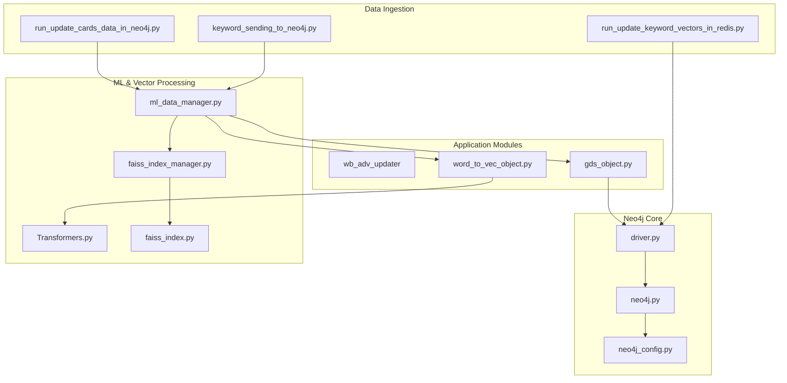
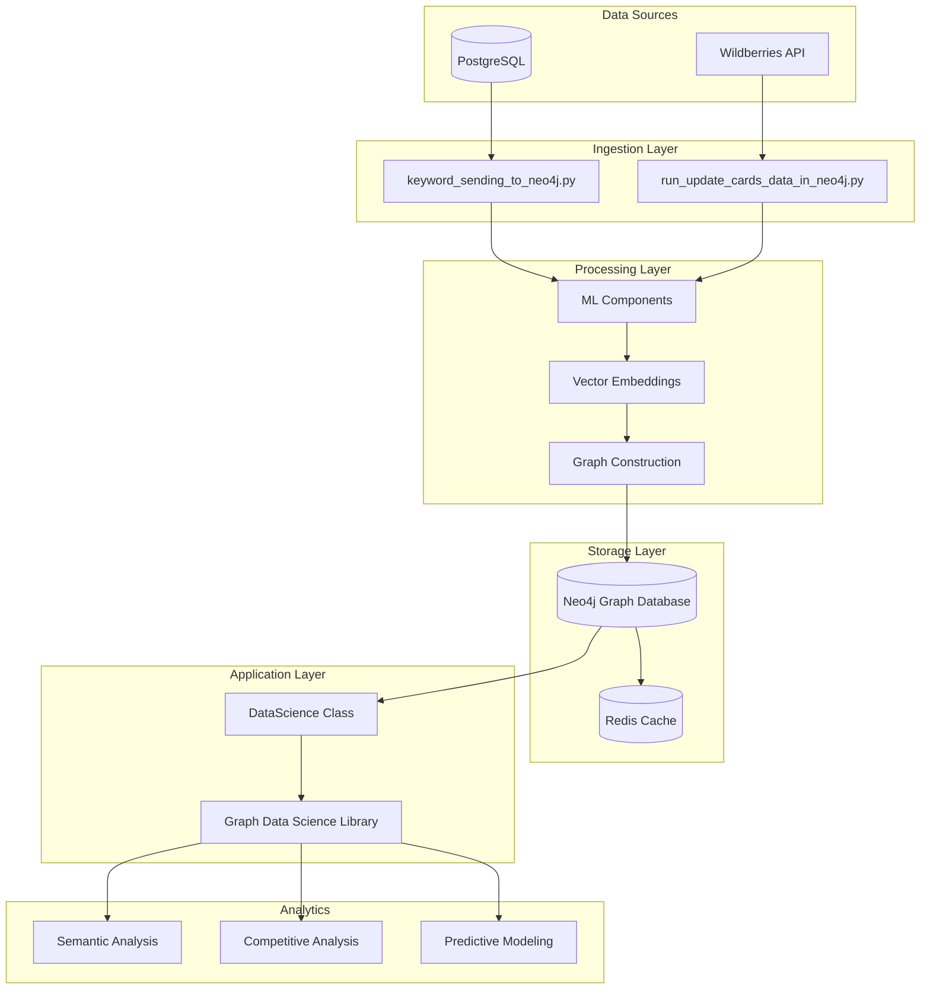
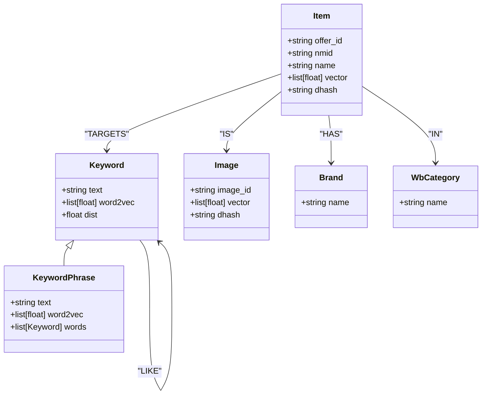
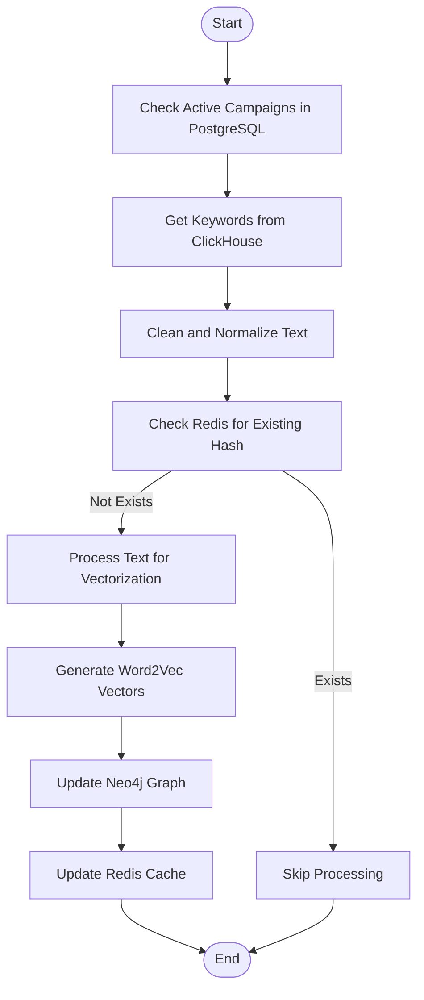
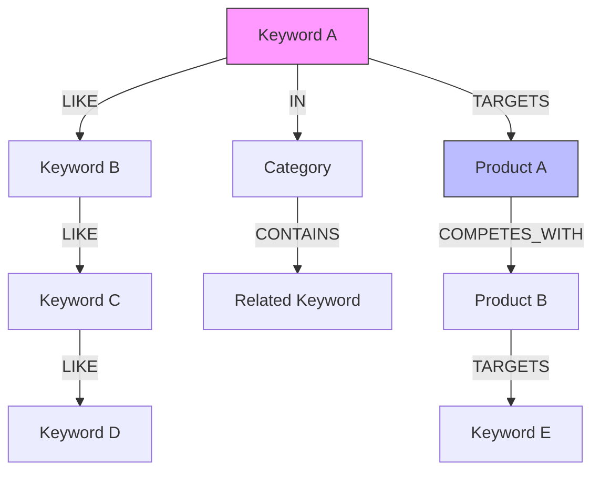
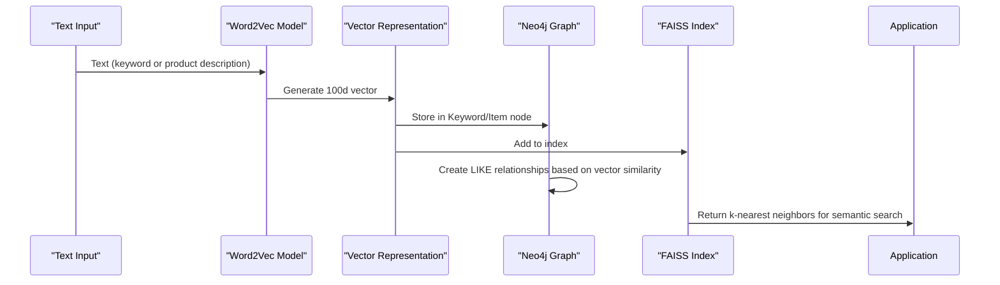
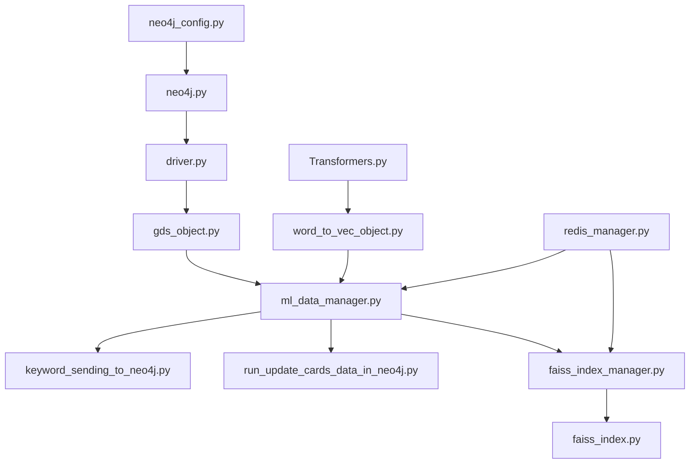

# Neo4j Graph Structure

<cite>
**Referenced Files in This Document**   
- [driver.py](file://app/utils/NeoDataScience/driver.py)
- [neo4j.py](file://app/core/di/databases/neo4j.py)
- [neo4j_config.py](file://app/configs/infrastructure_config/neo4j_config.py)
- [keyword_sending_to_neo4j.py](file://keyword_sending_to_neo4j.py)
- [ml_data_manager.py](file://app/modules/wb_adv_updater/ml_data_manager.py)
- [update_wb_adv_phrases_in_neo.py](file://app/modules/wb_adv_updater/update_wb_adv_phrases_in_neo.py)
- [gds_object.py](file://app/modules/wb_adv_updater/gds_object.py)
- [word_to_vec_object.py](file://app/modules/wb_adv_updater/word_to_vec_object.py)
- [Transformers.py](file://app/utils/text_master/Transformers.py)
- [run_update_cards_data_in_neo4j.py](file://run_update_cards_data_in_neo4j.py)
- [run_update_keyword_vectors_in_redis.py](file://run_update_keyword_vectors_in_redis.py)
- [ML.py](file://app/modules/wb_adv_updater/ML.py)
- [fitter.py](file://app/modules/wb_adv_updater/fitter.py)
- [data_getter.py](file://app/modules/wb_adv_updater/data_getter.py)
- [faiss_index.py](file://app/utils/faiss_manager/faiss_index.py)
- [faiss_index_manager.py](file://app/utils/faiss_manager/faiss_index_manager.py)
</cite>

## Table of Contents
1. [Introduction](#introduction)
2. [Project Structure](#project-structure)
3. [Core Components](#core-components)
4. [Architecture Overview](#architecture-overview)
5. [Detailed Component Analysis](#detailed-component-analysis)
6. [Dependency Analysis](#dependency-analysis)
7. [Performance Considerations](#performance-considerations)
8. [Troubleshooting Guide](#troubleshooting-guide)
9. [Conclusion](#conclusion)

## Introduction
This document provides comprehensive documentation for the Neo4j graph database implementation in the advertising automation system. The graph database models complex relationships between keywords, products, and advertising campaigns, enabling sophisticated analysis of semantic relationships and competitive positioning. The system integrates with PostgreSQL and Wildberries API through data ingestion pipelines, and incorporates machine learning features through vector embeddings and FAISS indexing. This documentation details the graph structure, data ingestion processes, traversal patterns, ML integration, performance considerations, and operational procedures.

## Project Structure
The Neo4j implementation is organized across several key directories within the repository. The core Neo4j functionality is located in `app/utils/NeoDataScience/driver.py`, which contains the DataScience class that serves as the primary interface to the Neo4j database. Configuration for Neo4j connections is managed in `app/configs/infrastructure_config/neo4j_config.py`, while dependency injection for Neo4j drivers is handled in `app/core/di/databases/neo4j.py`. Data ingestion scripts such as `keyword_sending_to_neo4j.py` and `run_update_cards_data_in_neo4j.py` orchestrate the population of the graph database from external sources. The ML components that generate vector embeddings are located in `app/modules/wb_adv_updater` and `app/utils/text_master`.

**Diagram sources**
- [driver.py](file://app/utils/NeoDataScience/driver.py)
- [neo4j.py](file://app/core/di/databases/neo4j.py)
- [neo4j_config.py](file://app/configs/infrastructure_config/neo4j_config.py)
- [keyword_sending_to_neo4j.py](file://keyword_sending_to_neo4j.py)
- [run_update_cards_data_in_neo4j.py](file://run_update_cards_data_in_neo4j.py)
- [run_update_keyword_vectors_in_redis.py](file://run_update_keyword_vectors_in_redis.py)
- [ml_data_manager.py](file://app/modules/wb_adv_updater/ml_data_manager.py)
- [gds_object.py](file://app/modules/wb_adv_updater/gds_object.py)
- [word_to_vec_object.py](file://app/modules/wb_adv_updater/word_to_vec_object.py)
- [Transformers.py](file://app/utils/text_master/Transformers.py)
- [faiss_index.py](file://app/utils/faiss_manager/faiss_index.py)
- [faiss_index_manager.py](file://app/utils/faiss_manager/faiss_index_manager.py)

**Section sources**
- [driver.py](file://app/utils/NeoDataScience/driver.py)
- [neo4j.py](file://app/core/di/databases/neo4j.py)
- [neo4j_config.py](file://app/configs/infrastructure_config/neo4j_config.py)
- [keyword_sending_to_neo4j.py](file://keyword_sending_to_neo4j.py)
- [run_update_cards_data_in_neo4j.py](file://run_update_cards_data_in_neo4j.py)
- [run_update_keyword_vectors_in_redis.py](file://run_update_keyword_vectors_in_redis.py)

## Core Components
The Neo4j graph database implementation consists of several core components that work together to model advertising data and enable sophisticated analysis. The DataScience class in `driver.py` serves as the primary interface to Neo4j, providing methods for creating and managing graph projections, executing Cypher queries, and handling vector operations. The system models entities such as Keywords, Products (Items), Images, and Campaigns as nodes, with relationships like IS, LIKE, and IN connecting them. Vector embeddings are generated using Word2Vec models for text analysis and image feature extraction for visual similarity. The graph is updated through scheduled processes that ingest data from PostgreSQL and the Wildberries API, ensuring the graph remains current with advertising campaign data.

**Section sources**
- [driver.py](file://app/utils/NeoDataScience/driver.py)
- [gds_object.py](file://app/modules/wb_adv_updater/gds_object.py)
- [word_to_vec_object.py](file://app/modules/wb_adv_updater/word_to_vec_object.py)
- [Transformers.py](file://app/utils/text_master/Transformers.py)

## Architecture Overview
The Neo4j graph architecture is designed to model the complex relationships between advertising elements, enabling semantic analysis and competitive intelligence. The system uses a multi-layered approach with raw data ingestion, vector embedding generation, graph construction, and analytical processing. Data flows from PostgreSQL and Wildberries API into the Neo4j database through dedicated ingestion scripts. Machine learning models generate vector representations of keywords and products, which are then used to establish semantic relationships in the graph. The Graph Data Science library is leveraged for advanced graph algorithms, including k-nearest neighbors for similarity analysis. Redis is used as a caching layer to optimize performance for frequently accessed data.

**Diagram sources**
- [driver.py](file://app/utils/NeoDataScience/driver.py)
- [keyword_sending_to_neo4j.py](file://keyword_sending_to_neo4j.py)
- [run_update_cards_data_in_neo4j.py](file://run_update_cards_data_in_neo4j.py)
- [ml_data_manager.py](file://app/modules/wb_adv_updater/ml_data_manager.py)
- [Transformers.py](file://app/utils/text_master/Transformers.py)
- [faiss_index.py](file://app/utils/faiss_manager/faiss_index.py)

## Detailed Component Analysis

### Neo4j Data Model
The Neo4j data model represents advertising entities as nodes with specific properties and relationships that capture their semantic and operational connections. The primary node types include Keyword, Product (Item), Image, and KeywordPhrase, each with properties that support vector-based similarity analysis and relationship weighting. Relationships between nodes are weighted with a "dist" property that represents the strength or similarity of the connection, enabling sophisticated graph algorithms to identify meaningful patterns in the advertising data.

#### Node Types and Properties

**Diagram sources**
- [driver.py](file://app/utils/NeoDataScience/driver.py#L125-L173)
- [ml_data_manager.py](file://app/modules/wb_adv_updater/ml_data_manager.py#L0-L199)
- [update_wb_adv_phrases_in_neo.py](file://app/modules/wb_adv_updater/update_wb_adv_phrases_in_neo.py#L0-L96)

**Section sources**
- [driver.py](file://app/utils/NeoDataScience/driver.py)
- [ml_data_manager.py](file://app/modules/wb_adv_updater/ml_data_manager.py)
- [update_wb_adv_phrases_in_neo.py](file://app/modules/wb_adv_updater/update_wb_adv_phrases_in_neo.py)

### Data Ingestion Pipeline
The data ingestion pipeline is responsible for populating the Neo4j graph with data from PostgreSQL and the Wildberries API. The process is orchestrated through several scripts that handle different aspects of data synchronization. The `keyword_sending_to_neo4j.py` script initiates the process of updating keyword phrases in the graph, while `run_update_cards_data_in_neo4j.py` manages the synchronization of product card data. These scripts work in conjunction with the ml_data_manager module, which coordinates the extraction, transformation, and loading of data into the graph database.

#### Data Ingestion Workflow

**Diagram sources**
- [keyword_sending_to_neo4j.py](file://keyword_sending_to_neo4j.py)
- [ml_data_manager.py](file://app/modules/wb_adv_updater/ml_data_manager.py)
- [update_wb_adv_phrases_in_neo.py](file://app/modules/wb_adv_updater/update_wb_adv_phrases_in_neo.py)
- [redis_manager.py](file://app/utils/redis_manager/exc.py)

**Section sources**
- [keyword_sending_to_neo4j.py](file://keyword_sending_to_neo4j.py)
- [ml_data_manager.py](file://app/modules/wb_adv_updater/ml_data_manager.py)
- [update_wb_adv_phrases_in_neo.py](file://app/modules/wb_adv_updater/update_wb_adv_phrases_in_neo.py)

### Graph Traversal Patterns
The system implements several key traversal patterns for analyzing semantic relationships and competitive positioning. These patterns leverage the graph structure to identify related keywords, analyze product competition, and support predictive modeling for advertising performance. The traversal patterns are optimized for performance through the use of indexed properties and pre-computed vector similarities.

#### Semantic Keyword Analysis

**Diagram sources**
- [driver.py](file://app/utils/NeoDataScience/driver.py)
- [ml_data_manager.py](file://app/modules/wb_adv_updater/ml_data_manager.py)
- [data_getter.py](file://app/modules/wb_adv_updater/data_getter.py)

**Section sources**
- [driver.py](file://app/utils/NeoDataScience/driver.py)
- [ml_data_manager.py](file://app/modules/wb_adv_updater/ml_data_manager.py)
- [data_getter.py](file://app/modules/wb_adv_updater/data_getter.py)

### ML Integration and Vector Embeddings
The system integrates machine learning features through vector embeddings and FAISS indexing to enable semantic analysis of keywords and products. The Word2Vec model from the Transformers.py module generates vector representations of text, while image feature extraction creates vector representations of product images. These vectors are stored in Neo4j and used to establish semantic relationships between nodes. The FAISS library is used to efficiently search for similar vectors, enabling rapid identification of semantically related keywords and visually similar products.

#### Vector Processing Pipeline

**Diagram sources**
- [Transformers.py](file://app/utils/text_master/Transformers.py)
- [driver.py](file://app/utils/NeoDataScience/driver.py)
- [faiss_index.py](file://app/utils/faiss_manager/faiss_index.py)
- [faiss_index_manager.py](file://app/utils/faiss_manager/faiss_index_manager.py)

**Section sources**
- [Transformers.py](file://app/utils/text_master/Transformers.py)
- [driver.py](file://app/utils/NeoDataScience/driver.py)
- [faiss_index.py](file://app/utils/faiss_manager/faiss_index.py)
- [faiss_index_manager.py](file://app/utils/faiss_manager/faiss_index_manager.py)

## Dependency Analysis
The Neo4j implementation has a well-defined dependency structure that ensures modularity and maintainability. The core Neo4j functionality is encapsulated in the DataScience class, which depends on the Neo4j Python driver and configuration settings. The data ingestion components depend on the DataScience class for graph operations, while the ML components provide vector embeddings that are consumed by the graph construction processes. Redis is used as a shared dependency for caching and coordination between different components of the system.

**Diagram sources**
- [neo4j_config.py](file://app/configs/infrastructure_config/neo4j_config.py)
- [neo4j.py](file://app/core/di/databases/neo4j.py)
- [driver.py](file://app/utils/NeoDataScience/driver.py)
- [gds_object.py](file://app/modules/wb_adv_updater/gds_object.py)
- [ml_data_manager.py](file://app/modules/wb_adv_updater/ml_data_manager.py)
- [keyword_sending_to_neo4j.py](file://keyword_sending_to_neo4j.py)
- [run_update_cards_data_in_neo4j.py](file://run_update_cards_data_in_neo4j.py)
- [Transformers.py](file://app/utils/text_master/Transformers.py)
- [word_to_vec_object.py](file://app/modules/wb_adv_updater/word_to_vec_object.py)
- [faiss_index.py](file://app/utils/faiss_manager/faiss_index.py)
- [faiss_index_manager.py](file://app/utils/faiss_manager/faiss_index_manager.py)
- [redis_manager.py](file://app/utils/redis_manager/exc.py)

**Section sources**
- [neo4j_config.py](file://app/configs/infrastructure_config/neo4j_config.py)
- [neo4j.py](file://app/core/di/databases/neo4j.py)
- [driver.py](file://app/utils/NeoDataScience/driver.py)
- [gds_object.py](file://app/modules/wb_adv_updater/gds_object.py)
- [ml_data_manager.py](file://app/modules/wb_adv_updater/ml_data_manager.py)
- [keyword_sending_to_neo4j.py](file://keyword_sending_to_neo4j.py)
- [run_update_cards_data_in_neo4j.py](file://run_update_cards_data_in_neo4j.py)
- [Transformers.py](file://app/utils/text_master/Transformers.py)
- [word_to_vec_object.py](file://app/modules/wb_adv_updater/word_to_vec_object.py)
- [faiss_index.py](file://app/utils/faiss_manager/faiss_index.py)
- [faiss_index_manager.py](file://app/utils/faiss_manager/faiss_index_manager.py)

## Performance Considerations
The Neo4j implementation includes several performance optimizations to handle the scale and complexity of advertising data. The system uses batch processing for data ingestion to minimize database transactions and reduce overhead. Vector operations are offloaded to dedicated ML components and cached in Redis to avoid redundant computations. The Graph Data Science library is used for efficient graph algorithms, with careful consideration of memory usage and computational complexity. Indexing strategies are employed to optimize query performance, particularly for frequently accessed properties like keyword text and product identifiers.

**Section sources**
- [driver.py](file://app/utils/NeoDataScience/driver.py)
- [ml_data_manager.py](file://app/modules/wb_adv_updater/ml_data_manager.py)
- [data_getter.py](file://app/modules/wb_adv_updater/data_getter.py)
- [faiss_index.py](file://app/utils/faiss_manager/faiss_index.py)

## Troubleshooting Guide
The system includes several mechanisms for monitoring and troubleshooting issues with the Neo4j implementation. The DataScience class includes error handling for transient database errors, with retry logic to handle temporary connectivity issues. Logging is implemented throughout the data ingestion and processing pipelines to provide visibility into system operations. The use of Redis as a caching layer helps identify data synchronization issues by providing a record of processed entities. Performance monitoring can be conducted by analyzing query execution times and memory usage patterns.

**Section sources**
- [driver.py](file://app/utils/NeoDataScience/driver.py#L0-L199)
- [ml_data_manager.py](file://app/modules/wb_adv_updater/ml_data_manager.py)
- [run_update_cards_data_in_neo4j.py](file://run_update_cards_data_in_neo4j.py)
- [run_update_keyword_vectors_in_redis.py](file://run_update_keyword_vectors_in_redis.py)

## Conclusion
The Neo4j graph database implementation provides a powerful foundation for analyzing complex relationships between keywords, products, and advertising campaigns. By modeling these entities as a graph with semantic relationships, the system enables sophisticated analysis of competitive positioning and keyword relevance. The integration of machine learning through vector embeddings enhances the graph's capabilities, allowing for semantic similarity analysis and predictive modeling. The data ingestion pipeline ensures the graph remains current with advertising data from PostgreSQL and the Wildberries API, while performance optimizations and caching strategies maintain system responsiveness at scale. This implementation supports the business objectives of optimizing advertising performance through data-driven insights and automated decision-making.