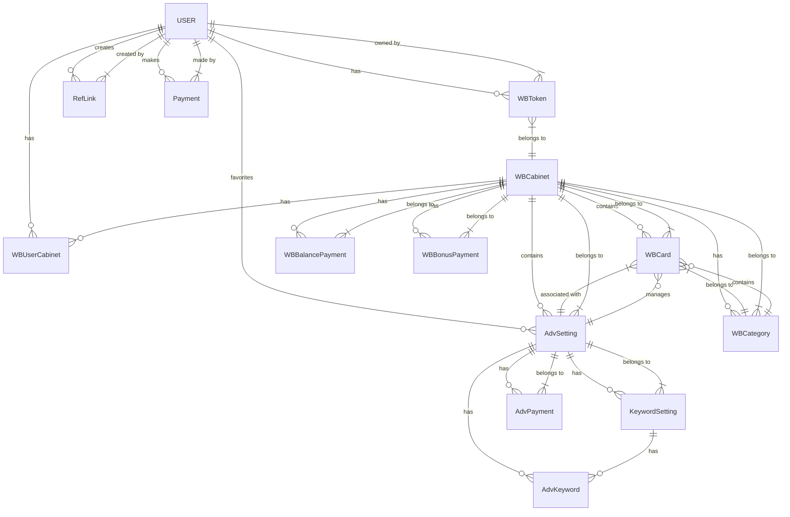
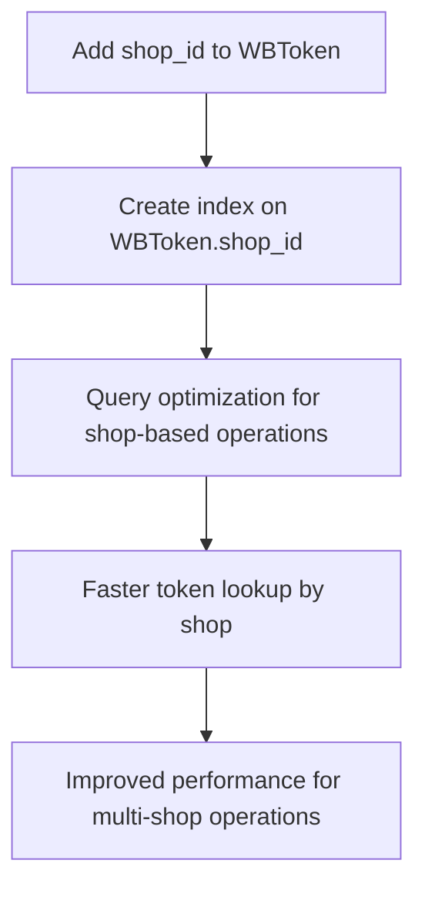
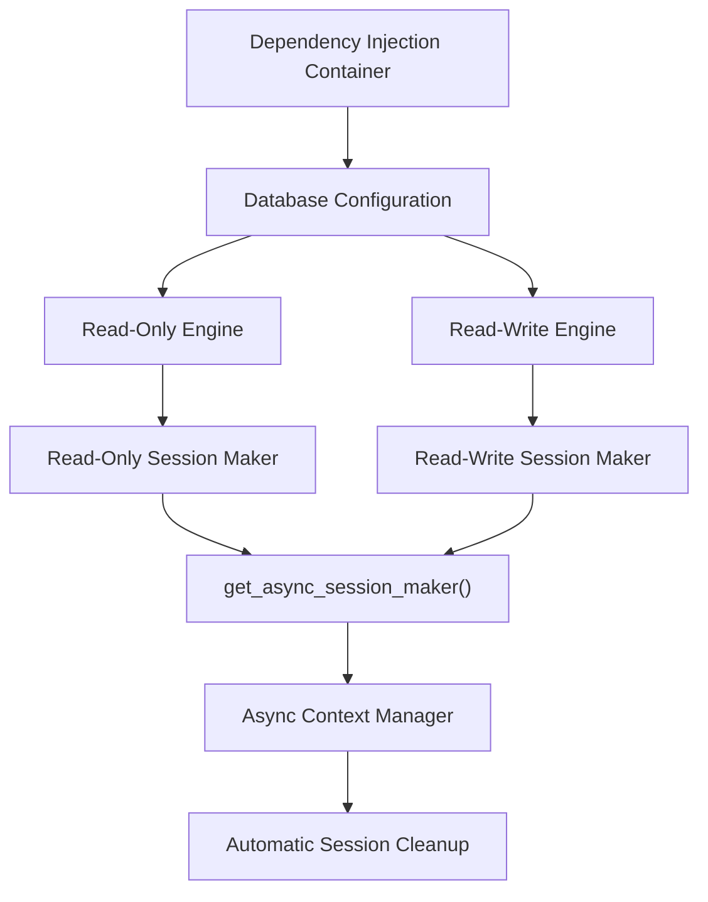

# PostgreSQL Schema

<cite>
**Referenced Files in This Document**   
- [app/utils/db/models.py](file://app/utils/db/models.py)
- [app/utils/db/base.py](file://app/utils/db/base.py)
- [app/utils/db/assoc_tables.py](file://app/utils/db/assoc_tables.py)
- [app/modules/common_slaves/wildberries/models/models.py](file://app/modules/common_slaves/wildberries/models/models.py)
- [app/modules/billing/models.py](file://app/modules/billing/models.py)
- [alembic/versions/0cf5b8a2edf8_add_auto_add_only_relevant_phrase_in_.py](file://alembic/versions/0cf5b8a2edf8_add_auto_add_only_relevant_phrase_in_.py)
- [alembic/versions/30d489ece148_add_shop_id_ðto_wbtoken.py](file://alembic/versions/30d489ece148_add_shop_id_ðto_wbtoken.py)
- [alembic/versions/ab95fca5744f_add_index_to_wbcategory.py](file://alembic/versions/ab95fca5744f_add_index_to_wbcategory.py)
- [alembic/versions/42cfd1a692b5_add_shop_id_index_to_wbtoken.py](file://alembic/versions/42cfd1a692b5_add_shop_id_index_to_wbtoken.py)
- [alembic/versions/563a95f2f3bb_add_auto_update_white_list_to_advsetting.py](file://alembic/versions/563a95f2f3bb_add_auto_update_white_list_to_advsetting.py)
- [alembic/versions/5eb707e93aa0_add_auto_update_target_place_in_.py](file://alembic/versions/5eb707e93aa0_add_auto_update_target_place_in_.py)
- [alembic/env.py](file://alembic/env.py)
- [app/core/di/app_container.py](file://app/core/di/app_container.py)
- [app/utils/db/session_maker.py](file://app/utils/db/session_maker.py)
</cite>

## Table of Contents
1. [Introduction](#introduction)
2. [Core Entities](#core-entities)
3. [Entity Relationships](#entity-relationships)
4. [Indexing and Performance Optimization](#indexing-and-performance-optimization)
5. [Data Validation and Lifecycle Hooks](#data-validation-and-lifecycle-hooks)
6. [Dependency Injection Integration](#dependency-injection-integration)
7. [Migration Best Practices](#migration-best-practices)
8. [Common Queries and ORM Implementations](#common-queries-and-orm-implementations)
9. [Conclusion](#conclusion)

## Introduction
The PostgreSQL schema for the adv-bot system supports advertising campaign management and user authentication for Wildberries marketplace integration. The schema is designed to manage advertising settings, user tokens, cabinet information, and billing data with a focus on performance and scalability. The system uses SQLAlchemy 2.0 with async support and Alembic for schema migrations. The data model supports complex advertising strategies including automated bidding, keyword management, and campaign optimization.

**Section sources**
- [app/utils/db/base.py](file://app/utils/db/base.py#L1-L18)
- [app/utils/db/models.py](file://app/utils/db/models.py#L1-L50)

## Core Entities

### AdvSetting
The AdvSetting entity represents advertising campaign settings for Wildberries. It stores configuration for both automatic and auction-based advertising campaigns, including bidding strategies, keyword management, and performance targets.

**Field Definitions:**
- `adv_id`: BIGINT, unique identifier for the advertising campaign
- `name`: String, name of the advertising campaign
- `wb_cabinet_id`: Integer, foreign key to WBCabinet
- `active_status`: String, current status of the campaign
- `bot_active`: Boolean, indicates if the bot is actively managing the campaign
- `nmids`: JSONB, list of product IDs associated with the campaign
- `pass_days`: Integer, number of days to pass before taking action
- `boost`: Float, boost factor for the campaign
- `type`: Integer, type of advertising campaign
- `hard_min_ctr`: Float, minimum click-through rate threshold
- `max_cpc`: Float, maximum cost per click
- `min_views_for_ml_predict`: Integer, minimum views required for ML prediction
- `parsing_active`: Boolean, indicates if parsing is active
- `last_update`: DateTime, timestamp of last update
- `bidder_active`: Boolean, indicates if automated bidding is active
- `max_cpm`: Integer, maximum cost per thousand impressions
- `max_place`: Integer, maximum placement position
- `min_block_position`: Integer, minimum block position with default 0
- `clusters_mode`: Boolean, indicates if cluster mode is active with default true
- `target_ctr_mode`: Boolean, indicates if target CTR mode is active with default false
- `hide_small_query_keywords`: Integer, threshold for hiding low-volume keywords with default 0
- `target_ctr_mode_strategy`: String, strategy for target CTR mode with default "forward"
- `new_auto_min_ctr_mode`: Boolean, indicates if new auto minimum CTR mode is active with default true
- `reset_place`: Boolean, indicates if placement should be reset with default true
- `bidder_step`: Integer, bidding step increment with default from settings
- `exponent_predict_ctr`: Float, exponent for CTR prediction with default from settings
- `auction_boost_all_phrase_mode`: Boolean, indicates if auction boost applies to all phrases with default false
- `plan_for_sales_for_day`: Integer, sales target for the day
- `target_price_for_order`: Float, target price per order
- `max_price_for_order`: Float, maximum price per order
- `cpm`: Integer, cost per thousand impressions
- `bidder_for_auto`: Boolean, indicates if bidder is used for automatic campaigns with default true
- `auto_update_white_list`: Boolean, indicates if white list should be automatically updated with default false
- `auto_update_target_place`: Boolean, indicates if target placement should be automatically updated with default false
- `max_balance_adding_for_day`: Integer, maximum balance addition per day with default 0
- `auto_add_only_relevant_phrase`: Boolean, indicates if only relevant phrases should be automatically added with default true
- `orders_source_for_auto_mode`: Enum, source of orders data for automatic mode

**Section sources**
- [app/modules/common_slaves/wildberries/models/models.py](file://app/modules/common_slaves/wildberries/models/models.py#L300-L600)
- [alembic/versions/0cf5b8a2edf8_add_auto_add_only_relevant_phrase_in_.py](file://alembic/versions/0cf5b8a2edf8_add_auto_add_only_relevant_phrase_in_.py#L1-L40)
- [alembic/versions/563a95f2f3bb_add_auto_update_white_list_to_advsetting.py](file://alembic/versions/563a95f2f3bb_add_auto_update_white_list_to_advsetting.py)
- [alembic/versions/5eb707e93aa0_add_auto_update_target_place_in_.py](file://alembic/versions/5eb707e93aa0_add_auto_update_target_place_in_.py)

### WBTokens
The WBToken entity stores Wildberries API tokens for user authentication and authorization. Each token is associated with a user and may contain a shop identifier.

**Field Definitions:**
- `api_key`: String, the actual API key/token value
- `user_id`: Integer, foreign key to User table
- `active`: Boolean, indicates if the token is active with default true
- `shop_id`: String, optional shop identifier extracted from token payload

The entity includes several properties for token validation and payload extraction:
- `check_valid()`: Validates if the token is properly formatted
- `get_payload(key)`: Extracts specific values from the JWT token payload
- `expires`: Returns the token expiration time
- `get_shop_id_from_token()`: Extracts shop ID from token payload
- `read_only`: Indicates if the token has read-only permissions
- `categories`: Returns the set of permissions associated with the token

**Section sources**
- [app/modules/common_slaves/wildberries/models/models.py](file://app/modules/common_slaves/wildberries/models/models.py#L200-L250)
- [alembic/versions/30d489ece148_add_shop_id_ðto_wbtoken.py](file://alembic/versions/30d489ece148_add_shop_id_ðto_wbtoken.py#L1-L35)

### WBCabinet
The WBCabinet entity represents a Wildberries cabinet (merchant account) with associated financial and operational data.

**Field Definitions:**
- `shop_id`: String, unique identifier for the shop
- `active`: Boolean, indicates if the cabinet is active with default true
- `expiration_time`: DateTime, when the cabinet expires with default 7 days from creation
- `expiration_alarm_days_pass`: Integer, number of days passed for expiration alarm
- `demo`: Boolean, indicates if this is a demo account with default true
- `balance`: Float, current balance with default 0
- `bonus`: Float, bonus amount with default 0
- `white_list_update_active`: Boolean, indicates if white list updates are active

The entity includes calculated properties:
- `calculated_balance`: Computes the effective balance including all payments
- `calculated_bonus`: Computes the effective bonus including all payments

**Section sources**
- [app/modules/common_slaves/wildberries/models/models.py](file://app/modules/common_slaves/wildberries/models/models.py#L140-L200)

### Billing
The billing system consists of multiple entities for tracking financial transactions.

**WBBalancePayment:**
- `wb_cabinet_id`: Integer, foreign key to WBCabinet
- `amount`: Float, transaction amount
- `description`: String, optional description
- `transaction_date_time`: DateTime, when the transaction occurred with default current time
- `operation_type`: String, type of operation with default 'subtract'

**WBBonusPayment:**
- Similar structure to WBBalancePayment with additional `admin_user_id` field

**AdvPayment:**
- `date`: Date, date of the payment
- `adv_setting_id`: Integer, foreign key to AdvSetting
- `type`: String, type of payment
- `amount`: Float, payment amount

All payment tables include appropriate indexes for efficient querying by cabinet or advertising setting.

**Section sources**
- [app/modules/common_slaves/wildberries/models/models.py](file://app/modules/common_slaves/wildberries/models/models.py#L50-L140)
- [app/modules/billing/models.py](file://app/modules/billing/models.py#L1-L24)

## Entity Relationships



**Diagram sources**
- [app/utils/db/models.py](file://app/utils/db/models.py#L1-L50)
- [app/modules/common_slaves/wildberries/models/models.py](file://app/modules/common_slaves/wildberries/models/models.py#L50-L660)
- [app/modules/billing/models.py](file://app/modules/billing/models.py#L1-L24)

## Indexing and Performance Optimization

The schema includes several indexes to optimize query performance, particularly for frequently accessed fields and common query patterns.

### Shop ID Indexing
The system implements indexing on shop_id fields across multiple tables to optimize queries by shop identifier:



**Section sources**
- [alembic/versions/30d489ece148_add_shop_id_ðto_wbtoken.py](file://alembic/versions/30d489ece148_add_shop_id_ðto_wbtoken.py#L1-L35)
- [alembic/versions/42cfd1a692b5_add_shop_id_index_to_wbtoken.py](file://alembic/versions/42cfd1a692b5_add_shop_id_index_to_wbtoken.py)

### WBCategory Indexing
An index was added to the wb_category_name field to improve search performance:

```python
__table_args__ = (Index("ix_wb_category_name", "wb_category_name"),)
```

This optimization supports faster lookups when filtering or searching by category name, which is a common operation in the advertising management interface.

**Section sources**
- [app/modules/common_slaves/wildberries/models/models.py](file://app/modules/common_slaves/wildberries/models/models.py#L117-L142)
- [alembic/versions/ab95fca5744f_add_index_to_wbcategory.py](file://alembic/versions/ab95fca5744f_add_index_to_wbcategory.py)

### AdvSetting Indexing
The AdvSetting table includes multiple indexes to support various query patterns:

- Composite index on (wb_cabinet_id, type, last_update) for primary queries
- Index on wb_cabinet_id for cabinet-based filtering
- Index on type for type-based filtering
- Index on adv_id for direct lookups
- Index on active_status for status filtering
- Index on bot_active for bot status filtering
- GIN index on name with trigram operations for fuzzy text search

These indexes support the complex querying requirements of the advertising management system, particularly for dashboard views and reporting.

**Section sources**
- [app/modules/common_slaves/wildberries/models/models.py](file://app/modules/common_slaves/wildberries/models/models.py#L300-L600)

## Data Validation and Lifecycle Hooks

The data model incorporates several validation mechanisms and lifecycle hooks to ensure data integrity.

### Hybrid Properties
The WBCabinet entity uses SQLAlchemy's hybrid_property decorator to provide calculated fields:

```python
@hybrid_property
def calculated_balance(self) -> float:
    """Computes effective balance including all payments"""
    if not self.balance_payments:
        return float(self.balance)
    return float(self.balance + sum(float(payment.amount) for payment in self.balance_payments))
```

This approach allows the property to be used both at the Python level and in SQL queries, providing consistent behavior across different access patterns.

### Token Validation
The WBToken entity includes comprehensive validation methods:

- JWT decoding without signature verification to extract payload
- Type checking for payload values
- Expiration time validation
- Shop ID extraction with type validation
- Permission category parsing from bit flags

These validations ensure that only properly formatted tokens are accepted and that their metadata is correctly interpreted.

### Constraints
The schema implements several constraints to maintain data integrity:

- Unique constraint on User.user_telegram_id
- Unique constraint on WBCabinet.shop_id
- Unique constraint on WBToken.api_key and user_id combination
- Unique constraint on WBUserCabinet.wb_cabinet_id and user_id combination
- Unique constraint on AdvPayment.date, adv_setting_id, and type combination

**Section sources**
- [app/modules/common_slaves/wildberries/models/models.py](file://app/modules/common_slaves/wildberries/models/models.py#L50-L660)

## Dependency Injection Integration

The system integrates with a dependency injection framework through the core/di module to manage database connections and session lifecycle.

### Session Management
The system uses a sophisticated session management system with read/write separation:



The `get_async_session_maker` function provides an async context manager that handles session creation, cleanup, and error logging. It includes performance monitoring to detect slow queries and long-held sessions.

### Connection Configuration
Database connections are configured through environment settings with separate endpoints for master and replica databases:

- Master host for write operations
- Replica host for read operations
- Configurable pool size and overflow
- Connection timeout and pre-ping validation

This architecture supports read/write splitting for improved performance and scalability.

**Section sources**
- [app/core/di/app_container.py](file://app/core/di/app_container.py)
- [app/utils/db/session_maker.py](file://app/utils/db/session_maker.py#L1-L177)

## Migration Best Practices

The system uses Alembic for database schema migrations with a structured approach to schema evolution.

### Migration Structure
Each migration follows a standard structure:

```python
"""Migration description

Revision ID: unique_identifier
Revises: previous_revision
Create Date: timestamp
"""

def upgrade() -> None:
    # Schema modifications for forward migration
    pass

def downgrade() -> None:
    # Schema modifications for rollback
    pass
```

### Schema Evolution Patterns
The migration history shows several patterns for schema evolution:

1. **Adding Columns**: Using `op.add_column()` to add new fields
2. **Creating Indexes**: Using `op.create_index()` to add performance optimizations
3. **Altering Columns**: Using `op.alter_column()` to modify existing fields
4. **Dropping Columns**: Using `op.drop_column()` to remove fields
5. **Creating Tables**: Using `op.create_table()` for new entities
6. **Dropping Tables**: Using `op.drop_table()` for deprecated entities

### Migration Configuration
The Alembic environment is configured to work with the application's SQLAlchemy models:

```python
target_metadata = [Base.metadata]
```

This configuration allows Alembic to compare the current model state with the database state to generate appropriate migration scripts.

### Version Management
The system maintains migrations in the alembic/versions directory with unique revision IDs. The migration history shows a clear progression of schema changes, with each migration addressing specific functional requirements.

**Section sources**
- [alembic/env.py](file://alembic/env.py#L1-L90)
- [alembic.ini](file://alembic.ini#L1-L111)
- [alembic/versions/](file://alembic/versions/)

## Common Queries and ORM Implementations

### Retrieving Active Campaigns
```python
async def get_active_campaigns(session: AsyncSession, cabinet_id: int) -> list[AdvSetting]:
    result = await session.execute(
        select(AdvSetting)
        .where(AdvSetting.wb_cabinet_id == cabinet_id)
        .where(AdvSetting.bot_active == True)
        .order_by(AdvSetting.last_update.desc())
    )
    return result.scalars().all()
```

### Finding Tokens by Shop ID
```python
async def get_token_by_shop_id(session: AsyncSession, shop_id: str) -> WBToken | None:
    result = await session.execute(
        select(WBToken)
        .where(WBToken.shop_id == shop_id)
        .where(WBToken.active == True)
    )
    return result.scalar_one_or_none()
```

### Calculating Cabinet Balance
```python
async def get_cabinet_balance(session: AsyncSession, cabinet_id: int) -> float:
    # This leverages the hybrid_property for SQL-level calculation
    result = await session.execute(
        select(WBCabinet.calculated_balance)
        .where(WBCabinet.id == cabinet_id)
    )
    return result.scalar_one()
```

### Finding Keywords by Status
```python
async def get_keywords_by_status(session: AsyncSession, adv_setting_id: int, status: int) -> list[KeywordSetting]:
    result = await session.execute(
        select(KeywordSetting)
        .where(KeywordSetting.adv_setting_id == adv_setting_id)
        .where(KeywordSetting.hard_status == status)
    )
    return result.scalars().all()
```

These ORM implementations leverage the defined indexes and relationships for optimal performance.

**Section sources**
- [app/modules/common_slaves/wildberries/models/models.py](file://app/modules/common_slaves/wildberries/models/models.py#L50-L660)
- [app/utils/db/session_maker.py](file://app/utils/db/session_maker.py#L1-L177)

## Conclusion
The PostgreSQL schema for the adv-bot system provides a robust foundation for managing Wildberries advertising campaigns. The data model effectively captures the complex relationships between users, tokens, cabinets, and advertising settings. The schema includes comprehensive indexing strategies to ensure query performance, particularly for shop-based operations and campaign management. The integration with Alembic enables safe and reliable schema evolution, while the dependency injection system ensures proper resource management. The use of SQLAlchemy 2.0 with async support allows for efficient database operations in a high-concurrency environment. Overall, the schema is well-designed to support the advertising management functionality of the system while maintaining data integrity and performance.