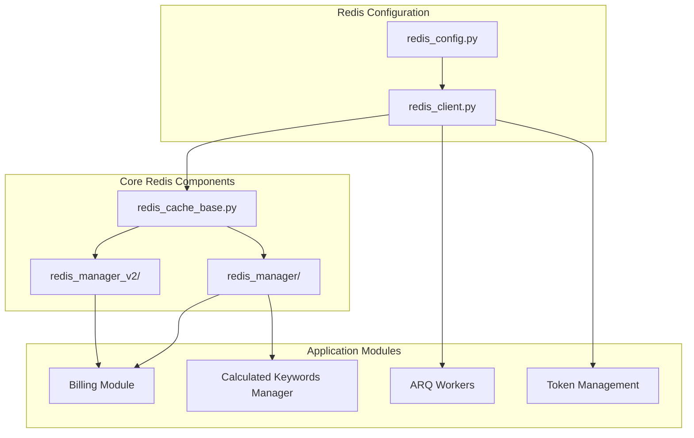
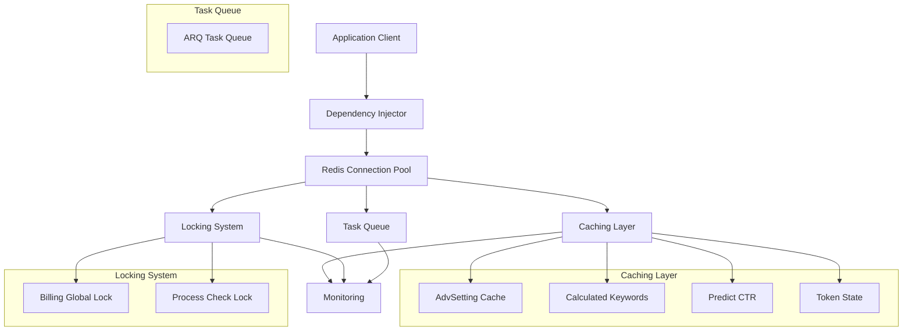
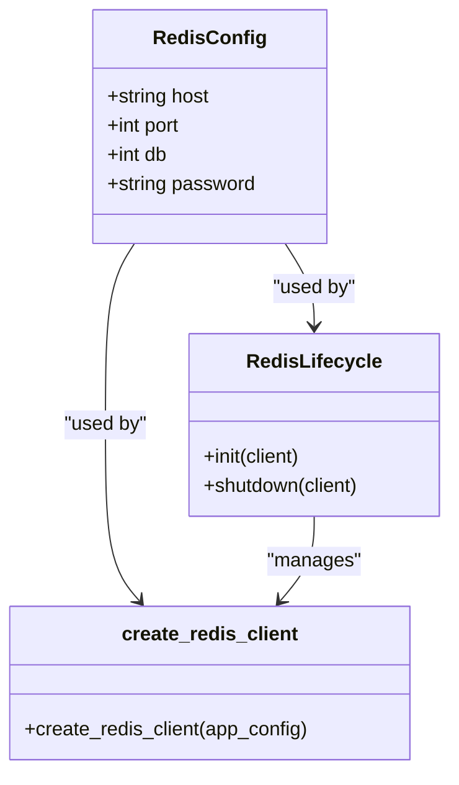
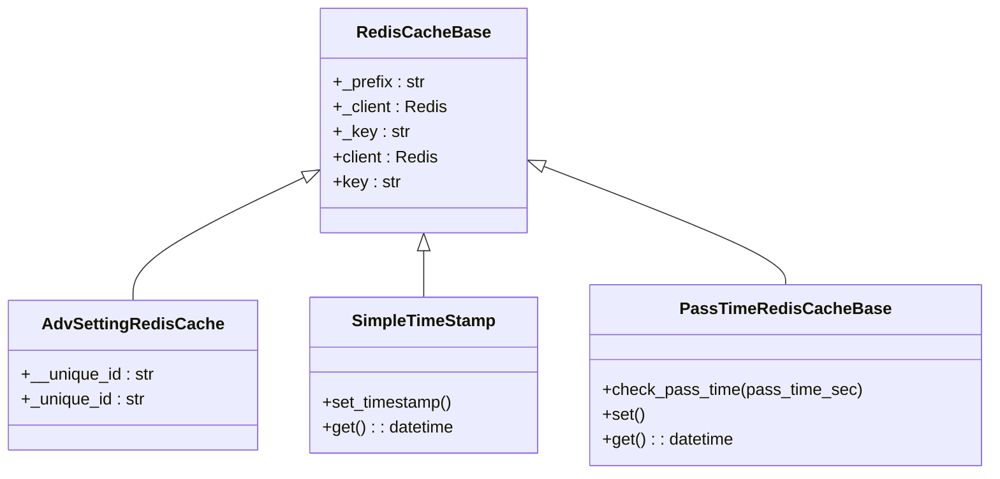
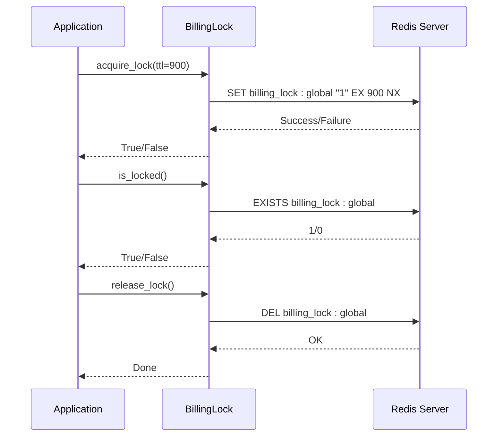
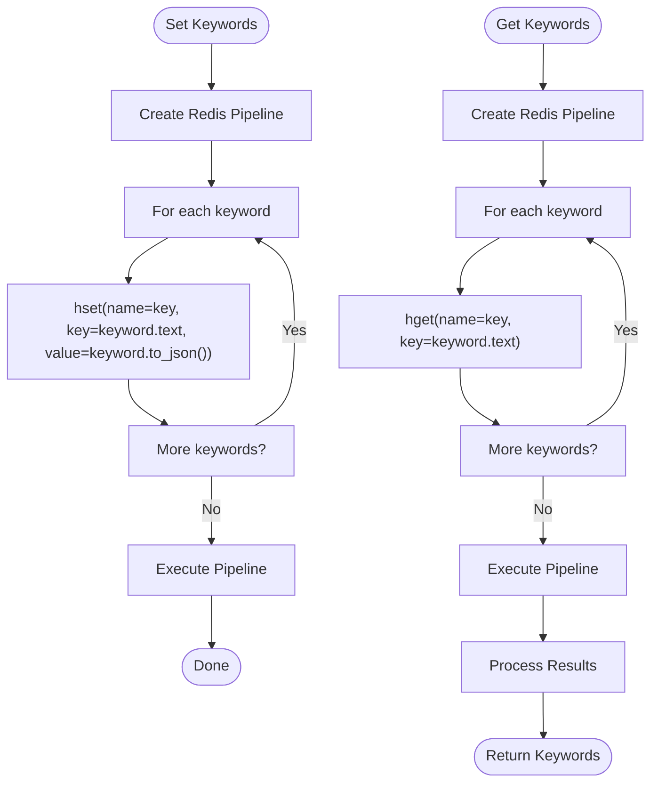
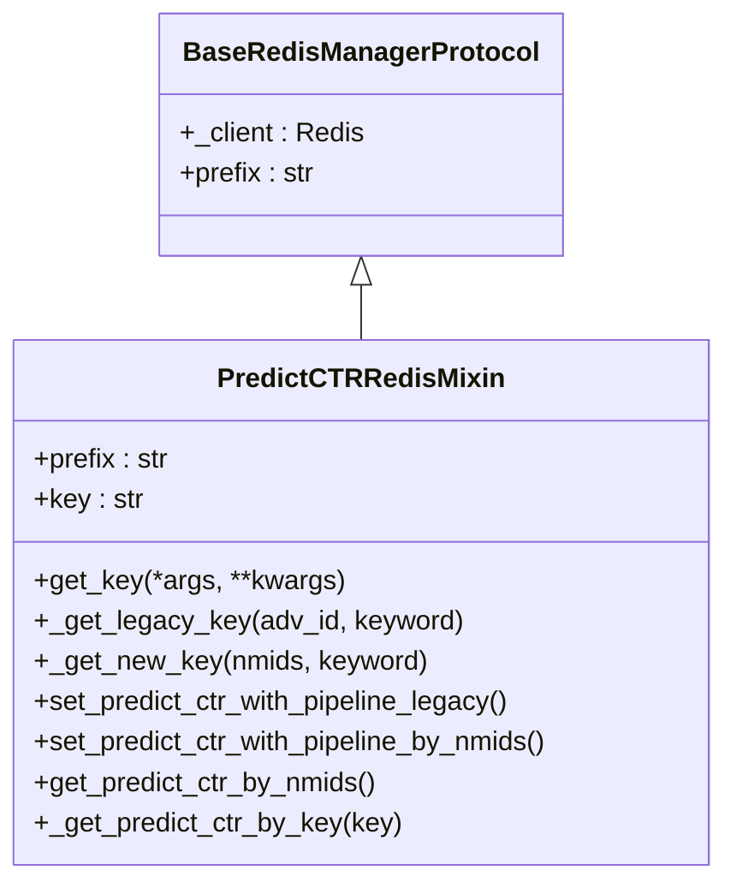
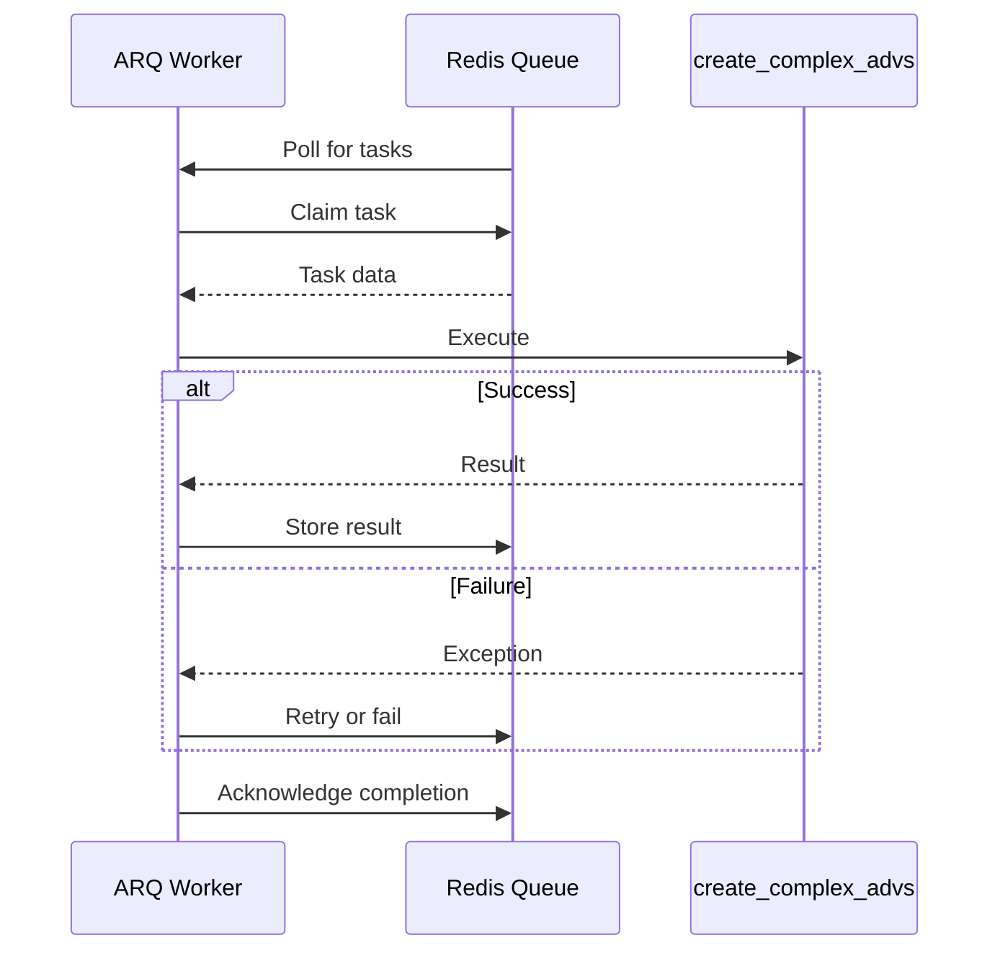
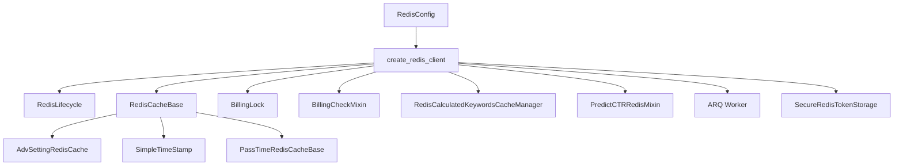

# Redis Caching Strategy

<cite>
**Referenced Files in This Document**   
- [redis_config.py](file://app/configs/infrastructure_config/redis_config.py)
- [redis.py](file://app/core/di/databases/redis.py)
- [redis_client.py](file://app/core/redis_manager/redis_client.py)
- [redis_cache_base.py](file://app/core/redis_cache/redis_cache_base.py)
- [adv_setting_redis_cache.py](file://app/core/redis_cache/mixins/main_objects_mixins/adv_setting_redis_cache.py)
- [billing_lock.py](file://app/modules/billing/redis_lock.py)
- [billing_check.py](file://app/core/redis_manager_v2/mixins/billing_check.py)
- [redis_manager.py](file://app/modules/billing/redis_manager.py)
- [redis_manager.py](file://app/modules/calculated_keywords_redis_cache_manager/redis_manager.py)
- [predic_ctr.py](file://app/core/redis_manager_v2/mixins/predic_ctr.py)
- [arq_redis_settings.py](file://app/arq_workers/arq_redis_settings.py)
- [workers.py](file://app/arq_workers/workers.py)
- [secure_redis_storage.py](file://app/core/mp/wb/token_management/secure_redis_storage.py)
- [simple_timestamp.py](file://app/core/redis_cache/mixins/data_types/simple_timestamp.py)
- [pass_time_redis_cache_base.py](file://app/core/redis_cache/mixins/data_types/pass_time_redis_cache_base.py)
</cite>

## Table of Contents
1. [Introduction](#introduction)
2. [Project Structure](#project-structure)
3. [Core Components](#core-components)
4. [Architecture Overview](#architecture-overview)
5. [Detailed Component Analysis](#detailed-component-analysis)
6. [Dependency Analysis](#dependency-analysis)
7. [Performance Considerations](#performance-considerations)
8. [Troubleshooting Guide](#troubleshooting-guide)
9. [Conclusion](#conclusion)

## Introduction
The Redis caching architecture in the adv-bot system serves multiple critical functions including caching frequently accessed data, rate limiting, distributed locking, and task queuing. This document provides a comprehensive analysis of the Redis implementation, covering connection management, data structures, key naming conventions, TTL policies, and specific use cases such as AdvSetting caching, billing locks, and calculated keywords management. The system employs a sophisticated multi-layered approach to Redis usage, with different modules handling specific aspects of the caching strategy.

## Project Structure

**Diagram sources**
- [redis_config.py](file://app/configs/infrastructure_config/redis_config.py)
- [redis_client.py](file://app/core/redis_manager/redis_client.py)
- [redis_cache_base.py](file://app/core/redis_cache/redis_cache_base.py)

**Section sources**
- [redis_config.py](file://app/configs/infrastructure_config/redis_config.py)
- [redis_client.py](file://app/core/redis_manager/redis_client.py)
- [redis_cache_base.py](file://app/core/redis_cache/redis_cache_base.py)

## Core Components

The Redis architecture in adv-bot consists of several core components that work together to provide a robust caching solution. The system is built around a dependency injection pattern that manages Redis connections and provides them to various components. The core components include connection management, caching base classes, specialized managers for different use cases, and integration with task queues.

**Section sources**
- [redis.py](file://app/core/di/databases/redis.py)
- [redis_cache_base.py](file://app/core/redis_cache/redis_cache_base.py)
- [base_redis_manager.py](file://app/core/redis_manager/base_redis_manager.py)

## Architecture Overview

**Diagram sources**
- [redis.py](file://app/core/di/databases/redis.py)
- [redis_cache_base.py](file://app/core/redis_cache/redis_cache_base.py)
- [billing_lock.py](file://app/modules/billing/redis_lock.py)
- [arq_redis_settings.py](file://app/arq_workers/arq_redis_settings.py)

## Detailed Component Analysis

### Connection Management and Pooling Strategy

The Redis connection management in adv-bot is implemented through a dependency injection pattern that ensures proper lifecycle management of Redis connections. The system uses redis-py's async client with connection pooling capabilities.

**Diagram sources**
- [redis_config.py](file://app/configs/infrastructure_config/redis_config.py)
- [redis.py](file://app/core/di/databases/redis.py)

**Section sources**
- [redis_config.py](file://app/configs/infrastructure_config/redis_config.py)
- [redis.py](file://app/core/di/databases/redis.py)

### AdvSetting Redis Cache Implementation

The AdvSetting caching system provides a specialized implementation for caching campaign settings with proper key naming and TTL management.

**Diagram sources**
- [redis_cache_base.py](file://app/core/redis_cache/redis_cache_base.py)
- [adv_setting_redis_cache.py](file://app/core/redis_cache/mixins/main_objects_mixins/adv_setting_redis_cache.py)
- [simple_timestamp.py](file://app/core/redis_cache/mixins/data_types/simple_timestamp.py)
- [pass_time_redis_cache_base.py](file://app/core/redis_cache/mixins/data_types/pass_time_redis_cache_base.py)

**Section sources**
- [redis_cache_base.py](file://app/core/redis_cache/redis_cache_base.py)
- [adv_setting_redis_cache.py](file://app/core/redis_cache/mixins/main_objects_mixins/adv_setting_redis_cache.py)

### Billing Lock and Process Management

The billing system implements distributed locking and process tracking using Redis to prevent concurrent execution and track processing status.

**Diagram sources**
- [billing_lock.py](file://app/modules/billing/redis_lock.py)
- [billing_check.py](file://app/core/redis_manager_v2/mixins/billing_check.py)

**Section sources**
- [billing_lock.py](file://app/modules/billing/redis_lock.py)
- [billing_check.py](file://app/core/redis_manager_v2/mixins/billing_check.py)

### Calculated Keywords Cache Manager

The calculated keywords system uses Redis hashes to store keyword data with efficient retrieval and batch operations.

**Diagram sources**
- [redis_manager.py](file://app/modules/calculated_keywords_redis_cache_manager/redis_manager.py)

**Section sources**
- [redis_manager.py](file://app/modules/calculated_keywords_redis_cache_manager/redis_manager.py)

### Predict CTR Redis Mixin

The PredictCTR system implements both legacy and new key formats for storing CTR predictions with proper text cleaning and key normalization.

**Diagram sources**
- [predic_ctr.py](file://app/core/redis_manager_v2/mixins/predic_ctr.py)

**Section sources**
- [predic_ctr.py](file://app/core/redis_manager_v2/mixins/predic_ctr.py)

### Task Queuing with ARQ

The system uses ARQ for task queuing with Redis as the backend, providing reliable task processing with proper error handling and retry mechanisms.

**Diagram sources**
- [arq_redis_settings.py](file://app/arq_workers/arq_redis_settings.py)
- [workers.py](file://app/arq_workers/workers.py)

**Section sources**
- [arq_redis_settings.py](file://app/arq_workers/arq_redis_settings.py)
- [workers.py](file://app/arq_workers/workers.py)

## Dependency Analysis

**Diagram sources**
- [redis_config.py](file://app/configs/infrastructure_config/redis_config.py)
- [redis.py](file://app/core/di/databases/redis.py)
- [redis_cache_base.py](file://app/core/redis_cache/redis_cache_base.py)
- [billing_lock.py](file://app/modules/billing/redis_lock.py)
- [billing_check.py](file://app/core/redis_manager_v2/mixins/billing_check.py)
- [redis_manager.py](file://app/modules/calculated_keywords_redis_cache_manager/redis_manager.py)
- [predic_ctr.py](file://app/core/redis_manager_v2/mixins/predic_ctr.py)
- [arq_redis_settings.py](file://app/arq_workers/arq_redis_settings.py)
- [secure_redis_storage.py](file://app/core/mp/wb/token_management/secure_redis_storage.py)

**Section sources**
- [redis_config.py](file://app/configs/infrastructure_config/redis_config.py)
- [redis.py](file://app/core/di/databases/redis.py)
- [redis_cache_base.py](file://app/core/redis_cache/redis_cache_base.py)

## Performance Considerations

The Redis implementation in adv-bot incorporates several performance optimization techniques:

1. **Connection Pooling**: The system uses redis-py's built-in connection pooling to minimize connection overhead.
2. **Pipelining**: Batch operations are implemented using Redis pipelines to reduce network round trips.
3. **Efficient Data Structures**: Hashes are used for related data to minimize key space and improve retrieval efficiency.
4. **Proper TTL Management**: Appropriate TTL values are set for different types of data to prevent memory bloat.
5. **Asynchronous Operations**: All Redis operations are performed asynchronously to avoid blocking the event loop.

The system also implements monitoring through aiocache plugins that track hit/miss ratios and timing information, allowing for performance analysis and optimization.

## Troubleshooting Guide

Common issues and their solutions:

1. **Connection Leaks**: Ensure proper lifecycle management through the RedisLifecycle class which handles connection shutdown.
2. **Cache Invalidation**: Implement proper TTL policies and use the release_lock methods to clean up after operations.
3. **Memory Optimization**: Monitor memory usage and adjust TTL values accordingly. Use Redis's memory analysis commands to identify large keys.
4. **High Availability**: Configure Redis with replication and consider using Redis Sentinel or Redis Cluster for production environments.
5. **Persistence**: Configure appropriate persistence options (RDB/AOF) based on data durability requirements.

**Section sources**
- [redis.py](file://app/core/di/databases/redis.py)
- [redis_client.py](file://app/core/redis_manager/redis_client.py)
- [redis_func_cache.py](file://app/utils/redis_func_cache.py)

## Conclusion

The Redis caching architecture in the adv-bot system is a comprehensive solution that addresses multiple requirements including data caching, distributed locking, and task queuing. The system is well-structured with clear separation of concerns and follows best practices for Redis usage. Key strengths include the dependency injection-based connection management, proper use of Redis data structures, and comprehensive error handling. The architecture supports high availability and performance requirements while providing extensibility for future enhancements.