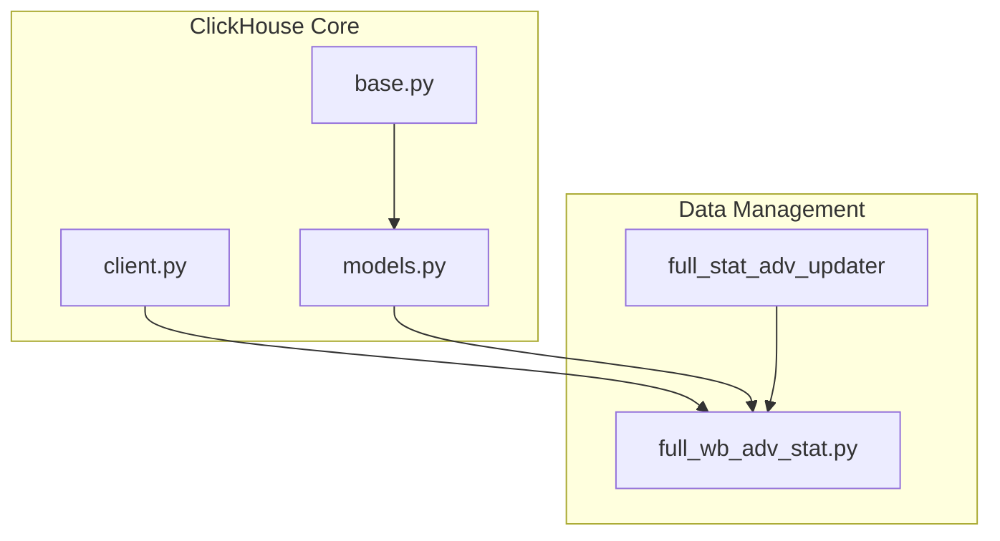
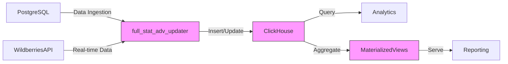
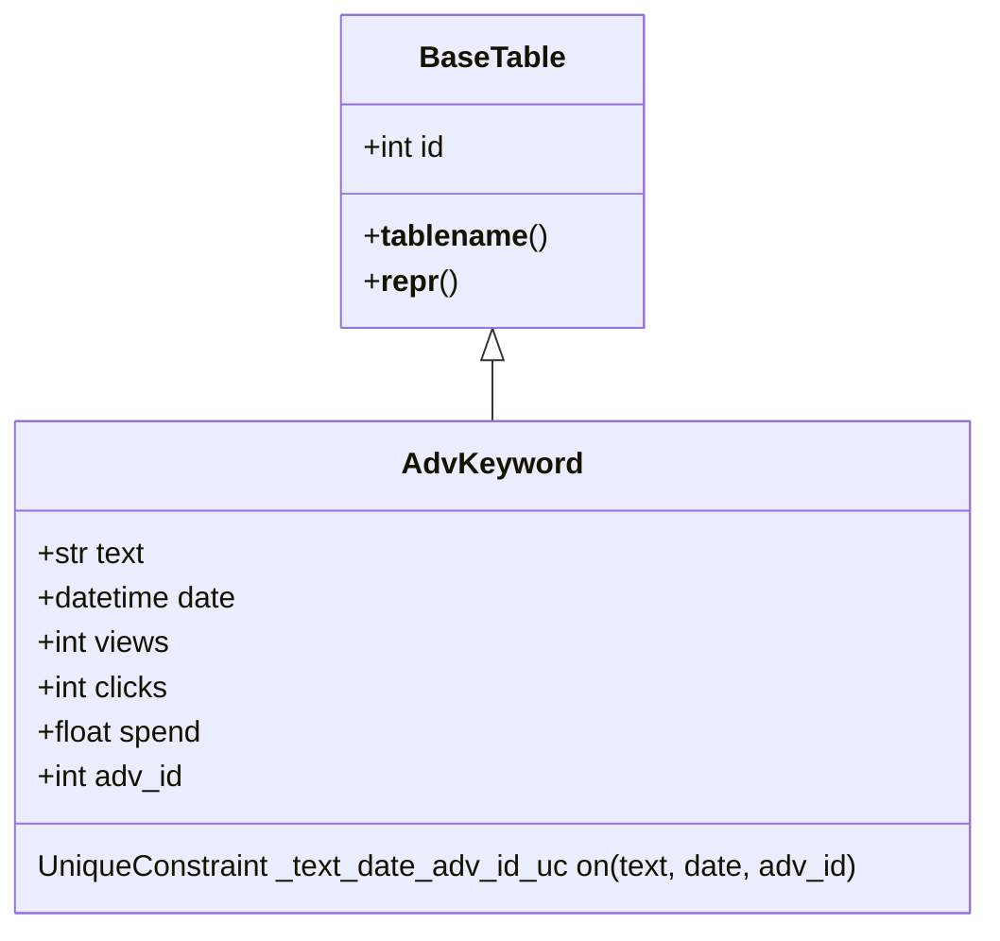
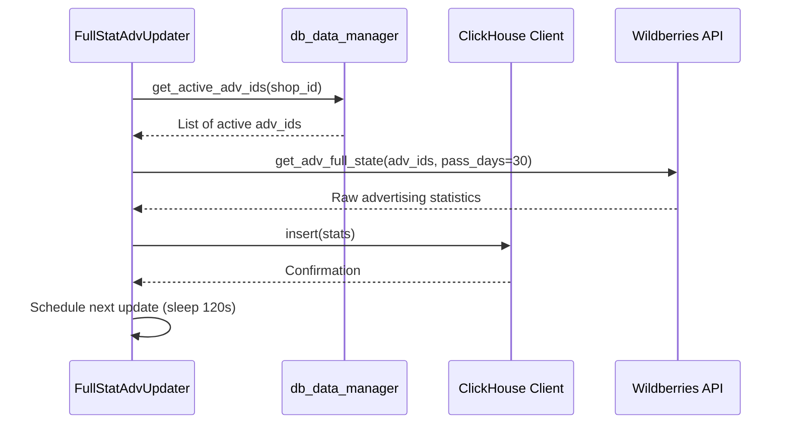
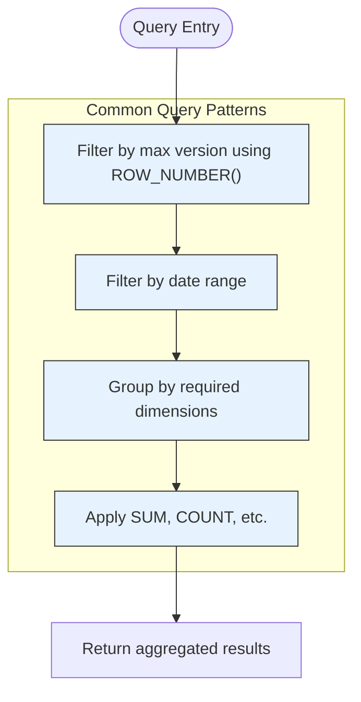
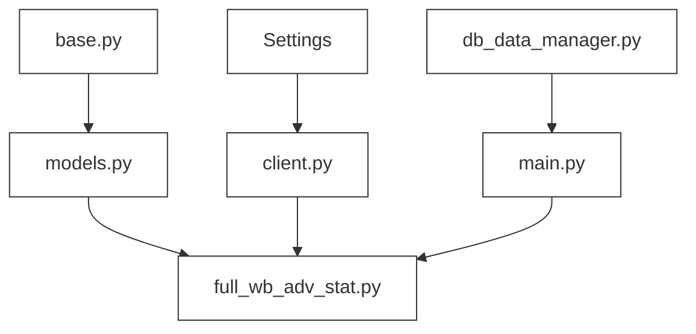

# ClickHouse Schema

<cite>
**Referenced Files in This Document**   
- [base.py](file://app/utils/click_house/base.py)
- [models.py](file://app/utils/click_house/models.py)
- [client.py](file://app/utils/click_house/client.py)
- [full_wb_adv_stat.py](file://app/modules/shop_runner/wb_stat_manager/clickhouse_manager/full_wb_adv_stat.py)
- [main.py](file://app/modules/full_stat_adv_updater/main.py)
- [db_data_manager.py](file://app/modules/full_stat_adv_updater/db_data_manager.py)
</cite>

## Table of Contents
1. [Introduction](#introduction)
2. [Project Structure](#project-structure)
3. [Core Components](#core-components)
4. [Architecture Overview](#architecture-overview)
5. [Detailed Component Analysis](#detailed-component-analysis)
6. [Dependency Analysis](#dependency-analysis)
7. [Performance Considerations](#performance-considerations)
8. [Troubleshooting Guide](#troubleshooting-guide)
9. [Conclusion](#conclusion)

## Introduction
The ClickHouse schema in the adv-bot system is designed for high-performance analytics and reporting of advertising metrics. This document details the column-oriented database structure optimized for fast querying of ad performance data, including impressions, clicks, spend, and conversion metrics. The schema supports time-series analysis, efficient aggregations, and real-time updates from PostgreSQL through the full_stat_adv_updater module. Key features include date-based partitioning, data retention policies, and integration with materialized views for aggregated reporting.

## Project Structure
The ClickHouse implementation is organized within the app/utils/click_house directory, with supporting modules in app/modules/shop_runner/wb_stat_manager and app/modules/full_stat_adv_updater. The schema design follows a modular approach with base classes for table definitions, client utilities for database connectivity, and specialized managers for data ingestion and retrieval.

**Diagram sources**
- [base.py](file://app/utils/click_house/base.py)
- [models.py](file://app/utils/click_house/models.py)
- [client.py](file://app/utils/click_house/client.py)
- [full_wb_adv_stat.py](file://app/modules/shop_runner/wb_stat_manager/clickhouse_manager/full_wb_adv_stat.py)
- [main.py](file://app/modules/full_stat_adv_updater/main.py)

**Section sources**
- [base.py](file://app/utils/click_house/base.py#L1-L17)
- [models.py](file://app/utils/click_house/models.py#L1-L22)

## Core Components
The ClickHouse schema consists of two primary tables: AdvKeyword for keyword-level performance data and full_adv_wb_stat for comprehensive advertising campaign statistics. Both tables are optimized for time-series analysis with DateTime partitioning and efficient aggregation through columnar storage. The schema uses appropriate data types including Int32 for counts, Float for monetary values, and String for text fields, ensuring optimal storage and query performance.

**Section sources**
- [models.py](file://app/utils/click_house/models.py#L1-L22)
- [full_wb_adv_stat.py](file://app/modules/shop_runner/wb_stat_manager/clickhouse_manager/full_wb_adv_stat.py#L200-L358)

## Architecture Overview
The ClickHouse architecture in adv-bot follows a data pipeline pattern where advertising metrics are ingested from PostgreSQL and Wildberries API sources, processed by the full_stat_adv_updater module, and stored in ClickHouse for analytics. The system maintains materialized views and aggregated reports for fast querying, with real-time update mechanisms ensuring data freshness.

**Diagram sources**
- [main.py](file://app/modules/full_stat_adv_updater/main.py#L1-L88)
- [full_wb_adv_stat.py](file://app/modules/shop_runner/wb_stat_manager/clickhouse_manager/full_wb_adv_stat.py#L1-L358)

## Detailed Component Analysis

### ClickHouse Base and Model Components
The ClickHouse implementation uses a base class pattern for table definitions, with BaseTable providing common functionality like auto-incrementing IDs and table name conventions. The model classes extend this base to define specific table structures with appropriate data types and constraints.

**Diagram sources**
- [base.py](file://app/utils/click_house/base.py#L1-L17)
- [models.py](file://app/utils/click_house/models.py#L1-L22)

### Data Ingestion and Update Mechanisms
The full_stat_adv_updater module manages the data ingestion pipeline, retrieving advertising statistics from Wildberries API and updating ClickHouse tables. The system uses versioning with timestamp-based version fields to handle concurrent updates and ensure data consistency.

**Diagram sources**
- [main.py](file://app/modules/full_stat_adv_updater/main.py#L1-L88)
- [db_data_manager.py](file://app/modules/full_stat_adv_updater/db_data_manager.py#L1-L21)
- [full_wb_adv_stat.py](file://app/modules/shop_runner/wb_stat_manager/clickhouse_manager/full_wb_adv_stat.py#L200-L358)

### Analytical Query Patterns
The ClickHouse schema supports various analytical queries for generating performance insights, using window functions to handle versioned data and aggregate functions for reporting. The queries are optimized for date-range analysis and efficient grouping operations.

**Diagram sources**
- [full_wb_adv_stat.py](file://app/modules/shop_runner/wb_stat_manager/clickhouse_manager/full_wb_adv_stat.py#L1-L358)

## Dependency Analysis
The ClickHouse components have well-defined dependencies, with the client module depending on configuration settings, the model classes depending on the base module, and the data management components depending on both the ClickHouse client and external data sources.

**Diagram sources**
- [client.py](file://app/utils/click_house/client.py#L37-L66)
- [base.py](file://app/utils/click_house/base.py)
- [models.py](file://app/utils/click_house/models.py)
- [full_wb_adv_stat.py](file://app/modules/shop_runner/wb_stat_manager/clickhouse_manager/full_wb_adv_stat.py)
- [main.py](file://app/modules/full_stat_adv_updater/main.py)
- [db_data_manager.py](file://app/modules/full_stat_adv_updater/db_data_manager.py)

**Section sources**
- [client.py](file://app/utils/click_house/client.py#L37-L66)
- [base.py](file://app/utils/click_house/base.py#L1-L17)
- [models.py](file://app/utils/click_house/models.py#L1-L22)

## Performance Considerations
The ClickHouse schema is optimized for high-performance querying through several mechanisms: column-oriented storage for efficient compression and I/O, date-based partitioning for fast time-range queries, and appropriate indexing through primary keys and unique constraints. The use of window functions with ROW_NUMBER() ensures efficient handling of versioned data, while the asynchronous client implementation supports concurrent operations without blocking.

## Troubleshooting Guide
Common issues with the ClickHouse implementation typically relate to connection management, data ingestion failures, or query performance. The system includes comprehensive logging for error tracking, with specific error messages for connection issues, query failures, and data insertion problems. Monitoring connection counts and query execution times can help identify performance bottlenecks.

**Section sources**
- [client.py](file://app/utils/click_house/client.py#L141-L221)
- [full_wb_adv_stat.py](file://app/modules/shop_runner/wb_stat_manager/clickhouse_manager/full_wb_adv_stat.py#L253-L291)

## Conclusion
The ClickHouse schema in the adv-bot system provides a robust foundation for advertising analytics and reporting. With its column-oriented design, efficient data types, and optimized query patterns, the schema supports fast aggregation and time-series analysis of advertising metrics. The integration with the full_stat_adv_updater module ensures real-time data freshness, while the modular architecture enables maintainability and scalability. This implementation effectively meets the requirements for high-performance querying of advertising metrics, spending reports, and historical statistics.