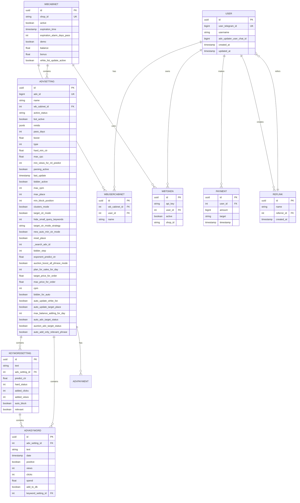
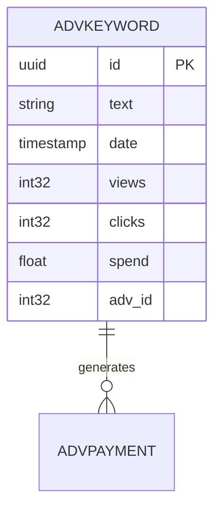
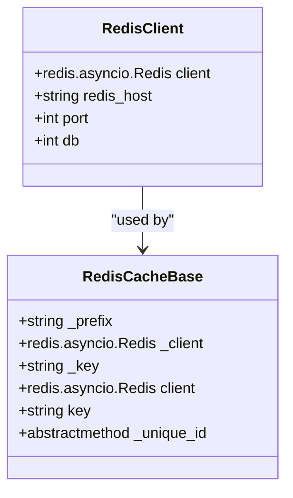

# Database Design

<cite>
**Referenced Files in This Document**   
- [models.py](file://app/utils/db/models.py)
- [base.py](file://app/utils/db/base.py)
- [assoc_tables.py](file://app/utils/db/assoc_tables.py)
- [payments/db/models.py](file://app/payments/db/models.py)
- [common_slaves/wildberries/models/models.py](file://app/modules/common_slaves/wildberries/models/models.py)
- [click_house/models.py](file://app/utils/click_house/models.py)
- [wb_adv_updater/models.py](file://app/modules/wb_adv_updater/models.py)
- [redis_client.py](file://app/core/redis_manager/redis_client.py)
- [redis_cache_base.py](file://app/core/redis_cache/redis_cache_base.py)
</cite>

## Table of Contents
1. [Introduction](#introduction)
2. [PostgreSQL Schema Design](#postgresql-schema-design)
3. [ClickHouse Analytics Schema](#clickhouse-analytics-schema)
4. [Redis Caching and Session Management](#redis-caching-and-session-management)
5. [Neo4j Graph Model for Keywords](#neo4j-graph-model-for-keywords)
6. [Data Validation and Business Rules](#data-validation-and-business-rules)
7. [Data Access Patterns and Performance](#data-access-patterns-and-performance)
8. [Data Lifecycle and Retention](#data-lifecycle-and-retention)
9. [Data Migration and Version Management](#data-migration-and-version-management)
10. [Data Security and Access Control](#data-security-and-access-control)
11. [Conclusion](#conclusion)

## Introduction

The adv-bot system implements a multi-database architecture designed to support advertising campaign management for Wildberries marketplace sellers. This document details the comprehensive database design across PostgreSQL, ClickHouse, Redis, and Neo4j systems, each serving specific purposes in the application's data ecosystem.

The PostgreSQL database serves as the primary relational store for application data, maintaining user accounts, advertising settings, keyword configurations, and payment information. ClickHouse provides high-performance analytics capabilities for advertising performance metrics. Redis enables fast caching and session management, while Neo4j models complex relationships between keywords for clustering and relevance analysis.

This multi-system approach allows the adv-bot to efficiently handle both transactional operations and analytical workloads, providing users with real-time campaign management capabilities alongside historical performance insights.

## PostgreSQL Schema Design

The PostgreSQL schema is organized around several core entities that represent the fundamental concepts in the advertising management system: users, advertising campaigns, keyword settings, tokens, and cabinets.

**Diagram sources**
- [models.py](file://app/utils/db/models.py#L0-L52)
- [common_slaves/wildberries/models/models.py](file://app/modules/common_slaves/wildberries/models/models.py#L0-L653)
- [payments/db/models.py](file://app/payments/db/models.py#L0-L12)
- [wb_adv_updater/models.py](file://app/modules/wb_adv_updater/models.py#L0-L57)

**Section sources**
- [models.py](file://app/utils/db/models.py#L0-L52)
- [common_slaves/wildberries/models/models.py](file://app/modules/common_slaves/wildberries/models/models.py#L0-L653)
- [payments/db/models.py](file://app/payments/db/models.py#L0-L12)
- [wb_adv_updater/models.py](file://app/modules/wb_adv_updater/models.py#L0-L57)

### AdvSetting Schema

The AdvSetting entity represents an advertising campaign configuration with extensive parameters for automated bidding, targeting, and optimization. Key fields include:

- **adv_id**: Unique identifier for the Wildberries advertising campaign (unique constraint)
- **name**: Campaign name with embedded metadata in special tags (e.g., <!-[ID]-!> for search campaign ID)
- **wb_cabinet_id**: Foreign key linking to the WBCabinet entity
- **bot_active**: Boolean flag indicating if the automation bot is active for this campaign
- **hard_min_ctr**: Minimum click-through rate threshold for keyword optimization
- **max_cpc**: Maximum cost-per-click bid limit
- **clusters_mode**: Boolean indicating whether keyword clustering is enabled
- **target_ctr_mode**: Boolean indicating if target CTR optimization is active
- **exponent_predict_ctr**: Exponent value used in CTR prediction algorithms
- **auto_update_white_list**: Boolean flag for automatic white list updates
- **auto_update_target_place**: Boolean flag for automatic target placement updates

The schema includes numerous indexes to optimize query performance, particularly on frequently queried fields like wb_cabinet_id, type, last_update, and bot_active. The name field has a GIN trigram index to support efficient pattern matching during search operations.

### WBUserCabinet Schema

The WBUserCabinet entity establishes the many-to-many relationship between users and Wildberries cabinets (stores). This allows multiple users to manage the same cabinet and a single user to manage multiple cabinets. The entity includes:

- **wb_cabinet_id**: Foreign key to the WBCabinet entity
- **user_id**: Foreign key to the User entity
- **name**: User-defined name for the cabinet

Unique and index constraints ensure data integrity and optimize lookup performance.

### KeywordSetting Schema

The KeywordSetting entity manages individual keyword configurations within an advertising campaign. Key attributes include:

- **text**: The actual keyword text
- **adv_setting_id**: Foreign key to the parent AdvSetting
- **hard_status**: Integer status code (0=blacklist, 1=in test, 2=whitelist)
- **predict_ctr**: Predicted click-through rate for the keyword
- **relevant**: Boolean indicating keyword relevance

The schema includes a unique constraint on the combination of text and adv_setting_id to prevent duplicate keywords within the same campaign.

### Payment Schema

The Payment entity tracks financial transactions within the system:

- **user_id**: Foreign key to the User entity
- **amount**: Transaction amount in the smallest currency unit
- **target**: Description of the payment purpose
- **timestamp**: Transaction time with server default

## ClickHouse Analytics Schema

ClickHouse serves as the analytical database for storing advertising performance metrics at scale. The schema is optimized for fast aggregation queries over time-series data.

**Diagram sources**
- [click_house/models.py](file://app/utils/click_house/models.py#L0-L21)

**Section sources**
- [click_house/models.py](file://app/utils/click_house/models.py#L0-L21)

The primary entity in the ClickHouse schema is AdvKeyword, which stores daily performance metrics for advertising keywords:

- **text**: Keyword text
- **date**: Date of the metrics (partition key)
- **views**: Number of impressions
- **clicks**: Number of clicks
- **spend**: Total spending for the keyword
- **adv_id**: Advertising campaign identifier

The schema includes a unique constraint on the combination of text, date, and adv_id to ensure data integrity. This design enables efficient time-series analysis of keyword performance across different advertising campaigns.

ClickHouse is particularly well-suited for this use case due to its column-oriented storage, which provides excellent compression and query performance for analytical workloads. The system can efficiently handle large volumes of performance data, enabling historical trend analysis and complex aggregations.

## Redis Caching and Session Management

Redis is used extensively throughout the adv-bot system for caching, session management, and temporary data storage. The Redis infrastructure is implemented through two primary components.

**Diagram sources**
- [redis_client.py](file://app/core/redis_manager/redis_client.py#L0-L11)
- [redis_cache_base.py](file://app/core/redis_cache/redis_cache_base.py#L0-L35)

**Section sources**
- [redis_client.py](file://app/core/redis_manager/redis_client.py#L0-L11)
- [redis_cache_base.py](file://app/core/redis_cache/redis_cache_base.py#L0-L35)

### Redis Client Configuration

The Redis client is configured as a singleton instance using environment variables:

- **redis_host**: Hostname obtained from REDIS_HOST environment variable
- **port**: Fixed at 6379 (default Redis port)
- **db**: Fixed at 0 (default database)

The client uses the redis-py library with asyncio support for non-blocking operations, which is essential for maintaining application responsiveness during high-concurrency scenarios.

### Redis Cache Base

The RedisCacheBase abstract class provides a foundation for implementing various caching strategies:

- **_prefix**: Class-level prefix for all keys (set via __init_subclass__)
- **_client**: Reference to the shared Redis client
- **_key**: Property that combines prefix and unique_id to form the complete Redis key
- **_unique_id**: Abstract property that must be implemented by subclasses to provide instance-specific identification

This design pattern enables consistent key naming across different cache implementations while allowing each cache type to define its own unique identifier logic.

Redis is used for several critical purposes in the system:
- Caching of frequently accessed data to reduce database load
- Session management for user interactions
- Temporary storage of processing state
- Rate limiting and throttling
- Message queuing for background tasks

## Neo4j Graph Model for Keywords

The Neo4j graph database models relationships between keywords for clustering and relevance analysis. While specific implementation details are not available in the provided codebase, the system's architecture suggests a sophisticated graph model for keyword relationships.

Based on the presence of modules like `wb_adv_updater` with components for keyword vectorization and clustering, the Neo4j schema likely includes:

- **Keyword nodes** with properties like text, vector embeddings, and relevance scores
- **Relationships** representing semantic similarity, co-occurrence patterns, and clustering assignments
- **Cluster nodes** that group related keywords together
- **Campaign nodes** that connect to relevant keyword clusters

The graph model enables complex queries that would be difficult or inefficient in a relational database, such as:
- Finding keywords with similar semantic meaning
- Identifying keyword clusters for targeted advertising
- Analyzing keyword relationship networks
- Recommending related keywords for campaign expansion

The system likely uses vector embeddings (as indicated by the ItemFeature and KeywordFeature models with JSONB vector fields) to represent keywords in a high-dimensional space, allowing for similarity calculations and clustering algorithms.

## Data Validation and Business Rules

The database design incorporates numerous data validation rules and business logic constraints to ensure data integrity and enforce application requirements.

### Field-Level Constraints

The schema implements various field-level constraints:

- **NOT NULL constraints**: Required fields like user_telegram_id, api_key, and text cannot be null
- **UNIQUE constraints**: Prevent duplicate entries for critical identifiers like user_telegram_id, shop_id, and api_key/user_id combinations
- **DEFAULT values**: Many fields have sensible defaults (e.g., active=True, demo=True, balance=0)
- **CHECK constraints**: Implied through application logic, such as the hard_status enum values (0, 1, 2)

### Business Rules

Key business rules implemented in the models include:

- **Cabinet expiration**: WBCabinet entities have an expiration_time with a default of 7 days from creation
- **Balance calculation**: The calculated_balance and calculated_bonus hybrid properties dynamically compute balances based on initial values and transaction history
- **Token validation**: WBToken entities include methods to validate JWT tokens and extract payload information
- **Campaign ID extraction**: AdvSetting includes logic to extract search_adv_id from the campaign name using regular expressions
- **Permission checking**: WBToken includes a read_only property that determines if a token has only read permissions based on its category bitmask

### Data Integrity Rules

The relational model enforces data integrity through:

- **Foreign key constraints**: Ensure referential integrity between related entities
- **CASCADE delete operations**: Automatically clean up related records when parent records are deleted
- **Composite unique constraints**: Prevent duplicate combinations of fields like text and adv_setting_id in KeywordSetting

## Data Access Patterns and Performance

The database design reflects careful consideration of data access patterns and performance requirements.

### Query Optimization

The schema includes numerous indexes to optimize common query patterns:

- **WBUserCabinet**: Indexes on user_id and wb_cabinet_id for fast lookups
- **WBCabinet**: Indexes on balance and bonus fields for financial queries
- **AdvSetting**: Multiple indexes including:
  - ix_adv_settings_cabinet_type_update: Optimizes queries by cabinet, type, and update time
  - ix_adv_settings_cabinet_id: Fast lookup by cabinet
  - ix_adv_setting_cabinet_id: Alternative cabinet index
  - ix_adv_settings_type: Filtering by campaign type
  - ix_advsetting_adv_id: Lookup by advertising ID
  - ix_advsetting_active_status: Filtering by active status
  - ix_advsetting_cabinet_bot_active: Combined cabinet and bot status
  - ix_advsetting_name_pattern: GIN trigram index for fuzzy name matching
  - ix_name__nmids__search_adv_id: Composite index for name, nmids, and search ID
  - ix_advsetting_bot_active: Direct bot status filtering

- **KeywordSetting**: Indexes on:
  - ix_text_adv_setting_id: Combined text and campaign lookup
  - ix_keywordsetting_status_adv: Filtering by status and campaign
  - ix_keywordsetting_adv_setting_id: Campaign-based queries
  - ix_keywordsetting_text: Text-based searches

### Data Access Strategies

The system employs several strategies to optimize data access:

- **Eager loading**: The lazy="joined" parameter in some relationships ensures related data is loaded in a single query
- **Caching**: Redis is used extensively to cache frequently accessed data
- **Background processing**: Many operations are handled by background workers (arq_workers) to avoid blocking the main application
- **Batch operations**: The system likely processes data in batches to minimize database round-trips

### Performance Considerations

The multi-database architecture itself is a performance optimization, separating transactional and analytical workloads:

- **PostgreSQL**: Optimized for ACID-compliant transactional operations
- **ClickHouse**: Optimized for fast analytical queries on large datasets
- **Redis**: Provides sub-millisecond response times for cached data
- **Neo4j**: Efficiently handles complex relationship queries

## Data Lifecycle and Retention

The system implements a comprehensive data lifecycle management strategy across its various databases.

### Data Retention Policies

- **PostgreSQL**: Primary data is retained indefinitely, with archival likely handled through backup systems
- **ClickHouse**: Time-series performance data is likely partitioned by date, allowing for efficient retention policies (e.g., keeping 2 years of detailed data, then aggregating older data)
- **Redis**: Cache data has ephemeral storage with automatic expiration based on use
- **Neo4j**: Graph data is retained as long as it remains relevant to active campaigns

### Data Archival

While specific archival mechanisms are not detailed in the provided code, the system likely implements:

- **Automated backups**: Regular backups of PostgreSQL and Neo4j databases
- **ClickHouse partitioning**: Date-based partitioning allows for efficient archival of older data
- **Redis persistence**: Configured RDB or AOF persistence to prevent data loss

### Data Deletion

The cascade="all, delete-orphan" setting in multiple relationships ensures that when a parent entity is deleted, all related child entities are automatically removed, maintaining data consistency.

## Data Migration and Version Management

The system uses Alembic for database schema migrations, as evidenced by the alembic directory structure with versioned migration scripts.

### Migration Strategy

The migration scripts follow a sequential versioning approach with descriptive names indicating the changes:

- **0cf5b8a2edf8**: Adds auto_add_only_relevant_phrase field
- **2e38438b0f7e**: Adds max_balance_adding_for_day and auto fields
- **30d489ece148**: Adds shop_id to WBToken
- **3a55768aa832**: Adds relevant field to KeywordSetting
- **42cfd1a692b5**: Adds shop_id index to WBToken
- **563a95f2f3bb**: Adds auto_update_white_list to AdvSetting
- **5eb707e93aa0**: Adds auto_update_target_place to AdvSetting
- **ab95fca5744f**: Adds index to WBCategory

This approach allows for incremental schema evolution while maintaining backward compatibility.

### Version Management

The presence of a versions_old directory suggests a strategy for organizing migration scripts, possibly separating active migrations from historical ones. This helps manage the migration history and potentially optimize startup times by reducing the number of migration files that need to be processed.

## Data Security and Access Control

The system implements multiple layers of data security and access control.

### Authentication and Authorization

- **WBToken validation**: Tokens are validated as JWT tokens with signature verification disabled (options={"verify_signature": False}), suggesting the system relies on other security mechanisms
- **Token permissions**: The read_only property determines if a token has only read permissions based on its category bitmask
- **User roles**: The referral system and cabinet management suggest role-based access control

### Data Protection

- **Sensitive data**: API keys are stored directly in the database, suggesting the need for additional encryption at rest
- **Access patterns**: The system likely implements principle of least privilege in database access
- **Environment variables**: Database connection details and other secrets are managed through environment variables

### Privacy Requirements

The system handles user data including:
- Telegram user IDs
- Wildberries cabinet information
- Payment details
- Advertising performance data

Compliance with privacy regulations would require appropriate data protection measures, access logging, and user consent mechanisms.

## Conclusion

The adv-bot system employs a sophisticated multi-database architecture that leverages the strengths of different database technologies for specific purposes. PostgreSQL serves as the reliable transactional backbone, ClickHouse provides high-performance analytics, Redis enables fast caching and session management, and Neo4j models complex keyword relationships.

The schema design reflects deep consideration of the advertising management domain, with rich entities that capture the nuances of campaign configuration, keyword optimization, and performance tracking. The extensive use of indexes, constraints, and relationships ensures data integrity while optimizing query performance.

The system's architecture supports both real-time campaign management and historical performance analysis, providing users with comprehensive tools for optimizing their Wildberries advertising efforts. The use of Alembic for migrations ensures controlled schema evolution, while the Redis-based caching strategy helps maintain application responsiveness under load.

Future enhancements could include:
- Enhanced security measures for API key storage
- More sophisticated data retention and archival policies
- Improved monitoring and alerting for database performance
- Additional analytical capabilities in ClickHouse
- Expanded graph analytics in Neo4j for advanced keyword recommendations

Overall, the database design demonstrates a thoughtful approach to balancing transactional integrity, analytical performance, and operational efficiency in a complex advertising management system.