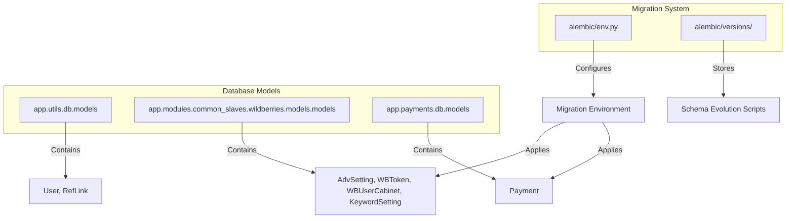
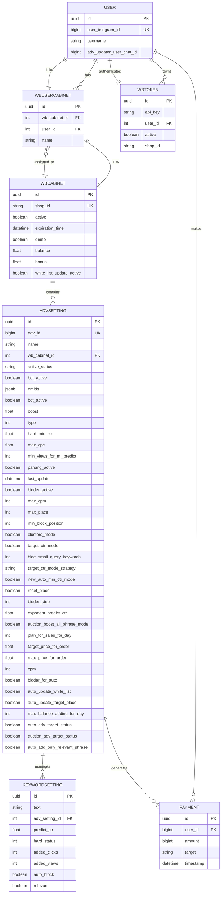
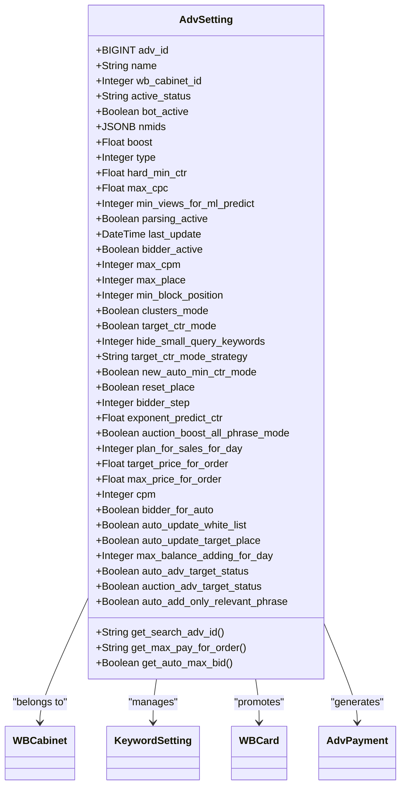
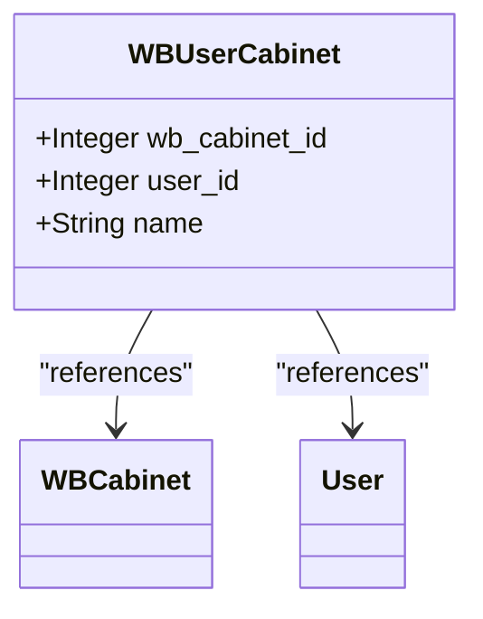
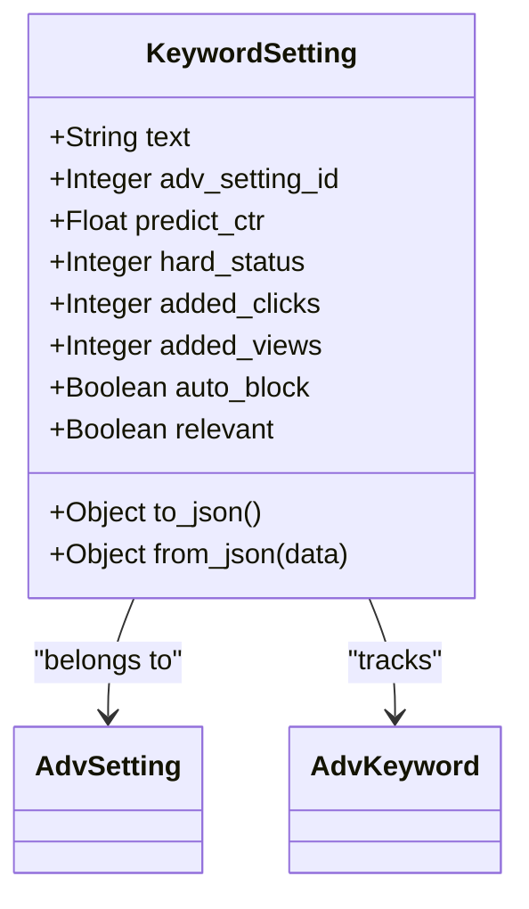
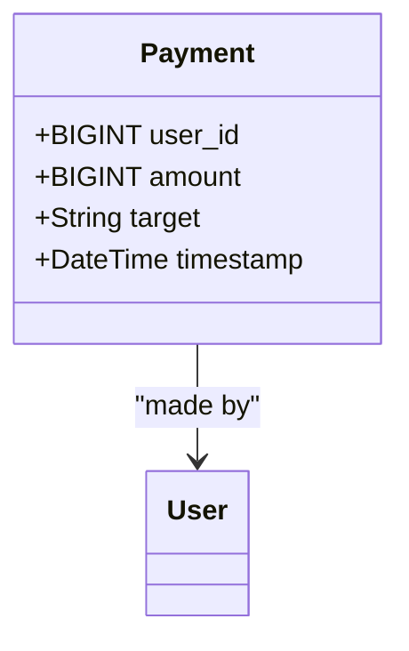
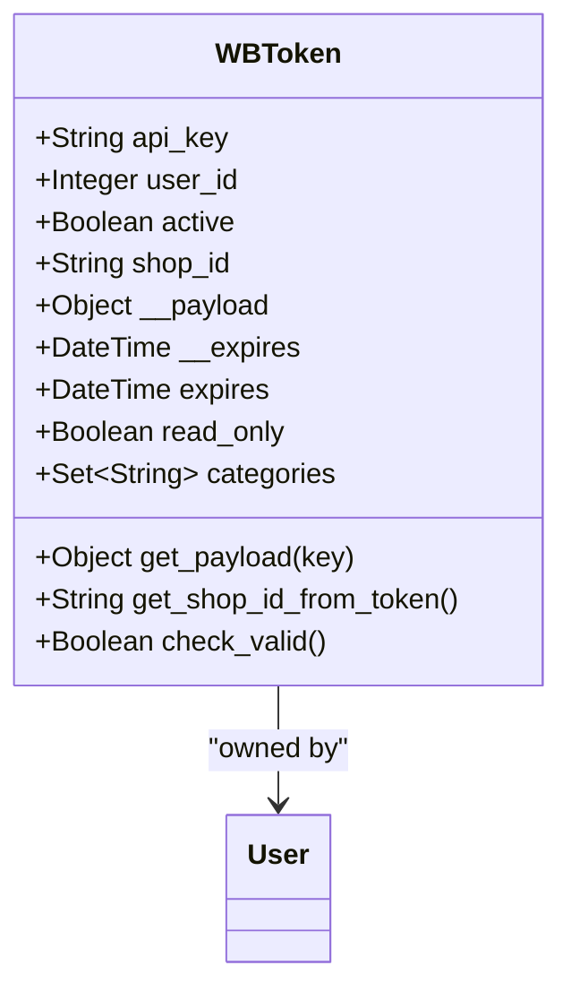
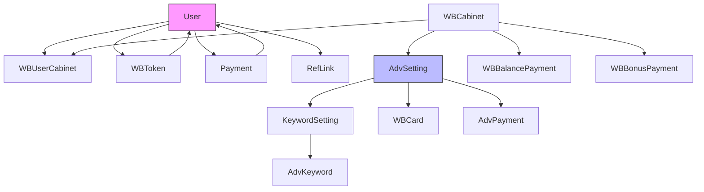

# PostgreSQL Schema

<cite>
**Referenced Files in This Document**   
- [models.py](file://app/utils/db/models.py)
- [models.py](file://app/modules/common_slaves/wildberries/models/models.py)
- [models.py](file://app/payments/db/models.py)
- [env.py](file://alembic/env.py)
- [0cf5b8a2edf8_add_auto_add_only_relevant_phrase_in_.py](file://alembic/versions/0cf5b8a2edf8_add_auto_add_only_relevant_phrase_in_.py)
- [2e38438b0f7e_add_max_balance_adding_for_day_and_auto_.py](file://alembic/versions/2e38438b0f7e_add_max_balance_adding_for_day_and_auto_.py)
- [30d489ece148_add_shop_id_ðto_wbtoken.py](file://alembic/versions/30d489ece148_add_shop_id_ðto_wbtoken.py)
- [42cfd1a692b5_add_shop_id_index_to_wbtoken.py](file://alembic/versions/42cfd1a692b5_add_shop_id_index_to_wbtoken.py)
- [3a55768aa832_add_relevant_to_keywordsetting.py](file://alembic/versions/3a55768aa832_add_relevant_to_keywordsetting.py)
- [563a95f2f3bb_add_auto_update_white_list_to_advsetting.py](file://alembic/versions/563a95f2f3bb_add_auto_update_white_list_to_advsetting.py)
- [5eb707e93aa0_add_auto_update_target_place_in_.py](file://alembic/versions/5eb707e93aa0_add_auto_update_target_place_in_.py)
</cite>

## Table of Contents
1. [Introduction](#introduction)
2. [Project Structure](#project-structure)
3. [Core Components](#core-components)
4. [Architecture Overview](#architecture-overview)
5. [Detailed Component Analysis](#detailed-component-analysis)
6. [Dependency Analysis](#dependency-analysis)
7. [Performance Considerations](#performance-considerations)
8. [Troubleshooting Guide](#troubleshooting-guide)
9. [Conclusion](#conclusion)

## Introduction
This document provides comprehensive documentation for the PostgreSQL schema used in the adv-bot system. It details the core data models including AdvSetting, WBUserCabinet, KeywordSetting, Payment, and WBToken, along with their relationships, constraints, and business logic. The schema supports advertising campaign management on the Wildberries marketplace, with features for automated bidding, keyword management, and financial tracking. This documentation covers entity relationships, field definitions, data types, indexes, business rules, data access patterns, and security considerations.

## Project Structure
The adv-bot system follows a modular structure with clear separation of concerns. The database models are organized across multiple modules, with core Wildberries-related entities in the common_slaves.wildberries.models package, user and payment models in utility packages, and migration scripts managed through Alembic. The schema evolution is tracked in the alembic/versions directory, with each migration script corresponding to a specific schema change. The system uses SQLAlchemy ORM for database interactions, with asynchronous session management.

**Diagram sources**
- [models.py](file://app/utils/db/models.py)
- [models.py](file://app/modules/common_slaves/wildberries/models/models.py)
- [models.py](file://app/payments/db/models.py)
- [env.py](file://alembic/env.py)

**Section sources**
- [models.py](file://app/utils/db/models.py)
- [models.py](file://app/modules/common_slaves/wildberries/models/models.py)
- [models.py](file://app/payments/db/models.py)
- [env.py](file://alembic/env.py)

## Core Components
The core components of the PostgreSQL schema include five primary entities that form the foundation of the advertising management system: AdvSetting, WBUserCabinet, KeywordSetting, Payment, and WBToken. These models represent advertising campaigns, user-cabinet relationships, keyword configurations, financial transactions, and API authentication tokens respectively. Each component has specific attributes that capture business requirements such as campaign settings, financial limits, and automation rules. The models are interconnected through foreign key relationships that maintain referential integrity across the system.

**Section sources**
- [models.py](file://app/modules/common_slaves/wildberries/models/models.py)
- [models.py](file://app/utils/db/models.py)
- [models.py](file://app/payments/db/models.py)

## Architecture Overview
The database architecture follows a relational model with normalized tables that represent the domain entities of the advertising management system. The schema is designed to support complex queries for campaign performance analysis, financial tracking, and user management. At the center is the AdvSetting entity, which represents advertising campaigns and connects to keywords, cards, and financial data. User access is managed through the User entity, which has relationships to cabinets, tokens, and payments. The architecture supports both OLTP operations for real-time campaign management and analytical queries for performance reporting.

**Diagram sources**
- [models.py](file://app/modules/common_slaves/wildberries/models/models.py)
- [models.py](file://app/utils/db/models.py)
- [models.py](file://app/payments/db/models.py)

## Detailed Component Analysis

### AdvSetting Analysis
The AdvSetting model represents an advertising campaign configuration in the Wildberries system. It contains comprehensive settings for both automatic and auction-based advertising campaigns, including bidding strategies, performance targets, and automation rules. The model supports complex business logic through various flags and thresholds that control campaign behavior.

**Diagram sources**
- [models.py](file://app/modules/common_slaves/wildberries/models/models.py#L400-L653)

**Section sources**
- [models.py](file://app/modules/common_slaves/wildberries/models/models.py#L400-L653)

### WBUserCabinet Analysis
The WBUserCabinet model establishes the many-to-many relationship between users and Wildberries cabinets, allowing users to manage multiple advertising cabinets. Each relationship can have a custom name, enabling user-friendly identification of cabinets. The model ensures data integrity through a unique constraint on the combination of wb_cabinet_id and user_id, preventing duplicate assignments.

**Diagram sources**
- [models.py](file://app/modules/common_slaves/wildberries/models/models.py#L0-L50)

**Section sources**
- [models.py](file://app/modules/common_slaves/wildberries/models/models.py#L0-L50)

### KeywordSetting Analysis
The KeywordSetting model manages individual keywords within an advertising campaign, including their status, performance predictions, and relevance. Keywords can be in different states (blacklist, testing, whitelist) as defined by the hard_status field. The model supports automated management through the relevant flag, which indicates whether a keyword is relevant to the product being advertised.

**Diagram sources**
- [models.py](file://app/modules/common_slaves/wildberries/models/models.py#L400-L653)
- [3a55768aa832_add_relevant_to_keywordsetting.py](file://alembic/versions/3a55768aa832_add_relevant_to_keywordsetting.py)

**Section sources**
- [models.py](file://app/modules/common_slaves/wildberries/models/models.py#L400-L653)

### Payment Analysis
The Payment model records financial transactions within the system, tracking payments made by users for advertising services. Each payment is linked to a user and contains information about the amount, target service, and timestamp. The model supports various payment targets and provides a foundation for financial reporting and balance management.

**Diagram sources**
- [models.py](file://app/payments/db/models.py#L0-L12)

**Section sources**
- [models.py](file://app/payments/db/models.py#L0-L12)

### WBToken Analysis
The WBToken model stores API authentication tokens used to access Wildberries services on behalf of users. Each token is associated with a user and may have a shop_id for routing requests to specific stores. The model includes methods to validate tokens and extract payload information, supporting secure API access with read-only mode detection.

**Diagram sources**
- [models.py](file://app/modules/common_slaves/wildberries/models/models.py#L200-L399)
- [30d489ece148_add_shop_id_ðto_wbtoken.py](file://alembic/versions/30d489ece148_add_shop_id_ðto_wbtoken.py)
- [42cfd1a692b5_add_shop_id_index_to_wbtoken.py](file://alembic/versions/42cfd1a692b5_add_shop_id_index_to_wbtoken.py)

**Section sources**
- [models.py](file://app/modules/common_slaves/wildberries/models/models.py#L200-L399)

## Dependency Analysis
The database schema exhibits a well-defined dependency structure with clear parent-child relationships between entities. The User entity serves as a central hub, connecting to cabinets, tokens, and payments. The WBCabinet entity acts as a container for advertising campaigns (AdvSetting), while each campaign manages its keywords (KeywordSetting) and associated cards (WBCard). The dependency graph shows a star schema pattern with AdvSetting at the center, connecting to multiple supporting entities for comprehensive campaign management.

**Diagram sources**
- [models.py](file://app/utils/db/models.py)
- [models.py](file://app/modules/common_slaves/wildberries/models/models.py)
- [models.py](file://app/payments/db/models.py)

**Section sources**
- [models.py](file://app/utils/db/models.py)
- [models.py](file://app/modules/common_slaves/wildberries/models/models.py)
- [models.py](file://app/payments/db/models.py)

## Performance Considerations
The schema includes several performance optimizations through strategic indexing. The WBToken table has an index on shop_id (idx_shop_id) to accelerate queries filtering by store identifier. The AdvSetting table features multiple indexes including ix_adv_settings_cabinet_type_update for campaign queries, ix_advsetting_name_pattern with GIN trigram operations for fuzzy name matching, and various composite indexes for common query patterns. The KeywordSetting table has indexes on text and adv_setting_id combinations to support efficient keyword lookups. These indexes enable fast data retrieval for both operational and analytical use cases, though they should be monitored for maintenance overhead as data volumes grow.

**Section sources**
- [models.py](file://app/modules/common_slaves/wildberries/models/models.py)
- [42cfd1a692b5_add_shop_id_index_to_wbtoken.py](file://alembic/versions/42cfd1a692b5_add_shop_id_index_to_wbtoken.py)

## Troubleshooting Guide
When diagnosing issues with the PostgreSQL schema, verify the integrity of foreign key relationships and index usage. Common issues include missing shop_id values in WBToken records, which can be resolved by running the update_shop_ids_in_wb_tokens.py script. For performance problems, check that critical indexes (such as idx_shop_id on WBToken) are present and being used by the query planner. Validate that Alembic migrations have been applied completely by comparing the current schema with migration scripts in alembic/versions. When troubleshooting authentication issues, verify that WBToken records have valid JWT structures and that the read_only property correctly identifies token permissions.

**Section sources**
- [models.py](file://app/modules/common_slaves/wildberries/models/models.py)
- [30d489ece148_add_shop_id_ðto_wbtoken.py](file://alembic/versions/30d489ece148_add_shop_id_ðto_wbtoken.py)
- [42cfd1a692b5_add_shop_id_index_to_wbtoken.py](file://alembic/versions/42cfd1a692b5_add_shop_id_index_to_wbtoken.py)

## Conclusion
The PostgreSQL schema for the adv-bot system provides a robust foundation for managing Wildberries advertising campaigns with comprehensive support for automation, financial tracking, and user management. The data model effectively captures complex business requirements through well-structured entities and relationships. Key features like automated keyword relevance, daily balance limits, and white list updates are implemented through specific fields in the AdvSetting model. The schema demonstrates good design practices with proper indexing, referential integrity, and separation of concerns. Future enhancements could include additional audit fields, improved partitioning for large tables, and enhanced security measures for sensitive data.