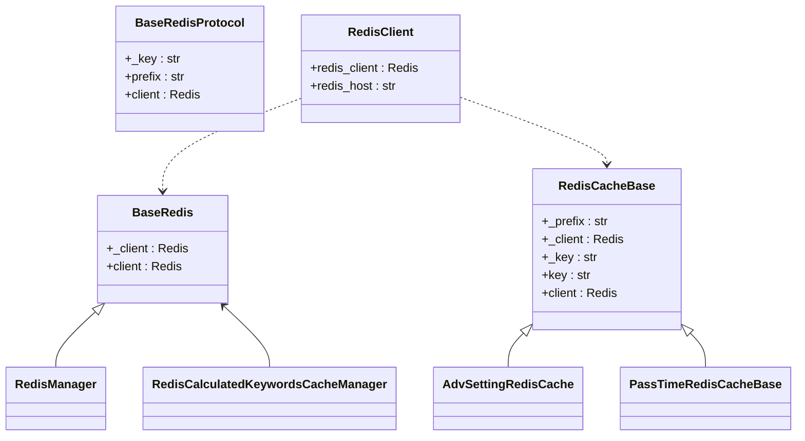
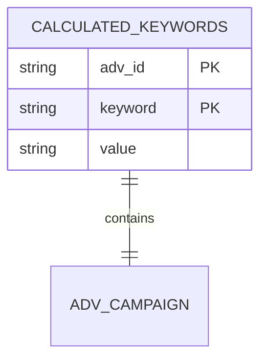
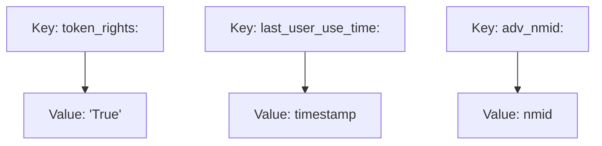
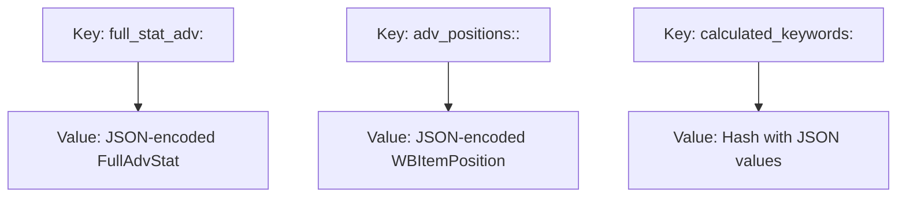
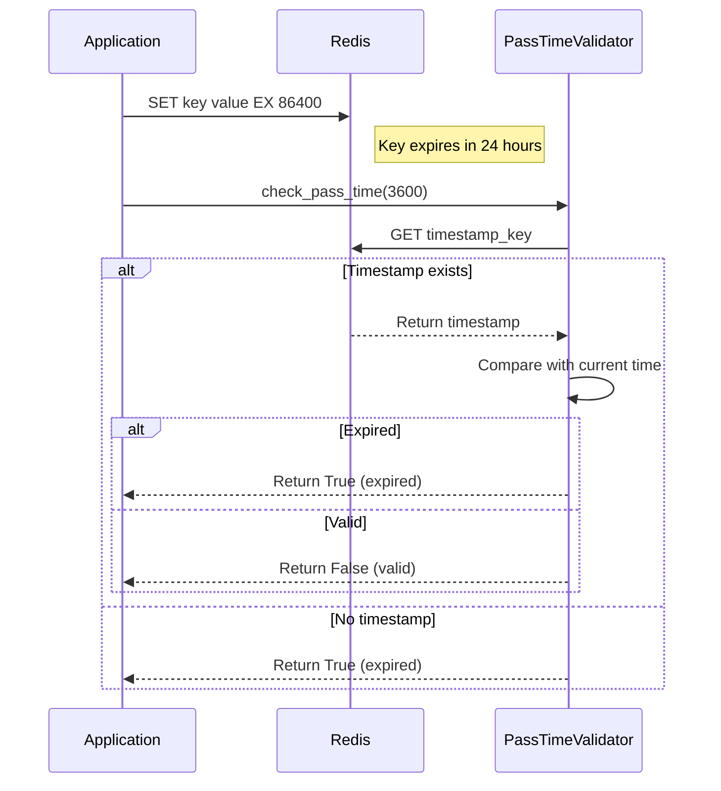
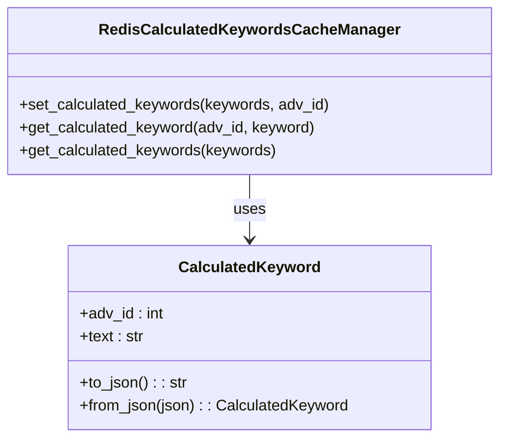
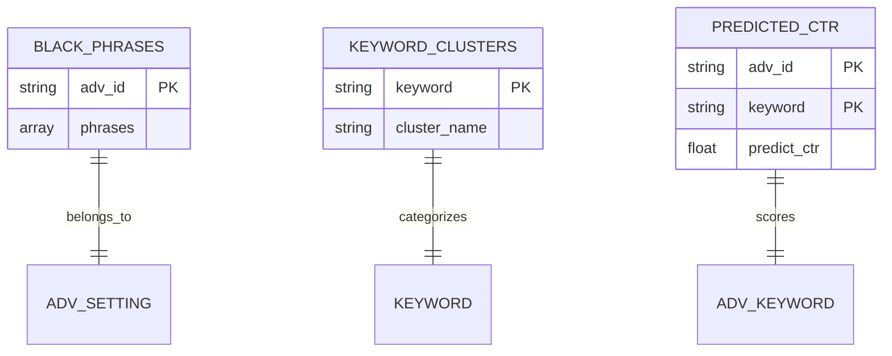
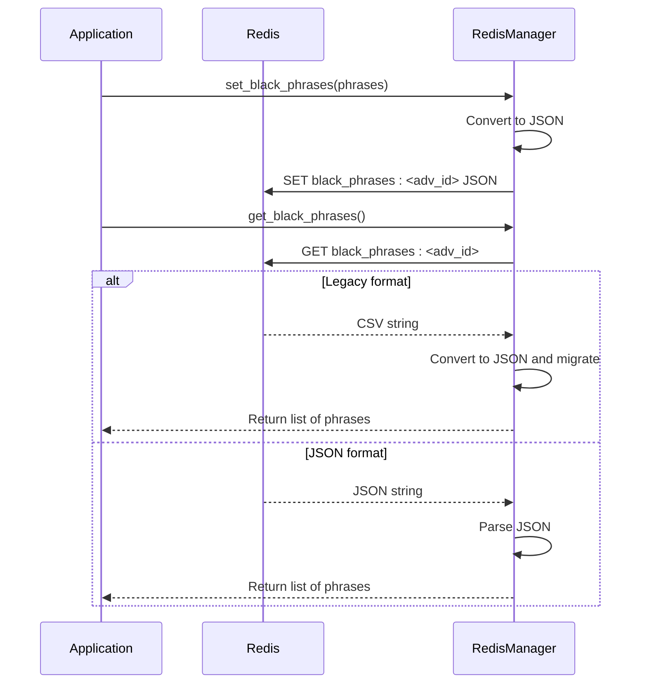
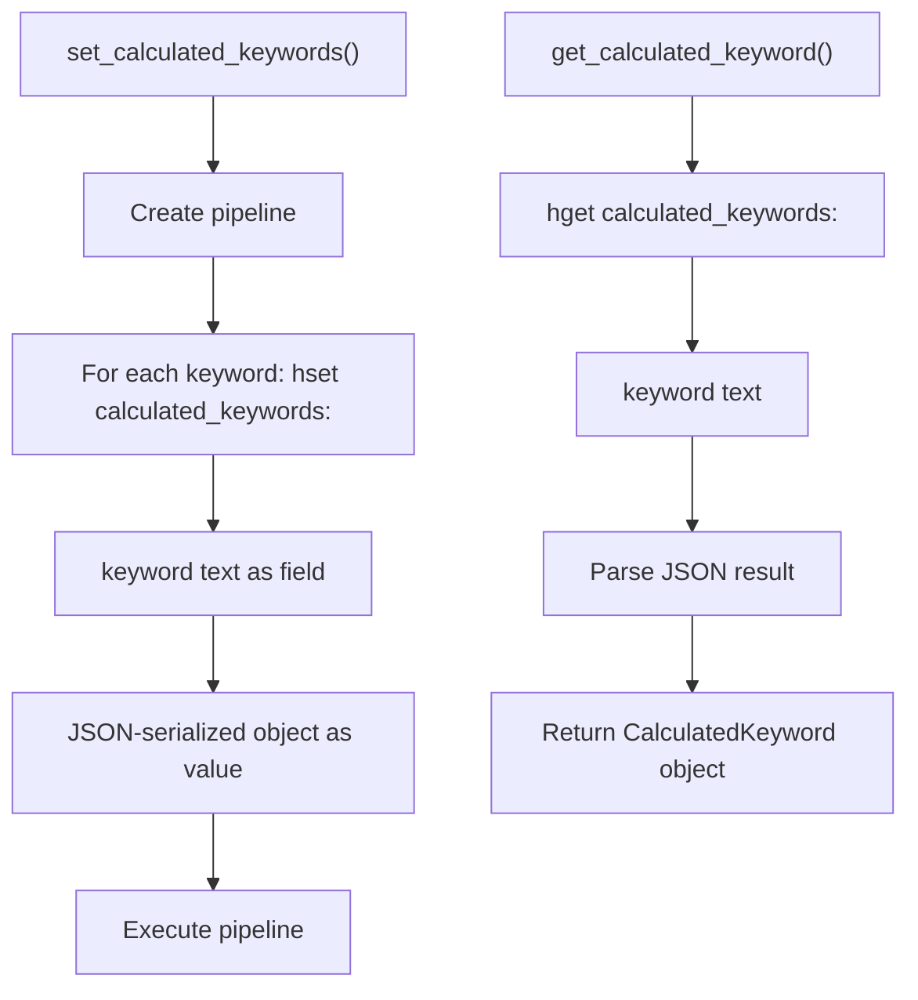
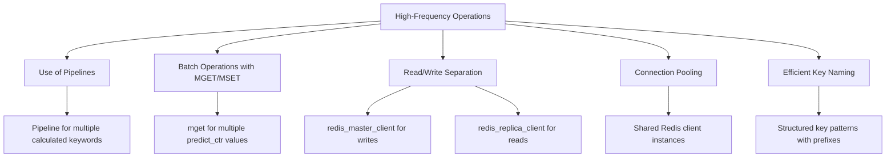

# Redis Data Structures

<cite>
**Referenced Files in This Document**   
- [redis_cache_base.py](file://app/core/redis_cache/redis_cache_base.py)
- [base_redis_manager.py](file://app/core/redis_manager/base_redis_manager.py)
- [redis_client.py](file://app/core/redis_manager/redis_client.py)
- [adv_setting_redis_cache.py](file://app/core/redis_cache/mixins/main_objects_mixins/adv_setting_redis_cache.py)
- [pass_time_redis_cache_base.py](file://app/core/redis_cache/mixins/data_types/pass_time_redis_cache_base.py)
- [redis_manager.py](file://app/modules/relevant_phrase_manager/redis_manager/redis_manager.py)
- [redis_manager.py](file://app/modules/calculated_keywords_redis_cache_manager/redis_manager.py)
- [__init__.py](file://app/utils/redis_manager/__init__.py)
</cite>

## Table of Contents
1. [Introduction](#introduction)
2. [Core Redis Architecture](#core-redis-architecture)
3. [Data Structure Patterns](#data-structure-patterns)
4. [TTL-Based Expiration Strategies](#ttl-based-expiration-strategies)
5. [Structured Data Formats](#structured-data-formats)
6. [Module-Specific Implementations](#module-specific-implementations)
7. [Performance Considerations](#performance-considerations)
8. [Connection Management](#connection-management)
9. [Conclusion](#conclusion)

## Introduction
The adv-bot system utilizes Redis as a primary caching layer for high-frequency data access and temporary storage. This document details the Redis data structures, patterns, and strategies implemented across the system for managing user session states, advertising settings, keyword relevance scores, and calculated bidding parameters. The architecture emphasizes efficient data retrieval, proper expiration management, and structured data organization using Redis' native data types.

## Core Redis Architecture



**Diagram sources**
- [redis_cache_base.py](file://app/core/redis_cache/redis_cache_base.py#L0-L35)
- [base_redis_manager.py](file://app/core/redis_manager/base_redis_manager.py#L0-L24)
- [redis_client.py](file://app/core/redis_manager/redis_client.py#L0-L11)

**Section sources**
- [redis_cache_base.py](file://app/core/redis_cache/redis_cache_base.py#L0-L35)
- [base_redis_manager.py](file://app/core/redis_manager/base_redis_manager.py#L0-L24)
- [redis_client.py](file://app/core/redis_manager/redis_client.py#L0-L11)

## Data Structure Patterns

The system implements various Redis data structure patterns for different use cases:

### Hash-Based Storage
For calculated keyword data, the system uses Redis hashes to store multiple fields per advertising campaign:



**Diagram sources**
- [redis_manager.py](file://app/modules/calculated_keywords_redis_cache_manager/redis_manager.py#L0-L63)

### String-Based Key-Value Storage
For simple key-value pairs like token rights and user activity timestamps:



**Diagram sources**
- [__init__.py](file://app/utils/redis_manager/__init__.py#L0-L799)

### JSON-Encoded Objects
For complex objects like full advertising statistics and position data:



**Diagram sources**
- [__init__.py](file://app/utils/redis_manager/__init__.py#L0-L799)

**Section sources**
- [redis_manager.py](file://app/modules/calculated_keywords_redis_cache_manager/redis_manager.py#L0-L63)
- [__init__.py](file://app/utils/redis_manager/__init__.py#L0-L799)

## TTL-Based Expiration Strategies

The system implements TTL-based expiration for temporary data using both explicit expiration times and time-based validation:



**Diagram sources**
- [pass_time_redis_cache_base.py](file://app/core/redis_cache/mixins/data_types/pass_time_redis_cache_base.py#L0-L30)
- [__init__.py](file://app/utils/redis_manager/__init__.py#L0-L799)

The system uses TTL expiration for:
- Token rights (set with ex=timeout parameter)
- 24-hour check flags (ex=60*60*24)
- Cache entries with configurable timeout parameters
- Rate-limiting counters and temporary flags

**Section sources**
- [pass_time_redis_cache_base.py](file://app/core/redis_cache/mixins/data_types/pass_time_redis_cache_base.py#L0-L30)
- [__init__.py](file://app/utils/redis_manager/__init__.py#L0-L799)

## Structured Data Formats

### Hashes for Campaign Data
The system uses Redis hashes to store calculated keywords by advertising campaign:



**Diagram sources**
- [redis_manager.py](file://app/modules/calculated_keywords_redis_cache_manager/redis_manager.py#L0-L63)

### Sets and Sorted Sets
For managing user preferences and campaign states, the system uses various Redis data structures:



**Diagram sources**
- [redis_manager.py](file://app/modules/relevant_phrase_manager/redis_manager/redis_manager.py#L0-L56)
- [__init__.py](file://app/utils/redis_manager/__init__.py#L0-L799)

**Section sources**
- [redis_manager.py](file://app/modules/relevant_phrase_manager/redis_manager/redis_manager.py#L0-L56)
- [redis_manager.py](file://app/modules/calculated_keywords_redis_cache_manager/redis_manager.py#L0-L63)
- [__init__.py](file://app/utils/redis_manager/__init__.py#L0-L799)

## Module-Specific Implementations

### Relevant Phrase Manager
The relevant_phrase_manager module implements Redis storage for blacklisted phrases:



**Diagram sources**
- [redis_manager.py](file://app/modules/relevant_phrase_manager/redis_manager/redis_manager.py#L0-L56)

### Calculated Keywords Redis Cache Manager
The calculated_keywords_redis_cache_manager uses Redis hashes for efficient storage:



**Diagram sources**
- [redis_manager.py](file://app/modules/calculated_keywords_redis_cache_manager/redis_manager.py#L0-L63)

**Section sources**
- [redis_manager.py](file://app/modules/relevant_phrase_manager/redis_manager/redis_manager.py#L0-L56)
- [redis_manager.py](file://app/modules/calculated_keywords_redis_cache_manager/redis_manager.py#L0-L63)

## Performance Considerations

The system implements several performance optimization techniques for high-frequency read/write operations:



Memory optimization techniques include:
- Using compact data representations
- Proper TTL settings to prevent memory bloat
- Efficient serialization formats
- Regular cleanup of expired data

The system also implements read/write separation using different Redis clients for master and replica instances, improving performance and reliability.

**Section sources**
- [__init__.py](file://app/utils/redis_manager/__init__.py#L0-L799)
- [redis_manager.py](file://app/modules/calculated_keywords_redis_cache_manager/redis_manager.py#L0-L63)

## Connection Management

The Redis client implementation includes failover handling and connection pooling strategies:

```mermaid
classDiagram
class RedisClient {
+redis_client : Redis
+redis_host : str
}
class BaseRedis {
+_client : Redis
+client : Redis
}
class RedisEvent {
+key : str
+set()
+clear()
+wait()
+is_set()
}
RedisClient --> BaseRedis : provides client
RedisEvent --> RedisClient : uses for synchronization
BaseRedis --> RedisEvent : extends functionality
note right of RedisClient
Centralized Redis client configuration
Environment-based host setting
Shared connection pool
end
note right of RedisEvent
Redis-backed event implementation
Uses Redis keys for synchronization
Supports distributed coordination
end
```

**Diagram sources**
- [redis_client.py](file://app/core/redis_manager/redis_client.py#L0-L11)
- [base_redis_manager.py](file://app/core/redis_manager/base_redis_manager.py#L0-L24)
- [__init__.py](file://app/utils/redis_manager/__init__.py#L0-L799)

The system uses:
- A centralized Redis client with environment-based configuration
- Connection pooling through the Redis async client
- Master/replica separation for read/write operations
- Redis-backed events for distributed synchronization
- Exception handling and retry mechanisms

**Section sources**
- [redis_client.py](file://app/core/redis_manager/redis_client.py#L0-L11)
- [base_redis_manager.py](file://app/core/redis_manager/base_redis_manager.py#L0-L24)
- [__init__.py](file://app/utils/redis_manager/__init__.py#L0-L799)

## Conclusion
The adv-bot system implements a comprehensive Redis caching strategy using various data structures and patterns to optimize performance and data management. The architecture leverages Redis hashes for structured data storage, implements TTL-based expiration for temporary data, and uses efficient serialization formats for complex objects. Module-specific implementations like the relevant_phrase_manager and calculated_keywords_redis_cache_manager demonstrate tailored approaches to specific use cases. Performance optimizations include pipeline usage, batch operations, and read/write separation, while the connection management system ensures reliability through proper client configuration and failover handling.