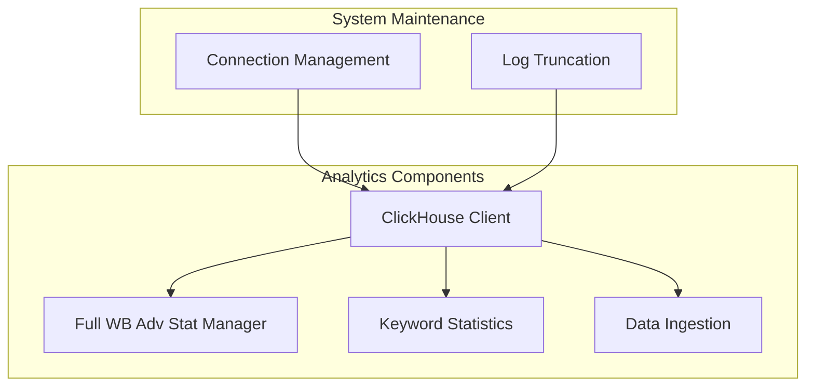
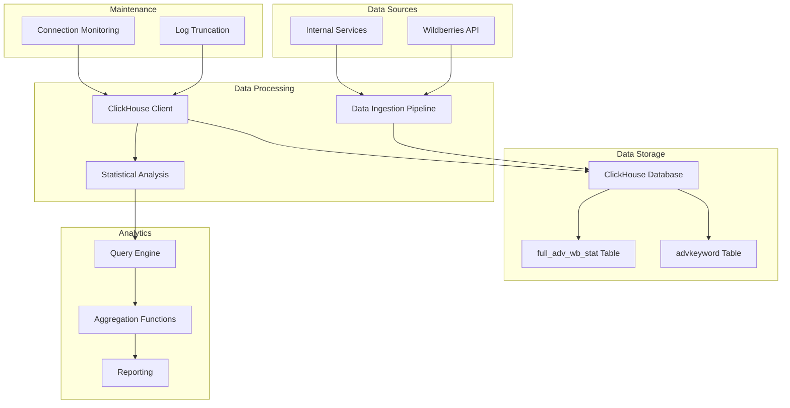
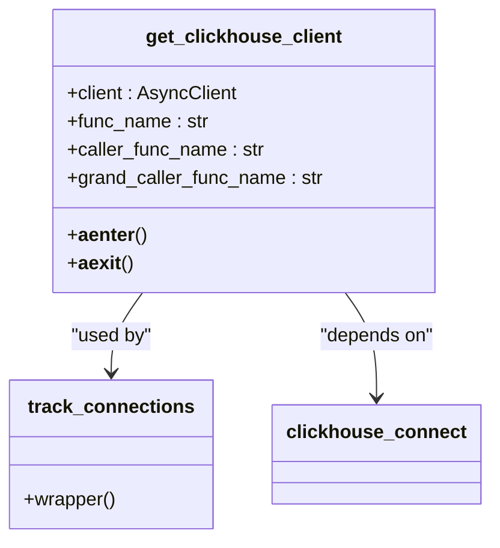
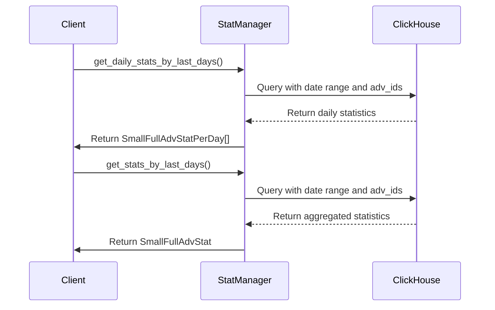
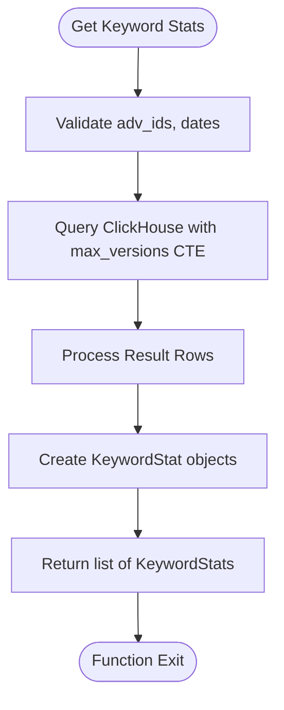
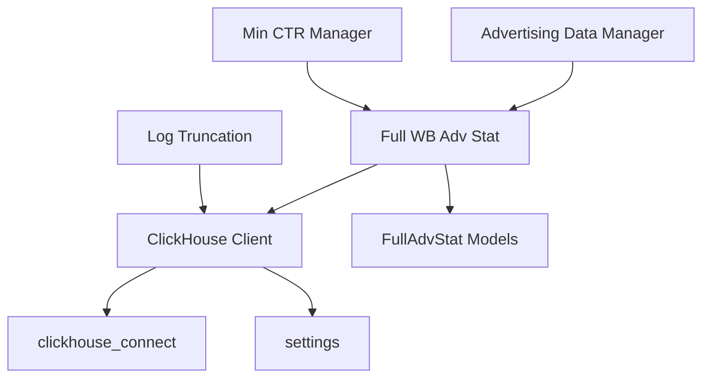
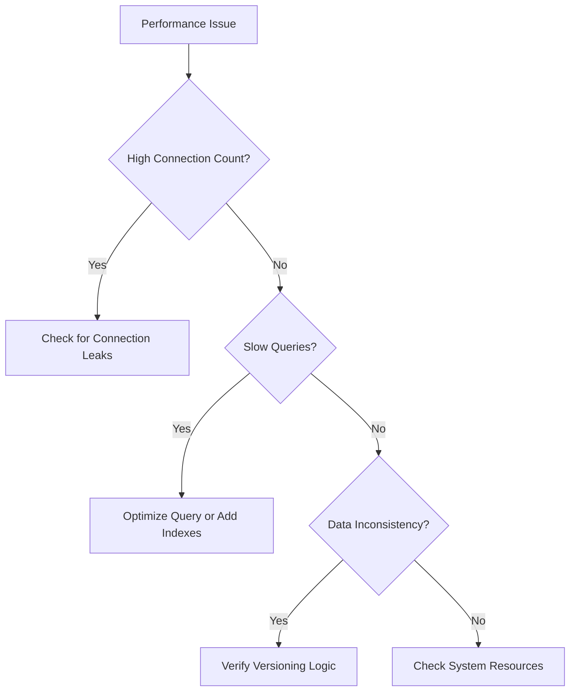

# ClickHouse Analytics Schema

<cite>
**Referenced Files in This Document**   
- [client.py](file://app/utils/click_house/client.py)
- [full_wb_adv_stat.py](file://app/modules/shop_runner/wb_stat_manager/clickhouse_manager/full_wb_adv_stat.py)
- [trunc_system_log_in_clickhouse.py](file://trunc_system_log_in_clickhouse.py)
- [settings_master.py](file://app/settings/settings_master.py)
</cite>

## Table of Contents
1. [Introduction](#introduction)
2. [Project Structure](#project-structure)
3. [Core Components](#core-components)
4. [Architecture Overview](#architecture-overview)
5. [Detailed Component Analysis](#detailed-component-analysis)
6. [Dependency Analysis](#dependency-analysis)
7. [Performance Considerations](#performance-considerations)
8. [Troubleshooting Guide](#troubleshooting-guide)
9. [Conclusion](#conclusion)

## Introduction
This document provides comprehensive documentation for the ClickHouse schema used in the adv-bot system for analytics and performance reporting. The system captures advertising statistics, keyword positions, and sales data from Wildberries API and internal services. The schema is designed for high-performance analytical queries with columnar storage, date-based partitioning, and optimized indexing for high-cardinality dimensions. This documentation covers table structures, data ingestion pipelines, analytical query patterns, performance optimization strategies, and maintenance procedures.

## Project Structure
The ClickHouse integration is implemented across several components in the adv-bot system. The core functionality is organized in a modular structure with dedicated modules for data management, statistical analysis, and system maintenance. The primary components are located in the `app/modules/shop_runner/wb_stat_manager/clickhouse_manager` directory for analytics processing and the `app/utils/click_house` directory for database connectivity.

**Diagram sources**
- [client.py](file://app/utils/click_house/client.py)
- [full_wb_adv_stat.py](file://app/modules/shop_runner/wb_stat_manager/clickhouse_manager/full_wb_adv_stat.py)

**Section sources**
- [client.py](file://app/utils/click_house/client.py)
- [full_wb_adv_stat.py](file://app/modules/shop_runner/wb_stat_manager/clickhouse_manager/full_wb_adv_stat.py)

## Core Components
The ClickHouse analytics system consists of several core components that handle data connectivity, statistical analysis, and system maintenance. The primary components include the ClickHouse client for database connectivity, the full_wb_adv_stat module for advertising performance analytics, and the log truncation utility for system maintenance. These components work together to ingest, store, analyze, and maintain advertising performance data from the Wildberries platform.

**Section sources**
- [client.py](file://app/utils/click_house/client.py#L1-L223)
- [full_wb_adv_stat.py](file://app/modules/shop_runner/wb_stat_manager/clickhouse_manager/full_wb_adv_stat.py#L1-L359)

## Architecture Overview
The ClickHouse analytics architecture follows a layered approach with clear separation between data access, business logic, and system maintenance. The system connects to ClickHouse using an asynchronous client that manages connection pooling and monitoring. Data is ingested from Wildberries API and internal services, processed for analytics, and stored in optimized columnar tables. Analytical queries are executed through dedicated functions that aggregate data across time periods and dimensions.

**Diagram sources**
- [client.py](file://app/utils/click_house/client.py#L1-L223)
- [full_wb_adv_stat.py](file://app/modules/shop_runner/wb_stat_manager/clickhouse_manager/full_wb_adv_stat.py#L1-L359)

## Detailed Component Analysis

### ClickHouse Client Analysis
The ClickHouse client implementation provides asynchronous connectivity to the ClickHouse database with connection pooling and monitoring capabilities. The client uses the clickhouse_connect library to establish connections and manages connection lifecycle through context managers. It includes comprehensive monitoring of connection usage across different function calls and processes.

**Diagram sources**
- [client.py](file://app/utils/click_house/client.py#L1-L223)

**Section sources**
- [client.py](file://app/utils/click_house/client.py#L1-L223)

### Advertising Statistics Analysis
The advertising statistics component provides functions for retrieving and aggregating advertising performance data from ClickHouse. It implements versioned data retrieval to handle updates and ensure data consistency. The component supports both daily and aggregated statistics across multiple advertising campaigns.

**Diagram sources**
- [full_wb_adv_stat.py](file://app/modules/shop_runner/wb_stat_manager/clickhouse_manager/full_wb_adv_stat.py#L1-L359)

**Section sources**
- [full_wb_adv_stat.py](file://app/modules/shop_runner/wb_stat_manager/clickhouse_manager/full_wb_adv_stat.py#L1-L359)

### Keyword Statistics Analysis
The keyword statistics component provides functionality for analyzing spending and performance by keyword. It implements queries that aggregate data across multiple advertising campaigns and time periods, with support for versioned data to ensure consistency. The component includes functions for retrieving total spending by keywords and detailed statistics for individual keywords.

**Diagram sources**
- [full_wb_adv_stat.py](file://app/modules/shop_runner/wb_stat_manager/clickhouse_manager/full_wb_adv_stat.py#L300-L359)

**Section sources**
- [full_wb_adv_stat.py](file://app/modules/shop_runner/wb_stat_manager/clickhouse_manager/full_wb_adv_stat.py#L300-L359)

## Dependency Analysis
The ClickHouse analytics components have dependencies on several external and internal modules. The primary dependencies include the clickhouse_connect library for database connectivity, the settings module for configuration, and various data model classes for type definitions. The components are designed with loose coupling to facilitate testing and maintenance.

**Diagram sources**
- [client.py](file://app/utils/click_house/client.py#L1-L223)
- [full_wb_adv_stat.py](file://app/modules/shop_runner/wb_stat_manager/clickhouse_manager/full_wb_adv_stat.py#L1-L359)

**Section sources**
- [client.py](file://app/utils/click_house/client.py#L1-L223)
- [full_wb_adv_stat.py](file://app/modules/shop_runner/wb_stat_manager/clickhouse_manager/full_wb_adv_stat.py#L1-L359)
- [settings_master.py](file://app/settings/settings_master.py#L89-L158)

## Performance Considerations
The ClickHouse implementation includes several performance optimization strategies. The system uses asynchronous queries to maximize throughput and implements connection pooling to reduce connection overhead. Data is stored in a columnar format with date-based partitioning to optimize query performance for time-series analysis. The queries use Common Table Expressions (CTEs) with window functions to efficiently handle versioned data and ensure consistency.

The system also implements connection monitoring and limiting through the CH_MAX_THREAD setting, which controls the maximum number of concurrent connections. This helps prevent resource exhaustion and ensures stable performance under load. The data ingestion process uses batched inserts with versioning to support efficient upsert operations without requiring complex merge trees.

**Section sources**
- [client.py](file://app/utils/click_house/client.py#L61)
- [settings_master.py](file://app/settings/settings_master.py#L155-L158)

## Troubleshooting Guide
The system includes several mechanisms for troubleshooting and maintenance. The log truncation script provides a way to manage system log growth in ClickHouse by periodically truncating system tables. Connection monitoring is implemented to track connection usage across different functions and processes, which can help identify connection leaks.

When experiencing performance issues, check the connection count and ensure it stays within the configured limits. Monitor query execution times and consider optimizing queries by adding appropriate indexes or adjusting the data model. For data consistency issues, verify that the versioning mechanism is working correctly and that queries are using the latest version of each record.

**Section sources**
- [trunc_system_log_in_clickhouse.py](file://trunc_system_log_in_clickhouse.py#L1-L44)
- [client.py](file://app/utils/click_house/client.py#L1-L223)

## Conclusion
The ClickHouse analytics schema in the adv-bot system provides a robust foundation for advertising performance analysis. The implementation leverages ClickHouse's strengths in columnar storage, time-series analysis, and high-performance querying to deliver insights from Wildberries advertising data. The architecture is well-structured with clear separation of concerns, making it maintainable and extensible. Future enhancements could include additional aggregation tables, improved indexing strategies, and more sophisticated analytical functions to support advanced reporting requirements.