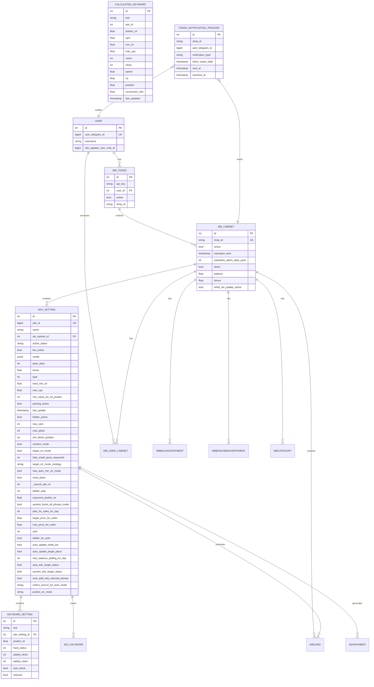
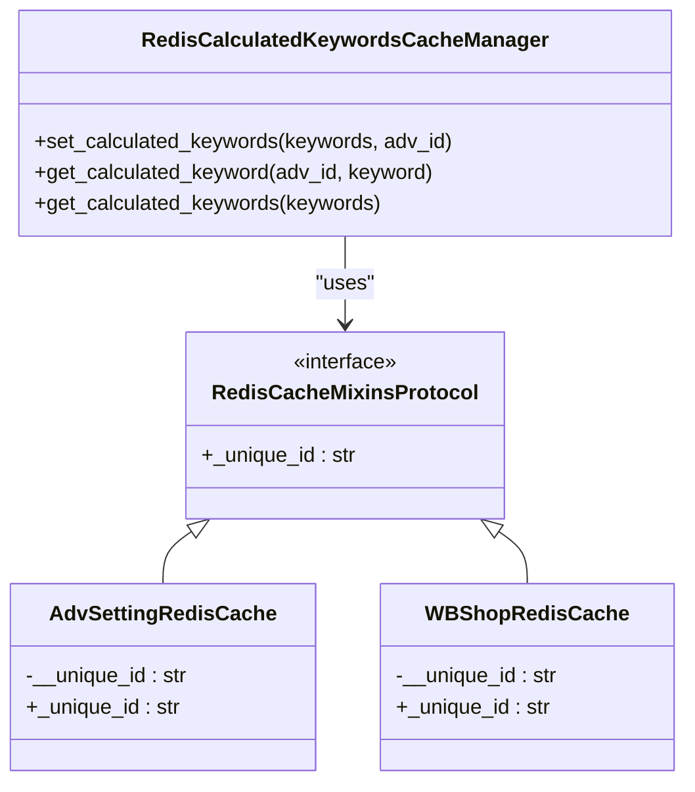
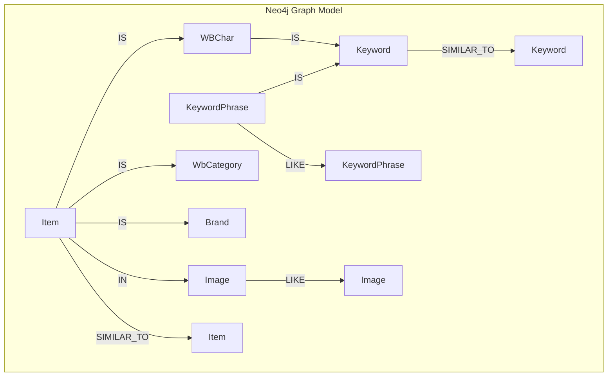
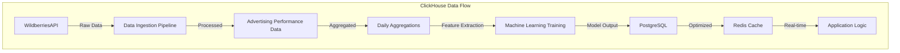

# Database Schema Design

<cite>
**Referenced Files in This Document**   
- [models.py](file://app/modules/common_slaves/wildberries/models/models.py)
- [wb_cabinet.py](file://app/modules/common_slaves/wildberries/models/wb_cabinet.py)
- [adv_setting_redis_cache.py](file://app/core/redis_cache/mixins/main_objects_mixins/adv_setting_redis_cache.py)
- [wb_shop_redis_cache.py](file://app/core/redis_cache/mixins/main_objects_mixins/wb_shop_redis_cache.py)
- [redis_manager.py](file://app/modules/calculated_keywords_redis_cache_manager/redis_manager.py)
- [driver.py](file://app/utils/NeoDataScience/driver.py)
- [client.py](file://app/utils/click_house/client.py)
- [models.py](file://app/modules/token_monitoring/models.py)
- [base.py](file://app/utils/db/base.py)
- [assoc_tables.py](file://app/utils/db/assoc_tables.py)
</cite>

## Table of Contents
1. [Introduction](#introduction)
2. [PostgreSQL Schema](#postgresql-schema)
3. [Redis Data Structures](#redis-data-structures)
4. [Neo4j Graph Model](#neo4j-graph-model)
5. [ClickHouse Analytics Schema](#clickhouse-analytics-schema)
6. [Data Access Patterns](#data-access-patterns)
7. [Caching Strategies](#caching-strategies)
8. [Performance Considerations](#performance-considerations)
9. [Data Lifecycle and Retention](#data-lifecycle-and-retention)
10. [Conclusion](#conclusion)

## Introduction
The adv-bot system implements a multi-database architecture to support its advertising optimization functionality for Wildberries marketplace. This document details the comprehensive data model across PostgreSQL, Redis, Neo4j, and ClickHouse database systems. The PostgreSQL database serves as the primary data store for application entities and relationships, Redis provides low-latency caching and state management, Neo4j models complex keyword relationships through graph analytics, and ClickHouse enables high-performance analytics on advertising data. This multi-faceted approach allows the system to efficiently manage advertising campaigns, optimize keyword performance, and provide real-time insights to users.

## PostgreSQL Schema

The PostgreSQL schema forms the core data persistence layer for the adv-bot system, storing all primary application entities and their relationships. The schema is managed through Alembic migrations and follows a relational model with proper normalization, foreign key constraints, and indexing strategies.



**Diagram sources**
- [models.py](file://app/modules/common_slaves/wildberries/models/models.py)
- [wb_cabinet.py](file://app/modules/common_slaves/wildberries/models/wb_cabinet.py)
- [models.py](file://app/modules/token_monitoring/models.py)

**Section sources**
- [models.py](file://app/modules/common_slaves/wildberries/models/models.py#L44-L718)
- [wb_cabinet.py](file://app/modules/common_slaves/wildberries/models/wb_cabinet.py#L1-L83)
- [models.py](file://app/modules/token_monitoring/models.py#L1-L80)

### AdvSetting Entity
The AdvSetting entity represents an advertising campaign configuration in the Wildberries marketplace. Each AdvSetting record contains comprehensive configuration parameters for campaign optimization, including bidding strategies, targeting rules, and performance thresholds. The entity maintains relationships with associated keywords, product cards, and payment records.

**Field Definitions:**
- `adv_id`: Unique identifier for the Wildberries advertising campaign (nullable for draft campaigns)
- `name`: Campaign name with embedded metadata in special markup format
- `wb_cabinet_id`: Foreign key to the associated Wildberries cabinet
- `bot_active`: Flag indicating whether the optimization bot is active for this campaign
- `hard_min_ctr`: Minimum CTR threshold for keyword optimization
- `max_cpc`: Maximum cost-per-click bid limit
- `max_cpm`: Maximum cost-per-thousand impressions limit
- `max_place`: Target advertising position
- `clusters_mode`: Flag enabling cluster-based bidding strategy
- `target_ctr_mode`: Flag enabling CTR-based bidding strategy
- `auto_update_white_list`: Flag enabling automatic white list updates
- `auto_update_target_place`: Flag enabling automatic position optimization
- `predict_ctr_mode`: Enum indicating CTR prediction model version (V1 or V2)

### WBCabinet Entity
The WBCabinet entity represents a Wildberries seller cabinet, which serves as a container for multiple advertising campaigns and product listings. Each cabinet is associated with a specific shop identified by its shop_id. The entity tracks financial metrics including balance and bonus funds, as well as subscription status and expiration information.

**Field Definitions:**
- `shop_id`: Unique identifier for the Wildberries shop (unique constraint)
- `active`: Flag indicating whether the cabinet is active
- `expiration_time`: Timestamp when the cabinet subscription expires
- `expiration_alarm_days_pass`: Number of days before expiration to trigger notifications
- `demo`: Flag indicating whether this is a demonstration cabinet
- `balance`: Current advertising balance
- `bonus`: Current bonus funds
- `white_list_update_active`: Flag indicating whether automatic white list updates are enabled

### WBToken Entity
The WBToken entity stores API authentication tokens for accessing Wildberries seller accounts. Each token is associated with a specific user and may be linked to a particular shop. The token model includes methods for validating token integrity and extracting metadata from JWT payloads.

**Field Definitions:**
- `api_key`: JWT token string for Wildberries API authentication
- `user_id`: Foreign key to the associated user
- `active`: Flag indicating whether the token is currently active
- `shop_id`: Optional identifier for the specific shop this token controls

### CalculatedKeyword Entity
The CalculatedKeyword entity stores computed performance metrics for keywords in advertising campaigns. These calculations are derived from raw advertising data and include predicted CTR, optimal bidding parameters, and historical performance statistics. The entity supports the system's machine learning optimization algorithms.

**Field Definitions:**
- `text`: Keyword text being analyzed
- `adv_id`: Advertising campaign ID associated with this keyword
- `predict_ctr`: Machine learning predicted click-through rate
- `cpm`: Recommended cost-per-thousand impressions
- `min_ctr`: Minimum acceptable CTR threshold
- `max_cpc`: Maximum recommended cost-per-click
- `views`: Historical view count
- `clicks`: Historical click count
- `spend`: Historical advertising spend
- `ctr`: Historical click-through rate
- `position`: Average advertising position
- `conversion_rate`: Conversion rate from click to purchase
- `last_updated`: Timestamp of last calculation update

### TokenStatusReport Entity
The TokenNotificationTracker entity provides a comprehensive audit trail for token status monitoring and notifications. It prevents duplicate notifications while maintaining a complete history of token-related alerts and their resolution status.

**Field Definitions:**
- `shop_id`: Identifier of the Wildberries shop associated with the token
- `user_telegram_id`: Telegram user ID receiving the notification
- `notification_type`: Enum indicating the type of notification (TOKEN_DEACTIVATED, TOKEN_EXPIRING_14_DAYS, etc.)
- `token_expiry_date`: Expected token expiration date (nullable for deactivation notifications)
- `sent_at`: Timestamp when the notification was sent
- `resolved_at`: Timestamp when the token issue was resolved (nullable until resolved)

## Redis Data Structures

Redis serves as the primary caching and state management layer in the adv-bot system, providing low-latency access to frequently used data and supporting real-time operations. The system implements a structured approach to Redis key organization with dedicated data structures for different use cases.



**Diagram sources**
- [adv_setting_redis_cache.py](file://app/core/redis_cache/mixins/main_objects_mixins/adv_setting_redis_cache.py#L1-L14)
- [wb_shop_redis_cache.py](file://app/core/redis_cache/mixins/main_objects_mixins/wb_shop_redis_cache.py#L1-L13)
- [redis_manager.py](file://app/modules/calculated_keywords_redis_cache_manager/redis_manager.py#L1-L62)

**Section sources**
- [adv_setting_redis_cache.py](file://app/core/redis_cache/mixins/main_objects_mixins/adv_setting_redis_cache.py#L1-L14)
- [wb_shop_redis_cache.py](file://app/core/redis_cache/mixins/main_objects_mixins/wb_shop_redis_cache.py#L1-L13)
- [redis_manager.py](file://app/modules/calculated_keywords_redis_cache_manager/redis_manager.py#L1-L62)

### AdvSettingRedisCache Structure
The AdvSettingRedisCache implements a mixin pattern for caching advertising campaign settings in Redis. Each AdvSetting instance is cached using a unique identifier derived from its adv_id, enabling fast retrieval of campaign configurations without database queries.

**Key Pattern:** `adv_setting:{adv_id}`
**Data Structure:** Hash or JSON serialization of AdvSetting model
**TTL:** Configurable based on update frequency and consistency requirements
**Access Pattern:** Read-heavy with periodic updates during campaign optimization cycles

### WBShopRedisCache Structure
The WBShopRedisCache provides caching for Wildberries shop information, using the shop_id as the primary key identifier. This cache layer reduces API calls to Wildberries services by maintaining local copies of shop metadata and configuration.

**Key Pattern:** `wb_shop:{shop_id}`
**Data Structure:** Hash or JSON serialization of shop metadata
**TTL:** Shorter duration than AdvSetting cache to ensure freshness of shop status
**Access Pattern:** Frequent reads during user interactions and campaign management operations

### CalculatedKeyword Redis Cache
The calculated keyword cache stores pre-computed keyword performance metrics in Redis for rapid access during bidding decisions and user interface rendering. The implementation uses a hash structure within Redis to store multiple keywords per advertising campaign.

**Key Pattern:** `calculated_keywords:{adv_id}`
**Data Structure:** Redis Hash with keyword text as field name and JSON-serialized CalculatedKeyword as value
**Operations:**
- `set_calculated_keywords`: Bulk insert of calculated keywords for an advertising campaign
- `get_calculated_keyword`: Retrieve a single keyword's calculated metrics
- `get_calculated_keywords`: Bulk retrieval of multiple keywords' calculated metrics

**Performance Characteristics:**
- Pipeline operations for bulk operations to minimize network round trips
- JSON serialization for complex object storage
- Automatic cache invalidation through application logic when underlying data changes

## Neo4j Graph Model

The Neo4j graph database models complex relationships between keywords, products, and categories in the Wildberries marketplace. This graph-based approach enables sophisticated recommendation algorithms and semantic analysis of keyword relationships through vector similarity calculations.



**Diagram sources**
- [driver.py](file://app/utils/NeoDataScience/driver.py#L1-L710)

**Section sources**
- [driver.py](file://app/utils/NeoDataScience/driver.py#L1-L710)

### Node Types
- **Item**: Represents a Wildberries product (NMID)
- **Image**: Represents product images with visual features (dhash, vgg19 vectors)
- **Keyword**: Represents individual words or terms
- **KeywordPhrase**: Represents complete search phrases
- **WBChar**: Represents product characteristics
- **Brand**: Represents product brands
- **WbCategory**: Represents product categories

### Relationship Types
- **IS**: Connects items to their attributes (category, brand, characteristics)
- **IN**: Connects items to their images
- **LIKE**: Represents similarity between images or keyword phrases based on vector distance
- **SIMILAR_TO**: Represents semantic similarity between items or keywords

### Graph Algorithms
The system implements several graph algorithms for recommendation and optimization:

**k-Nearest Neighbors (kNN):**
- Applied to image vectors (vgg19) to find visually similar products
- Applied to keyword vectors (word2vec) to find semantically similar search terms
- Uses cosine similarity as the distance metric

**Fast Random Projection (FastRP):**
- Generates embedding vectors for all nodes in the graph
- Used for dimensionality reduction and feature extraction
- Enables efficient similarity calculations across heterogeneous node types

**Vector Synchronization:**
- Periodic synchronization of vectors between Neo4j and Redis
- Items and keywords with updated vectors are pushed to Redis for real-time access
- Implements a background process to maintain cache consistency

## ClickHouse Analytics Schema

ClickHouse serves as the analytics database for the adv-bot system, storing high-volume advertising performance data for historical analysis and machine learning training. The schema is optimized for fast aggregation queries on time-series data.



**Diagram sources**
- [client.py](file://app/utils/click_house/client.py#L1-L223)

**Section sources**
- [client.py](file://app/utils/click_house/client.py#L1-L223)

### Data Ingestion
The system uses a connection pooling strategy with connection counting and logging to manage ClickHouse client connections efficiently. The implementation includes:

- **Connection Pooling**: Utilizes urllib3 PoolManager with configurable pool size
- **Multiprocessing Support**: Uses multiprocessing.Manager for shared state in Linux environments
- **Connection Tracking**: Monitors total connections and per-function connection counts
- **Resource Management**: Implements async context manager for proper connection cleanup

### Query Patterns
The ClickHouse client provides a decorator-based approach for connection management:

```python
@track_connections
async def query_data(client: AsyncClient, query: str) -> Any:
    result = await client.query(query)
    return result
```

This pattern ensures connections are properly acquired and released, with comprehensive logging for monitoring and debugging.

### Performance Optimization
- **Async Operations**: All database operations are asynchronous to maximize throughput
- **Connection Reuse**: Connection pooling reduces connection establishment overhead
- **Query Optimization**: The system likely implements query optimization techniques for common analytical patterns
- **Data Partitioning**: Time-series data is likely partitioned by date for efficient range queries

## Data Access Patterns

The adv-bot system implements sophisticated data access patterns to optimize performance and ensure data consistency across its multi-database architecture.

### Primary Data Flow
1. **User Interaction**: User requests trigger application logic
2. **Redis Check**: System first checks Redis for cached data
3. **PostgreSQL Fallback**: If data is not in Redis, query PostgreSQL
4. **ClickHouse Analytics**: For historical data and aggregations, query ClickHouse
5. **Neo4j Relationships**: For relationship-based queries, access Neo4j
6. **Cache Update**: Results are written back to Redis for future requests

### Read Patterns
- **Hot Data**: Frequently accessed data (campaign settings, keyword metrics) is cached in Redis
- **Cold Data**: Historical data and infrequently accessed records are stored in PostgreSQL
- **Analytical Queries**: Aggregation and reporting queries target ClickHouse
- **Relationship Queries**: Graph-based queries access Neo4j

### Write Patterns
- **Transactional Data**: Writes to PostgreSQL for data requiring ACID guarantees
- **Cache Invalidation**: Writes to PostgreSQL trigger Redis cache invalidation
- **Analytics Pipeline**: Batch writes to ClickHouse for historical data
- **Graph Updates**: Asynchronous updates to Neo4j for relationship data

## Caching Strategies

The system employs a multi-layered caching strategy to optimize performance across different data access patterns.

### Cache Hierarchy
1. **Redis Cache**: Primary caching layer for frequently accessed data
2. **Application Memory**: Secondary caching for computed results
3. **Database Indexes**: Tertiary optimization through PostgreSQL indexing

### Cache Invalidation
- **Time-based**: TTL policies for cache entries
- **Event-driven**: Database changes trigger cache invalidation
- **Explicit**: Application logic explicitly invalidates stale cache entries

### Cache Warming
- **Startup Initialization**: Critical data is pre-loaded into Redis on application startup
- **Background Refresh**: Periodic background jobs refresh frequently used cache entries
- **Predictive Loading**: Based on usage patterns, the system anticipates and pre-loads data

## Performance Considerations

The multi-database architecture of the adv-bot system addresses performance requirements through specialized database selection and optimization techniques.

### PostgreSQL Optimization
- **Indexing Strategy**: Comprehensive indexing on frequently queried fields
- **Composite Indexes**: Multi-column indexes for common query patterns
- **Partial Indexes**: Indexes with WHERE clauses for filtered queries
- **GIN Indexes**: Text search optimization using trigram operations

### Redis Performance
- **Pipeline Operations**: Bulk operations use Redis pipelines to minimize round trips
- **Efficient Serialization**: JSON serialization balances readability and performance
- **Connection Pooling**: Reuses connections to reduce overhead

### ClickHouse Performance
- **Columnar Storage**: Optimized for analytical queries on large datasets
- **Data Compression**: Efficient storage of high-volume advertising data
- **Parallel Processing**: Leverages multiple CPU cores for query execution

### Neo4j Performance
- **Graph Algorithms**: Built-in algorithms for efficient relationship traversal
- **Vector Indexing**: Fast similarity searches using kNN
- **Projection Caching**: Caches graph projections for repeated algorithm execution

## Data Lifecycle and Retention

The system implements comprehensive data lifecycle management policies across all database systems.

### PostgreSQL Retention
- **Transactional Data**: Retained indefinitely with archival to cold storage
- **Historical Records**: Maintained with soft deletion (active flags) rather than physical deletion
- **Audit Trails**: Notification tracking data retained for compliance and debugging

### ClickHouse Retention
- **Raw Performance Data**: Retained for configurable period (likely 1-2 years)
- **Aggregated Data**: Longer retention for daily and monthly aggregates
- **Automatic Purging**: Old data automatically removed based on retention policies

### Redis Retention
- **Ephemeral Data**: Cache entries have TTL based on data volatility
- **Session Data**: User session data expires after inactivity period
- **Computed Results**: Temporary calculations automatically expire

### Neo4j Retention
- **Graph Projections**: Temporary graphs are dropped after algorithm execution
- **Historical Snapshots**: Periodic snapshots retained for trend analysis
- **Vector Models**: Machine learning embeddings retained as long as relevant

## Conclusion
The adv-bot system's database architecture demonstrates a sophisticated multi-model approach that leverages the strengths of different database technologies for specific use cases. PostgreSQL provides reliable transactional integrity for core application data, Redis enables low-latency access to frequently used information, Neo4j supports complex relationship analysis through graph algorithms, and ClickHouse delivers high-performance analytics on large datasets. This architecture supports the system's requirements for real-time advertising optimization, historical analysis, and machine learning-driven recommendations. The comprehensive data model, caching strategies, and performance optimizations ensure the system can handle the demands of optimizing Wildberries advertising campaigns at scale.