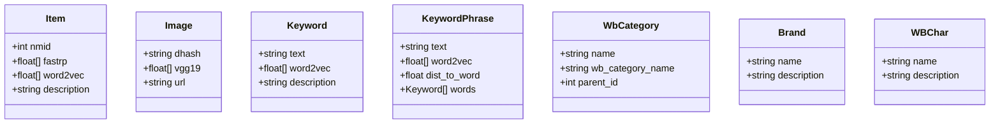
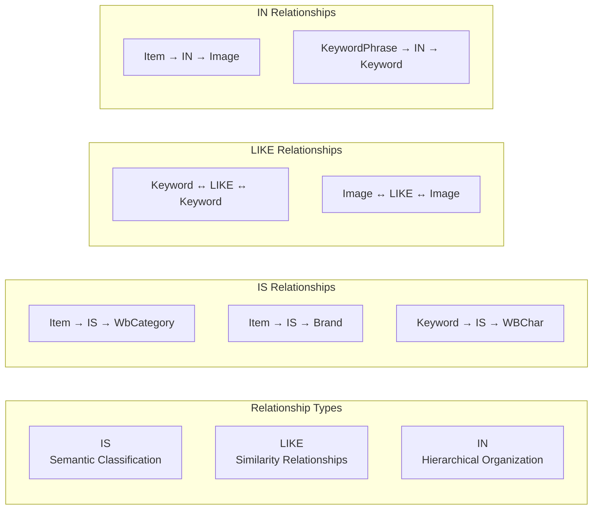
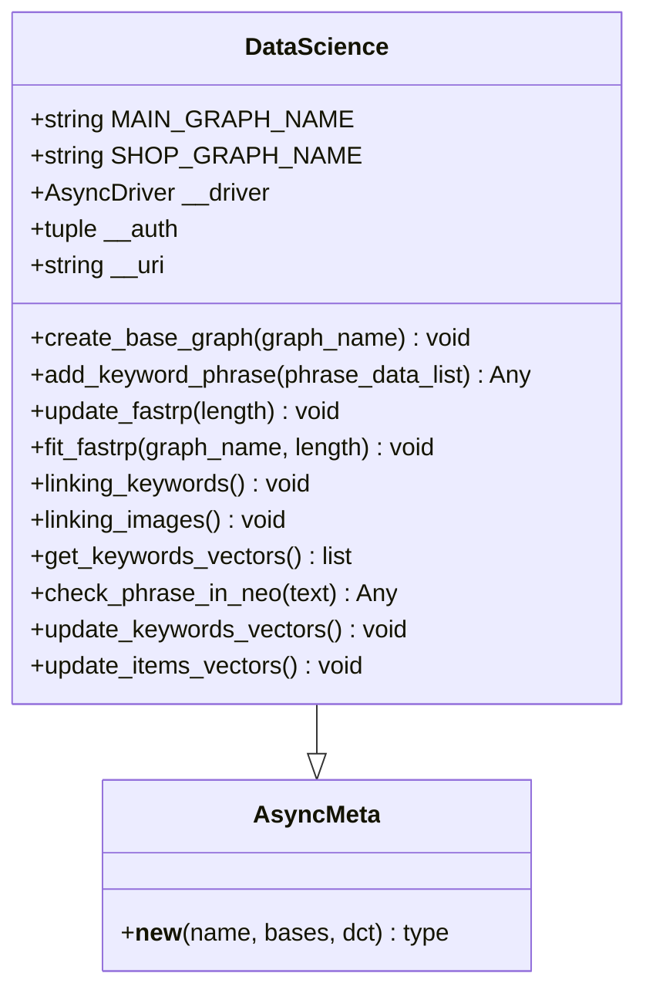
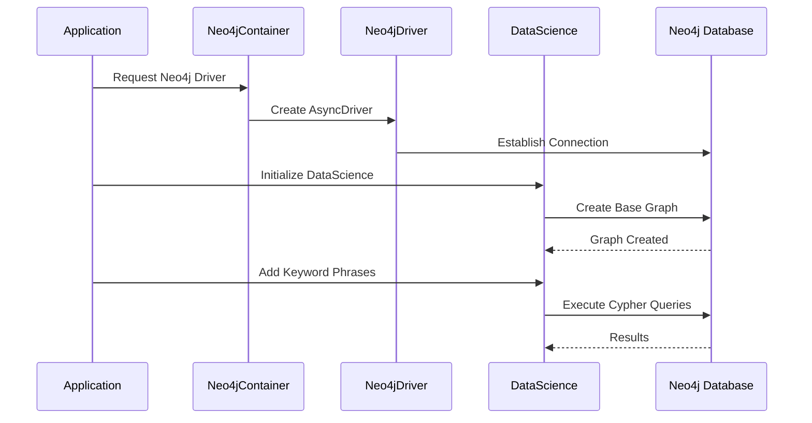
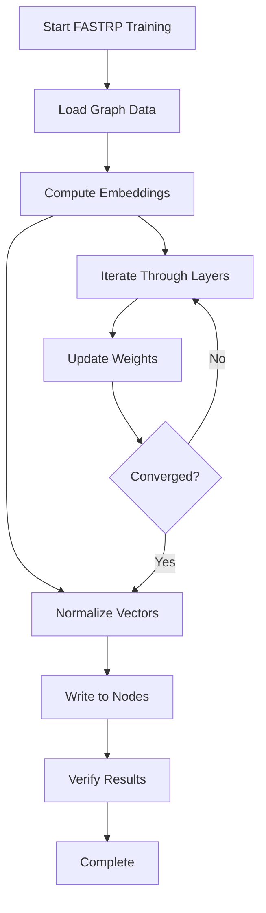

# Neo4j Graph Model Documentation

<cite>
**Referenced Files in This Document**
- [app/utils/NeoDataScience/driver.py](file://app/utils/NeoDataScience/driver.py)
- [app/core/di/containers/neo4j_container.py](file://app/core/di/containers/neo4j_container.py)
- [app/core/di/databases/neo4j.py](file://app/core/di/databases/neo4j.py)
- [app/configs/infrastructure_config/neo4j_config.py](file://app/configs/infrastructure_config/neo4j_config.py)
- [app/modules/wb_adv_updater/update_wb_adv_phrases_in_neo.py](file://app/modules/wb_adv_updater/update_wb_adv_phrases_in_neo.py)
- [app/modules/wb_adv_updater/gds_object.py](file://app/modules/wb_adv_updater/gds_object.py)
- [app/modules/wb_adv_updater/data_manager.py](file://app/modules/wb_adv_updater/data_manager.py)
- [app/modules/common_slaves/wildberries/data_classes/namedtuples.py](file://app/modules/common_slaves/wildberries/data_classes/namedtuples.py)
- [dockers/neo4j/Dockerfile](file://dockers/neo4j/Dockerfile)
</cite>

## Table of Contents
1. [Introduction](#introduction)
2. [Graph Model Architecture](#graph-model-architecture)
3. [Node Types and Properties](#node-types-and-properties)
4. [Relationship Types](#relationship-types)
5. [Neo4j Driver Implementation](#neo4j-driver-implementation)
6. [Integration with Application](#integration-with-application)
7. [Graph Algorithms and Operations](#graph-algorithms-and-operations)
8. [Performance Considerations](#performance-considerations)
9. [Real-World Use Cases](#real-world-use-cases)
10. [Troubleshooting Guide](#troubleshooting-guide)
11. [Conclusion](#conclusion)

## Introduction

The adv-bot system utilizes Neo4j as its primary graph database to represent and analyze relationships between keywords, advertisements, and shops. This graph-based approach enables sophisticated semantic analysis, phrase clustering, and relevance detection for Wildberries advertising campaigns. The Neo4j implementation leverages the Graph Data Science (GDS) library for advanced graph algorithms and machine learning capabilities.

The graph model serves as the foundation for several critical features including keyword recommendation, advertisement targeting, and competitive analysis. By modeling the relationships between different entities as a graph, the system can efficiently traverse connections and perform complex queries that would be difficult to implement with traditional relational databases.

## Graph Model Architecture

The Neo4j graph model in the adv-bot system is designed around three primary graph instances:

```mermaid
graph TB
subgraph "Main Graph Instance"
MAIN[MAIN_GRAPH_NAME = "main"]
SHOP[SHOP_GRAPH_NAME = "shop_graph"]
end
subgraph "Node Types"
ITEM[Item]
IMAGE[Image]
KEYWORD[Keyword]
KEYWORD_PHRASE[KeywordPhrase]
WBCATEGORY[WbCategory]
BRAND[Brand]
WBCAR[WBChar]
end
subgraph "Relationship Types"
IS[IS]
LIKE[LIKE]
IN[IN]
end
MAIN --> ITEM
MAIN --> IMAGE
MAIN --> KEYWORD
MAIN --> KEYWORD_PHRASE
MAIN --> WBCATEGORY
MAIN --> BRAND
MAIN --> WBCAR
ITEM --> IS
IMAGE --> LIKE
KEYWORD --> IS
KEYWORD_PHRASE --> IS
WBCATEGORY --> IS
BRAND --> IS
WBCAR --> IS
```

**Diagram sources**
- [app/utils/NeoDataScience/driver.py](file://app/utils/NeoDataScience/driver.py#L260-L303)

The architecture consists of two main graph instances:
- **Main Graph**: Contains the primary entity relationships for items, images, keywords, and categories
- **Shop Graph**: Dedicated graph for shop-specific relationships and configurations

**Section sources**
- [app/utils/NeoDataScience/driver.py](file://app/utils/NeoDataScience/driver.py#L260-L303)

## Node Types and Properties

### Core Entity Nodes

The graph model defines seven primary node types, each serving specific roles in the advertising ecosystem:



**Diagram sources**
- [app/modules/common_slaves/wildberries/data_classes/namedtuples.py](file://app/modules/common_slaves/wildberries/data_classes/namedtuples.py#L1-L21)

### Node Properties and Indexing Strategy

Each node type maintains specific properties optimized for graph traversal and machine learning operations:

- **Item Nodes**: Store product metadata with FASTRP embeddings for semantic similarity
- **Image Nodes**: Contain VGG19 embeddings for visual similarity analysis
- **Keyword Nodes**: Maintain Word2Vec vectors for semantic relationships
- **KeywordPhrase Nodes**: Combine individual keywords with composite phrase embeddings

The indexing strategy focuses on frequently queried properties:
- Text-based properties for exact match searches
- Vector properties for similarity computations
- Numeric properties for range queries and filtering

**Section sources**
- [app/modules/common_slaves/wildberries/data_classes/namedtuples.py](file://app/modules/common_slaves/wildberries/data_classes/namedtuples.py#L1-L21)

## Relationship Types

The graph model employs three primary relationship types, each serving distinct analytical purposes:



**Diagram sources**
- [app/utils/NeoDataScience/driver.py](file://app/utils/NeoDataScience/driver.py#L260-L303)

### Relationship Properties

Each relationship type includes distance properties for similarity calculations:

- **IS Relationships**: Semantic classification with default distance of 1
- **LIKE Relationships**: Cosine similarity scores between 0 and 1
- **IN Relationships**: Hierarchical containment with configurable distances

The relationships enable complex queries such as:
- Finding semantically related keywords
- Identifying visually similar products
- Traversing category hierarchies

**Section sources**
- [app/utils/NeoDataScience/driver.py](file://app/utils/NeoDataScience/driver.py#L260-L303)

## Neo4j Driver Implementation

The Neo4j driver implementation provides a comprehensive interface for graph operations, built around the DataScience class:



**Diagram sources**
- [app/utils/NeoDataScience/driver.py](file://app/utils/NeoDataScience/driver.py#L45-L110)

### Key Features

The driver implementation includes several advanced features:

#### Graph Lifecycle Management
- Automatic graph creation and deletion
- Existence checking for safe operations
- Resource cleanup and connection management

#### Vector Operations
- FASTRP embedding computation for node properties
- KNN similarity computation for keyword relationships
- Batch vector updates for performance optimization

#### Error Handling
- Retry mechanisms for transient failures
- Transaction isolation and rollback support
- Comprehensive logging for debugging

**Section sources**
- [app/utils/NeoDataScience/driver.py](file://app/utils/NeoDataScience/driver.py#L45-L110)

## Integration with Application

The Neo4j integration follows a dependency injection pattern that ensures clean separation of concerns:



**Diagram sources**
- [app/core/di/containers/neo4j_container.py](file://app/core/di/containers/neo4j_container.py#L1-L29)
- [app/core/di/databases/neo4j.py](file://app/core/di/databases/neo4j.py#L1-L45)

### Configuration Management

The system uses Pydantic-based configuration for secure credential management:

```python
class Neo4jConfig(BaseSettings):
    uri: str = Field(..., description="Neo4j URI")
    name: str = Field(..., description="Neo4j user")
    password: str = Field(..., description="Neo4j password")
    port: int = Field(..., description="Neo4j port")
```

Environment variables handle sensitive configuration:
- NEO4J_URI: Database connection endpoint
- NEO4J_NAME: Authentication username
- NEO4J_PASSWORD: Authentication credentials
- NEO4J_PORT: Network port for connection

**Section sources**
- [app/configs/infrastructure_config/neo4j_config.py](file://app/configs/infrastructure_config/neo4j_config.py#L1-L17)

## Graph Algorithms and Operations

The Neo4j implementation leverages the Graph Data Science library for advanced analytics:

### FASTRP Embedding Computation

FASTRP (Fast Random Projection) computes dense vector representations for nodes:



**Diagram sources**
- [app/utils/NeoDataScience/driver.py](file://app/utils/NeoDataScience/driver.py#L230-L260)

### KNN Similarity Computation

KNN (k-nearest neighbors) identifies similar nodes based on vector similarity:

```python
stream_query = """
    CALL gds.knn.stream(
        $name,
        {
            jobid: 'knn',
            nodeProperties: {word2vec: 'COSINE'}
        }
    )
    YIELD node1, node2, similarity
    MATCH (source) WHERE id(source) = node1
    MATCH (target) WHERE id(target) = node2
    MERGE (source)-[r:LIKE]->(target)
    ON CREATE SET r.dist = similarity
    ON MATCH SET r.dist = similarity
"""
```

### Graph Linking Operations

The system performs automatic graph linking for different entity types:

- **Keyword Linking**: Creates semantic relationships between similar keywords
- **Image Linking**: Establishes visual similarity between product images
- **Category Linking**: Builds hierarchical relationships between product categories

**Section sources**
- [app/utils/NeoDataScience/driver.py](file://app/utils/NeoDataScience/driver.py#L168-L260)

## Performance Considerations

### Large-Scale Graph Traversals

The Neo4j implementation includes several optimizations for handling large datasets:

#### Batch Processing
- Keyword phrase insertion uses batch operations to minimize transaction overhead
- Vector updates are performed asynchronously to prevent blocking operations
- Memory-efficient streaming for large result sets

#### Index Utilization
- Text property indexes for exact match queries
- Vector property indexes for similarity searches
- Composite indexes for multi-field queries

#### Connection Pooling
- Async driver usage prevents thread blocking
- Connection reuse reduces overhead
- Graceful connection management during lifecycle events

### Query Optimization Strategies

#### Cypher Query Patterns
```cypher
// Efficient keyword phrase addition
UNWIND $data_list AS phrase
MERGE (keyword_phrase:KeywordPhrase {text: phrase.text})
ON CREATE SET keyword_phrase.word2vec = phrase.word2vec
ON MATCH SET keyword_phrase.word2vec = phrase.word2vec
WITH keyword_phrase, phrase
UNWIND phrase.words AS word
    MERGE (keyword:Keyword {text: word.text})
    ON CREATE SET keyword.word2vec = word.word2vec
    ON MATCH SET keyword.word2vec = word.word2vec
    MERGE (keyword_phrase)-[r:IS]->(keyword)
```

#### Vector Retrieval Optimization
- Selective property loading reduces memory usage
- Streaming results for large vector datasets
- Caching strategies for frequently accessed vectors

**Section sources**
- [app/utils/NeoDataScience/driver.py](file://app/utils/NeoDataScience/driver.py#L300-L350)

## Real-World Use Cases

### Finding Semantically Related Keywords

The graph model enables sophisticated keyword analysis through semantic relationships:

```mermaid
graph TD
QUERY[User Query: "smartphone accessories"] --> FIND_KEYWORD[FIND KeywordPhrase {text: "smartphone accessories"}]
FIND_KEYWORD --> TRAVERSE_TRAVEL[TRAVERSE LIKE relationships]
TRAVERSE_TRAVEL --> SIMILARITY_FILTER[Filter by similarity threshold]
SIMILARITY_FILTER --> RELEVANT_KEYWORDS[Return relevant keywords]
RELEVANT_KEYWORDS --> DISPLAY[Display to User]
```

**Diagram sources**
- [app/utils/NeoDataScience/driver.py](file://app/utils/NeoDataScience/driver.py#L550-L600)

### Detecting Keyword Cannibalization

The system identifies competing keywords that may negatively impact campaign performance:

1. **Keyword Grouping**: Clustering similar keywords using vector similarity
2. **Performance Analysis**: Comparing click-through rates and conversion metrics
3. **Conflict Detection**: Identifying keywords with overlapping semantics
4. **Recommendation Generation**: Suggesting keyword consolidation strategies

### Advertisement Targeting

The graph model supports advanced targeting strategies:

- **Semantic Targeting**: Matching ads to semantically related keywords
- **Visual Targeting**: Using image similarity for product-based targeting
- **Category Targeting**: Leveraging hierarchical category relationships
- **Competitive Analysis**: Identifying market competitors through shared keywords

### Phrase Clustering

The system automatically groups related phrases for efficient campaign management:

```python
async def get_keywords_vectors_by_keywords(self, keywords: list[str]) -> list[tuple[str, list[float]]]:
    query = """
    MATCH (k:KeywordPhrase) WHERE k.text IN $keywords
    RETURN k.text as keyword, k.fastrp as vector
    """
```

**Section sources**
- [app/utils/NeoDataScience/driver.py](file://app/utils/NeoDataScience/driver.py#L550-L600)

## Troubleshooting Guide

### Common Issues and Solutions

#### Connection Problems
- **Symptom**: Unable to connect to Neo4j database
- **Solution**: Verify environment variables and network connectivity
- **Prevention**: Implement connection health checks

#### Performance Degradation
- **Symptom**: Slow query execution on large graphs
- **Solution**: Review index usage and query patterns
- **Prevention**: Monitor query execution plans regularly

#### Memory Issues
- **Symptom**: Out-of-memory errors during vector operations
- **Solution**: Implement batch processing and streaming
- **Prevention**: Monitor memory usage and optimize vector sizes

#### Data Consistency
- **Symptom**: Inconsistent results across queries
- **Solution**: Verify transaction isolation and commit strategies
- **Prevention**: Implement proper error handling and retry logic

### Debugging Tools

The system provides several debugging capabilities:

- **Logging**: Comprehensive logging for all operations
- **Profiling**: Built-in profiling for performance analysis
- **Health Checks**: Automated monitoring of graph integrity
- **Metrics Collection**: Performance metrics for capacity planning

**Section sources**
- [app/utils/NeoDataScience/driver.py](file://app/utils/NeoDataScience/driver.py#L25-L45)

## Conclusion

The Neo4j graph model implementation in the adv-bot system provides a robust foundation for advanced advertising analytics. By leveraging graph-based relationships and machine learning algorithms, the system enables sophisticated keyword analysis, semantic similarity computation, and competitive intelligence.

Key strengths of the implementation include:

- **Scalable Architecture**: Efficient handling of large-scale graph operations
- **Advanced Analytics**: Integration of GDS algorithms for intelligent insights
- **Flexible Design**: Modular structure supporting various use cases
- **Production Ready**: Comprehensive error handling and monitoring

The graph model continues to evolve with new features and optimizations, maintaining its role as a critical component in the adv-bot advertising ecosystem. Future enhancements may include additional relationship types, improved clustering algorithms, and enhanced visualization capabilities.