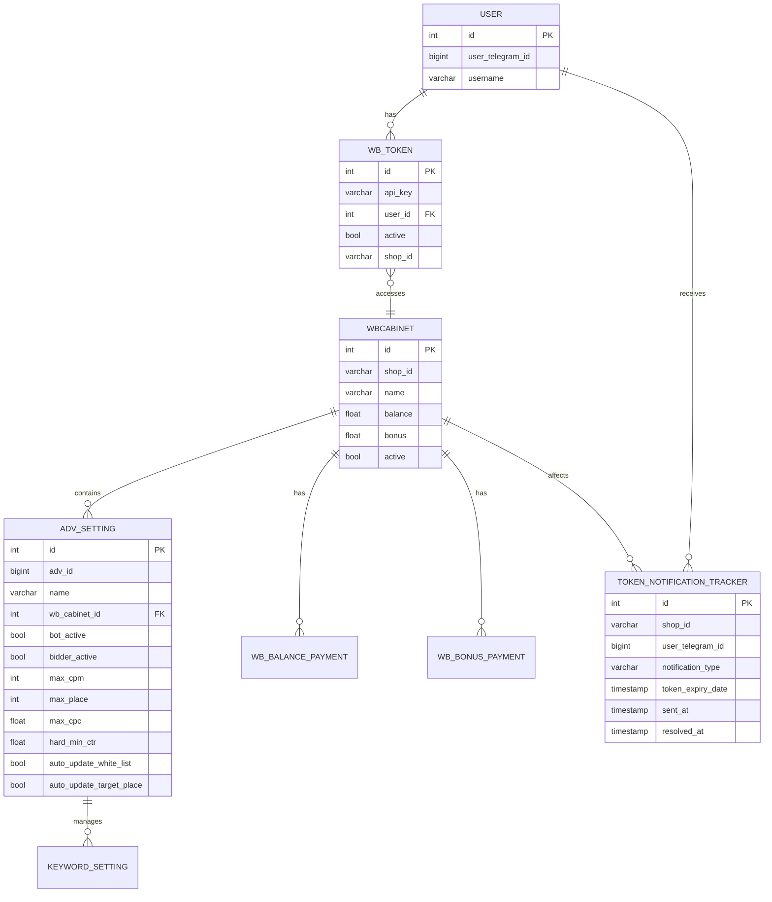

# PostgreSQL Schema

<cite>
**Referenced Files in This Document**   
- [models.py](file://app/modules/common_slaves/wildberries/models/models.py)
- [token_notification_tracker.py](file://app/modules/token_monitoring/models.py)
- [pricer.py](file://models/pricer.py)
- [30d489ece148_add_shop_id_ðto_wbtoken.py](file://alembic/versions/30d489ece148_add_shop_id_ðto_wbtoken.py)
- [42cfd1a692b5_add_shop_id_index_to_wbtoken.py](file://alembic/versions/42cfd1a692b5_add_shop_id_index_to_wbtoken.py)
- [f8e1d9c2a3b4_add_token_notification_tracker_table.py](file://alembic/versions/f8e1d9c2a3b4_add_token_notification_tracker_table.py)
- [89d25ba5dcd2_sync_models_to_db.py](file://alembic/versions/89d25ba5dcd2_sync_models_to_db.py)
- [ab95fca5744f_add_index_to_wbcategory.py](file://alembic/versions/ab95fca5744f_add_index_to_wbcategory.py)
</cite>

## Table of Contents
1. [Introduction](#introduction)
2. [Core Data Models](#core-data-models)
3. [Entity Relationships](#entity-relationships)
4. [Data Access Patterns](#data-access-patterns)
5. [Schema Evolution and Migrations](#schema-evolution-and-migrations)
6. [Performance Considerations](#performance-considerations)
7. [Data Validation and Constraints](#data-validation-and-constraints)
8. [Retention Policies](#retention-policies)
9. [Conclusion](#conclusion)

## Introduction

The PostgreSQL schema for the adv-bot system supports an advertising automation platform that manages Wildberries marketplace advertising campaigns. The database stores configuration settings, token information, campaign performance data, and notification tracking. The schema is managed through Alembic migrations and accessed via SQLAlchemy ORM. This documentation details the core models including AdvSetting, WBToken, WBCabinet, TokenNotificationTracker, and Pricer-related functionality, explaining their roles in the advertising workflow, relationships, indexes, and evolution over time.

## Core Data Models

### AdvSetting Model

The `AdvSetting` table stores configuration for advertising campaigns, including bid strategies, targeting parameters, and automation settings. Each record represents a specific advertising campaign with various optimization parameters.

**Key Fields:**
- `adv_id`: BIGINT, unique identifier for the Wildberries advertising campaign
- `name`: String, campaign name with embedded metadata patterns
- `wb_cabinet_id`: Integer, foreign key to WBCabinet
- `bot_active`: Boolean, whether the automation bot is active
- `max_cpc`: Float, maximum cost-per-click bid
- `hard_min_ctr`: Float, minimum CTR threshold with default from settings
- `keyword_settings`: Relationship to KeywordSetting table
- `payments`: Relationship to AdvPayment table for billing

The model includes numerous automation flags such as `auto_update_white_list`, `auto_update_target_place`, and `bidder_for_auto` that control different aspects of campaign management. It also stores business logic parameters like `plan_for_sales_for_day` and `target_price_for_order` for sales target calculations.

**Section sources**
- [models.py](file://app/modules/common_slaves/wildberries/models/models.py#L300-L500)

### WBToken Model

The `WBToken` table stores API tokens used to authenticate with the Wildberries marketplace API. These tokens enable the system to manage advertising campaigns on behalf of users.

**Key Fields:**
- `api_key`: String, the actual API token value
- `user_id`: Integer, foreign key to User table
- `active`: Boolean, whether the token is currently active
- `shop_id`: String, identifier for the associated Wildberries shop

The model includes properties for token validation and parsing, including JWT decoding to extract payload information like expiration time and permissions. The `is_expired` property checks if the token has passed its expiration date.

**Section sources**
- [models.py](file://app/modules/common_slaves/wildberries/models/models.py#L170-L220)

### WBCabinet Model

The `WBCabinet` table represents a Wildberries seller cabinet, which is a container for multiple shops and advertising campaigns. It serves as an organizational unit within the system.

**Key Fields:**
- `shop_id`: String, unique identifier for the shop
- `name`: String, display name of the cabinet
- `balance`: Float, current advertising budget balance
- `bonus`: Float, bonus funds available
- `active`: Boolean, whether the cabinet is active

The model maintains relationships with tokens, advertising settings, and payment records, forming the central hub for all advertising activities associated with a particular seller.

**Section sources**
- [models.py](file://app/modules/common_slaves/wildberries/models/models.py#L50-L100)

### TokenNotificationTracker Model

The `TokenNotificationTracker` table records notifications sent to users about token status issues, preventing duplicate notifications and providing an audit trail.

**Key Fields:**
- `shop_id`: String, identifier of the affected shop
- `user_telegram_id`: BIGINT, Telegram user ID to notify
- `notification_type`: String, type of notification from NotificationType enum
- `token_expiry_date`: DateTime, when the token expires (nullable)
- `sent_at`: DateTime, when the notification was sent
- `resolved_at`: DateTime, when the issue was resolved (nullable)

The table includes a unique constraint on `(shop_id, user_telegram_id, notification_type)` to prevent duplicate notifications for the same issue.

**Section sources**
- [token_notification_tracker.py](file://app/modules/token_monitoring/models.py#L15-L80)

### Pricer Functionality

The `pricer.py` module contains functions for pricing calculations, though these are currently mocked in the implementation. The functions support cost prediction and bidding strategies.

**Key Functions:**
- `get_price_for_day_for_shop`: Returns daily pricing for a shop
- `predict_keyword_ctr`: Predicts click-through rate for keyword-NMID pairs
- `get_minimal_bet`: Determines minimum bid for keyword-campaign combinations
- `get_adv_costs`: Calculates advertising costs over a date range
- `get_position_from_bet`: Determines ad position based on bid amount

These functions are designed to support the advertising optimization algorithms, though the current implementation returns mock values.

**Section sources**
- [pricer.py](file://models/pricer.py#L1-L123)

## Entity Relationships

**Diagram sources**
- [models.py](file://app/modules/common_slaves/wildberries/models/models.py)
- [token_notification_tracker.py](file://app/modules/token_monitoring/models.py)

**Section sources**
- [models.py](file://app/modules/common_slaves/wildberries/models/models.py)
- [token_notification_tracker.py](file://app/modules/token_monitoring/models.py)

## Data Access Patterns

The system uses SQLAlchemy ORM with async session patterns for database access. The primary access patterns include:

### Campaign Configuration Retrieval
Applications typically query `AdvSetting` records filtered by `wb_cabinet_id` and `bot_active` status. The `ix_adv_settings_cabinet_bot_active` index optimizes these queries for retrieving active campaigns for a specific cabinet.

### Token Validation
Token validation occurs through the `WBToken` model's properties, particularly `is_expired` and `check_valid`. Applications retrieve tokens by `user_id` and validate their JWT payload to ensure they remain active.

### Notification Management
The `TokenNotificationTracker` table is queried to prevent duplicate notifications. Before sending a notification, the system checks for existing unresolved notifications with the same `(shop_id, user_telegram_id, notification_type)` combination.

### Performance Optimization
The schema includes several composite indexes to optimize common query patterns:
- `ix_adv_settings_cabinet_type_update` for retrieving campaigns by cabinet, type, and update time
- `ix_advsetting_name_pattern` using GIN with trigram operations for fuzzy name matching
- `ix_name__nmids__search_adv_id` for queries involving campaign name, NMIDs, and search campaign ID

**Section sources**
- [models.py](file://app/modules/common_slaves/wildberries/models/models.py#L300-L500)
- [token_notification_tracker.py](file://app/modules/token_monitoring/models.py#L15-L80)

## Schema Evolution and Migrations

The database schema is managed through Alembic migrations, with versioned scripts in the `alembic/versions/` directory. The migration history shows the evolution of key tables.

### WBToken Schema Evolution
The `WBToken` table was enhanced with shop identifier support through multiple migrations:
1. Migration `30d489ece148` added the `shop_id` column to store the associated shop identifier
2. Migration `42cfd1a692b5` added an index on the `shop_id` column for improved query performance

These changes enabled more efficient token management by shop ID, supporting the advertising automation workflow.

### Token Notification Tracker Introduction
Migration `f8e1d9c2a3b4` introduced the `token_notification_tracker` table to manage user notifications about token issues. The migration created the table with appropriate indexes on `shop_id`, `user_telegram_id`, and `sent_at` for query performance.

### Index Management
Migration `ab95fca5744f` restructured indexes across multiple tables, removing redundant indexes and ensuring optimal query performance. This included dropping indexes like `ix_wbcard_nmid` and `idx_user_telegram_id` that were no longer needed.

**Section sources**
- [30d489ece148_add_shop_id_ðto_wbtoken.py](file://alembic/versions/30d489ece148_add_shop_id_ðto_wbtoken.py)
- [42cfd1a692b5_add_shop_id_index_to_wbtoken.py](file://alembic/versions/42cfd1a692b5_add_shop_id_index_to_wbtoken.py)
- [f8e1d9c2a3b4_add_token_notification_tracker_table.py](file://alembic/versions/f8e1d9c2a3b4_add_token_notification_tracker_table.py)
- [ab95fca5744f_add_index_to_wbcategory.py](file://alembic/versions/ab95fca5744f_add_index_to_wbcategory.py)

## Performance Considerations

### Indexing Strategy
The schema employs a comprehensive indexing strategy to optimize query performance:

**WBToken Indexes:**
- `idx_shop_id`: Index on shop_id for queries filtering by shop
- Composite queries use the unique constraint on `(api_key, user_id)`

**AdvSetting Indexes:**
- `ix_adv_settings_cabinet_type_update`: Composite index for primary campaign queries
- `ix_adv_settings_cabinet_id`: Index for cabinet-based filtering
- `ix_adv_setting_type`: Index for type-based filtering
- `ix_advsetting_adv_id`: Index on adv_id for campaign lookups
- `ix_advsetting_active_status`: Index on active_status for status filtering
- `ix_advsetting_bot_active`: Index on bot_active for bot status filtering
- `ix_advsetting_name_pattern`: GIN trigram index for fuzzy name matching

**TokenNotificationTracker Indexes:**
- `ix_token_notification_tracker_shop_id`: Index on shop_id
- `ix_token_notification_tracker_user_telegram_id`: Index on user_telegram_id
- `ix_token_notification_tracker_sent_at`: Index on sent_at for time-based queries
- `ix_token_notification_tracker_resolved_at`: Index on resolved_at for resolution tracking

### Query Optimization
The system should leverage these indexes through appropriate query patterns:
- Use `wb_cabinet_id` and `bot_active` together when retrieving active campaigns
- Use trigram similarity operators with `ilike` for name searches
- Filter by `sent_at` ranges when retrieving recent notifications
- Use the unique constraint on `TokenNotificationTracker` to prevent duplicates

### Data Distribution
Large tables like `AdvSetting` and `TokenNotificationTracker` may benefit from partitioning strategies in the future, particularly by time or cabinet ID, to improve query performance as data volumes grow.

**Section sources**
- [models.py](file://app/modules/common_slaves/wildberries/models/models.py)
- [token_notification_tracker.py](file://app/modules/token_monitoring/models.py)
- [alembic/versions/](file://alembic/versions/)

## Data Validation and Constraints

The schema implements several validation rules and constraints to ensure data integrity:

### Unique Constraints
- `WBToken`: Unique constraint on `(api_key, user_id)` prevents duplicate token entries
- `TokenNotificationTracker`: Unique constraint on `(shop_id, user_telegram_id, notification_type)` prevents duplicate notifications
- `WBUserCabinet`: Unique constraint on `(wb_cabinet_id, user_id)` prevents duplicate user-cabinet associations

### Check Constraints
- `WBBalancePayment`: Conditional unique constraint with `postgresql_where` ensures only one daily auto-balance charge per cabinet
- `WBBonusPayment`: Similar conditional unique constraint for daily auto-bonus charges

### Foreign Key Constraints
- `AdvSetting`: References `wbcabinet.id` for cabinet association
- `WBToken`: References `user.id` for user association
- `KeywordSetting`: References `advsetting.id` for campaign association
- `WBCard`: References `wbcategory.id` and `wbcabinet.id` for categorization

### Data Type Constraints
- `WBToken.shop_id`: String type with nullable=True, allowing for optional shop identification
- `AdvSetting.nmids`: JSONB type with NOT NULL constraint after migration `89d25ba5dcd2`
- `TokenNotificationTracker.notification_type`: String type with values from NotificationType enum

**Section sources**
- [models.py](file://app/modules/common_slaves/wildberries/models/models.py)
- [token_notification_tracker.py](file://app/modules/token_monitoring/models.py)
- [89d25ba5dcd2_sync_models_to_db.py](file://alembic/versions/89d25ba5dcd2_sync_models_to_db.py)

## Retention Policies

The system does not implement explicit data retention policies in the database schema. However, certain design patterns suggest retention considerations:

### Notification Tracking
The `TokenNotificationTracker` table likely requires periodic cleanup of resolved notifications. Records with non-null `resolved_at` values could be archived or deleted after a retention period (e.g., 90 days) to control table growth.

### Historical Data
Payment tables (`WBBalancePayment`, `WBBonusPayment`) accumulate records over time and may benefit from archiving older records to separate tables or data warehouses for analytical purposes while keeping recent data in the primary tables.

### Token Management
Inactive `WBToken` records (where `active=False` and `is_expired=True`) could be subject to cleanup after a grace period to reduce table size and improve query performance.

These retention policies would likely be implemented at the application level through scheduled jobs rather than database-level mechanisms like partitioning or TTL.

**Section sources**
- [models.py](file://app/modules/common_slaves/wildberries/models/models.py)
- [token_notification_tracker.py](file://app/modules/token_monitoring/models.py)

## Conclusion

The PostgreSQL schema for the adv-bot system provides a robust foundation for managing Wildberries advertising campaigns. The core models—AdvSetting, WBToken, WBCabinet, and TokenNotificationTracker—form a cohesive data model that supports campaign configuration, token management, and user notifications. The schema has evolved through Alembic migrations to add important features like shop ID indexing and notification tracking. With comprehensive indexing and relationship management through SQLAlchemy ORM, the database supports efficient data access patterns for the advertising automation workflow. Future enhancements could include more sophisticated retention policies, partitioning for large tables, and additional constraints to further ensure data integrity.