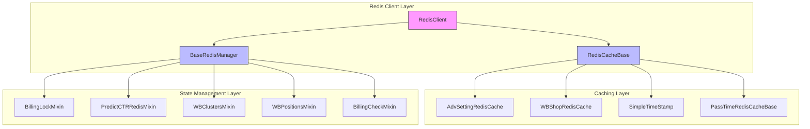
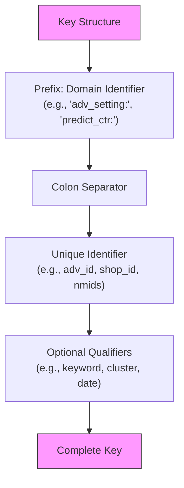
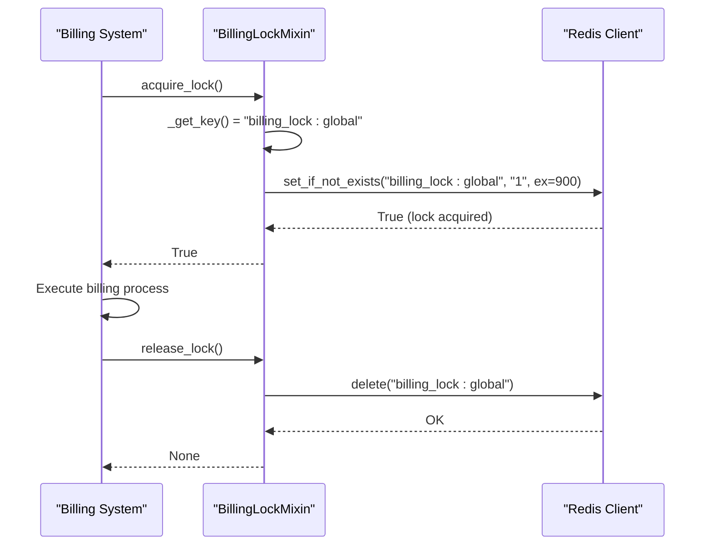
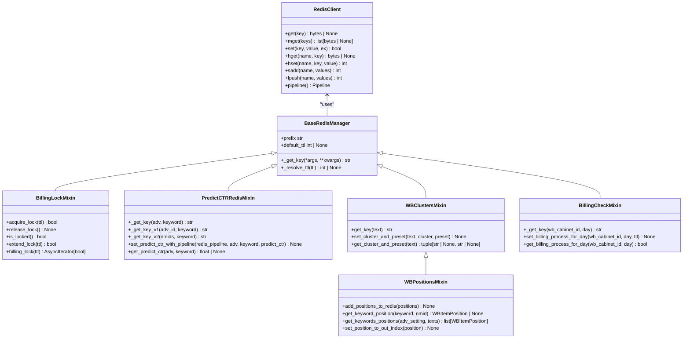

# Redis Data Structures

<cite>
**Referenced Files in This Document**   
- [redis_cache_base.py](file://app/core/redis_cache/redis_cache_base.py)
- [adv_setting_redis_cache.py](file://app/core/redis_cache/mixins/main_objects_mixins/adv_setting_redis_cache.py)
- [wb_shop_redis_cache.py](file://app/core/redis_cache/mixins/main_objects_mixins/wb_shop_redis_cache.py)
- [base_redis_manager.py](file://app/core/redis_manager_v2/base_redis_manager.py)
- [billing_lock.py](file://app/core/redis_manager_v2/mixins/billing_lock.py)
- [predict_ctr.py](file://app/core/redis_manager_v2/mixins/predict_ctr.py)
- [wb_clusters.py](file://app/core/redis_manager_v2/mixins/wb_clusters.py)
- [wb_positions.py](file://app/core/redis_manager_v2/mixins/wb_positions.py)
- [billing_check.py](file://app/core/redis_manager_v2/mixins/billing_check.py)
- [redis_client.py](file://app/core/redis_manager_v2/redis_client.py)
- [redis_config.py](file://app/configs/infrastructure_config/redis_config.py)
</cite>

## Table of Contents
1. [Introduction](#introduction)
2. [Core Redis Architecture](#core-redis-architecture)
3. [Caching Strategies](#caching-strategies)
4. [Key Naming Conventions](#key-naming-conventions)
5. [TTL Policies](#ttl-policies)
6. [Data Serialization Formats](#data-serialization-formats)
7. [State Management](#state-management)
8. [Redis Data Structures](#redis-data-structures)
9. [Integration with Core Services](#integration-with-core-services)
10. [Performance Considerations](#performance-considerations)
11. [Troubleshooting Guide](#troubleshooting-guide)

## Introduction
The adv-bot system utilizes Redis as a primary caching and state management solution for high-performance data access and coordination across distributed components. This documentation details the Redis data structures, caching strategies, and integration patterns used throughout the system. The architecture is designed to optimize access to frequently used data such as advertising settings, shop configurations, and predictive analytics while maintaining data consistency and system reliability.

**Section sources**
- [redis_cache_base.py](file://app/core/redis_cache/redis_cache_base.py#L1-L34)
- [base_redis_manager.py](file://app/core/redis_manager_v2/base_redis_manager.py#L1-L34)

## Core Redis Architecture
The Redis architecture in the adv-bot system is built around two primary abstraction layers: the RedisCache system for object-oriented caching and the RedisManager system for operational state management. These layers provide a structured approach to Redis interactions while maintaining separation of concerns between data caching and system coordination.

**Diagram sources**
- [redis_client.py](file://app/core/redis_manager_v2/redis_client.py#L1-L243)
- [base_redis_manager.py](file://app/core/redis_manager_v2/base_redis_manager.py#L1-L34)
- [redis_cache_base.py](file://app/core/redis_cache/redis_cache_base.py#L1-L34)

**Section sources**
- [redis_client.py](file://app/core/redis_manager_v2/redis_client.py#L1-L243)
- [base_redis_manager.py](file://app/core/redis_manager_v2/base_redis_manager.py#L1-L34)

## Caching Strategies
The system implements multiple caching strategies optimized for different data access patterns and performance requirements. The primary caching mechanisms include object caching for frequently accessed entities, timestamp-based caching for time-sensitive operations, and predictive data caching for machine learning models.

### Object Caching
The system uses a mixin-based approach for caching core business objects such as advertising settings and shop configurations. The `AdvSettingRedisCache` and `WBShopRedisCache` classes provide transparent caching for these entities, automatically handling key generation and data serialization.

### Timestamp Caching
For operations that need to track time-based states, the system implements timestamp caching through the `SimpleTimeStamp` and `PassTimeRedisCacheBase` classes. These mixins allow components to store and retrieve timestamps, with the latter providing built-in time comparison functionality to determine if a specified duration has passed.

### Predictive Data Caching
The CTR (Click-Through Rate) prediction system implements a sophisticated caching strategy that supports multiple versions of prediction models. The system can store predictions using either legacy keys (based on advertisement ID) or modern keys (based on NMID arrays), allowing for gradual migration between prediction models without service disruption.

**Section sources**
- [adv_setting_redis_cache.py](file://app/core/redis_cache/mixins/main_objects_mixins/adv_setting_redis_cache.py#L1-L14)
- [wb_shop_redis_cache.py](file://app/core/redis_cache/mixins/main_objects_mixins/wb_shop_redis_cache.py#L1-L13)
- [simple_timestamp.py](file://app/core/redis_cache/mixins/data_types/simple_timestamp.py#L1-L19)
- [pass_time_redis_cache_base.py](file://app/core/redis_cache/mixins/data_types/pass_time_redis_cache_base.py#L1-L28)

## Key Naming Conventions
The system follows a consistent key naming convention that includes a prefix, entity identifier, and optional qualifiers. This hierarchical structure enables efficient key organization and retrieval while preventing naming collisions across different data domains.

### Prefix Structure
All Redis keys use a prefix that identifies the data domain or functionality:
- `adv_setting:` - Advertising setting configurations
- `wb_shop:` - Wildberries shop configurations
- `predict_ctr:` - CTR prediction data (legacy)
- `predict_ctr_v2:` - CTR prediction data (modern)
- `billing_lock:` - Billing system locks
- `cluster_and_preset:` - Product clustering data
- `adv_positions:` - Advertisement position tracking
- `billing:processed` - Billing processing status

### Entity Identification
Following the prefix, keys include a unique identifier for the specific entity:
- Advertisement ID for ad-related data
- Shop ID for shop-specific configurations
- NMID (product identifier) for product-level data
- Text keywords for search and positioning data

### Qualifiers and Versioning
Additional qualifiers may be appended to provide context or support versioning:
- Text keywords for CTR predictions
- Cluster names for grouped products
- Date strings for time-based records

**Diagram sources**
- [adv_setting_redis_cache.py](file://app/core/redis_cache/mixins/main_objects_mixins/adv_setting_redis_cache.py#L1-L14)
- [predict_ctr.py](file://app/core/redis_manager_v2/mixins/predict_ctr.py#L1-L70)
- [wb_clusters.py](file://app/core/redis_manager_v2/mixins/wb_clusters.py#L1-L44)

**Section sources**
- [adv_setting_redis_cache.py](file://app/core/redis_cache/mixins/main_objects_mixins/adv_setting_redis_cache.py#L1-L14)
- [predict_ctr.py](file://app/core/redis_manager_v2/mixins/predict_ctr.py#L1-L70)
- [wb_clusters.py](file://app/core/redis_manager_v2/mixins/wb_clusters.py#L1-L44)

## TTL Policies
The system implements granular TTL (Time-To-Live) policies tailored to the specific requirements of each data type and usage pattern. These policies balance data freshness with performance optimization.

### Default TTL Configuration
The base `BaseRedisManager` class defines a `default_ttl` attribute that can be overridden by specific implementations. When no TTL is explicitly provided, this default value is used. If neither an explicit TTL nor a default TTL is defined, keys are stored without expiration.

### Domain-Specific TTL Settings
Different data domains have specific TTL requirements:
- **Billing Lock**: 900 seconds (15 minutes) - sufficient for billing process completion
- **Billing Check**: 93,600 seconds (26 hours) - covers daily billing cycles with buffer
- **CTR Predictions**: No explicit TTL mentioned, suggesting potentially longer-lived or indefinite storage
- **Position Data**: No explicit TTL mentioned, indicating data persistence requirements

### Dynamic TTL Resolution
The system implements a flexible TTL resolution mechanism in the `_resolve_ttl` method of `BaseRedisManager`. This method prioritizes TTL values in the following order:
1. Explicit TTL passed as a parameter to the operation
2. Default TTL defined by the manager class
3. None (no expiration) if neither of the above is specified

This hierarchy allows for both global defaults and per-operation overrides, providing flexibility in cache duration management.

**Section sources**
- [base_redis_manager.py](file://app/core/redis_manager_v2/base_redis_manager.py#L1-L34)
- [billing_lock.py](file://app/core/redis_manager_v2/mixins/billing_lock.py#L1-L98)
- [billing_check.py](file://app/core/redis_manager_v2/mixins/billing_check.py#L1-L35)

## Data Serialization Formats
The system employs different serialization formats based on the data structure and access patterns, optimizing for both storage efficiency and processing speed.

### JSON Serialization
Complex objects with nested structures are serialized using JSON format. This is particularly evident in the position tracking system, where `WBItemPosition` objects are converted to JSON strings for storage. The JSON format preserves the full object structure, including all attributes and their relationships.

### String Serialization
Simple values such as timestamps, flags, and numeric predictions are stored as plain strings. This approach minimizes serialization overhead and leverages Redis's native string operations for maximum performance.

### Binary Data Handling
The system handles binary data through proper encoding and decoding. When retrieving data, byte strings are automatically decoded to UTF-8 strings with error handling for invalid characters. This ensures data integrity while maintaining compatibility with Redis's binary-safe storage.

### Pipeline Optimization
For operations involving multiple related data points, the system uses Redis pipelines to batch operations. This reduces network overhead and improves throughput, particularly for bulk operations like retrieving multiple position records or updating several CTR predictions simultaneously.

**Section sources**
- [wb_positions.py](file://app/core/redis_manager_v2/mixins/wb_positions.py#L1-L93)
- [predict_ctr.py](file://app/core/redis_manager_v2/mixins/predict_ctr.py#L1-L70)
- [redis_client.py](file://app/core/redis_manager_v2/redis_client.py#L1-L243)

## State Management
Redis serves as a critical state management system for coordinating distributed operations and maintaining system-wide consistency. The state management functions are implemented through specialized mixins that provide atomic operations for critical system functions.

### Billing Lock Management
The `BillingLockMixin` provides a global lock mechanism to prevent concurrent execution of billing processes. This singleton-style lock ensures data consistency during financial operations by allowing only one billing process to run at a time across the entire system.

### CTR Prediction State
The `PredictCTRRedisMixin` manages the state of click-through rate predictions, which are essential for advertising optimization. This mixin supports multiple prediction model versions, allowing for gradual migration and A/B testing of different prediction algorithms.

### Cluster and Position State
The clustering system maintains product groupings and presets through the `WBClustersMixin`, while advertisement positions are tracked in real-time using the `WBPositionsMixin`. These state management components enable sophisticated targeting and positioning strategies based on historical performance data.

**Diagram sources**
- [billing_lock.py](file://app/core/redis_manager_v2/mixins/billing_lock.py#L1-L98)
- [predict_ctr.py](file://app/core/redis_manager_v2/mixins/predict_ctr.py#L1-L70)
- [wb_clusters.py](file://app/core/redis_manager_v2/mixins/wb_clusters.py#L1-L44)

**Section sources**
- [billing_lock.py](file://app/core/redis_manager_v2/mixins/billing_lock.py#L1-L98)
- [predict_ctr.py](file://app/core/redis_manager_v2/mixins/predict_ctr.py#L1-L70)
- [wb_clusters.py](file://app/core/redis_manager_v2/mixins/wb_clusters.py#L1-L44)

## Redis Data Structures
The system leverages various Redis data structures optimized for specific use cases, maximizing performance and functionality.

### String-Based Structures
The most commonly used data structure is Redis strings, employed for:
- Caching simple values like timestamps
- Storing serialized objects (JSON)
- Holding numeric values like CTR predictions
- Maintaining flags and status indicators

### Hash Structures
Although not explicitly shown in the provided code, the Redis client implementation includes comprehensive hash operations, suggesting potential use for:
- Storing object properties as field-value pairs
- Managing configuration settings
- Implementing counters and statistics

### Sorted Sets
The Redis client provides sorted set operations, indicating potential use for:
- Ranking and leaderboard functionality
- Time-series data with score-based ordering
- Priority queues for processing tasks

### Lists and Sets
The system supports list and set operations for:
- Queue-based processing (lpush/rpush with lpop/rpop)
- Maintaining unique collections of items
- Implementing publish-subscribe patterns

**Diagram sources**
- [redis_client.py](file://app/core/redis_manager_v2/redis_client.py#L1-L243)
- [base_redis_manager.py](file://app/core/redis_manager_v2/base_redis_manager.py#L1-L34)
- [billing_lock.py](file://app/core/redis_manager_v2/mixins/billing_lock.py#L1-L98)
- [predict_ctr.py](file://app/core/redis_manager_v2/mixins/predict_ctr.py#L1-L70)
- [wb_clusters.py](file://app/core/redis_manager_v2/mixins/wb_clusters.py#L1-L44)
- [wb_positions.py](file://app/core/redis_manager_v2/mixins/wb_positions.py#L1-L93)
- [billing_check.py](file://app/core/redis_manager_v2/mixins/billing_check.py#L1-L35)

**Section sources**
- [redis_client.py](file://app/core/redis_manager_v2/redis_client.py#L1-L243)
- [base_redis_manager.py](file://app/core/redis_manager_v2/base_redis_manager.py#L1-L34)

## Integration with Core Services
The Redis system is integrated with core services through a well-defined client and manager architecture that provides both low-level access and high-level abstractions.

### Redis Client Abstraction
The `RedisClient` class provides a comprehensive wrapper around the underlying Redis library, implementing:
- Read-write separation through replica clients
- Pipeline support for batch operations
- Type-safe method signatures
- Error handling and logging
- Binary data encoding/decoding

### Manager Pattern
The system uses a manager pattern where specialized classes inherit from `BaseRedisManager` and incorporate functional mixins. This approach enables:
- Code reuse through mixin composition
- Consistent error handling
- Standardized key generation
- Configurable TTL policies
- Easy testing and mocking

### Dependency Injection
The Redis client is designed to be easily injected into other components, allowing for:
- Flexible configuration
- Easy testing with mock clients
- Runtime client replacement
- Connection pooling

### Configuration Management
Redis configuration is managed through Pydantic settings, allowing for environment-based configuration with sensible defaults. The configuration includes host, port, database number, and optional password, providing flexibility for different deployment environments.

**Section sources**
- [redis_client.py](file://app/core/redis_manager_v2/redis_client.py#L1-L243)
- [base_redis_manager.py](file://app/core/redis_manager_v2/base_redis_manager.py#L1-L34)
- [redis_config.py](file://app/configs/infrastructure_config/redis_config.py#L1-L15)

## Performance Considerations
The Redis implementation in the adv-bot system incorporates several performance optimization strategies to ensure high throughput and low latency.

### Connection Management
The system maintains persistent connections to Redis, avoiding the overhead of connection establishment for each operation. The client implementation supports replica read/write separation, potentially improving performance in clustered Redis deployments.

### Pipeline Usage
For operations involving multiple related commands, the system leverages Redis pipelines to:
- Reduce network round-trips
- Improve throughput for batch operations
- Maintain atomicity for related operations
- Minimize client-server communication overhead

### Memory Optimization
The key naming convention and data serialization strategies are designed to minimize memory usage:
- Concise prefix names
- Efficient string representations
- JSON serialization only for complex objects
- Proper encoding of binary data

### Asynchronous Operations
The entire Redis interface is designed for asynchronous operation, allowing the system to:
- Handle multiple Redis operations concurrently
- Prevent blocking of event loops
- Scale to handle high request volumes
- Integrate seamlessly with other async components

**Section sources**
- [redis_client.py](file://app/core/redis_manager_v2/redis_client.py#L1-L243)
- [predict_ctr.py](file://app/core/redis_manager_v2/mixins/predict_ctr.py#L1-L70)
- [wb_positions.py](file://app/core/redis_manager_v2/mixins/wb_positions.py#L1-L93)

## Troubleshooting Guide
This section provides guidance for diagnosing and resolving common Redis-related issues in the adv-bot system.

### Connection Timeouts
Connection timeouts typically indicate network issues or Redis server overload. To troubleshoot:
1. Verify Redis server availability and network connectivity
2. Check Redis server resource usage (CPU, memory, connections)
3. Review connection pool settings and client configuration
4. Monitor for network latency or packet loss

### Cache Misses
Excessive cache misses may indicate:
- Inappropriate TTL settings that are too short
- Cache key naming inconsistencies
- Insufficient cache capacity
- Application logic bypassing the cache

Monitor cache hit rates and review the specific patterns of cache misses to identify the root cause.

### Data Inconsistency
Data inconsistency issues may arise from:
- Improper lock management in distributed environments
- Race conditions in cache updates
- Incomplete transaction handling
- TTL expiration during critical operations

Implement proper locking mechanisms and ensure atomic operations for critical data updates.

### Memory Pressure
High memory usage can be addressed by:
- Reviewing TTL policies and ensuring appropriate expiration
- Analyzing key distribution and identifying memory hogs
- Implementing LRU (Least Recently Used) eviction policies
- Scaling Redis infrastructure

Use Redis memory analysis tools to identify large keys and optimize data structures.

**Section sources**
- [redis_client.py](file://app/core/redis_manager_v2/redis_client.py#L1-L243)
- [billing_lock.py](file://app/core/redis_manager_v2/mixins/billing_lock.py#L1-L98)
- [base_redis_manager.py](file://app/core/redis_manager_v2/base_redis_manager.py#L1-L34)