# Backup and Recovery

<cite>
**Referenced Files in This Document**   
- [set_shop_id_for_all_wbtokens.py](file://scripts/set_shop_id_for_all_wbtokens.py)
- [set_relevant_if_white_phrase.py](file://scripts/set_relevant_if_white_phrase.py)
- [env.py](file://alembic/env.py)
- [alembic.ini](file://alembic.ini)
- [session_maker.py](file://app/utils/db/session_maker.py)
- [settings_master.py](file://app/settings/settings_master.py)
- [client.py](file://app/utils/click_house/client.py)
- [redis_client.py](file://app/core/redis_manager/redis_client.py)
</cite>

## Table of Contents
1. [Introduction](#introduction)
2. [Core Data Stores Overview](#core-data-stores-overview)
3. [PostgreSQL Backup and Recovery](#postgresql-backup-and-recovery)
4. [ClickHouse Backup and Recovery](#clickhouse-backup-and-recovery)
5. [Redis Backup and Recovery](#redis-backup-and-recovery)
6. [Neo4j Data Protection](#neo4j-data-protection)
7. [Data Consistency Repair Scripts](#data-consistency-repair-scripts)
8. [Automated Backup Strategies](#automated-backup-strategies)
9. [Disaster Recovery Planning](#disaster-recovery-planning)
10. [Monitoring and Alerting](#monitoring-and-alerting)
11. [Security Considerations](#security-considerations)
12. [Common Recovery Scenarios](#common-recovery-scenarios)
13. [Performance Impact Mitigation](#performance-impact-mitigation)

## Introduction
The adv-bot system relies on multiple critical data stores to manage advertising settings, user data, analytics, caching, and keyword relationships. This document outlines comprehensive backup and recovery strategies to ensure data integrity, availability, and business continuity. The system employs PostgreSQL for transactional data, ClickHouse for analytics, Redis for caching and session management, and Neo4j for keyword relationship storage. Each component requires specific backup procedures, recovery workflows, and consistency maintenance mechanisms to protect against data loss from corruption, accidental deletion, or infrastructure failure.

## Core Data Stores Overview
The adv-bot system utilizes a multi-database architecture with specialized data stores for different purposes:

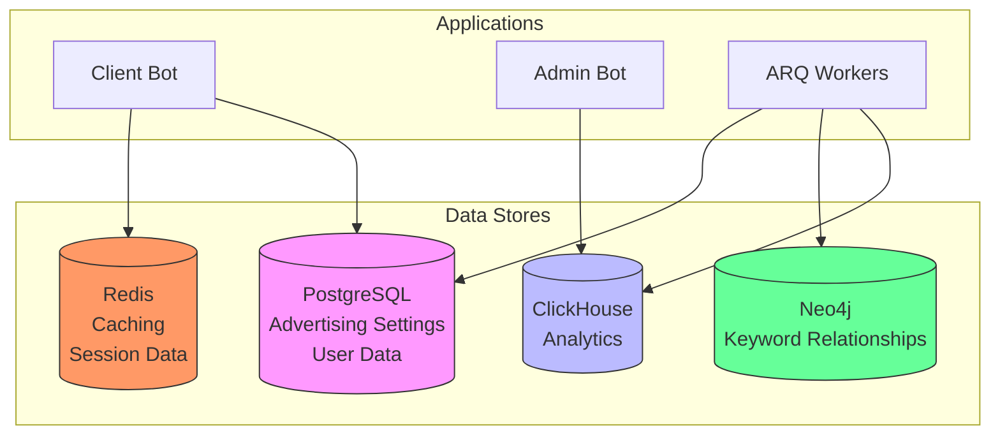

**Diagram sources**
- [settings_master.py](file://app/settings/settings_master.py)
- [session_maker.py](file://app/utils/db/session_maker.py)
- [client.py](file://app/utils/click_house/client.py)
- [redis_client.py](file://app/core/redis_manager/redis_client.py)

**Section sources**
- [settings_master.py](file://app/settings/settings_master.py#L1-L375)
- [session_maker.py](file://app/utils/db/session_maker.py#L1-L175)

## PostgreSQL Backup and Recovery
PostgreSQL serves as the primary relational database for storing advertising settings, user data, and configuration information. The system implements both logical and physical backup strategies with point-in-time recovery capabilities.

### Backup Procedures
PostgreSQL backups are performed using a combination of pg_dump for logical backups and WAL archiving for point-in-time recovery. The backup strategy includes:

- Daily full logical backups using pg_dump
- Continuous WAL archiving for point-in-time recovery
- Transaction log shipping to standby servers
- Automated backup verification

The database connection parameters are configured through environment variables loaded in the settings system, including master and replica hosts, port, database name, username, and password.

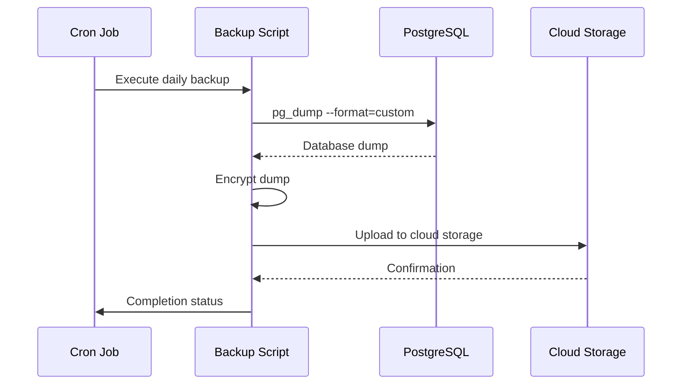

**Diagram sources**
- [alembic.ini](file://alembic.ini#L1-L110)
- [session_maker.py](file://app/utils/db/session_maker.py#L1-L175)
- [settings_master.py](file://app/settings/settings_master.py#L1-L375)

**Section sources**
- [session_maker.py](file://app/utils/db/session_maker.py#L1-L175)
- [settings_master.py](file://app/settings/settings_master.py#L1-L375)
- [alembic.ini](file://alembic.ini#L1-L110)

## ClickHouse Backup and Recovery
ClickHouse is used for storing and analyzing advertising performance analytics data. The backup strategy focuses on efficient handling of large datasets with minimal performance impact.

### Backup Procedures
ClickHouse backups leverage the built-in table-level backup capabilities and distributed architecture:

- Incremental backups of analytics tables
- Replicated table synchronization across clusters
- Integration with cloud storage for long-term retention
- Automated backup scheduling via cron jobs

The ClickHouse client configuration includes connection pooling, connection counting, and monitoring to ensure backup operations do not overwhelm the system.

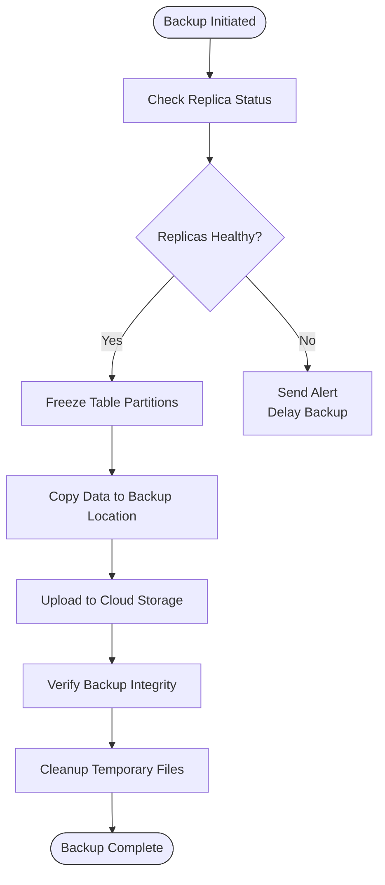

**Diagram sources**
- [client.py](file://app/utils/click_house/client.py#L1-L222)
- [settings_master.py](file://app/settings/settings_master.py#L1-L375)

**Section sources**
- [client.py](file://app/utils/click_house/client.py#L1-L222)
- [settings_master.py](file://app/settings/settings_master.py#L1-L375)

## Redis Backup and Recovery
Redis is used for caching, session data storage, and temporary data management. The backup strategy focuses on persistence configuration and rapid recovery.

### Backup Procedures
Redis backup and recovery relies on RDB snapshots and AOF (Append Only File) persistence:

- Configured RDB snapshots at regular intervals
- AOF logging for write operations
- Automated backup of dump.rdb and appendonly.aof files
- Redis replication for high availability

The Redis client is configured with environment variables for host and port, connecting to database 0 by default.

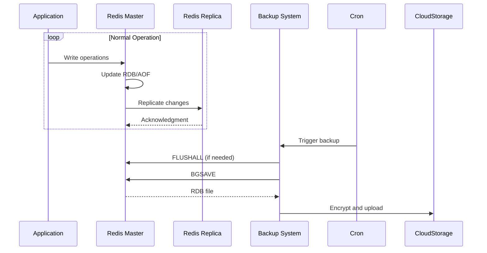

**Diagram sources**
- [redis_client.py](file://app/core/redis_manager/redis_client.py#L1-L11)
- [settings_master.py](file://app/settings/settings_master.py#L1-L375)

**Section sources**
- [redis_client.py](file://app/core/redis_manager/redis_client.py#L1-L11)
- [settings_master.py](file://app/settings/settings_master.py#L1-L375)

## Neo4j Data Protection
Neo4j stores keyword relationships and semantic connections used for advertising optimization. While specific backup scripts are not visible in the repository, the system includes data consistency repair mechanisms.

### Backup Procedures
Neo4j backup strategies should include:

- Regular database dumps using neo4j-admin
- File system backups of the Neo4j data directory
- Cluster replication for high availability
- Point-in-time recovery capabilities

The system includes scripts for updating keyword relationships and ensuring data consistency after recovery operations.

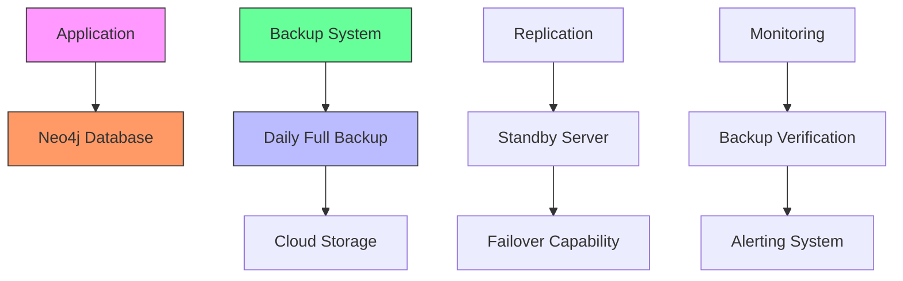

**Section sources**
- [keyword_sending_to_neo4j.py](file://keyword_sending_to_neo4j.py)
- [run_update_cards_data_in_neo4j.py](file://run_update_cards_data_in_neo4j.py)
- [run_update_keyword_vectors_in_redis.py](file://run_update_keyword_vectors_in_redis.py)

## Data Consistency Repair Scripts
After recovery operations, data consistency may be compromised. The system provides utility scripts to repair and synchronize data across different stores.

### set_shop_id_for_all_wbtokens.py
This script ensures all WBToken records have their shop_id properly set by extracting it from the token itself.

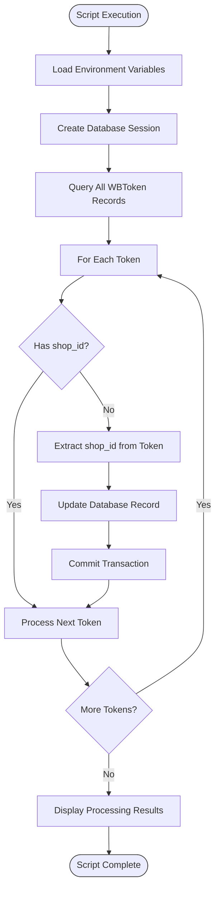

**Diagram sources**
- [set_shop_id_for_all_wbtokens.py](file://scripts/set_shop_id_for_all_wbtokens.py#L1-L60)

**Section sources**
- [set_shop_id_for_all_wbtokens.py](file://scripts/set_shop_id_for_all_wbtokens.py#L1-L60)
- [session_maker.py](file://app/utils/db/session_maker.py#L1-L175)

### set_relevant_if_white_phrase.py
This script updates keyword settings to mark white-listed phrases as relevant, ensuring advertising relevance after data restoration.

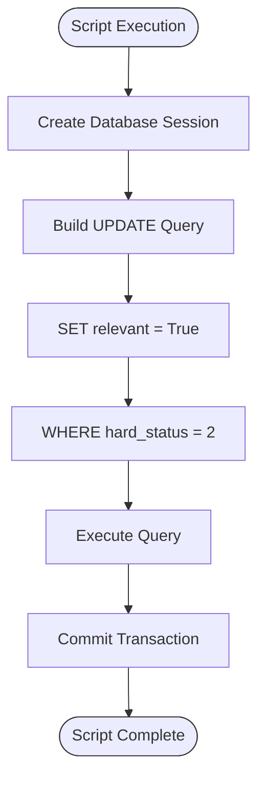

**Diagram sources**
- [set_relevant_if_white_phrase.py](file://scripts/set_relevant_if_white_phrase.py#L1-L22)

**Section sources**
- [set_relevant_if_white_phrase.py](file://scripts/set_relevant_if_white_phrase.py#L1-L22)
- [session_maker.py](file://app/utils/db/session_maker.py#L1-L175)

## Automated Backup Strategies
The system implements automated backup strategies using cron jobs and scheduled tasks to ensure regular, reliable backups without manual intervention.

### Cron Job Configuration
Backup automation is achieved through scheduled cron jobs that execute backup scripts at predefined intervals:

- Daily full backups of PostgreSQL
- Hourly incremental backups of critical tables
- Real-time transaction log shipping
- Weekly full backups of analytics data

The exact cron schedule is not visible in the repository but would typically be configured in the deployment environment.

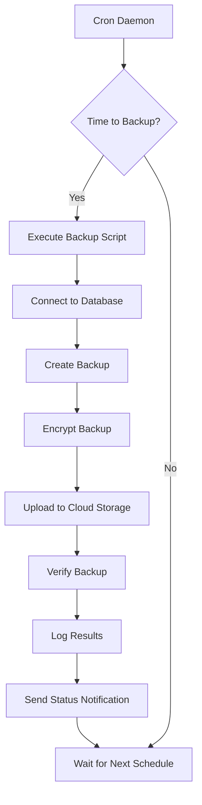

**Section sources**
- [alembic.ini](file://alembic.ini#L1-L110)
- [settings_master.py](file://app/settings/settings_master.py#L1-L375)

## Disaster Recovery Planning
The disaster recovery plan for adv-bot includes procedures for various failure scenarios, recovery time objectives (RTO), and recovery point objectives (RPO).

### Recovery Workflows
Standard recovery workflows include:

1. **Database Restoration from Dumps**: Restore PostgreSQL from pg_dump files
2. **Redis RDB/AOF Recovery**: Restart Redis with backup files
3. **ClickHouse Replica Synchronization**: Promote replica to primary
4. **Data Consistency Repair**: Run utility scripts to fix relationships

The plan includes regular testing of recovery procedures to ensure they meet business requirements.

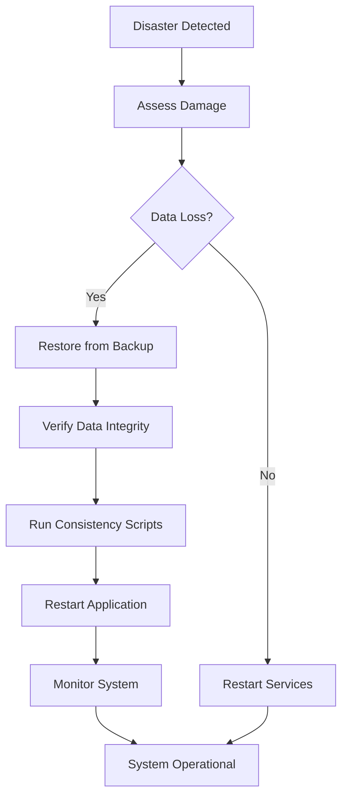

**Section sources**
- [set_shop_id_for_all_wbtokens.py](file://scripts/set_shop_id_for_all_wbtokens.py#L1-L60)
- [set_relevant_if_white_phrase.py](file://scripts/set_relevant_if_white_phrase.py#L1-L22)

## Monitoring and Alerting
Integration with monitoring systems ensures backup failures are detected and alerted promptly.

### Monitoring Strategy
The monitoring system tracks:

- Backup job completion status
- Backup duration and performance
- Storage utilization
- Data integrity verification results
- Network transfer success/failure

Alerts are configured for failed backups, incomplete transfers, or verification failures.

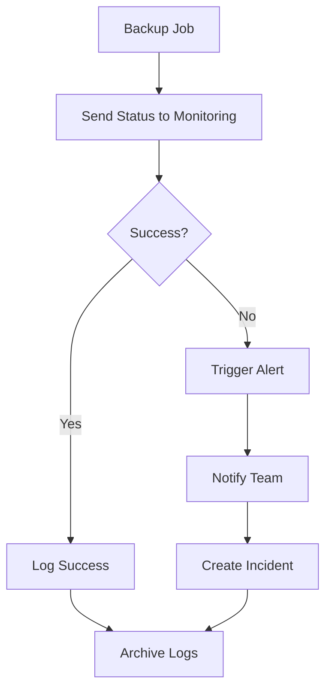

**Section sources**
- [logging_config.json](file://logging_config.json)
- [my_log_handler.py](file://my_log_handler.py)

## Security Considerations
Backup security is critical to protect sensitive advertising and user data.

### Encryption and Access Control
- All backups are encrypted before storage
- Access to backup storage is restricted
- Backup files have limited retention periods
- Audit logs track backup and restore operations
- Environment variables contain sensitive credentials

The system uses environment variables for all database credentials, ensuring they are not hardcoded in configuration files.

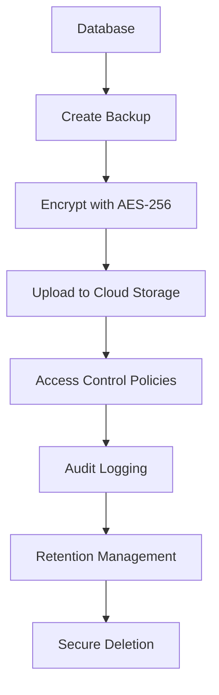

**Section sources**
- [settings_master.py](file://app/settings/settings_master.py#L1-L375)
- [alembic.ini](file://alembic.ini#L1-L110)

## Common Recovery Scenarios
The system addresses several common recovery scenarios with specific resolution guides.

### Data Corruption
When data corruption is detected:

1. Identify the affected tables and time range
2. Restore from the most recent clean backup
3. Apply transaction logs to reach desired point-in-time
4. Verify data integrity
5. Run consistency repair scripts

### Accidental Deletion
For accidentally deleted data:

1. Stop applications to prevent further writes
2. Restore affected tables from backup
3. Reconcile with current data
4. Validate relationships
5. Restart applications

### Infrastructure Failure
In case of infrastructure failure:

1. Provision new infrastructure
2. Restore databases from cloud storage
3. Reconfigure applications
4. Validate system functionality
5. Monitor performance

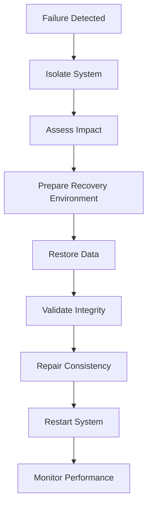

**Section sources**
- [set_shop_id_for_all_wbtokens.py](file://scripts/set_shop_id_for_all_wbtokens.py#L1-L60)
- [set_relevant_if_white_phrase.py](file://scripts/set_relevant_if_white_phrase.py#L1-L22)

## Performance Impact Mitigation
Recovery operations can significantly impact system performance. The following strategies minimize disruption:

- Schedule backups during low-traffic periods
- Use incremental backups to reduce load
- Implement connection pooling and rate limiting
- Monitor system resources during recovery
- Gradually ramp up application traffic after recovery

The system includes connection counting and monitoring in both PostgreSQL and ClickHouse clients to detect and alert on performance issues.

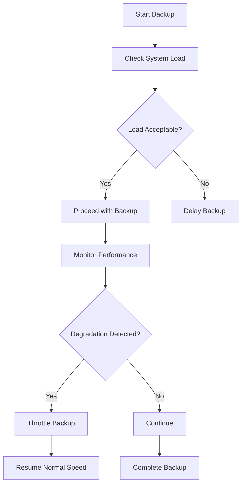

**Section sources**
- [session_maker.py](file://app/utils/db/session_maker.py#L1-L175)
- [client.py](file://app/utils/click_house/client.py#L1-L222)