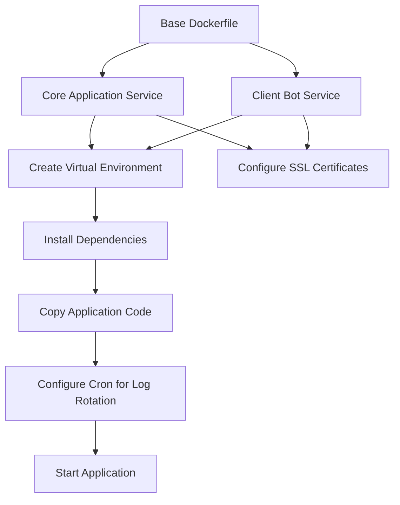
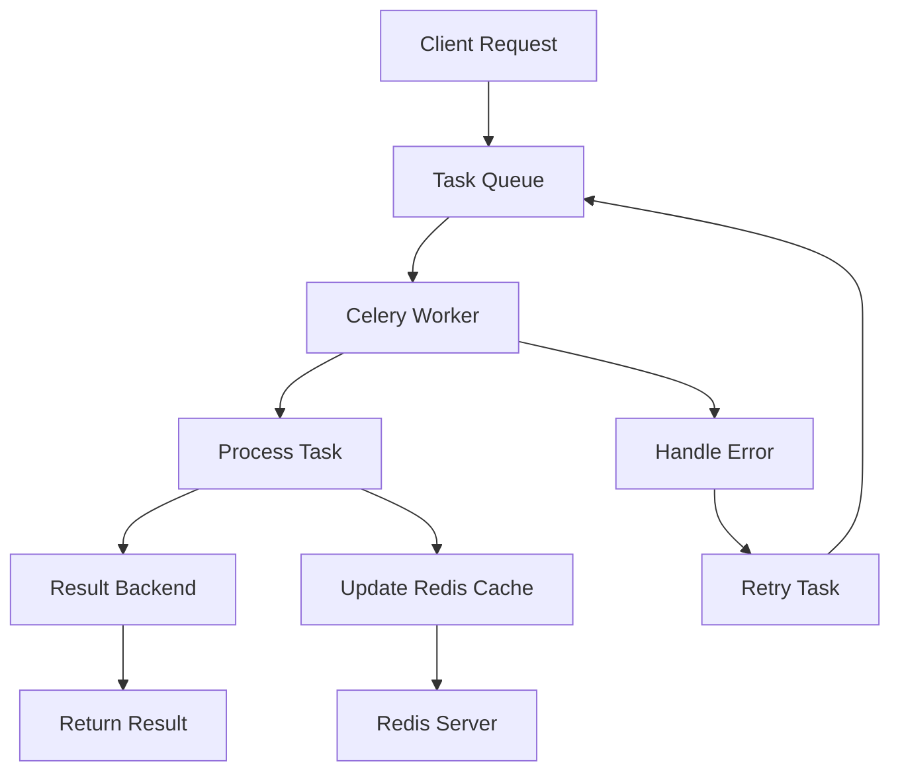
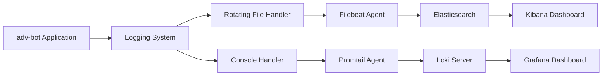
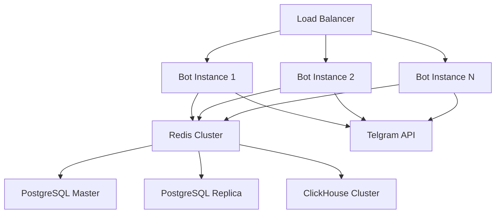

# Deployment Guide

<cite>
**Referenced Files in This Document**   
- [dockers/Dockerfile](file://dockers/Dockerfile)
- [ClientBotDockerfile](file://ClientBotDockerfile)
- [celeryconfig.py](file://celeryconfig.py)
- [logging_config.json](file://logging_config.json)
- [filebeat.yml](file://filebeat.yml)
- [promtail-config.yml](file://promtail-config.yml)
- [app/settings/settings_master.py](file://app/settings/settings_master.py)
- [run_shop_update_worker.py](file://run_shop_update_worker.py)
- [app/modules/shop_runner/shop_run_worker/worker/worker.py](file://app/modules/shop_runner/shop_run_worker/worker/worker.py)
</cite>

## Table of Contents
1. [Docker Configuration](#docker-configuration)
2. [Production Environment Setup](#production-environment-setup)
3. [Background Workers Configuration](#background-workers-configuration)
4. [Logging and Monitoring Setup](#logging-and-monitoring-setup)
5. [Backup and Recovery Procedures](#backup-and-recovery-procedures)
6. [Scalability and High Availability](#scalability-and-high-availability)
7. [Security Hardening](#security-hardening)
8. [Disaster Recovery Planning](#disaster-recovery-planning)
9. [Deployment Workflows and Troubleshooting](#deployment-workflows-and-troubleshooting)

## Docker Configuration

The adv-bot system utilizes two Docker configuration files for different components: `dockers/Dockerfile` for the core application services and `ClientBotDockerfile` for the client-facing bot component. Both Dockerfiles are based on Python 3.11 and follow a multi-step build process to ensure optimal performance and security.

The Dockerfiles install essential system packages including logrotate, cron, rsyslog, and various development libraries. They also configure SSL certificates for secure database connections, particularly for Yandex Cloud PostgreSQL integration. The build process creates a virtual environment and installs dependencies from requirements.txt, ensuring isolation and reproducibility.

Container networking is configured to connect with external services including Redis, PostgreSQL, ClickHouse, and message brokers. Volume mounting is used for persistent storage of logs and configuration files. Environment variables are managed through the settings system, allowing for flexible configuration across different deployment environments.

**Diagram sources**
- [dockers/Dockerfile](file://dockers/Dockerfile)
- [ClientBotDockerfile](file://ClientBotDockerfile)

**Section sources**
- [dockers/Dockerfile](file://dockers/Dockerfile)
- [ClientBotDockerfile](file://ClientBotDockerfile)

## Production Environment Setup

The adv-bot system requires several external services for production deployment. The primary database is PostgreSQL, configured with master-replica architecture for high availability. Connection parameters are managed through environment variables accessed via the Settings class in `app/settings/settings_master.py`.

ClickHouse is used for analytical data storage and processing, with dedicated credentials and connection settings. Redis serves as both a message broker for Celery and a caching layer, configured with separate master and replica hosts for improved performance and reliability.

Message brokers are implemented using Redis as the transport layer for Celery, with configuration options for task serialization, result backend storage, and connection retry policies. The system is designed to handle network interruptions gracefully with automatic reconnection capabilities.

Monitoring systems are integrated through centralized logging solutions. The application uses structured JSON logging with custom formatting that includes timestamp, logger name, file path, line number, log level, and message content.

**Section sources**
- [app/settings/settings_master.py](file://app/settings/settings_master.py)
- [celeryconfig.py](file://celeryconfig.py)
- [logging_config.json](file://logging_config.json)

## Background Workers Configuration

Background processing in the adv-bot system is managed through Celery, configured in `celeryconfig.py`. The configuration specifies Redis as both the broker and result backend, with connection details derived from environment variables through the settings system.

Key Celery configuration parameters include:
- **broker_url**: Redis connection string for message queuing
- **result_backend**: Redis connection string for task result storage
- **task_serializer**: JSON format for task serialization
- **result_serializer**: JSON format for result serialization
- **timezone**: UTC for consistent time handling
- **worker_concurrency**: Automatic concurrency based on available CPU cores
- **task_retries**: 5 retry attempts for failed tasks
- **task_retry_delay**: 30 seconds between retry attempts
- **task_acks_late**: Tasks acknowledged after successful completion
- **task_reject_on_worker_lost**: Reject tasks when worker is lost

The worker configuration includes specific task modules to import, currently focusing on advertisement creation tasks. Advanced options like broker transport prefixes allow for multiple Celery instances to coexist in the same Redis instance.

**Diagram sources**
- [celeryconfig.py](file://celeryconfig.py)

**Section sources**
- [celeryconfig.py](file://celeryconfig.py)

## Logging and Monitoring Setup

The adv-bot system implements comprehensive logging and monitoring through multiple integrated systems. The core logging configuration is defined in `logging_config.json`, which sets up a structured logging system with both console and file handlers.

The logging configuration includes:
- Custom formatter with detailed context (logger name, timestamp, file path, line number, log level, message)
- Console handler for DEBUG level logging to stdout
- Rotating file handler for ERROR level logging with 10MB size limit and 5 backup files
- Root logger configured for DEBUG level with both handlers

Centralized log collection is implemented using two different systems: Filebeat for Elasticsearch integration and Promtail for Loki integration. Filebeat is configured to collect Docker container logs and ship them to an Elasticsearch instance, while Promtail pushes logs to a Loki server for long-term storage and querying.

The monitoring architecture enables real-time log analysis, alerting, and troubleshooting. Logs are structured in JSON format, making them easily parseable by monitoring tools and enabling efficient querying and analysis.

**Diagram sources**
- [logging_config.json](file://logging_config.json)
- [filebeat.yml](file://filebeat.yml)
- [promtail-config.yml](file://promtail-config.yml)

**Section sources**
- [logging_config.json](file://logging_config.json)
- [filebeat.yml](file://filebeat.yml)
- [promtail-config.yml](file://promtail-config.yml)

## Backup and Recovery Procedures

Critical data in the adv-bot system is stored in PostgreSQL, ClickHouse, and Redis, each requiring specific backup and recovery procedures.

For PostgreSQL, regular backups should be performed using pg_dump or similar tools, with backups stored in secure, off-site locations. The system's Alembic migration scripts in the `alembic` directory provide version control for database schema changes, enabling rollback to previous schema versions if needed.

ClickHouse data should be backed up using its native backup utilities, with attention to the analytical data stored in the system. Given the potentially large volume of analytical data, incremental backup strategies are recommended.

Redis persistence is configured through RDB snapshots and AOF (Append Only File) logging. Regular snapshots should be taken, and the AOF file should be monitored for integrity. For Redis data that is critical and not easily reproducible, additional backup mechanisms should be implemented.

The system's worker architecture, as seen in `run_shop_update_worker.py` and `app/modules/shop_runner/shop_run_worker/worker/worker.py`, is designed with fault tolerance in mind. Workers automatically retry failed operations and maintain state in Redis, allowing for recovery from interruptions.

**Section sources**
- [run_shop_update_worker.py](file://run_shop_update_worker.py)
- [app/modules/shop_runner/shop_run_worker/worker/worker.py](file://app/modules/shop_runner/shop_run_worker/worker/worker.py)

## Scalability and High Availability

The adv-bot system is designed with scalability and high availability in mind. The architecture separates concerns into distinct components that can be scaled independently based on load patterns.

The client bot component can be scaled horizontally by deploying multiple instances behind a load balancer. Each instance maintains its own connection to the Telegram API while sharing state through Redis, enabling seamless scaling.

Background workers are managed by Celery, which supports distributed processing across multiple worker nodes. The worker concurrency can be adjusted based on available resources, and additional worker nodes can be added to handle increased load.

Database scalability is addressed through master-replica configurations for both PostgreSQL and Redis. Read operations can be directed to replica instances, reducing load on the master. ClickHouse is inherently designed for high-performance analytical queries and can be scaled horizontally for large datasets.

The system's use of asynchronous processing with asyncio, as seen in the shop worker implementation, allows for efficient handling of I/O-bound operations. This enables a single worker to handle multiple concurrent operations without blocking.

**Diagram sources**
- [app/modules/shop_runner/shop_run_worker/worker/worker.py](file://app/modules/shop_runner/shop_run_worker/worker/worker.py)

**Section sources**
- [app/modules/shop_runner/shop_run_worker/worker/worker.py](file://app/modules/shop_runner/shop_run_worker/worker/worker.py)

## Security Hardening

The adv-bot system implements multiple security measures to protect sensitive data and ensure system integrity. Database connections use SSL/TLS encryption, with certificates configured in the Dockerfiles for secure connections to PostgreSQL.

Authentication credentials are managed through environment variables rather than hardcoded values, following the principle of least privilege. The settings system in `app/settings/settings_master.py` validates critical configuration values and raises exceptions for invalid settings.

The Docker containers run with minimal privileges, installing only necessary packages and avoiding unnecessary services. SSL certificates for Yandex Cloud are securely downloaded and configured with appropriate permissions during the build process.

API tokens and secrets, such as the Telegram bot token and YooKassa payment token, are loaded from environment variables and validated at runtime. The webhook secret is required and validated to prevent unauthorized access to webhook endpoints.

Regular dependency updates are essential for security, with the requirements.txt file listing specific versions of all dependencies to ensure reproducible builds and facilitate security patching.

**Section sources**
- [app/settings/settings_master.py](file://app/settings/settings_master.py)
- [dockers/Dockerfile](file://dockers/Dockerfile)
- [ClientBotDockerfile](file://ClientBotDockerfile)

## Disaster Recovery Planning

A comprehensive disaster recovery plan for the adv-bot system should include regular backups, monitoring, alerting, and documented recovery procedures.

Backup strategies should cover all critical components:
- PostgreSQL: Regular dumps with point-in-time recovery enabled
- ClickHouse: Native backup solutions with incremental backup capabilities
- Redis: RDB snapshots and AOF file backups
- Configuration: Version-controlled Dockerfiles and configuration files

Monitoring should include:
- System health checks for all services
- Resource utilization monitoring (CPU, memory, disk)
- Application performance metrics
- Error rate tracking and alerting

Recovery procedures should be documented and tested regularly. This includes:
- Database restoration from backups
- Container recreation from Docker images
- Configuration restoration
- Data consistency verification

The system's worker architecture provides inherent resilience, with workers automatically retrying failed operations and maintaining state in Redis. This allows for recovery from temporary outages without data loss.

Regular testing of backup and recovery procedures is essential to ensure they work as expected when needed. This includes periodic restoration tests and disaster recovery drills.

**Section sources**
- [run_shop_update_worker.py](file://run_shop_update_worker.py)
- [app/modules/shop_runner/shop_run_worker/worker/worker.py](file://app/modules/shop_runner/shop_run_worker/worker/worker.py)

## Deployment Workflows and Troubleshooting

Practical deployment workflows for the adv-bot system should follow a structured approach:

1. **Environment Preparation**: Set up all required services (PostgreSQL, ClickHouse, Redis) with appropriate configurations
2. **Configuration**: Set environment variables for all components
3. **Container Build**: Build Docker images using the provided Dockerfiles
4. **Service Deployment**: Deploy core services, client bot, and background workers
5. **Health Checks**: Verify all components are running and communicating properly
6. **Monitoring Setup**: Configure logging and monitoring systems

Common deployment issues and solutions include:

**Issue**: Database connection failures
**Solution**: Verify environment variables for database connection parameters and ensure SSL certificates are properly configured

**Issue**: Worker processes not starting
**Solution**: Check Redis connectivity and verify Celery configuration parameters

**Issue**: High memory usage
**Solution**: Adjust worker concurrency settings and monitor resource utilization

**Issue**: Log collection failures
**Solution**: Verify Filebeat and Promtail configurations and check network connectivity to logging servers

**Issue**: Telegram webhook delivery failures
**Solution**: Validate webhook URL and secret, and check server accessibility from the internet

The system's modular architecture allows for independent deployment and scaling of components based on specific requirements and load patterns.

**Section sources**
- [celeryconfig.py](file://celeryconfig.py)
- [logging_config.json](file://logging_config.json)
- [app/settings/settings_master.py](file://app/settings/settings_master.py)