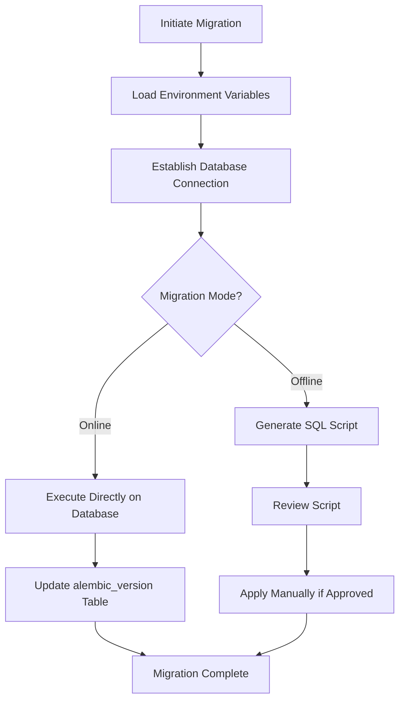
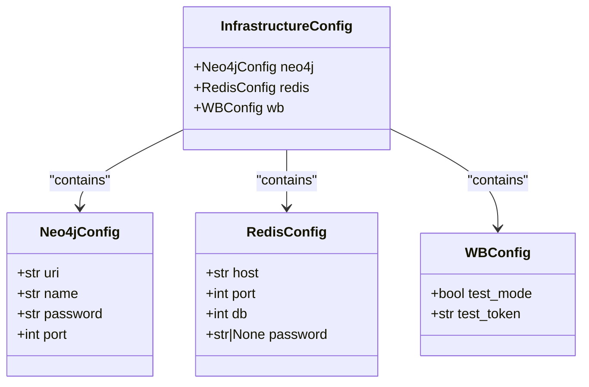
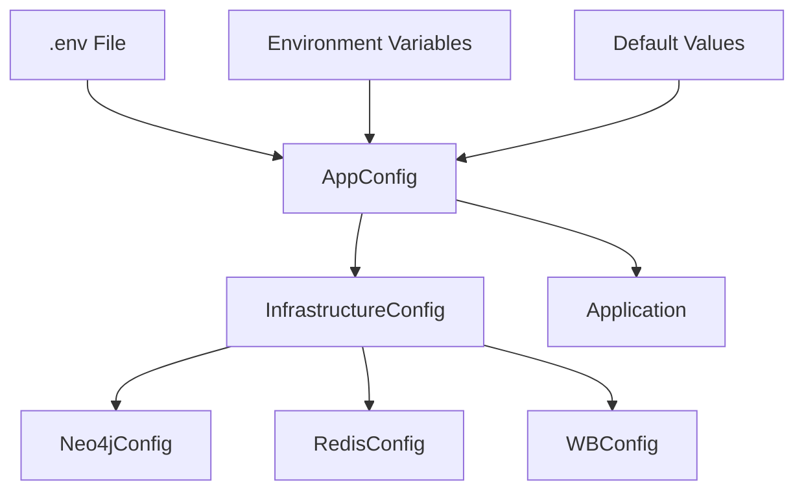
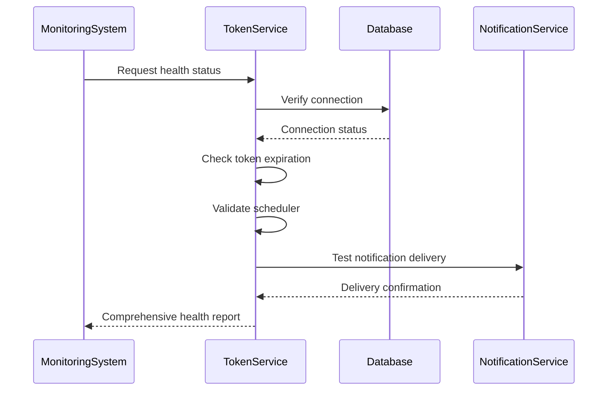
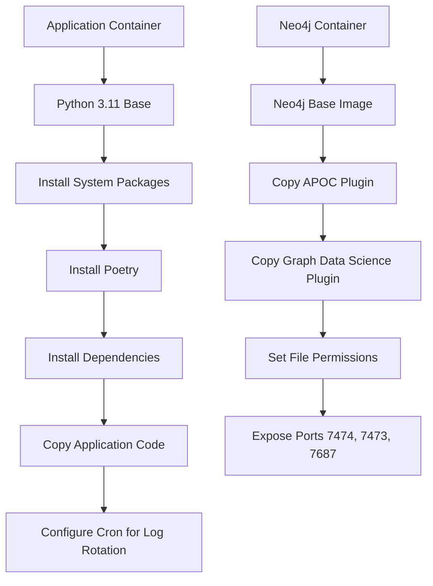

# Deployment Procedures

<cite>
**Referenced Files in This Document**   
- [alembic.ini](file://alembic.ini)
- [env.py](file://alembic/env.py)
- [app_config.py](file://app/configs/app_config.py)
- [infrastructure_config.py](file://app/configs/infrastructure_config/infrastructure_config.py)
- [neo4j_config.py](file://app/configs/infrastructure_config/neo4j_config.py)
- [redis_config.py](file://app/configs/infrastructure_config/redis_config.py)
- [wb_config.py](file://app/configs/infrastructure_config/wb_config.py)
- [session_maker.py](file://app/utils/db/session_maker.py)
- [settings_master.py](file://app/settings/settings_master.py)
- [Dockerfile](file://dockers/Dockerfile)
- [neo4j/Dockerfile](file://dockers/neo4j/Dockerfile)
- [startup.py](file://app/modules/token_monitoring/startup.py)
</cite>

## Table of Contents
1. [Introduction](#introduction)
2. [Database Migration Workflow with Alembic](#database-migration-workflow-with-alembic)
3. [Infrastructure Configuration](#infrastructure-configuration)
4. [Application Configuration](#application-configuration)
5. [Step-by-Step Deployment Instructions](#step-by-step-deployment-instructions)
6. [Health Check Implementation and System Monitoring](#health-check-implementation-and-system-monitoring)
7. [Docker Compose and Orchestration Deployment](#docker-compose-and-orchestration-deployment)
8. [Zero-Downtime and Blue-Green Deployment Strategies](#zero-downtime-and-blue-green-deployment-strategies)
9. [Deployment Verification and Service Availability](#deployment-verification-and-service-availability)
10. [Conclusion](#conclusion)

## Introduction
This document provides comprehensive deployment procedures for the adv-bot system, covering database migrations, infrastructure configuration, deployment workflows, monitoring, and verification processes. The system is designed to manage advertising campaigns on Wildberries with advanced features including token monitoring, automated bidding, and predictive analytics.

The deployment process involves multiple components including PostgreSQL for relational data, Neo4j for graph-based relationships, Redis for caching, and ClickHouse for analytics. The system uses Alembic for database migrations, Docker for containerization, and supports multiple deployment environments with appropriate configuration management.

**Section sources**
- [alembic.ini](file://alembic.ini)
- [app_config.py](file://app/configs/app_config.py)

## Database Migration Workflow with Alembic

### Version Management
The adv-bot system uses Alembic for database schema migrations, providing robust version control for the PostgreSQL database. The migration configuration is defined in `alembic.ini`, which specifies the script location as the `alembic/` directory and sets up the SQLAlchemy connection URL.

Alembic manages migration scripts in the `alembic/versions/` directory, with each migration file named using a revision identifier and descriptive slug (e.g., `0cf5b8a2edf8_add_auto_add_only_relevant_phrase_in_.py`). This approach enables clear tracking of schema changes over time.

The system maintains a history of migrations that includes:
- Adding auto-add functionality for relevant phrases
- Implementing balance limits and auto-update features
- Enhancing shop and token management
- Adding predictive CTR (Click-Through Rate) capabilities
- Implementing token notification tracking

### Migration Script Execution
Migration scripts are executed through Alembic's command-line interface. The process is configured in `alembic/env.py`, which sets up the migration environment by:

1. Loading environment variables via `dotenv.load_dotenv()`
2. Retrieving the database connection string from the application settings
3. Configuring the target metadata from the application's base model

The migration environment supports both offline and online modes:
- **Offline mode**: Generates SQL scripts without connecting to the database, useful for review and auditing
- **Online mode**: Directly applies migrations to the connected database



**Diagram sources**
- [alembic.ini](file://alembic.ini#L1-L110)
- [env.py](file://alembic/env.py#L0-L89)

### Rollback Strategies
The system implements several rollback strategies to ensure data integrity during deployment failures:

1. **Automated Rollback**: Alembic automatically handles rollback operations through the `down_revision` field in each migration script, allowing reverting to the previous version.

2. **Manual Intervention**: For complex scenarios, administrators can use Alembic commands:
   - `alembic downgrade <target_revision>`: Revert to a specific migration
   - `alembic history`: View migration history and revision identifiers
   - `alembic current`: Check the current database revision

3. **Data Backup**: Before major migrations, the system should implement database backups using standard PostgreSQL tools like `pg_dump`.

4. **Testing Environment**: All migrations should be tested in staging environments before production deployment.

The migration system is designed to be idempotent, ensuring that repeated execution of the same migration does not cause errors or data corruption.

**Section sources**
- [alembic.ini](file://alembic.ini#L1-L110)
- [env.py](file://alembic/env.py#L0-L89)

## Infrastructure Configuration

### Configuration Architecture
The infrastructure configuration is managed through a hierarchical structure defined in `infrastructure_config.py`. This approach centralizes all external service configurations in a single location, making it easier to manage and modify settings across different environments.

The configuration system uses Pydantic's `BaseSettings` class, which provides:
- Type validation for configuration values
- Environment variable loading from `.env` files
- Default value support
- Configuration inheritance and composition



**Diagram sources**
- [infrastructure_config.py](file://app/configs/infrastructure_config/infrastructure_config.py#L0-L19)
- [neo4j_config.py](file://app/configs/infrastructure_config/neo4j_config.py#L0-L16)
- [redis_config.py](file://app/configs/infrastructure_config/redis_config.py#L0-L15)
- [wb_config.py](file://app/configs/infrastructure_config/wb_config.py#L0-L22)

### Neo4j Configuration
The Neo4j configuration (`neo4j_config.py`) defines the connection parameters for the graph database:

- **uri**: The connection URI for Neo4j
- **name**: Username for authentication
- **password**: Password for authentication
- **port**: Connection port

The configuration uses environment variables prefixed with `NEO4J_` to allow environment-specific settings. This enables different Neo4j instances for development, staging, and production environments.

### Redis Configuration
The Redis configuration (`redis_config.py`) includes:

- **host**: Redis server hostname or IP address
- **port**: Connection port
- **db**: Database number (default: 0)
- **password**: Authentication password (optional)

Environment variables are prefixed with `REDIS_`, following the same pattern as other services. This consistent naming convention simplifies environment management.

### Wildberries API Configuration
The Wildberries API configuration (`wb_config.py`) includes settings specific to the Wildberries integration:

- **test_mode**: Boolean flag to enable test mode with mock data
- **test_token**: Token value used in test mode

This configuration allows the system to operate in a sandbox environment during development and testing, preventing unintended interactions with the live Wildberries platform.

**Section sources**
- [infrastructure_config.py](file://app/configs/infrastructure_config/infrastructure_config.py#L0-L19)
- [neo4j_config.py](file://app/configs/infrastructure_config/neo4j_config.py#L0-L16)
- [redis_config.py](file://app/configs/infrastructure_config/redis_config.py#L0-L15)
- [wb_config.py](file://app/configs/infrastructure_config/wb_config.py#L0-L22)

## Application Configuration

### Configuration Structure
The application configuration is implemented in `app_config.py` using Pydantic settings. The main `AppConfig` class serves as the root configuration object, containing:

- **infrastructure**: Reference to the infrastructure configuration
- Additional application-specific settings as needed

The configuration system uses environment variables with the `APP_` prefix, allowing for environment-specific overrides without modifying code.



**Diagram sources**
- [app_config.py](file://app/configs/app_config.py#L0-L22)
- [infrastructure_config.py](file://app/configs/infrastructure_config/infrastructure_config.py#L0-L19)

### Settings Management
The system uses a settings manager (`settings_master.py`) that provides property-based access to environment variables. This approach offers several advantages:

1. **Lazy Loading**: Values are only retrieved from environment variables when accessed
2. **Type Conversion**: Automatic conversion to appropriate types (int, bool, etc.)
3. **Validation**: Built-in validation and error handling for missing or invalid values
4. **Default Values**: Sensible defaults for optional settings

Key settings include:
- Database connection parameters (host, port, credentials)
- Redis configuration
- ClickHouse analytics database settings
- Webhook configuration for Telegram integration
- Thread pool sizes for various processing tasks
- Semaphore limits for database connections

The settings system is designed to fail fast when required settings are missing, preventing the application from starting with an invalid configuration.

**Section sources**
- [app_config.py](file://app/configs/app_config.py#L0-L22)
- [settings_master.py](file://app/settings/settings_master.py#L0-L199)

## Step-by-Step Deployment Instructions

### Development Environment
1. **Prerequisites**: Install Python 3.11, Docker, and Docker Compose
2. **Environment Setup**: Copy `.env.example` to `.env` and configure development settings
3. **Database Initialization**: 
   ```bash
   alembic upgrade head
   ```
4. **Start Services**: 
   ```bash
   docker-compose -f docker-compose.dev.yml up
   ```
5. **Verify Operation**: Access the application and confirm all services are responsive

### Staging Environment
1. **Prepare Deployment Package**: Build Docker images with staging tags
2. **Configure Environment**: Set staging-specific environment variables
3. **Database Migration**: 
   ```bash
   alembic upgrade head
   ```
4. **Deploy Services**: Use orchestration tools to deploy containers
5. **Run Integration Tests**: Execute automated tests against the staging environment
6. **Performance Testing**: Validate system performance under expected load

### Production Environment
1. **Pre-Deployment Checklist**:
   - Verify backup procedures are current
   - Confirm monitoring and alerting are configured
   - Validate rollback procedures
   - Notify stakeholders of maintenance window

2. **Deployment Process**:
   - Drain traffic from current instances
   - Apply database migrations
   - Deploy new application version
   - Run health checks
   - Gradually restore traffic

3. **Post-Deployment Activities**:
   - Monitor system metrics and logs
   - Verify business functionality
   - Update documentation
   - Conduct post-mortem review

**Section sources**
- [alembic.ini](file://alembic.ini#L1-L110)
- [env.py](file://alembic/env.py#L0-L89)
- [app_config.py](file://app/configs/app_config.py#L0-L22)

## Health Check Implementation and System Monitoring

### Health Check Endpoints
The system implements comprehensive health checks through the token monitoring module (`startup.py`). Key health indicators include:

- **Database connectivity**: Verification of PostgreSQL, Neo4j, and Redis connections
- **Service availability**: Confirmation that critical services are running
- **Token status**: Monitoring of Wildberries API tokens for validity and expiration
- **Scheduler status**: Verification that background tasks are executing properly

The health check system uses a decorator-based approach to monitor HTTP endpoints and detect service disruptions.



**Diagram sources**
- [startup.py](file://app/modules/token_monitoring/startup.py#L0-L119)

### System Monitoring Setup
The monitoring infrastructure includes:

1. **Logging**: Comprehensive logging with different levels (INFO, WARNING, ERROR)
2. **Metrics Collection**: Performance metrics for database queries and API responses
3. **Alerting**: Notification system for critical issues
4. **Dashboarding**: Visualization of system health and performance

The token monitoring system specifically tracks:
- Token deactivation events
- Approaching expiration dates
- Usage patterns and anomalies
- Integration points with external services

Monitoring is initialized through the `initialize_token_monitoring()` function, which sets up both decorator-based monitoring and scheduled expiration checks.

**Section sources**
- [startup.py](file://app/modules/token_monitoring/startup.py#L0-L119)

## Docker Compose and Orchestration Deployment

### Docker Configuration
The system provides Docker support through two Dockerfiles:

1. **Main Application Dockerfile** (`dockers/Dockerfile`):
   - Based on Python 3.11-slim
   - Uses Poetry for dependency management
   - Includes system packages for logging and cron
   - Configures logrotate for log management

2. **Neo4j Dockerfile** (`dockers/neo4j/Dockerfile`):
   - Based on Neo4j 2025.07.1
   - Includes APOC and Graph Data Science plugins
   - Configures proper file permissions
   - Exposes standard Neo4j ports



**Diagram sources**
- [Dockerfile](file://dockers/Dockerfile#L0-L36)
- [neo4j/Dockerfile](file://dockers/neo4j/Dockerfile#L0-L14)

### Orchestration Strategy
For production deployments, the system should be orchestrated using tools like Kubernetes or Docker Swarm. Key considerations include:

- **Service Discovery**: Ensuring components can locate each other
- **Load Balancing**: Distributing traffic across multiple instances
- **Auto-scaling**: Adjusting capacity based on demand
- **Rolling Updates**: Deploying new versions without downtime
- **Persistent Storage**: Managing data volumes for databases

The containerized architecture enables consistent deployment across different environments, from development to production.

**Section sources**
- [Dockerfile](file://dockers/Dockerfile#L0-L36)
- [neo4j/Dockerfile](file://dockers/neo4j/Dockerfile#L0-L14)

## Zero-Downtime and Blue-Green Deployment Strategies

### Zero-Downtime Deployment
The system supports zero-downtime deployments through:

1. **Connection Pooling**: The `session_maker.py` implementation includes connection pooling with:
   - Configurable pool size and overflow
   - Pre-ping to validate connections
   - Semaphore limiting for database connections

2. **Graceful Shutdown**: The application can be configured to:
   - Stop accepting new requests
   - Complete processing of existing requests
   - Cleanly close database connections
   - Terminate background tasks

3. **Health Checks**: Load balancers can use health endpoints to determine instance readiness

### Blue-Green Deployment
The blue-green deployment pattern is supported through:

1. **Environment Isolation**: Complete separation of blue and green environments
2. **Configuration Management**: Environment-specific settings via `.env` files
3. **Traffic Switching**: DNS or load balancer-based traffic routing
4. **Database Compatibility**: Migration strategy that maintains backward compatibility

The deployment process follows these steps:
1. Deploy new version to inactive environment (green)
2. Run verification tests
3. Switch traffic from active environment (blue) to green
4. Monitor green environment
5. Keep blue environment as fallback
6. Decommission blue environment after successful validation

This approach minimizes risk and allows for rapid rollback if issues are detected.

**Section sources**
- [session_maker.py](file://app/utils/db/session_maker.py#L0-L177)
- [settings_master.py](file://app/settings/settings_master.py#L0-L199)

## Deployment Verification and Service Availability

### Verification Steps
After deployment, execute the following verification steps:

1. **Service Health Check**:
   ```bash
   curl http://localhost:8000/health
   ```

2. **Database Connectivity**:
   - Verify all tables exist and have expected structure
   - Confirm migration version matches expected value
   - Test read/write operations

3. **External Service Integration**:
   - Test Neo4j connectivity and query execution
   - Verify Redis cache operations
   - Confirm Wildberries API access

4. **Background Tasks**:
   - Verify schedulers are running
   - Check queue processing
   - Validate periodic tasks execute as expected

5. **Security Validation**:
   - Confirm authentication mechanisms work
   - Verify sensitive data is properly protected
   - Test error handling for unauthorized access

### Service Availability Monitoring
Implement continuous monitoring to ensure service availability:

1. **Uptime Monitoring**: External services to ping health endpoints
2. **Performance Metrics**: Track response times and error rates
3. **Resource Utilization**: Monitor CPU, memory, and storage usage
4. **Log Analysis**: Centralized logging with alerting on critical errors
5. **Business Metrics**: Track key performance indicators specific to advertising campaign management

The system should generate alerts for:
- Service unavailability
- Performance degradation
- Resource exhaustion
- Security incidents
- Data consistency issues

Regular verification ensures the deployed system functions as expected and meets performance and reliability requirements.

**Section sources**
- [startup.py](file://app/modules/token_monitoring/startup.py#L0-L119)
- [session_maker.py](file://app/utils/db/session_maker.py#L0-L177)

## Conclusion
The adv-bot system provides a comprehensive framework for managing advertising campaigns on Wildberries with robust deployment procedures. The architecture combines multiple database technologies (PostgreSQL, Neo4j, Redis, ClickHouse) with a microservices-inspired design, enabling scalability and maintainability.

Key deployment features include:
- **Database migrations** using Alembic for reliable schema evolution
- **Hierarchical configuration** for easy environment management
- **Containerization** with Docker for consistent deployments
- **Health monitoring** to ensure service availability
- **Zero-downtime strategies** to minimize user impact

The deployment process is designed to be repeatable, reliable, and safe, with appropriate safeguards for production environments. By following these procedures, teams can confidently deploy updates while maintaining system stability and data integrity.