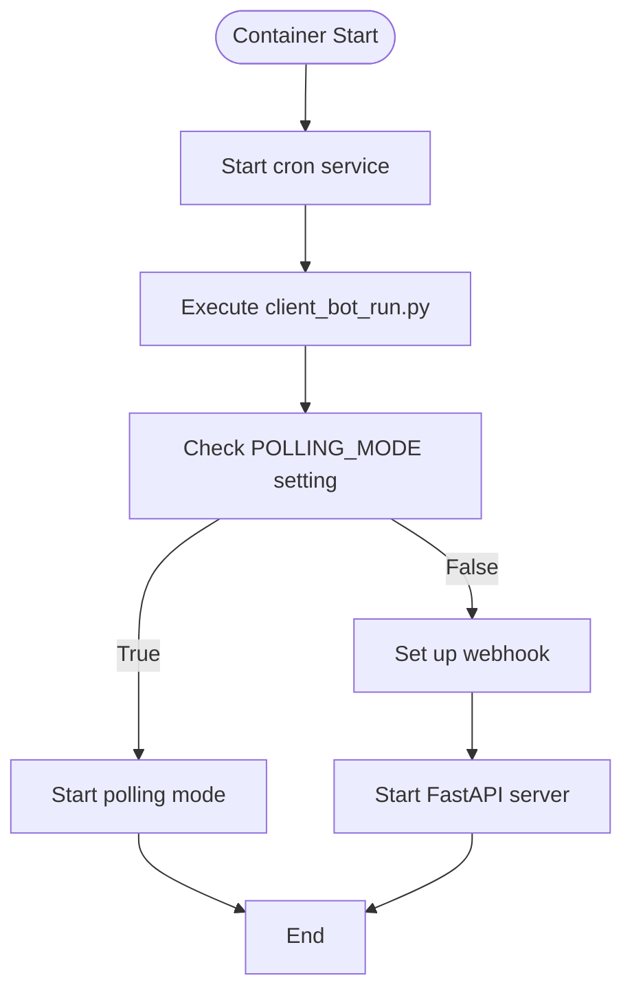

# Docker Configuration

<cite>
**Referenced Files in This Document**   
- [ClientBotDockerfile](file://ClientBotDockerfile)
- [dockers/Dockerfile](file://dockers/Dockerfile)
- [client_bot_run.py](file://client_bot_run.py)
- [requirements.txt](file://requirements.txt)
- [logging_config.json](file://logging_config.json)
</cite>

## Table of Contents
1. [Introduction](#introduction)
2. [Multi-Stage Docker Setup](#multi-stage-docker-setup)
3. [Base Image and Virtual Environment](#base-image-and-virtual-environment)
4. [System-Level Dependencies](#system-level-dependencies)
5. [Code and Configuration Copying](#code-and-configuration-copying)
6. [Environment Variable Configuration](#environment-variable-configuration)
7. [Cron and Log Rotation Setup](#cron-and-log-rotation-setup)
8. [Differences Between Dockerfiles](#differences-between-dockerfiles)
9. [Container Execution Commands](#container-execution-commands)
10. [Practical Examples](#practical-examples)
11. [Common Issues and Troubleshooting](#common-issues-and-troubleshooting)
12. [Performance Optimization](#performance-optimization)

## Introduction
The adv-bot system utilizes a sophisticated Docker configuration to ensure reliable deployment and operation of its client bot component. This documentation provides a comprehensive analysis of the Docker setup, focusing on the two Dockerfiles used in the system: the main `dockers/Dockerfile` and the client-specific `ClientBotDockerfile`. The configuration establishes a robust environment with proper dependency management, logging infrastructure, and certificate setup for Yandex Cloud PostgreSQL integration. The Docker setup follows best practices for Python applications, including virtual environment isolation, multi-stage build considerations, and proper service orchestration.

## Multi-Stage Docker Setup
The adv-bot system implements a multi-stage Docker configuration approach with two distinct Dockerfiles serving different purposes in the deployment pipeline. The primary `dockers/Dockerfile` serves as the base image definition, while `ClientBotDockerfile` extends this foundation with application-specific runtime configurations. This separation allows for efficient image building and deployment, where the base image can be built once and reused across multiple services, while the client-specific Dockerfile adds the final application layer and execution commands. The multi-stage approach optimizes build times by caching dependency installations and reduces image bloat by separating build-time dependencies from runtime requirements.

**Section sources**
- [dockers/Dockerfile](file://dockers/Dockerfile#L1-L45)
- [ClientBotDockerfile](file://ClientBotDockerfile#L1-L55)

## Base Image and Virtual Environment
The Docker configuration begins with the Python 3.11 base image, providing a stable and up-to-date Python environment for the adv-bot application. The setup creates an isolated virtual environment using Python's venv module, ensuring dependency separation and preventing conflicts with system packages. The virtual environment is created at `/app/venv` and activated during the build process to install all Python dependencies specified in requirements.txt. This approach guarantees consistent package versions across different deployment environments and prevents dependency conflicts that could arise from global package installations.

**Section sources**
- [ClientBotDockerfile](file://ClientBotDockerfile#L1-L10)
- [dockers/Dockerfile](file://dockers/Dockerfile#L1-L10)

## System-Level Dependencies
The Docker configuration installs several critical system-level dependencies to support the application's functionality. These include logrotate for log management, cron for scheduled tasks, rsyslog for system logging, and various development libraries such as libsystemd-dev and pkg-config. Additionally, wget and ca-certificates are installed to facilitate certificate downloads and secure HTTPS connections. The installation of these system packages is performed in a single RUN command to minimize image layers and optimize build efficiency. These dependencies enable essential system services that support the application's logging, scheduling, and secure database connectivity requirements.

**Section sources**
- [ClientBotDockerfile](file://ClientBotDockerfile#L12-L20)
- [dockers/Dockerfile](file://dockers/Dockerfile#L12-L28)

## Code and Configuration Copying
The Docker configuration follows a strategic approach to copying code and configuration files, optimizing build performance and cache utilization. Initially, only the requirements.txt file is copied to install Python dependencies, allowing Docker to cache this layer and avoid reinstalling packages when application code changes. After dependency installation, the entire project directory is copied to the container using the COPY . . instruction. This two-step process significantly reduces build times during development, as changes to application code do not trigger dependency reinstallation. The WORKDIR is set to /app, establishing the application's root directory within the container.

**Section sources**
- [ClientBotDockerfile](file://ClientBotDockerfile#L8-L10)
- [ClientBotDockerfile](file://ClientBotDockerfile#L60-L62)
- [dockers/Dockerfile](file://dockers/Dockerfile#L8-L10)
- [dockers/Dockerfile](file://dockers/Dockerfile#L38-L40)

## Environment Variable Configuration
The Docker configuration sets up the PATH environment variable to include the virtual environment's bin directory, ensuring that Python executables and installed packages are accessible without explicit activation. The ENV PATH="/app/venv/bin:$PATH" instruction prepends the virtual environment's path to the system PATH, making pip, python, and other installed tools available in their activated state throughout the container's lifecycle. This configuration eliminates the need to manually activate the virtual environment in runtime commands and ensures consistent execution environment for all processes within the container.

**Section sources**
- [ClientBotDockerfile](file://ClientBotDockerfile#L53-L54)
- [dockers/Dockerfile](file://dockers/Dockerfile#L44-L45)

## Cron and Log Rotation Setup
The Docker configuration implements a comprehensive logging infrastructure using logrotate and cron for automated log management. A cron job is configured to execute logrotate every five minutes via the command "*/5 * * * * /usr/sbin/logrotate /etc/logrotate.conf". This frequent rotation ensures that log files are regularly rotated and managed, preventing disk space exhaustion. Although the logrotate configuration files are referenced in comments, they are currently commented out in the Dockerfile, suggesting they may be provided at runtime or through other configuration mechanisms. The rsyslog service is also installed to support system-level logging.

**Section sources**
- [ClientBotDockerfile](file://ClientBotDockerfile#L45-L48)
- [dockers/Dockerfile](file://dockers/Dockerfile#L34-L37)

## Differences Between Dockerfiles
The two Dockerfiles in the adv-bot system exhibit several key differences that reflect their distinct purposes. The `dockers/Dockerfile` combines multiple operations in a single RUN command for efficiency, while `ClientBotDockerfile` separates these operations into individual commands, potentially for better build transparency. The client Dockerfile includes explicit comments about logrotate configuration files that are currently disabled, suggesting ongoing configuration adjustments. Most significantly, `ClientBotDockerfile` includes a CMD instruction to start services and run the application, while the base Dockerfile omits this, indicating it's intended as a base image rather than a runnable container. The certificate installation process is also structured differently, with the client Dockerfile using separate RUN commands.

**Section sources**
- [ClientBotDockerfile](file://ClientBotDockerfile#L1-L55)
- [dockers/Dockerfile](file://dockers/Dockerfile#L1-L45)

## Container Execution Commands
The `ClientBotDockerfile` specifies the container's startup command using the CMD instruction, which starts the cron service and executes the client bot application. The command "bash -c 'service cron start && python client_bot_run.py'" ensures that the cron daemon is running for scheduled tasks while launching the main application. The `client_bot_run.py` script serves as the application entry point, implementing a dual-mode operation that supports both polling and webhook configurations based on environment settings. This flexible execution model allows the bot to adapt to different deployment environments and infrastructure requirements.

**Diagram sources**
- [ClientBotDockerfile](file://ClientBotDockerfile#L56-L58)
- [client_bot_run.py](file://client_bot_run.py#L1-L155)

**Section sources**
- [ClientBotDockerfile](file://ClientBotDockerfile#L56-L58)
- [client_bot_run.py](file://client_bot_run.py#L1-L155)

## Practical Examples
Practical deployment of the adv-bot system involves building and running containers with appropriate volume mounts and environment configurations. To build the client bot image: `docker build -f ClientBotDockerfile -t adv-bot-client .`. The container can then be run with log volume mounting: `docker run -v ./logs:/app/logs -e POLLING_MODE=true adv-bot-client`. For production deployments, additional volumes should be mounted for configuration files and environment variables. Environment variables such as WEBHOOK_URL, WEBHOOK_PATH, and POLLING_MODE can be injected to configure the bot's operational mode. When deploying in Kubernetes environments, appropriate resource limits and health checks should be configured based on the FastAPI endpoints exposed in client_bot_run.py.

**Section sources**
- [ClientBotDockerfile](file://ClientBotDockerfile#L1-L58)
- [client_bot_run.py](file://client_bot_run.py#L1-L155)
- [logging_config.json](file://logging_config.json#L1-L33)

## Common Issues and Troubleshooting
Common issues in the adv-bot Docker deployment typically involve certificate loading failures, cron job misconfigurations, and environment variable conflicts. Certificate issues may arise if the Yandex Cloud CA certificates fail to download during build, which can be diagnosed by checking the build output for wget errors. Cron misconfigurations can prevent log rotation, leading to disk space exhaustion; this can be verified by checking cron service status and logrotate execution logs. Environment variable conflicts between the container and application settings may cause unexpected behavior, particularly with the POLLING_MODE setting. Troubleshooting steps include verifying service status with `docker exec`, checking log files in the mounted volume, and validating environment variables with `printenv`. The FastAPI health check endpoints (/health, /ready, /readiness) provide valuable runtime status information.

**Section sources**
- [ClientBotDockerfile](file://ClientBotDockerfile#L1-L58)
- [client_bot_run.py](file://client_bot_run.py#L1-L155)
- [logging_config.json](file://logging_config.json#L1-L33)

## Performance Optimization
Performance optimization for the adv-bot Docker containers focuses on reducing startup time and minimizing resource consumption. Key optimization strategies include combining RUN commands to reduce image layers, leveraging Docker build cache effectively, and minimizing the size of the final image. The current configuration could be further optimized by using multi-stage builds to separate build and runtime environments, reducing the final image size by excluding development dependencies. Container startup time can be improved by optimizing the application's initialization sequence and implementing lazy loading for non-essential components. Monitoring container resource usage and adjusting CPU and memory limits appropriately ensures efficient resource utilization in production environments.

**Section sources**
- [ClientBotDockerfile](file://ClientBotDockerfile#L1-L58)
- [dockers/Dockerfile](file://dockers/Dockerfile#L1-L45)