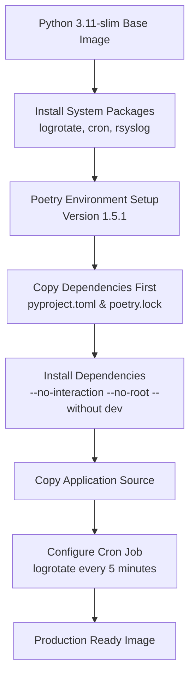
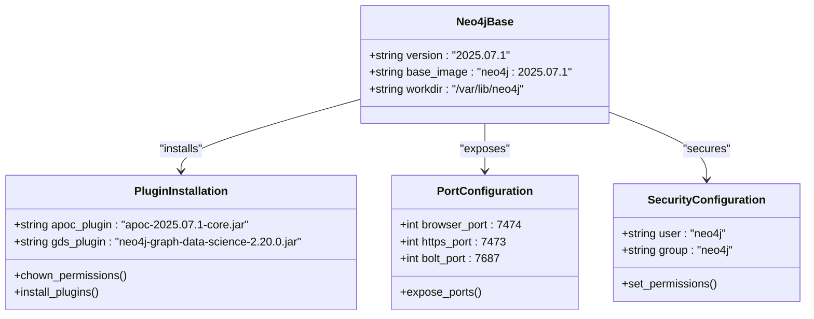
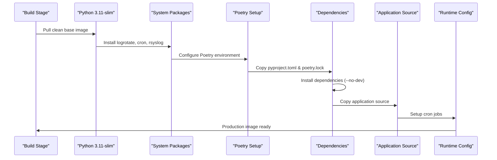
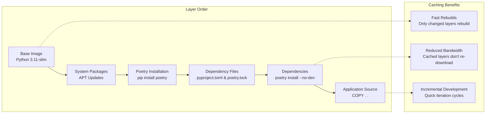
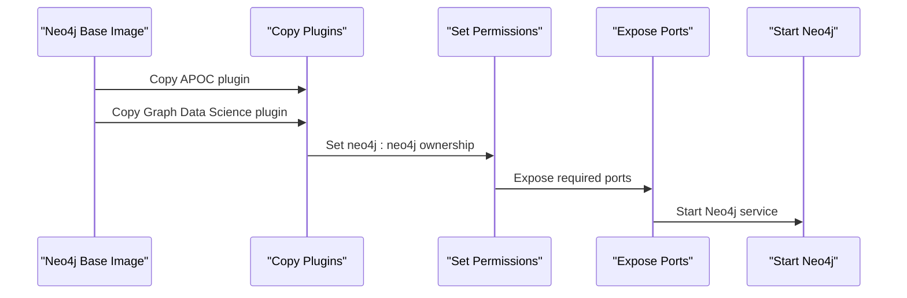
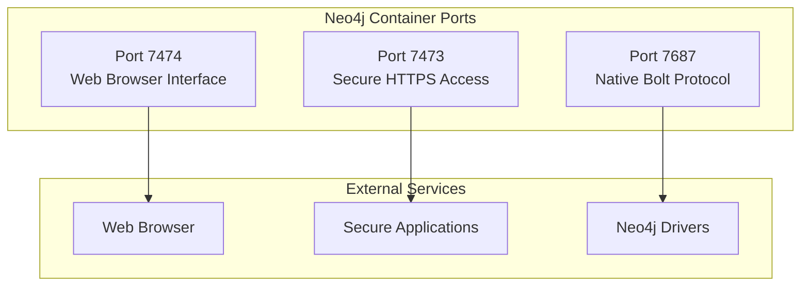
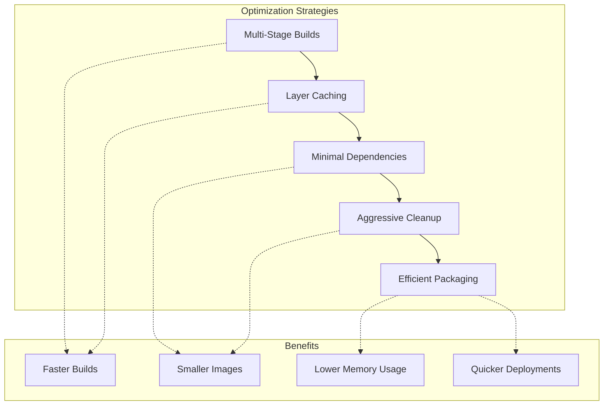
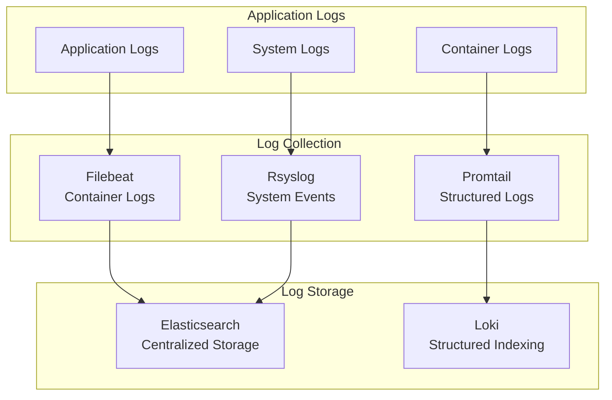

# Docker Configuration

<cite>
**Referenced Files in This Document**
- [dockers/Dockerfile](file://dockers/Dockerfile)
- [dockers/neo4j/Dockerfile](file://dockers/neo4j/Dockerfile)
- [pyproject.toml](file://pyproject.toml)
- [filebeat.yml](file://filebeat.yml)
- [promtail-config.yml](file://promtail-config.yml)
- [app/configs/infrastructure_config/neo4j_config.py](file://app/configs/infrastructure_config/neo4j_config.py)
- [app/configs/infrastructure_config/redis_config.py](file://app/configs/infrastructure_config/redis_config.py)
- [app/configs/infrastructure_config/wb_config.py](file://app/configs/infrastructure_config/wb_config.py)
</cite>

## Table of Contents
1. [Introduction](#introduction)
2. [Main Application Dockerfile](#main-application-dockerfile)
3. [Neo4j Docker Configuration](#neo4j-docker-configuration)
4. [Multi-Stage Build Process](#multi-stage-build-process)
5. [System Package Installation](#system-package-installation)
6. [Poetry Dependency Management](#poetry-dependency-management)
7. [Layer Caching Strategy](#layer-caching-strategy)
8. [Logging and Scheduling Setup](#logging-and-scheduling-setup)
9. [Plugin Integration](#plugin-integration)
10. [Port Configuration](#port-configuration)
11. [Container Optimization Best Practices](#container-optimization-best-practices)
12. [Environment-Specific Builds](#environment-specific-builds)
13. [Common Build Issues and Solutions](#common-build-issues-and-solutions)
14. [Monitoring and Logging](#monitoring-and-logging)
15. [Security Hardening](#security-hardening)
16. [Troubleshooting Guide](#troubleshooting-guide)

## Introduction

The adv-bot system utilizes a sophisticated Docker configuration designed for production deployment with multiple services. The system consists of two primary Docker configurations: a main Python application Dockerfile and a specialized Neo4j Dockerfile with plugin integration. This dual-container approach enables efficient microservices architecture with optimized resource utilization and enhanced security.

The Docker configuration emphasizes best practices including multi-stage builds, layer caching optimization, minimal base images, and comprehensive logging infrastructure. The setup supports various deployment environments while maintaining security standards and operational efficiency.

## Main Application Dockerfile

The main application Dockerfile implements a sophisticated multi-stage build process using Python 3.11-slim as the base image, ensuring optimal image size and security posture. The configuration prioritizes dependency isolation and build efficiency through strategic layer ordering and caching mechanisms.



**Diagram sources**
- [dockers/Dockerfile](file://dockers/Dockerfile#L1-L37)

**Section sources**
- [dockers/Dockerfile](file://dockers/Dockerfile#L1-L37)

## Neo4j Docker Configuration

The Neo4j Dockerfile extends the official Neo4j 2025.07.1 image with essential plugins for enhanced functionality. The configuration includes APOC (Awesome Procedures On Cypher) and Graph Data Science plugins, which are critical for advanced graph analytics and machine learning capabilities.



**Diagram sources**
- [dockers/neo4j/Dockerfile](file://dockers/neo4j/Dockerfile#L1-L15)

**Section sources**
- [dockers/neo4j/Dockerfile](file://dockers/neo4j/Dockerfile#L1-L15)

## Multi-Stage Build Process

The Docker configuration implements a multi-stage build strategy that optimizes both build performance and final image size. The process begins with a clean Python 3.11-slim base image, ensuring minimal attack surface and reduced maintenance overhead.

The build process follows a logical sequence:
1. **Base Layer**: Python 3.11-slim provides a secure foundation
2. **System Dependencies**: Essential logging and scheduling tools
3. **Development Tools**: Poetry for dependency management
4. **Dependency Resolution**: Isolated dependency installation
5. **Source Code**: Application code inclusion
6. **Runtime Configuration**: Cron job setup and final optimizations



**Diagram sources**
- [dockers/Dockerfile](file://dockers/Dockerfile#L1-L37)

## System Package Installation

The Docker configuration installs essential system packages that support logging, monitoring, and scheduled operations. These packages are carefully selected to minimize image size while providing necessary functionality.

Key system packages include:
- **logrotate**: Automated log rotation to prevent disk space issues
- **cron**: Scheduled task execution for maintenance operations
- **rsyslog**: Centralized logging infrastructure
- **libsystemd-dev**: Systemd development libraries
- **pkg-config**: Package configuration utilities
- **wget**: Secure file downloading capabilities
- **ca-certificates**: SSL certificate support

The installation process uses `apt-get` with aggressive cleanup to maintain minimal image size:

```bash
apt-get update && apt-get install -y --no-install-recommends \
    logrotate cron rsyslog libsystemd-dev pkg-config wget ca-certificates \
    && rm -rf /var/lib/apt/lists/*
```

**Section sources**
- [dockers/Dockerfile](file://dockers/Dockerfile#L11-L17)

## Poetry Dependency Management

The configuration integrates Poetry as the primary dependency management tool, configured with specific version constraints and environment settings. Poetry provides deterministic dependency resolution and virtual environment management.

Key Poetry configurations:
- **Version**: 1.5.1 (specific version for reproducibility)
- **Virtual Environment**: In-project storage (`POETRY_VIRTUALENVS_IN_PROJECT`)
- **PATH Configuration**: Automatic PATH updates for Poetry executables
- **Dependency Scope**: Excludes development dependencies in production builds

The Poetry setup ensures consistent dependency resolution across different environments while maintaining build reproducibility.

**Section sources**
- [dockers/Dockerfile](file://dockers/Dockerfile#L3-L8)
- [pyproject.toml](file://pyproject.toml#L1-L10)

## Layer Caching Strategy

The Docker configuration implements an intelligent layer caching strategy that maximizes build performance and minimizes rebuild times. The caching strategy follows a specific order that allows Docker to leverage cached layers effectively.



**Diagram sources**
- [dockers/Dockerfile](file://dockers/Dockerfile#L1-L37)

The caching strategy provides several advantages:
1. **Fast Rebuilds**: Only layers affected by changes are rebuilt
2. **Bandwidth Efficiency**: Cached layers reduce network traffic
3. **Development Speed**: Quick iteration cycles during development
4. **CI/CD Optimization**: Faster automated builds

**Section sources**
- [dockers/Dockerfile](file://dockers/Dockerfile#L20-L25)

## Logging and Scheduling Setup

The Docker configuration includes comprehensive logging and scheduling infrastructure to support operational monitoring and maintenance tasks. The setup ensures reliable log management and automated system maintenance.

### Log Rotation Configuration

Log rotation is configured through cron jobs that execute every 5 minutes, ensuring logs remain manageable and disk space is conserved. The configuration includes:

```bash
echo "*/5 * * * * /usr/sbin/logrotate /etc/logrotate.conf" > /etc/cron.d/logrotate \
    && chmod 0644 /etc/cron.d/logrotate
```

### Centralized Logging Infrastructure

The system integrates with external logging solutions through Filebeat and Promtail configurations:

- **Filebeat**: Collects container logs from `/var/lib/docker/containers/*/*.log`
- **Promtail**: Provides structured logging with Loki integration
- **Elasticsearch Output**: Centralized log storage and analysis

**Section sources**
- [dockers/Dockerfile](file://dockers/Dockerfile#L35-L37)
- [filebeat.yml](file://filebeat.yml#L1-L10)
- [promtail-config.yml](file://promtail-config.yml#L1-L29)

## Plugin Integration

The Neo4j Dockerfile demonstrates sophisticated plugin integration capabilities, allowing for enhanced functionality through third-party extensions. The plugin system supports both APOC and Graph Data Science capabilities.

### Plugin Installation Process



**Diagram sources**
- [dockers/neo4j/Dockerfile](file://dockers/neo4j/Dockerfile#L1-L15)

### Plugin Versions and Compatibility

The configuration specifies exact plugin versions to ensure compatibility and reproducibility:
- **APOC**: Version 2025.07.1-core.jar
- **Graph Data Science**: Version 2.20.0.jar

Both plugins are copied to the Neo4j plugins directory with appropriate ownership settings to ensure proper execution permissions.

**Section sources**
- [dockers/neo4j/Dockerfile](file://dockers/neo4j/Dockerfile#L4-L8)

## Port Configuration

The Neo4j Dockerfile exposes three critical ports that enable different types of connectivity and communication:



**Diagram sources**
- [dockers/neo4j/Dockerfile](file://dockers/neo4j/Dockerfile#L11-L13)

### Port Purpose and Usage

- **Port 7474**: HTTP interface for web-based Neo4j Browser access
- **Port 7473**: HTTPS encrypted connection for secure data transfer
- **Port 7687**: Native Bolt protocol for high-performance driver connections

Each port serves a specific use case and security requirement, enabling flexible deployment scenarios while maintaining security boundaries.

**Section sources**
- [dockers/neo4j/Dockerfile](file://dockers/neo4j/Dockerfile#L11-L13)

## Container Optimization Best Practices

The Docker configuration implements numerous optimization strategies to ensure efficient resource utilization, fast deployment, and minimal operational overhead.

### Image Size Reduction Strategies

1. **Minimal Base Images**: Python 3.11-slim reduces base image size
2. **APT Cleanup**: Aggressive removal of package caches
3. **Single RUN Commands**: Minimized layers through command consolidation
4. **Selective Package Installation**: Only essential system packages

### Performance Optimization



### Resource Efficiency

The configuration prioritizes resource efficiency through:
- **Memory Optimization**: Minimal runtime footprint
- **CPU Efficiency**: Optimized dependency loading
- **Network Utilization**: Efficient layer downloads
- **Storage Management**: Compact image sizes

## Environment-Specific Builds

The Docker configuration supports multiple deployment environments through flexible build strategies and configuration management.

### Build Variants

1. **Development Environment**: Includes development dependencies
2. **Testing Environment**: Optimized for CI/CD pipelines
3. **Production Environment**: Minimal, secure, and optimized
4. **Staging Environment**: Near-production configuration

### Tagging Strategy

```bash
# Development builds
docker build -t adv-bot:dev .

# Testing builds
docker build -t adv-bot:test .

# Production builds
docker build -t adv-bot:latest .
docker build -t adv-bot:v1.0.0 .

# Neo4j specific builds
docker build -t neo4j-adv-bot:latest -f dockers/neo4j/Dockerfile .
```

### Environment Variables

The configuration supports environment-specific customization through:
- **Configuration Files**: Environment-specific settings
- **Volume Mounts**: Dynamic configuration injection
- **Build Arguments**: Compile-time environment selection

## Common Build Issues and Solutions

The Docker configuration anticipates and addresses common build challenges through proactive design decisions and troubleshooting strategies.

### Dependency Resolution Issues

**Problem**: Poetry dependency conflicts or missing packages
**Solution**: 
- Use exact version specifications in pyproject.toml
- Clear Poetry cache periodically
- Verify dependency compatibility matrix

### Layer Caching Problems

**Problem**: Docker not utilizing cached layers effectively
**Solution**:
- Maintain consistent file ordering in COPY commands
- Use `.dockerignore` to exclude unnecessary files
- Group frequently changing files separately

### Plugin Installation Failures

**Problem**: Neo4j plugins not loading correctly
**Solution**:
- Verify plugin compatibility with Neo4j version
- Check file permissions and ownership
- Validate plugin checksums

### Port Conflicts

**Problem**: Container port binding failures
**Solution**:
- Use dynamic port mapping in development
- Implement port conflict detection
- Provide clear error messaging for port issues

**Section sources**
- [dockers/Dockerfile](file://dockers/Dockerfile#L1-L37)
- [dockers/neo4j/Dockerfile](file://dockers/neo4j/Dockerfile#L1-L15)

## Monitoring and Logging

The Docker configuration integrates comprehensive monitoring and logging infrastructure to support operational visibility and troubleshooting.

### Log Collection Architecture



**Diagram sources**
- [filebeat.yml](file://filebeat.yml#L1-L10)
- [promtail-config.yml](file://promtail-config.yml#L1-L29)

### Monitoring Integration

The configuration supports multiple monitoring approaches:
- **Distributed Tracing**: Integration with observability platforms
- **Metrics Collection**: Prometheus-compatible metrics export
- **Health Checks**: Built-in container health monitoring
- **Alerting**: Integration with alerting systems

**Section sources**
- [filebeat.yml](file://filebeat.yml#L1-L10)
- [promtail-config.yml](file://promtail-config.yml#L1-L29)

## Security Hardening

The Docker configuration implements multiple security measures to protect against common vulnerabilities and ensure secure operations.

### Base Image Security

- **Minimal Attack Surface**: Python 3.11-slim base image
- **Regular Updates**: Automated security patch management
- **Non-root Execution**: Reduced privilege levels
- **Package Verification**: Integrity checking of installed packages

### Network Security

- **Port Exposure Control**: Minimal port exposure
- **Protocol Encryption**: HTTPS and TLS support
- **Firewall Integration**: Network-level protection
- **Access Control**: Authentication and authorization

### File System Security

- **Ownership Validation**: Proper file ownership settings
- **Permission Management**: Minimal required permissions
- **Volume Security**: Secure volume mounting practices
- **Secret Management**: Encrypted credential handling

## Troubleshooting Guide

This section provides comprehensive troubleshooting guidance for common Docker-related issues encountered during development and deployment.

### Build Troubleshooting

**Issue**: Docker build fails with dependency errors
**Diagnosis Steps**:
1. Check pyproject.toml dependency versions
2. Verify Poetry cache integrity
3. Review network connectivity for package downloads
4. Validate Python version compatibility

**Issue**: Layer caching not working effectively
**Resolution**:
1. Review COPY command ordering
2. Implement .dockerignore file
3. Separate static vs. dynamic files
4. Use build arguments for environment-specific layers

### Runtime Troubleshooting

**Issue**: Container fails to start
**Diagnostic Approach**:
1. Check container logs for startup errors
2. Verify environment variable configuration
3. Validate port availability
4. Review resource allocation limits

**Issue**: Performance degradation
**Investigation Steps**:
1. Monitor container resource usage
2. Analyze log patterns for bottlenecks
3. Check network connectivity
4. Review dependency performance

### Neo4j-Specific Issues

**Issue**: Plugins not loading
**Troubleshooting Process**:
1. Verify plugin file integrity
2. Check Neo4j server logs
3. Validate plugin compatibility
4. Review permission settings

**Issue**: Port binding conflicts
**Resolution Strategy**:
1. Use docker ps to identify port conflicts
2. Implement dynamic port mapping
3. Configure port forwarding rules
4. Review firewall settings

### Logging and Monitoring Issues

**Issue**: Logs not appearing in centralized system
**Diagnostic Checklist**:
1. Verify Filebeat/Promtail configuration
2. Check Elasticsearch/Loki connectivity
3. Review authentication credentials
4. Validate log format specifications

**Issue**: Performance impact from logging
**Optimization Strategies**:
1. Adjust log levels appropriately
2. Implement log sampling
3. Optimize log collection intervals
4. Review storage capacity planning

**Section sources**
- [dockers/Dockerfile](file://dockers/Dockerfile#L1-L37)
- [dockers/neo4j/Dockerfile](file://dockers/neo4j/Dockerfile#L1-L15)