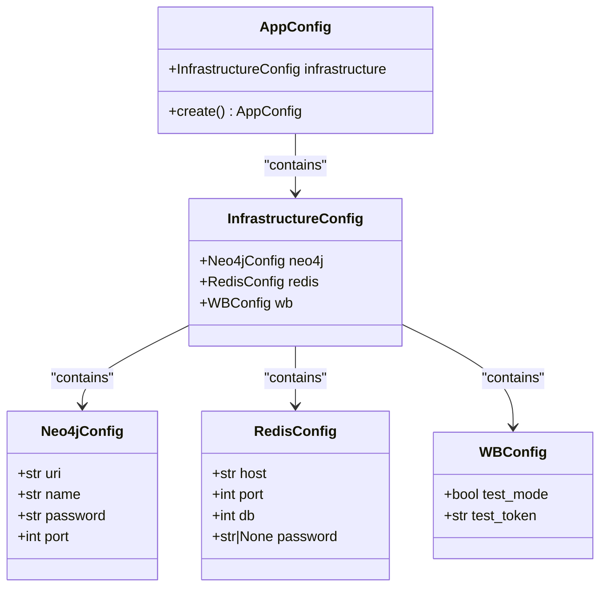
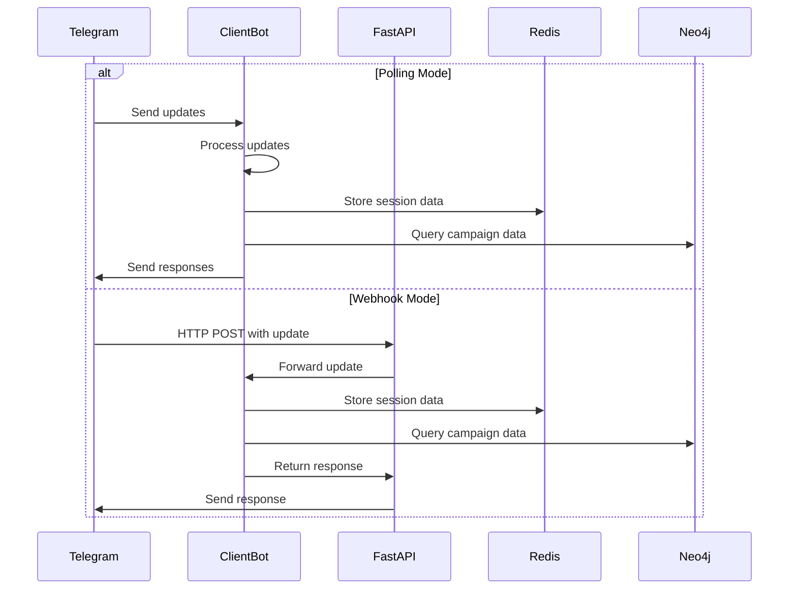
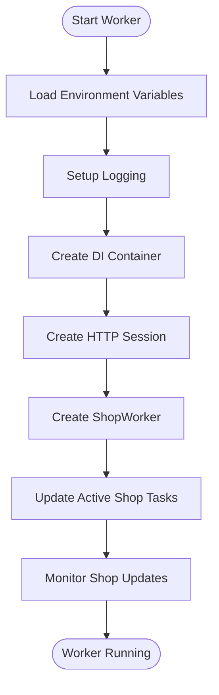
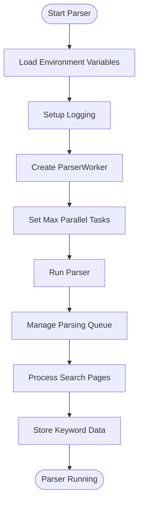
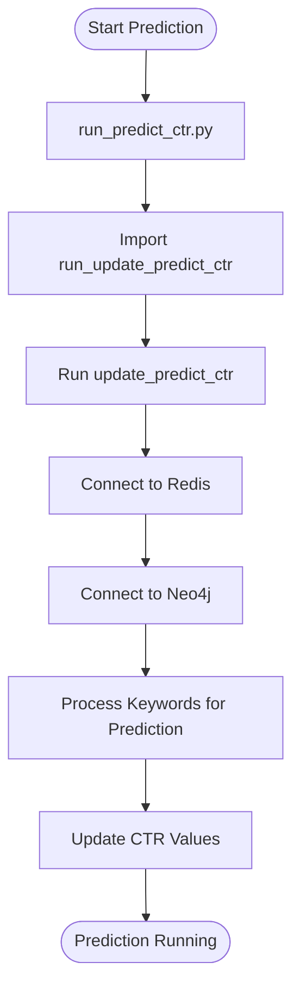
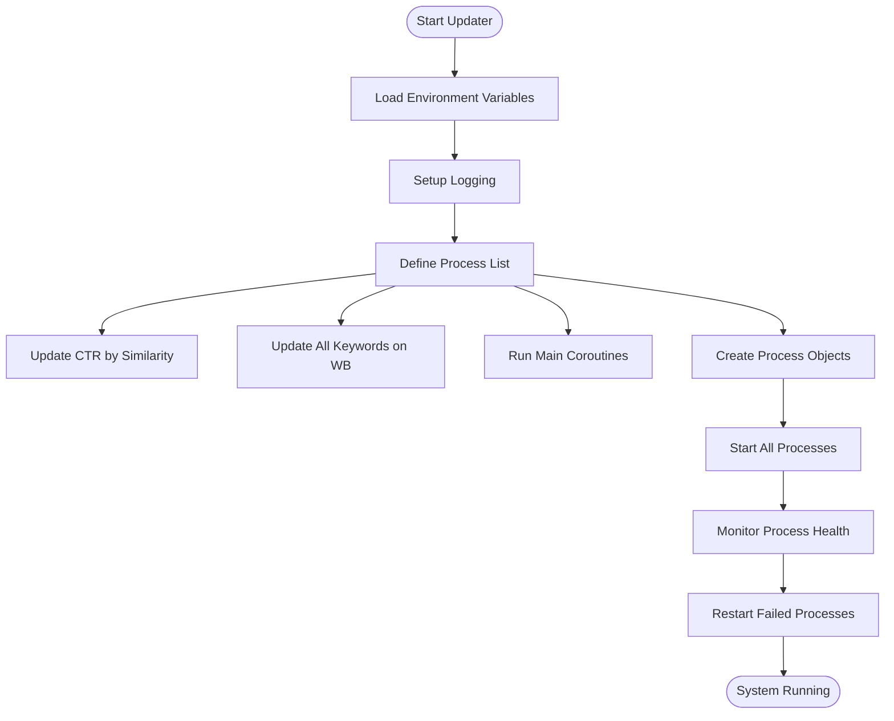
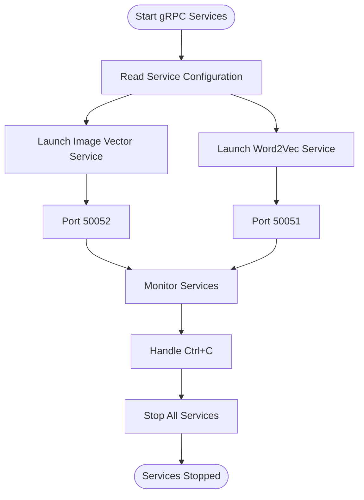

# Environment Setup

<cite>
**Referenced Files in This Document**   
- [app_config.py](file://app/configs/app_config.py)
- [infrastructure_config.py](file://app/configs/infrastructure_config/infrastructure_config.py)
- [neo4j_config.py](file://app/configs/infrastructure_config/neo4j_config.py)
- [redis_config.py](file://app/configs/infrastructure_config/redis_config.py)
- [wb_config.py](file://app/configs/infrastructure_config/wb_config.py)
- [settings_master.py](file://app/settings/settings_master.py)
- [client_bot_run.py](file://client_bot_run.py)
- [run_shop_update_worker.py](file://run_shop_update_worker.py)
- [run_keywords_parsing.py](file://run_keywords_parsing.py)
- [run_predict_ctr.py](file://run_predict_ctr.py)
- [updater.py](file://updater.py)
- [arq_redis_settings.py](file://app/arq_workers/arq_redis_settings.py)
- [config.py](file://app/modules/grpcs/predict_ctr_service/config.py)
- [run_grpc_services.py](file://run_grpc_services.py)
</cite>

## Table of Contents
1. [Introduction](#introduction)
2. [Core Configuration Architecture](#core-configuration-architecture)
3. [Environment Variables](#environment-variables)
4. [Component Setup](#component-setup)
5. [Secrets Management](#secrets-management)
6. [Configuration Pitfalls and Debugging](#configuration-pitfalls-and-debugging)
7. [Deployment Scenarios](#deployment-scenarios)
8. [Conclusion](#conclusion)

## Introduction

The adv-bot application is a multi-component system designed to manage advertising campaigns on Wildberries (WB). This document provides comprehensive guidance for setting up the runtime environment, covering all essential components: client bot, shop update worker, keyword parsing, prediction service, and main updater. Since no `.env.example` file is available, environment variables have been inferred from configuration files and entry point scripts. The setup process involves configuring environment-specific settings, managing secrets, and understanding how configuration affects system behavior across different deployment scenarios.

## Core Configuration Architecture

The adv-bot application uses a hierarchical configuration system built on Pydantic Settings, with environment variables as the primary source of configuration. The configuration is organized into multiple layers, with the main application configuration delegating to infrastructure-specific configurations for Neo4j, Redis, and Wildberries API.



**Diagram sources**
- [app_config.py](file://app/configs/app_config.py#L1-L23)
- [infrastructure_config.py](file://app/configs/infrastructure_config/infrastructure_config.py#L1-L20)
- [neo4j_config.py](file://app/configs/infrastructure_config/neo4j_config.py#L1-L17)
- [redis_config.py](file://app/configs/infrastructure_config/redis_config.py#L1-L16)
- [wb_config.py](file://app/configs/infrastructure_config/wb_config.py#L1-L23)

**Section sources**
- [app_config.py](file://app/configs/app_config.py#L1-L23)
- [infrastructure_config.py](file://app/configs/infrastructure_config/infrastructure_config.py#L1-L20)

## Environment Variables

The application relies on numerous environment variables for configuration. These variables are organized by component and service, with specific prefixes for different configuration sections.

### Application-Level Variables

| Variable | Purpose | Default | Required |
|--------|--------|--------|--------|
| `APP_` prefix | Prefix for AppConfig settings | None | Yes |
| `TEST_MODE` | Enables test mode with test tokens | false | No |
| `POLLING_MODE` | Determines bot operation mode (polling vs webhook) | false | No |
| `VERSION` | Application version identifier | None | No |
| `LOG_LEVEL` | Logging verbosity level | ERROR | No |

### Database and Cache Variables

| Variable | Purpose | Default | Required |
|--------|--------|--------|--------|
| `NEO4J_URI` | Neo4j database URI | None | Yes |
| `NEO4J_NAME` | Neo4j username | None | Yes |
| `NEO4J_PASSWORD` | Neo4j password | None | Yes |
| `NEO4J_PORT` | Neo4j port | None | Yes |
| `REDIS_MASTER_HOST` | Redis master host | None | Yes |
| `REDIS_REPLICA_HOST` | Redis replica host | None | Yes |
| `REDIS_PORT` | Redis port | 6379 | No |
| `REDIS_PASSWORD` | Redis password | None | No |
| `POSTGRES_MASTER_HOST` | PostgreSQL master host | None | No |
| `POSTGRES_REPLICA_HOST` | PostgreSQL replica host | None | No |
| `POSTGRES_HOST` | PostgreSQL host | None | Yes |
| `POSTGRES_PORT` | PostgreSQL port | None | Yes |
| `POSTGRES_USER` | PostgreSQL username | None | Yes |
| `POSTGRES_PASSWORD` | PostgreSQL password | None | Yes |
| `POSTGRES_DBNAME` | PostgreSQL database name | None | Yes |
| `POSTGRES_SSL_MODE` | PostgreSQL SSL mode | None | Yes |
| `CLICK_HOUSE_HOST` | ClickHouse host | None | Yes |
| `CLICK_HOUSE_USER` | ClickHouse username | None | Yes |
| `CLICK_HOUSE_PASSWORD` | ClickHouse password | None | Yes |
| `CLICKHOUSE_PORT` | ClickHouse port | None | Yes |

### Bot and API Variables

| Variable | Purpose | Default | Required |
|--------|--------|--------|--------|
| `TELEGRAM_BOT_TOKEN` | Telegram bot authentication token | None | Yes |
| `WEBHOOK_URL` | Public URL for Telegram webhook | None | No |
| `WEBHOOK_PATH` | Webhook endpoint path | None | No |
| `WEBHOOK_SECRET` | Secret token for webhook authentication | None | Yes |
| `TELEGRAM_WEB_PORT` | Web server port for bot | None | Yes |
| `WB_TEST_MODE` | Wildberries API test mode flag | false | No |
| `WB_TEST_TOKEN` | Test token for Wildberries API | test_token_value | No |
| `YOOKASSA_TOKEN` | Payment processing token | None | Yes |

### Component-Specific Variables

| Variable | Purpose | Default | Required |
|--------|--------|--------|--------|
| `PARALLER_PARSE_TASKS` | Maximum parallel parsing tasks | 50 | No |
| `MAX_PARSING_PARALLEL_JOBS` | Maximum parsing jobs | 10 | No |
| `MAX_PAGE_LIMIT_PARSER_WORKER` | Maximum pages to parse | 60 | No |
| `PARSING_TIMEOUT` | Parsing operation timeout in seconds | 14400 (4 hours) | No |
| `PREDICT_CTR_HOST` | Prediction service host | localhost | No |
| `PREDICT_CTR_PORT` | Prediction service port | 50053 | No |
| `BIDDER_STEP_RUB` | Bid increment step in rubles | None | Yes |
| `SHOP_FILTER_LIST` | Comma-separated list of shop IDs to process | None | No |
| `SHOPS_WORKS_TLL` | Time-to-live for shop processing tasks | 300 seconds | No |

**Section sources**
- [settings_master.py](file://app/settings/settings_master.py#L1-L434)
- [app_config.py](file://app/configs/app_config.py#L1-L23)
- [infrastructure_config.py](file://app/configs/infrastructure_config/infrastructure_config.py#L1-L20)

## Component Setup

The adv-bot application consists of multiple independent components that can be run separately or together. Each component has its own entry point and specific configuration requirements.

### Client Bot Setup

The client bot handles user interactions through Telegram. It can operate in two modes: polling and webhook.



**Diagram sources**
- [client_bot_run.py](file://client_bot_run.py#L1-L157)
- [app_config.py](file://app/configs/app_config.py#L1-L23)

**Section sources**
- [client_bot_run.py](file://client_bot_run.py#L1-L157)

### Shop Update Worker Setup

The shop update worker manages the periodic updating of shop data from Wildberries.



**Diagram sources**
- [run_shop_update_worker.py](file://run_shop_update_worker.py#L1-L28)

**Section sources**
- [run_shop_update_worker.py](file://run_shop_update_worker.py#L1-L28)

### Keyword Parsing Setup

The keyword parsing component extracts and processes keywords from Wildberries search results.



**Diagram sources**
- [run_keywords_parsing.py](file://run_keywords_parsing.py#L1-L32)

**Section sources**
- [run_keywords_parsing.py](file://run_keywords_parsing.py#L1-L32)

### Prediction Service Setup

The prediction service provides CTR (Click-Through Rate) predictions for advertising keywords.



**Diagram sources**
- [run_predict_ctr.py](file://run_predict_ctr.py#L1-L7)
- [config.py](file://app/modules/grpcs/predict_ctr_service/config.py#L1-L7)

**Section sources**
- [run_predict_ctr.py](file://run_predict_ctr.py#L1-L7)

### Main Updater Setup

The main updater orchestrates multiple background processes for campaign management.



**Diagram sources**
- [updater.py](file://updater.py#L1-L99)

**Section sources**
- [updater.py](file://updater.py#L1-L99)

### gRPC Services Setup

The application includes gRPC services for various prediction and vector operations.



**Diagram sources**
- [run_grpc_services.py](file://run_grpc_services.py#L1-L36)
- [config.py](file://app/modules/grpcs/predict_ctr_service/config.py#L1-L7)

**Section sources**
- [run_grpc_services.py](file://run_grpc_services.py#L1-L36)

## Secrets Management

The adv-bot application handles several types of sensitive data that require proper management:

### Authentication Tokens
- **Telegram Bot Token**: Used for bot authentication with Telegram API
- **Wildberries API Tokens**: Required for accessing Wildberries advertising data
- **YooKassa Token**: Used for payment processing
- **Database Credentials**: Neo4j, PostgreSQL, and Redis passwords

### Best Practices for Secrets Management

1. **Environment Variables**: Store all secrets in environment variables rather than configuration files
2. **.env Files**: Use .env files in development, but ensure they are git-ignored
3. **Secret Management Services**: In production, use dedicated secret management services like Hashicorp Vault, AWS Secrets Manager, or Azure Key Vault
4. **Access Control**: Restrict access to secrets based on the principle of least privilege
5. **Rotation**: Implement regular rotation of tokens and passwords
6. **Auditing**: Maintain logs of secret access and usage

### Sensitive Configuration Files
- `settings_master.py`: Contains logic for retrieving environment variables
- `app_config.py`: Central configuration class that loads environment variables
- `arq_redis_settings.py`: Contains Redis connection settings including host

**Section sources**
- [settings_master.py](file://app/settings/settings_master.py#L1-L434)
- [app_config.py](file://app/configs/app_config.py#L1-L23)
- [arq_redis_settings.py](file://app/arq_workers/arq_redis_settings.py#L1-L6)

## Configuration Pitfalls and Debugging

### Common Configuration Issues

1. **Missing Required Variables**: Ensure all required environment variables are set, particularly database credentials and API tokens
2. **Incorrect Hostnames**: Verify that service hostnames (Redis, PostgreSQL, Neo4j) are accessible from the application environment
3. **Port Conflicts**: Check for port conflicts, especially when running multiple services locally
4. **SSL/TLS Configuration**: Ensure SSL settings match the database configuration
5. **Network Connectivity**: Verify network connectivity between the application and external services

### Debugging Techniques

1. **Log Analysis**: Use the configured LOG_LEVEL to control verbosity and identify issues
2. **Health Checks**: Utilize the built-in health check endpoints:
   - `/health`: Basic health status
   - `/readiness`: Readiness status
   - `/webhook-info`: Webhook configuration details
3. **Process Monitoring**: Use the process controller in the main updater to monitor background processes
4. **Configuration Validation**: Implement validation in settings classes to catch issues early
5. **Connection Testing**: Test database and service connections independently before starting the full application

### Troubleshooting Specific Components

**Client Bot Issues**:
- Webhook not receiving updates: Verify WEBHOOK_URL is publicly accessible
- Polling mode conflicts: Ensure only one mode is active at a time
- Telegram API errors: Check bot token validity and permissions

**Database Connection Issues**:
- Connection timeouts: Verify network connectivity and firewall rules
- Authentication failures: Check username and password accuracy
- SSL handshake errors: Validate SSL configuration matches database settings

**Background Worker Issues**:
- Processes terminating unexpectedly: Check error logs and resource limits
- Performance bottlenecks: Adjust parallel task limits based on system resources
- Data consistency issues: Verify transaction handling and error recovery

**Section sources**
- [client_bot_run.py](file://client_bot_run.py#L1-L157)
- [updater.py](file://updater.py#L1-L99)
- [settings_master.py](file://app/settings/settings_master.py#L1-L434)

## Deployment Scenarios

The adv-bot application can be deployed in various scenarios, each with specific configuration requirements.

### Development Environment

For local development, use a simplified configuration with test services:

```env
TEST_MODE=true
POLLING_MODE=true
LOG_LEVEL=DEBUG
NEO4J_URI=localhost
NEO4J_NAME=test
NEO4J_PASSWORD=test
NEO4J_PORT=7687
REDIS_MASTER_HOST=localhost
REDIS_REPLICA_HOST=localhost
REDIS_PORT=6379
POSTGRES_HOST=localhost
POSTGRES_PORT=5432
POSTGRES_USER=test
POSTGRES_PASSWORD=test
POSTGRES_DBNAME=test
POSTGRES_SSL_MODE=disable
CLICK_HOUSE_HOST=localhost
CLICK_HOUSE_USER=default
CLICK_HOUSE_PASSWORD=
CLICKHOUSE_PORT=8123
TELEGRAM_BOT_TOKEN=123456:ABC-DEF1234ghIkl-zyx57W2v1u123ew11
WEBHOOK_SECRET=testsecret123
BIDDER_STEP_RUB=10
```

### Production Environment

In production, use secure configurations with proper service endpoints:

```env
TEST_MODE=false
POLLING_MODE=false
LOG_LEVEL=INFO
NEO4J_URI=neo4j.prod.example.com
NEO4J_NAME=adv_bot_user
NEO4J_PASSWORD=${SECRET_NEO4J_PASSWORD}
NEO4J_PORT=7687
REDIS_MASTER_HOST=redis-master.prod.example.com
REDIS_REPLICA_HOST=redis-replica.prod.example.com
REDIS_PORT=6379
REDIS_PASSWORD=${SECRET_REDIS_PASSWORD}
POSTGRES_HOST=postgres.prod.example.com
POSTGRES_PORT=5432
POSTGRES_USER=adv_bot_user
POSTGRES_PASSWORD=${SECRET_POSTGRES_PASSWORD}
POSTGRES_DBNAME=adv_bot_db
POSTGRES_SSL_MODE=require
CLICK_HOUSE_HOST=clickhouse.prod.example.com
CLICK_HOUSE_USER=adv_bot_user
CLICK_HOUSE_PASSWORD=${SECRET_CLICKHOUSE_PASSWORD}
CLICKHOUSE_PORT=8123
TELEGRAM_BOT_TOKEN=${SECRET_TELEGRAM_BOT_TOKEN}
WEBHOOK_URL=https://bot.adv-bot.com
WEBHOOK_PATH=/webhook
WEBHOOK_SECRET=${SECRET_WEBHOOK_TOKEN}
BIDDER_STEP_RUB=1
YOOKASSA_TOKEN=${SECRET_YOOKASSA_TOKEN}
```

### Docker Deployment

When deploying with Docker, ensure proper networking and volume configuration:

```dockerfile
# Example Dockerfile
FROM python:3.11-slim

WORKDIR /app
COPY . .

# Install dependencies
RUN pip install -r requirements.txt

# Expose ports
EXPOSE 8080
EXPOSE 50051-50053

# Run application
CMD ["python", "client_bot_run.py"]
```

Use Docker Compose to orchestrate multiple services:

```yaml
version: '3.8'
services:
  app:
    build: .
    environment:
      - REDIS_MASTER_HOST=redis
      - POSTGRES_HOST=postgres
      - NEO4J_URI=neo4j
    depends_on:
      - redis
      - postgres
      - neo4j
  
  redis:
    image: redis:7-alpine
  
  postgres:
    image: postgres:15
    environment:
      POSTGRES_DB: adv_bot
      POSTGRES_USER: adv_bot
      POSTGRES_PASSWORD: ${POSTGRES_PASSWORD}
  
  neo4j:
    image: neo4j:5
    environment:
      NEO4J_AUTH: neo4j/${NEO4J_PASSWORD}
```

**Section sources**
- [client_bot_run.py](file://client_bot_run.py#L1-L157)
- [settings_master.py](file://app/settings/settings_master.py#L1-L434)
- [app_config.py](file://app/configs/app_config.py#L1-L23)

## Conclusion

Setting up the runtime environment for the adv-bot application requires careful configuration of multiple components and services. The hierarchical configuration system based on Pydantic Settings provides flexibility while maintaining structure. Key considerations include proper management of environment variables, especially sensitive credentials, and understanding the interplay between different components. The application supports both polling and webhook modes for the Telegram bot, various deployment scenarios from development to production, and multiple background workers for different aspects of campaign management. By following the guidelines outlined in this document, you can successfully configure and deploy the adv-bot application in your target environment.