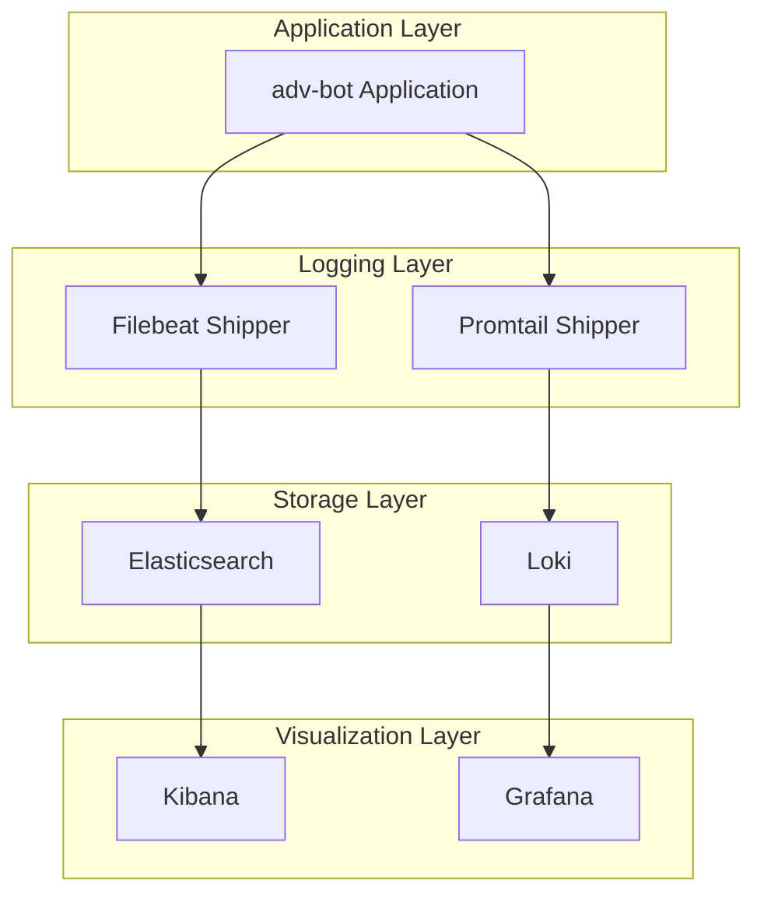
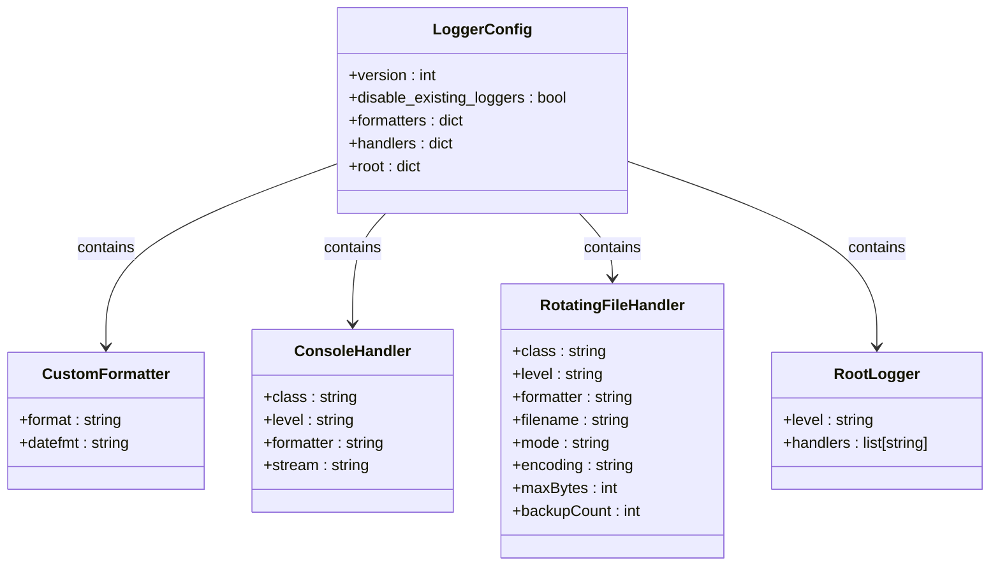
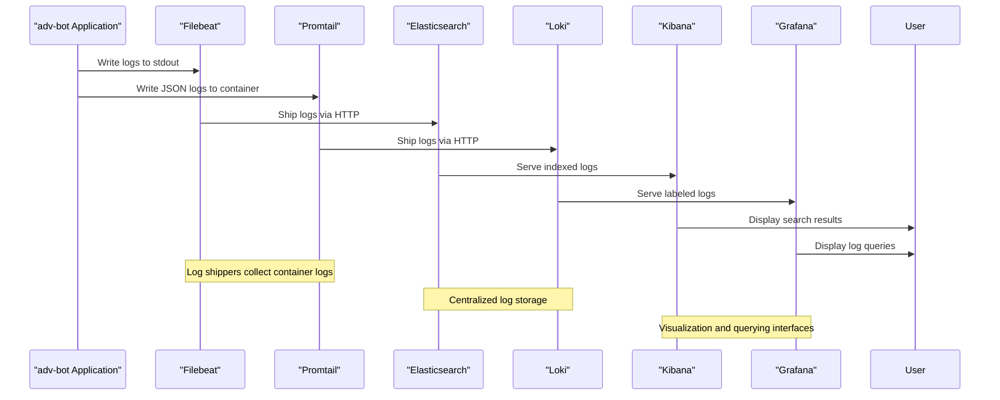
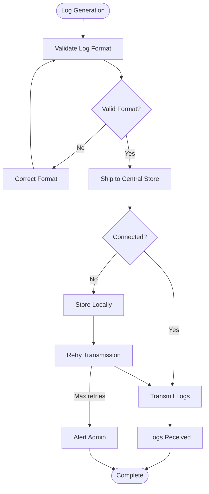

# Monitoring and Logging

<cite>
**Referenced Files in This Document**   
- [logging_config.json](file://logging_config.json)
- [filebeat.yml](file://filebeat.yml)
- [promtail-config.yml](file://promtail-config.yml)
- [python_modules/logger.py](file://python_modules/logger.py)
- [app/settings/settings_master.py](file://app/settings/settings_master.py)
- [app/settings/__init__.py](file://app/settings/__init__.py)
</cite>

## Table of Contents
1. [Introduction](#introduction)
2. [Centralized Logging Infrastructure](#centralized-logging-infrastructure)
3. [Logging Configuration](#logging-configuration)
4. [Log Shipper Configurations](#log-shipper-configurations)
5. [Log Querying and Visualization](#log-querying-and-visualization)
6. [Common Issues and Solutions](#common-issues-and-solutions)
7. [Performance Optimization](#performance-optimization)
8. [Conclusion](#conclusion)

## Introduction
The adv-bot system implements a comprehensive monitoring and logging infrastructure designed to capture, process, and analyze application logs across multiple services. This documentation details the centralized logging architecture, configuration specifics, and operational practices for effective system monitoring. The logging framework is built around structured logging with centralized collection, enabling efficient troubleshooting, performance analysis, and system observability.

## Centralized Logging Infrastructure
The adv-bot system employs a multi-tier logging architecture that captures application events and routes them to centralized storage for analysis. The infrastructure consists of three main components: application logging configuration, log shippers (Filebeat and Promtail), and centralized log storage (Elasticsearch and Loki). This design enables both real-time monitoring and historical analysis of system behavior across distributed components.

**Diagram sources**
- [logging_config.json](file://logging_config.json)
- [filebeat.yml](file://filebeat.yml)
- [promtail-config.yml](file://promtail-config.yml)

**Section sources**
- [logging_config.json](file://logging_config.json)
- [filebeat.yml](file://filebeat.yml)
- [promtail-config.yml](file://promtail-config.yml)

## Logging Configuration
The logging configuration is defined in `logging_config.json`, which implements a structured logging approach with a custom formatter and dual-handler strategy. The configuration follows Python's standard logging module format and is loaded at application startup to ensure consistent logging behavior across all components.

### Custom Formatter
The system uses a custom formatter that includes essential contextual information for effective debugging and analysis. The format string `%(name)s - %(asctime)s - %(pathname)s:%(lineno)d - %(levelname)s - %(message)s` captures:
- **Component name**: The logger name, typically corresponding to the module or class
- **Timestamp**: Formatted as YYYY-MM-DD HH:MM:SS for chronological analysis
- **File path and line number**: Precise location of the log statement for code tracing
- **Log level**: Severity level (DEBUG, INFO, WARNING, ERROR, CRITICAL)
- **Message**: The actual log content

The date format is standardized to "%Y-%m-%d %H:%M:%S" to ensure consistent timestamp parsing across different systems and time zones.

### Dual-Handler Approach
The logging system implements a dual-handler approach to balance real-time debugging needs with persistent error tracking:

#### Console Handler
The console handler outputs all logs at DEBUG level and above to stdout, enabling real-time monitoring during development and debugging. This handler uses the custom formatter and streams to `sys.stdout`, making it compatible with containerized environments and standard log collection tools.

#### Rotating File Handler
The error_to_file handler captures only ERROR and CRITICAL level logs in a rotating file configuration:
- **File location**: `logs/errors.log` (relative to application root)
- **Rotation size**: 10MB (10,485,760 bytes) before rotation
- **Backup files**: 5 retained rotated files for historical analysis
- **Encoding**: UTF-8 to support international characters
- **Append mode**: Ensures logs are preserved across application restarts

This configuration prevents disk space exhaustion while maintaining a sufficient history of critical errors for post-mortem analysis.

### Root Logger Configuration
The root logger is configured with DEBUG level to capture all log messages from the application and its dependencies. It chains both handlers, meaning that all logs are output to the console, while only ERROR and CRITICAL level logs are persisted to the rotating file. This approach provides comprehensive visibility during development while ensuring critical errors are reliably stored for production analysis.

**Diagram sources**
- [logging_config.json](file://logging_config.json)

**Section sources**
- [logging_config.json](file://logging_config.json)

## Log Shipper Configurations
The adv-bot system uses two log shippers to forward logs to different centralized storage systems, enabling specialized querying and visualization capabilities.

### Filebeat Configuration
Filebeat is configured to collect Docker container logs and ship them to Elasticsearch for full-text search and complex querying. The configuration in `filebeat.yml` specifies:

- **Input type**: Docker, capturing logs from all containers
- **Log paths**: `/var/lib/docker/containers/*/*.log` - standard Docker daemon log location
- **Output**: Elasticsearch at `http://147.45.151.145:9200`
- **Authentication**: Basic auth with username "elastic" and password "123456789"

This configuration enables centralized storage of structured logs in Elasticsearch, where they can be indexed and searched using Kibana.

### Promtail Configuration
Promtail is configured to collect logs and ship them to Loki for cost-effective, high-volume log storage with efficient label-based querying. The configuration in `promtail-config.yml` includes:

- **Server configuration**: HTTP listen port 9080 for metrics and health checks
- **Position tracking**: `/tmp/positions.yaml` to track read positions across restarts
- **Loki client**: Pushes logs to `http://loki:3100/loki/api/v1/push`
- **Scrape configuration**: Targets Docker container logs at `/var/lib/docker/containers/*/*log`
- **Pipeline stages**: Extracts structured fields from JSON logs:
  - **log**: The actual log message
  - **level**: Log severity level
  - **logger**: Source logger name
  - **service**: Service identifier

The label extraction pipeline transforms unstructured logs into structured data that can be efficiently queried in Grafana using Loki's label-based indexing.

**Diagram sources**
- [filebeat.yml](file://filebeat.yml)
- [promtail-config.yml](file://promtail-config.yml)

**Section sources**
- [filebeat.yml](file://filebeat.yml)
- [promtail-config.yml](file://promtail-config.yml)

## Log Querying and Visualization
The centralized logging infrastructure enables powerful querying and visualization capabilities through Kibana and Grafana interfaces.

### Kibana Query Examples
In Kibana, users can perform full-text searches and complex queries on the Elasticsearch-stored logs:
- Search for specific error messages: `message:"ConnectionError"`
- Filter by log level: `level:ERROR`
- Query by component: `name:"app.client_bot"`
- Time-range analysis: Filter logs by specific time periods
- Aggregation queries: Count occurrences of specific error types

### Grafana Query Examples
In Grafana, users can leverage Loki's label-based querying for efficient log exploration:
- `{level="error"}` - All error-level logs
- `{service="adv-bot", level="warning"}` - Warnings from adv-bot service
- `{logger="app.wb_api"} |= "timeout"` - Logs from wb_api module containing "timeout"
- Correlation queries: Combine logs from multiple services using shared identifiers

### Log Correlation
The system supports cross-service log correlation through consistent logging practices:
- Shared request IDs for tracing operations across components
- Standardized timestamp format for chronological alignment
- Consistent component naming for filtering related logs
- Structured JSON fields for programmatic analysis

### Alerting Configuration
Both Kibana and Grafana support alerting based on log patterns:
- Error rate thresholds: Alert when ERROR logs exceed a certain rate
- Specific error patterns: Alert on critical exceptions
- Service availability: Monitor for missing heartbeat logs
- Performance degradation: Detect slow operations from timing logs

## Common Issues and Solutions
The logging infrastructure may encounter several common issues in production environments.

### Log Rotation Conflicts
When multiple processes write to the same log file, rotation conflicts can occur. Solutions include:
- Ensuring single-writer access to log files
- Using file locking mechanisms
- Configuring rotation at the container level
- Using centralized logging to eliminate local file dependencies

### Shipper Connectivity Problems
Log shippers may experience connectivity issues with their destinations:
- Network connectivity between shipper and destination
- Authentication failures (incorrect credentials)
- Firewall rules blocking required ports
- Destination service unavailability

Solutions include:
- Implementing retry mechanisms with exponential backoff
- Configuring local buffering to prevent log loss
- Monitoring shipper health and restart processes
- Using persistent storage for positions to resume after failures

### JSON Parsing Errors
When Promtail processes JSON logs, parsing errors can occur due to:
- Malformed JSON in application logs
- Missing required fields in the pipeline configuration
- Encoding issues with special characters

Solutions include:
- Validating JSON structure before logging
- Implementing error handling in the application's logging pipeline
- Using default values for missing fields
- Testing log output with sample data

**Diagram sources**
- [logging_config.json](file://logging_config.json)
- [filebeat.yml](file://filebeat.yml)
- [promtail-config.yml](file://promtail-config.yml)

**Section sources**
- [logging_config.json](file://logging_config.json)
- [filebeat.yml](file://filebeat.yml)
- [promtail-config.yml](file://promtail-config.yml)

## Performance Optimization
For high-volume log environments, several optimization strategies can be applied:

### Log Level Management
Adjust log levels based on environment:
- Development: DEBUG for comprehensive visibility
- Production: INFO or WARNING to reduce volume
- Use environment variables (LOG_LEVEL) to control levels dynamically

### Selective Logging
Implement conditional logging for high-frequency events:
- Sample high-volume logs (e.g., log every 100th request)
- Use metrics instead of logs for counters and gauges
- Implement log throttling for repetitive messages

### Efficient Log Shipment
Optimize shipper configurations:
- Batch log transmission to reduce network overhead
- Compress logs before transmission
- Tune buffer sizes based on available memory
- Use efficient codecs for serialization

### Storage Optimization
Configure appropriate retention policies:
- Shorter retention for high-volume, low-value logs
- Longer retention for error and security logs
- Tiered storage for cost optimization
- Regular cleanup of old logs

## Conclusion
The adv-bot system's monitoring and logging infrastructure provides a robust foundation for system observability, troubleshooting, and performance analysis. By implementing structured logging with comprehensive contextual information, dual-handler persistence strategies, and centralized log collection through Filebeat and Promtail, the system enables effective monitoring across development and production environments. The integration with Elasticsearch and Loki, combined with Kibana and Grafana visualization, provides powerful querying and alerting capabilities. By addressing common issues and applying performance optimizations, the logging infrastructure can scale effectively with the application while maintaining reliability and usability for developers and operations teams.