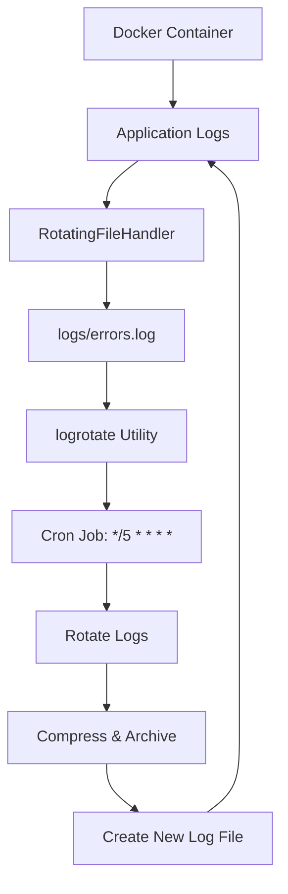
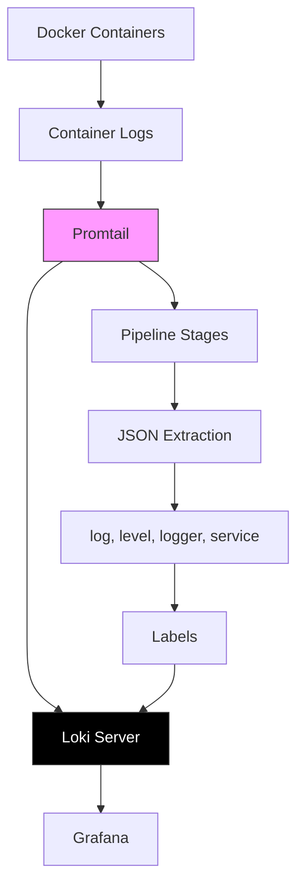
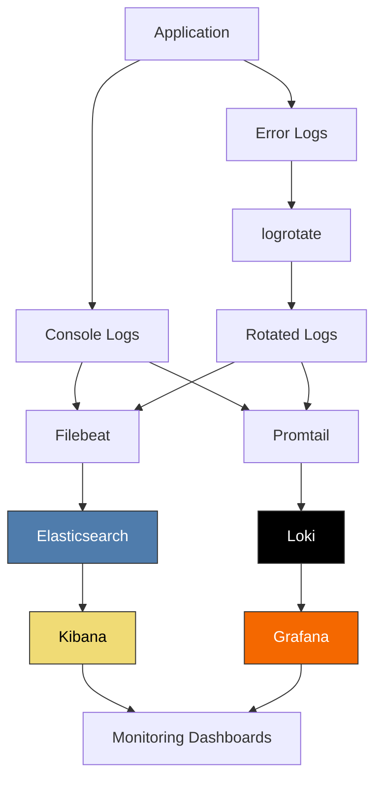

# Monitoring and Logging

<cite>
**Referenced Files in This Document**   
- [logging_config.json](file://logging_config.json)
- [filebeat.yml](file://filebeat.yml)
- [promtail-config.yml](file://promtail-config.yml)
- [Dockerfile](file://dockers/Dockerfile)
- [logger.py](file://python_modules/logger.py)
- [my_log_handler.py](file://my_log_handler.py)
- [settings_master.py](file://app/settings/settings_master.py)
- [trunc_system_log_in_clickhouse.py](file://trunc_system_log_in_clickhouse.py)
</cite>

## Table of Contents
1. [Introduction](#introduction)
2. [Logrotate Configuration and Cron Integration](#logrotate-configuration-and-cron-integration)
3. [Filebeat Configuration for Log Shipping](#filebeat-configuration-for-log-shipping)
4. [Promtail Configuration for Loki-based Log Aggregation](#promtail-configuration-for-loki-based-log-aggregation)
5. [Logging Configuration via logging_config.json](#logging-configuration-via-logging_configjson)
6. [Centralized Logging and Monitoring Dashboard Setup](#centralized-logging-and-monitoring-dashboard-setup)
7. [Log Analysis for Troubleshooting Common Issues](#log-analysis-for-troubleshooting-common-issues)
8. [Performance Considerations for High-Volume Logging](#performance-considerations-for-high-volume-logging)
9. [Log Retention Policies](#log-retention-policies)
10. [Conclusion](#conclusion)

## Introduction
The adv-bot system implements a comprehensive monitoring and logging infrastructure to ensure reliable operation, effective troubleshooting, and performance optimization. This documentation details the various components of the logging ecosystem, including log rotation, collection, shipping, aggregation, and analysis. The system leverages multiple tools and configurations to handle logging at scale, with specific attention to Docker container logs, application-level logging, and centralized log management. The architecture supports both real-time monitoring and historical analysis through integration with various observability tools.

## Logrotate Configuration and Cron Integration

The adv-bot deployment implements log rotation through the integration of logrotate with cron within the Docker container environment. This configuration ensures that log files do not grow indefinitely, preventing disk space exhaustion and maintaining system performance. The Dockerfile includes the installation of logrotate, cron, and rsyslog as system dependencies, establishing the foundation for automated log management.

Logrotate is configured to execute every five minutes through a cron job, providing frequent log rotation that helps maintain manageable log file sizes. The cron schedule `*/5 * * * *` triggers the logrotate command to process the configuration in `/etc/logrotate.conf`, ensuring that application logs are rotated according to the defined policies. This frequent rotation interval is particularly important in high-volume logging environments where log files can grow rapidly.

The logrotate utility works in conjunction with the application's logging configuration to manage log file lifecycle. When log files reach their maximum size or when the rotation schedule triggers, logrotate compresses and archives the existing log files while creating new ones for ongoing logging. This process prevents any single log file from becoming too large, which could impact both disk I/O performance and the efficiency of log analysis tools.



**Diagram sources**
- [Dockerfile](file://dockers/Dockerfile#L35)
- [logging_config.json](file://logging_config.json#L20)

**Section sources**
- [Dockerfile](file://dockers/Dockerfile#L35)
- [logging_config.json](file://logging_config.json#L20)

## Filebeat Configuration for Log Shipping

Filebeat is configured as the log shipper in the adv-bot deployment, responsible for collecting and forwarding Docker container logs to an Elasticsearch backend. The configuration is defined in the `filebeat.yml` file, which specifies the input sources and output destinations for log data. Filebeat is set up to monitor Docker container logs by targeting the standard Docker container log path `/var/lib/docker/containers/*/*.log`.

The Filebeat configuration uses the Docker input type, which automatically detects and collects logs from all running Docker containers. This approach ensures comprehensive log collection without requiring manual configuration for each container. The `containers.ids: '*'` directive indicates that Filebeat should collect logs from all containers, providing complete visibility into the application's logging output.

Logs are shipped to an Elasticsearch instance running at `http://147.45.151.145:9200`, with authentication handled through basic credentials (username: "elastic", password: "123456789"). This direct shipping to Elasticsearch enables immediate indexing and search capabilities, allowing for real-time log analysis and monitoring. The configuration represents a straightforward log shipping pipeline that moves logs from the container environment to a centralized storage and analysis system.

```mermaid
flowchart LR
A[Docker Containers] --> B[/var/lib/docker/containers/*/*.log]
B --> C[Filebeat]
C --> D[Elasticsearch]
D --> E[Kibana]
style C fill:#f9f,stroke:#333
style D fill:#bbf,stroke:#333
```

**Diagram sources**
- [filebeat.yml](file://filebeat.yml#L1)

**Section sources**
- [filebeat.yml](file://filebeat.yml#L1)

## Promtail Configuration for Loki-based Log Aggregation

Promtail is configured as the log collector for Loki-based log aggregation in the adv-bot deployment. The `promtail-config.yml` file defines the configuration for collecting, processing, and shipping logs to a Loki server. Promtail runs a server on HTTP port 9080 and uses a positions file at `/tmp/positions.yaml` to track the read position in log files, ensuring that logs are not duplicated or missed during restarts.

The configuration specifies a single scrape job named "docker" that targets localhost and collects logs from Docker container log files at the path `/var/lib/docker/containers/*/*log`. This configuration extracts structured fields from JSON-formatted log entries using pipeline stages, specifically extracting the "log", "level", "logger", and "service" fields. These extracted fields are then used as labels in Loki, enabling efficient querying and filtering of log data based on these attributes.

Logs are shipped to a Loki server at `http://loki:3100/loki/api/v1/push`, indicating that the Promtail instance is likely running in a containerized environment where Loki is available as a service named "loki". The label extraction configuration allows for rich metadata to be associated with each log entry, facilitating advanced querying capabilities in Grafana or other Loki-compatible visualization tools. This setup enables efficient log aggregation with low overhead, as Promtail only ships the log data without requiring intermediate storage.



**Diagram sources**
- [promtail-config.yml](file://promtail-config.yml#L1)

**Section sources**
- [promtail-config.yml](file://promtail-config.yml#L1)

## Logging Configuration via logging_config.json

The `logging_config.json` file defines the Python logging configuration for the adv-bot application, establishing the format, handlers, and overall logging behavior. The configuration uses Python's built-in logging module with a dictionary-based configuration format, allowing for flexible and programmatic logging setup.

The logging system defines a custom formatter with the format string `%(name)s - %(asctime)s - %(pathname)s:%(lineno)d - %(levelname)s - %(message)s`, which includes the logger name, timestamp, source file path with line number, log level, and message. This comprehensive format provides rich context for each log entry, facilitating debugging and troubleshooting by including precise location information within the codebase.

Two handlers are configured: a console handler that outputs to stdout with DEBUG level and the custom formatter, and a file handler that writes ERROR level and higher messages to `logs/errors.log` using a RotatingFileHandler. The file handler is configured with a maximum file size of 10MB (10485760 bytes) and maintains up to 5 backup files, implementing automatic log rotation when the size limit is reached. The root logger is set to DEBUG level and uses both handlers, ensuring that all log messages are output to the console while error messages are also persisted to disk.

```mermaid
classDiagram
class LoggerConfig {
+version : 1
+disable_existing_loggers : false
}
class Formatters {
+custom : {
format : "%(name)s - %(asctime)s - %(pathname)s : %(lineno)d - %(levelname)s - %(message)s"
datefmt : "%Y-%m-%d %H : %M : %S"
}
}
class Handlers {
+console : StreamHandler
+error_to_file : RotatingFileHandler
}
class RootLogger {
+level : DEBUG
+handlers : [console, error_to_file]
}
LoggerConfig --> Formatters : contains
LoggerConfig --> Handlers : contains
LoggerConfig --> RootLogger : configures
Handlers --> Formatters : uses
```

**Diagram sources**
- [logging_config.json](file://logging_config.json#L1)

**Section sources**
- [logging_config.json](file://logging_config.json#L1)
- [python_modules/logger.py](file://python_modules/logger.py#L29)

## Centralized Logging and Monitoring Dashboard Setup

The adv-bot deployment implements a comprehensive centralized logging and monitoring solution that integrates multiple tools to provide full observability. The architecture combines Filebeat for Elasticsearch shipping, Promtail for Loki aggregation, and custom logging configurations to create a multi-layered monitoring system. This approach allows for both real-time log analysis and long-term log retention with efficient querying capabilities.

The monitoring stack is designed to work within a containerized environment, with each component handling specific aspects of log management. Filebeat collects Docker container logs and ships them to Elasticsearch for indexing and search, enabling integration with Kibana for visualization and analysis. Simultaneously, Promtail collects the same container logs and forwards them to Loki, providing a cost-effective solution for log storage and querying with Grafana integration.

Application-level logging is configured through the `logging_config.json` file and the custom logger module, ensuring that Python application logs are properly formatted and directed to appropriate outputs. The logging configuration includes both console output for container logs and file output for error logs, with log rotation handled by the logrotate utility integrated with cron. This multi-pronged approach ensures that logs are available in multiple formats and locations, providing redundancy and flexibility for different use cases.

For dashboard setup, the combination of Elasticsearch/Kibana and Loki/Grafana provides complementary visualization capabilities. Kibana excels at full-text search and complex aggregations on structured data, while Grafana with Loki offers efficient log exploration with metric correlation. Users can create dashboards that combine log data with metrics and traces, providing a holistic view of system performance and behavior. The system also includes a custom log handler (`ScriptHandler`) that can execute scripts in response to log events, enabling automated alerting and response workflows.



**Diagram sources**
- [filebeat.yml](file://filebeat.yml#L1)
- [promtail-config.yml](file://promtail-config.yml#L1)
- [logging_config.json](file://logging_config.json#L1)
- [Dockerfile](file://dockers/Dockerfile#L35)

**Section sources**
- [filebeat.yml](file://filebeat.yml#L1)
- [promtail-config.yml](file://promtail-config.yml#L1)
- [logging_config.json](file://logging_config.json#L1)
- [Dockerfile](file://dockers/Dockerfile#L35)

## Log Analysis for Troubleshooting Common Issues

Log analysis in the adv-bot system follows a structured approach to identify and resolve common issues. The comprehensive logging configuration, with detailed formatting that includes source file and line number information, enables precise identification of problem locations. When troubleshooting, administrators should first examine the error logs in `logs/errors.log`, which contain all ERROR level and higher messages, including stack traces for exceptions.

Common issues such as database connectivity problems, API integration failures, or configuration errors are typically evident in the logs through repeated error messages or exceptions. The timestamp format in the log entries (YYYY-MM-DD HH:MM:SS) allows for correlation of events across different components and services. When investigating performance issues, the logs can be analyzed for patterns of slow operations, frequent retries, or resource contention.

For container-related issues, the Docker container logs collected by Filebeat and Promtail provide additional context beyond the application logs. These logs include container startup/shutdown events, resource usage, and system-level messages that may not be captured by the application's logging system. Correlating application logs with container logs can help identify issues such as container restarts, memory pressure, or network connectivity problems.

The system includes a script `trunc_system_log_in_clickhouse.py` that periodically truncates system logs in ClickHouse, indicating that log volume management is an ongoing concern. When analyzing logs, it's important to consider the retention policies and potential log rotation that may affect the availability of historical data. For real-time troubleshooting, the console logs (available through Docker logs) provide the most immediate feedback, while the file logs offer persistence across container restarts.

**Section sources**
- [logging_config.json](file://logging_config.json#L1)
- [trunc_system_log_in_clickhouse.py](file://trunc_system_log_in_clickhouse.py#L1)
- [python_modules/logger.py](file://python_modules/logger.py#L29)

## Performance Considerations for High-Volume Logging

The adv-bot system implements several performance optimizations to handle high-volume logging efficiently. The logging configuration balances the need for comprehensive logging with performance considerations by using asynchronous log handling where possible and optimizing log output formats. The RotatingFileHandler with size-based rotation prevents individual log files from becoming too large, which could impact disk I/O performance.

The integration of logrotate with cron, running every five minutes, ensures that log files are regularly rotated without requiring the application to handle rotation internally. This external rotation mechanism reduces the performance overhead on the application itself, as log rotation operations (file closing, renaming, compression) are handled by a separate process. The rotation configuration with a 10MB size limit and 5 backup files provides a reasonable balance between log retention and disk space usage.

For high-volume environments, the system leverages Filebeat and Promtail as lightweight log shippers that are optimized for performance. These tools use efficient file reading mechanisms and buffering to minimize the impact on the host system. Filebeat's Docker input type is specifically designed to handle the high volume of container logs with minimal resource usage. Similarly, Promtail is designed for high-performance log collection with low memory and CPU footprint.

The logging configuration also includes level-based filtering, where only ERROR level and higher messages are written to the error log file, reducing disk I/O for less critical messages. The console output includes all messages (DEBUG level and higher), but this is typically redirected to Docker's logging system, which may have its own buffering and performance optimizations. For extremely high-volume scenarios, additional optimizations could include sampling high-frequency log messages or implementing more granular log level controls through the LOG_LEVEL environment variable.

**Section sources**
- [logging_config.json](file://logging_config.json#L1)
- [Dockerfile](file://dockers/Dockerfile#L35)
- [filebeat.yml](file://filebeat.yml#L1)
- [promtail-config.yml](file://promtail-config.yml#L1)

## Log Retention Policies

The adv-bot deployment implements multiple log retention policies across different logging components to balance storage requirements with operational needs. The primary retention mechanism is implemented through the RotatingFileHandler configuration in `logging_config.json`, which maintains up to 5 backup files with a maximum size of 10MB each, providing approximately 50MB of error log retention.

The logrotate utility, configured to run every five minutes via cron, inherits the rotation settings from the application configuration but may have additional system-level policies defined in `/etc/logrotate.conf`. This external rotation system provides an additional layer of log management that can be configured independently of the application, allowing for different retention policies based on system requirements.

For container logs, retention is primarily controlled by Docker's logging driver configuration, which is not explicitly defined in the available configuration files. By default, Docker uses the json-file logging driver with unlimited log size, but this can be overridden with size and rotation limits. The use of Filebeat and Promtail to ship logs to external systems (Elasticsearch and Loki) suggests that long-term log retention is handled by these backend systems rather than the local filesystem.

The presence of the `trunc_system_log_in_clickhouse.py` script indicates that ClickHouse system logs are periodically truncated, with the script running every 10 minutes to clear various system log tables. This aggressive truncation policy suggests that system-level performance data is only retained for a short period, likely because it is either replicated elsewhere or because historical system logs are less critical than application logs.

**Section sources**
- [logging_config.json](file://logging_config.json#L20)
- [Dockerfile](file://dockers/Dockerfile#L35)
- [trunc_system_log_in_clickhouse.py](file://trunc_system_log_in_clickhouse.py#L1)

## Conclusion

The adv-bot deployment features a robust and comprehensive monitoring and logging infrastructure that addresses the needs of a complex, containerized application. The system integrates multiple logging tools and configurations to provide complete visibility into application behavior, performance, and errors. Key components include logrotate with cron for log file management, Filebeat for Elasticsearch integration, Promtail for Loki-based log aggregation, and a detailed Python logging configuration.

The logging architecture is designed to handle high-volume logging efficiently while providing multiple avenues for log analysis and troubleshooting. The combination of local log files, centralized log storage, and monitoring dashboards enables both real-time monitoring and historical analysis. Performance considerations are addressed through optimized log handling, external log rotation, and lightweight log shippers.

For future improvements, the system could benefit from more granular log level controls, structured logging with JSON output, and enhanced alerting capabilities. The current configuration provides a solid foundation for observability, but additional instrumentation and monitoring metrics could further improve system reliability and maintainability.